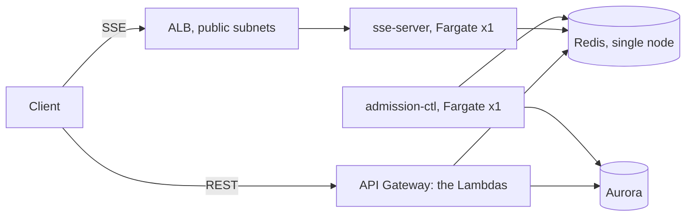

# Deploying to AWS

Continuous delivery runs from `.github/workflows/cicd.yml`. A push to `main`
deploys to `prod`; `workflow_dispatch` can target `dev` and is the only way to
deploy the foundation stack.

```
                 ┌──────────────┐
                 │ quality gate │  lint · test · govulncheck · sonar
                 └──────┬───────┘
                        ▼
              ┌───────────────────┐
              │ foundation        │  only when infra/foundation/** changes
              │ VPC · Aurora+Proxy│  or deploy_foundation = true
              │ Redis · secrets   │
              └─────────┬─────────┘
                        ▼
              ┌───────────────────┐
              │ preflight         │  the SSM parameters exist?
              └─────────┬─────────┘
                        ▼
    ┌───────────────────┼───────────────────┐
    ▼                   ▼                   ▼
 booking, queue,       nik-verify         notification     ← wave 1
 events
                        │                   │        each publishes its own
                        │                   │        SSM parameter
                        ▼                   ▼
                      user           outbox-publisher   ← wave 2
                        └─────────┬─────────┘
                                  ▼
                            smoke  (GET /sys/ping)
```

The waves are a real dependency order, not a convenience: `user` resolves
`/rusuh/prod/nik-verify/base-url` and `outbox-publisher` resolves
`/rusuh/prod/notification/queue-{url,arn}`, and each of those is written by
the wave-1 stack that owns it. The parameter has to exist before the stack
that reads it is created.

## Queue and booking secrets

The foundation does not create these three secrets. Create them in Secrets Manager (plain string values) and set the
three repository variables above to their ARNs. `preflight` fails with the variable's name when one is missing or is not a
Secrets Manager ARN, before anything is deployed.

| Secret | Value | Rule |
|---|---|---|
| device pepper | a long random string, e.g. `openssl rand -base64 48` | queue and booking must reference **the same secret**: join stores `HMAC(pepper, X-Device-Id)` and booking recomputes it. Different peppers give every guest `DEVICE_MISMATCH` on the ticket page. Never rotate during a sale. |
| e-ticket signing key | a long random string | booking signs the `?t=` e-ticket links with it. Notification (email links) and user-service (`GET /tickets/{id}/eticket`) must use the **same** key later, or the links they send and verify do not match. |
| Turnstile secret key | the Cloudflare Turnstile secret for the site | queue verifies the CAPTCHA at join. |

The values are read at deploy time (CloudFormation dynamic references), so the Lambda roles need no Secrets Manager access
and rotating a secret takes effect on the next deploy (`DeployRevision` forces one).

**Queue and booking Lambdas use `REDIS_CLUSTER=false`.** The foundation provisions a single-node ElastiCache cache cluster,
not a cluster-mode replication group, and the cluster client both services use cannot talk to it. Switch the variable to
`"true"` in `services/queue/template-cfn.yaml` and `services/booking/template-cfn.yaml` together with a cluster-mode Redis.

**ECS: the admission controller and the SSE stream server** run from their own `deploy-ecs` job, not the Lambda waves: see
[ECS: admission-ctl and sse-server](#ecs-admission-ctl-and-sse-server). The stream is **not** behind the unified gateway
(clients use the `StreamUrl` output of the ECS stack), and `/queue/serving` is not behind it yet.

**CORS and the queue cookie.** The unified gateway allows the new headers (`X-Grant-Token`, `X-Device-Id`, `X-Queue-Token`)
but still has `AllowOrigins: *` and `AllowCredentials: false`. A browser only sends and accepts the `queue_token` cookie
across origins with credentials allowed, which needs an explicit origin list. Set the web origin(s) in
`infra/api-gateway/template.yaml` once the frontend URL is known.

## How parameters reach the service stacks

The service templates resolve their own infrastructure, rather than having
the pipeline read stack outputs and pass them back:

```yaml
VpcSubnetIds:
  Type: AWS::SSM::Parameter::Value<List<AWS::EC2::Subnet::Id>>
  Default: /rusuh/prod/vpc/private-subnet-ids
```

`infra/foundation` publishes twelve such parameters; CloudFormation resolves
them at deploy time. `sam deploy` therefore passes **no infrastructure
parameters at all** — only the handful of values the pipeline genuinely owns
(`DukcapilMode`, `DukcapilBaseUrl`, `AppBaseUrl`, `CookieDomain`) plus
`Environment`.

Standard-tier SSM parameters are free, so this costs nothing.

> **Only `prod` exists.** A CloudFormation `Default` cannot reference another
> parameter, so those paths are the literal string `/rusuh/prod/...`. Deploying
> a second environment without overriding every path would resolve **prod's**
> subnets, database and Redis — a silent failure, not a loud one. The
> `preflight` job refuses any environment but `prod` for that reason. To add
> `dev`, deploy the foundation with `Environment=dev` and then pass each path
> explicitly, e.g.
> `--parameter-overrides VpcSubnetIds=/rusuh/dev/vpc/private-subnet-ids ...`.
> The value you override a `Value<...>` parameter with is the **parameter
> path**, not the resolved value.

## One-time setup

> **[`RUNBOOK.md`](RUNBOOK.md) is the authoritative procedure.** It has the
> ordered steps, the current commands and the failure table. This section
> explains the *reasoning* behind each step; where the two disagree about a
> command, the runbook is newer.


**1. The deploy role.** This is the only stack CI cannot deploy, because it
creates the role CI assumes:

```bash
aws cloudformation deploy \
  --template-file infra/bootstrap/github-oidc-role.yaml \
  --stack-name rusuh-cd-bootstrap \
  --capabilities CAPABILITY_NAMED_IAM \
  --parameter-overrides GitHubRepo=<owner>/<repo> AllowedBranch=cicd
```

`AllowedBranch` must name the branch you will actually deploy from, and that
branch must also appear in the workflow's trigger list (step 3b) - `cicd` or
`test-deployment` while the pipeline is being proven out, `main` once it is. Only that one
branch can assume the role; the subject claim is narrowed to it deliberately,
because `repo:owner/repo:*` would also match pull requests from forks. To
change it later, redeploy this stack with the new value.

Copy the `RoleArn` output into the repository secret below. If the GitHub OIDC
provider already exists in the account, add
`CreateOidcProvider=false` or the stack fails with `EntityAlreadyExists`.

**2. Verify an SES identity.** Verification needs either DNS records or a
click in a mailbox, so the template does not create it. There is no
AWS-provided sender address: every `From` must be a verified identity, in the
**same region** as `vars.AWS_REGION`.

A single email address is enough and needs no DNS — the POC path:

```bash
REGION=ap-southeast-3          # must equal your AWS_REGION variable
FROM_EMAIL=you@example.com     # an address you can open right now

# Sandboxed or not? Decides whether you can email anyone but yourself.
aws sesv2 get-account --region "$REGION" \
  --query '{ProductionAccess:ProductionAccessEnabled,Max24h:SendQuota.Max24HourSend,RatePerSec:SendQuota.MaxSendRate}'

# Create the identity. AWS emails a confirmation link to FROM_EMAIL.
aws sesv2 create-email-identity --email-identity "$FROM_EMAIL" --region "$REGION"

# Click the link, then wait for it to register.
until [ "$(aws sesv2 get-email-identity --email-identity "$FROM_EMAIL" \
            --region "$REGION" --query VerifiedForSendingStatus --output text)" = "True" ]; do
  echo "waiting for the confirmation click..."; sleep 10
done
echo "verified: $FROM_EMAIL"

# Prove it sends. The simulator needs no recipient verification.
aws sesv2 send-email --region "$REGION" \
  --from-email-address "$FROM_EMAIL" \
  --destination '{"ToAddresses":["success@simulator.amazonses.com"]}' \
  --content '{"Simple":{"Subject":{"Data":"rusuh SES check"},"Body":{"Text":{"Data":"it works"}}}}'
```

A `MessageId` back means sending works. Then:

```bash
gh variable set EMAIL_FROM_ADDRESS --body "$FROM_EMAIL"
gh variable set AWS_REGION --body "$REGION"
```

`MessageRejected: Email address is not verified` on the send means the
identity landed in a different region than `$REGION`. Identities are
per-region, and so is production access.

### The sandbox is the real constraint

A new account is in the SES sandbox, per region:

| | Sandbox |
|---|---|
| Recipients | **verified addresses only** — the one that matters |
| Quota | 200 messages / 24 h |
| Rate | 1 message / second |

So the magic-link flow will not reach an unverified inbox. Either verify each
test recipient the same way, or request production access (Console → SES →
Account dashboard → Request production access). Approval is not instant, so
ask well before a demo.

> **POC decision: stay in the sandbox.** Production access is deliberately
> not requested. The consequence to plan around is that **every recipient must
> be verified individually**, in the deploy region:
>
> ```bash
> aws sesv2 create-email-identity --email-identity tester@example.com --region "$REGION"
> ```
>
> Each address needs a click on the link AWS sends to it, within 24 hours.
> So a demo cannot involve anyone typing their own email address - the tester
> list has to be known and verified in advance. If that changes, requesting
> production access is the only fix, and it needs lead time.

The **mailbox simulator** is exempt from the recipient restriction and does not
touch your reputation, which makes it the right target for pipeline testing:

| Address | Simulates |
|---|---|
| `success@simulator.amazonses.com` | delivered |
| `bounce@simulator.amazonses.com` | hard bounce |
| `complaint@simulator.amazonses.com` | spam complaint |

> A `@gmail.com` sender works in the sandbox but you cannot DKIM-sign a domain
> you do not own, so it fails DMARC and tends to land in spam at real
> inboxes. Fine for proving the plumbing; verify a domain before anyone
> outside the team is meant to receive these.

**3. Repository secrets and variables.**

| Secret | Value |
|---|---|
| `AWS_DEPLOY_ROLE_ARN` | `RoleArn` from step 1 |
| `TURNSTILE_SITE_KEY` | events — **required**. The public Turnstile site key (`0x4AAAAAAA…`), returned as `captcha.site_key`. The template gets it as a parameter. Queue's secret key is separate (`TURNSTILE_SECRET_ARN`) |
| `SONAR_TOKEN` | optional; Sonar is skipped when unset |
| `DUKCAPIL_EXTRA_HEADER_VALUE` | optional; value for `DUKCAPIL_EXTRA_HEADER_NAME`. A secret rather than a variable so the deploy log, which echoes its arguments, masks it |

| Variable | Example | Used by |
|---|---|---|
| `AWS_REGION` | `ap-southeast-1` | every job |
| `EMAIL_FROM_ADDRESS` | `no-reply@rusuhtiket.com` | foundation, notification |
| `APP_BASE_URL` | `https://ticket.sjt.com` | notification — the **frontend** URL, not the API. See below. |
| `DUKCAPIL_MODE` | unset (= `stub`) or `live` | nik-verify — see *Dukcapil: live, mock or stub* |
| `DUKCAPIL_BASE_URL` | `https://mock.apidog.com/m1/1409481-1420084-default` | nik-verify — required when `DUKCAPIL_MODE=live`. Base URL only: the client appends `/verify`. |
| `DUKCAPIL_EXTRA_HEADER_NAME` | `apidogToken` | nik-verify — one extra request header. Unused against a real Dukcapil endpoint; **required** against an Apidog mock, which rejects untokened requests. |
| `COOKIE_DOMAIN` | `.rusuhtiket.com` or empty | user, queue (the `queue_token` cookie domain; empty = the template default `my-rusuh.my.id`) |
| `SSE_BASE_URL` | `https://events.my-rusuh.my.id` or empty | queue — join returns an absolute `sse_url` built from it. Empty = the template default. |
| `DEVICE_PEPPER_SECRET_ARN` | `arn:aws:secretsmanager:ap-southeast-1:…:secret:rusuh-prod/device-pepper-…` | queue, booking — **required**, see *Queue and booking secrets* |
| `TURNSTILE_SECRET_ARN` | `arn:aws:secretsmanager:…` | queue — **required**, see *Queue and booking secrets* |
| `ETICKET_SIGNING_KEY_SECRET_ARN` | `arn:aws:secretsmanager:…` | booking — **required**, see *Queue and booking secrets* |
| `SINGLE_AZ` | `true` (default) | foundation — `false` for multi-AZ |
| `DB_ALLOWED_CIDR` | `0.0.0.0/0` | foundation — **empty means nothing can connect**. This POC uses `0.0.0.0/0`; see *What this costs you*. |
| `DB_PUBLICLY_ACCESSIBLE` | `true` (default) | foundation — `false` returns Aurora to private subnets |
| `ENABLE_NAT_GATEWAY` | `true` (default) | foundation |
| `SONAR_HOST_URL` | optional | sonarqube |

**3b. Which branch deploys.** Two gates, and they must agree:

| Gate | Where | What it does |
|---|---|---|
| `push.branches` + `resolve-env`'s `if:` | `.github/workflows/cicd.yml` | which branches may *start* a deploy run - currently `main`, `cicd`, `test-deployment` |
| `AllowedBranch` | the bootstrap stack's trust policy | which single branch may *reach AWS* |

The role is the real gate; the workflow list is only a filter on what starts.
A push to a listed-but-untrusted branch runs the quality jobs and then fails
at assume-role, which is the intended outcome. Deploying from a branch that is
not in the workflow list is the quieter failure: the run goes green with every
deploy job *skipped*, because `resolve-env` never fires. Add the branch to
both places, or use one that is already there.

Pushes to any other branch run the quality jobs only.

`workflow_dispatch` - the Run workflow button, and the only way to force
`deploy_foundation` - exists **only on the default branch**, because that is
where GitHub reads the workflow definition from. So from a feature branch
there is no button, and the route to AWS is a push to `cicd`:

```bash
git push origin HEAD:cicd
```

The foundation still deploys on that push, because `infra/foundation/**` is in
the change filter. If paths-filter does not see it (first push of a new
branch), touch `infra/foundation/template.yaml` and push again.

Deploying from `cicd` requires the bootstrap role to allow it:
`AllowedBranch=cicd` in step 1. The branch gate is the role's trust policy,
not the workflow, so getting this wrong fails at assume-role rather than
deploying something unintended.

**3c. APP_BASE_URL when there is no frontend yet.** It has no template
default, so `notification` will not deploy without it - but nothing validates
that it resolves. It is concatenated into email bodies and never fetched:

```
{APP_BASE_URL}{path}?token={token}
```

So any `https://` URL works; set what you expect the frontend to become. Two
things it must *not* be:

- **An API Gateway `execute-api` URL.** The magic link points at the app, not
  the API - the API reads the token from a cookie that the app route sets, so
  a link straight to the API returns 400. Those URLs also do not exist until
  after the deploy that needs this value.
- **Anything starting `http://`.** `notification` runs with
  `APP_ENV=production` and refuses to start: *APP_BASE_URL must be https
  outside local: emailed links carry login tokens*. That fails at the first
  invocation, not at deploy.

With a placeholder the email still arrives and reads correctly; the link is
just not clickable. The token is visible in it, so a tester can copy it and
drive the endpoint directly. Changing it later is one variable and a re-run,
with no code change.

**4. GitHub Environments.** Create `prod` (and `dev` if wanted) under
Settings → Environments. Add required reviewers on `prod` so a release pauses
for approval. Every deploy job declares `environment:`, so the gate applies
without further wiring.

**5. First deploy.** Actions → *Golang CI/CD* → Run workflow →
environment `prod`, **deploy_foundation = true**. Later runs leave that off;
the foundation redeploys only when `infra/foundation/**` changes.

**6. Create the schema.** The pipeline does not migrate — apply
`migrations/*.up.sql` by hand once the foundation is up. See *Schema* below.

## Promoting the deploy branch to main

Once the pipeline is proven from `cicd`, move it to `main`. **Nothing else is
re-done** - not the SES identity, not the secrets, not the schema, not the
foundation. Redeploy the one stack whose trust policy names the branch:

```bash
aws cloudformation deploy \
  --template-file infra/bootstrap/github-oidc-role.yaml \
  --stack-name rusuh-cd-bootstrap \
  --capabilities CAPABILITY_NAMED_IAM \
  --parameter-overrides \
    GitHubRepo=<owner>/<repo> \
    AllowedBranch=main
```

It updates the role's trust policy in place. Same role, same ARN, so
`AWS_DEPLOY_ROLE_ARN` does not change.

**Do this before merging, not after.** The role is the gate: merge first and
the push to `main` fails at assume-role, and you have to re-run the workflow
once the role catches up. Change the role, then merge, and the merge deploys.

The stack names depend only on the environment (`rusuh-prod-*`), never on the
branch, so merging to `main` **updates the same stacks**. No second Aurora, no
parallel environment, no duplicate cost.

Two things change for the better once `main` is the deploy branch:

- `workflow_dispatch` appears, because GitHub reads it from the default
  branch. That is the only way to force `deploy_foundation=true` or turn off
  `cost_optimized`, so until now neither has been reachable.
- A pull request into `main` runs the quality jobs without deploying, and the
  merge deploys - the normal flow.

One loose end: the workflow still accepts pushes to `cicd`, so a push there
will run the deploy jobs and fail at assume-role. That failure is correct, and
the role is doing its job, but it is noise. To close it, drop `cicd` from both
the `push:` trigger and `resolve-env`'s `if:` in `.github/workflows/cicd.yml`.

## Dukcapil: live, mock or stub

NIK verification needs a Dukcapil endpoint and key, which arrive with the
contract. Until then there are two ways to run without one — the built-in
stub, or a mock server over real HTTP — chosen by one repository variable:

| `DUKCAPIL_MODE` | What nik-verify does | What you must set |
|---|---|---|
| unset, or `stub` | Answers from the NIK itself. No HTTP at all; `dukcapil.Client` is never constructed. | nothing |
| `live` | Real HTTP `POST {base}/verify`. Points at production Dukcapil **or** a mock server — the service cannot tell the difference. | `DUKCAPIL_BASE_URL`, plus a `dukcapil-api-key` secret |

**The default is `stub`** so that a deploy into a fresh account produces a
working service with nothing configured. That is a POC convenience and nothing
more: stub mode verifies every NIK except the two test cases below, so a real
environment must pass `live`.

`live` against a mock is the more useful of the two while you are building the
front end — it exercises the HTTP client, the 3 s timeout, the rate limiter
and the circuit breaker, none of which the stub touches.

### What the stub actually does

It is not a blanket pass. The answer comes from the last four digits:

| NIK ends with | Stub answers |
|---|---|
| `0000` | **rejected** — not found in Dukcapil |
| `9999` | **outage** — as if Dukcapil were down, so the fail-closed path runs |
| anything else | verified |

So all three outcomes a caller has to handle are reachable with no endpoint at
all. Pick test NIKs accordingly.

## The request nik-verify sends

One endpoint, one field. `services/nik-verify/internal/nik/infrastructure/dukcapil/client.go`:

```bash
curl -i -X POST "$DUKCAPIL_BASE_URL/verify" \
  -H 'Content-Type: application/json' \
  -H "X-Api-Key: $DUKCAPIL_API_KEY" \
  -d '{"nik":"3201234567890123"}'
```

`nik` is the only field, and deliberately so: FR-15a and requirements §12 say
name and date of birth are neither collected nor sent, so do not add them to
the mock's schema either — a mock that accepts them invites someone to send
them.

`DUKCAPIL_BASE_URL` is an origin with **no trailing slash**: the client
concatenates `baseURL + "/verify"`, so `https://host/mock/123/` becomes
`https://host/mock/123//verify`.

### What the client expects back

| HTTP status | Client behaviour | Breaker |
|---|---|---|
| `200` | Parses the body (below) | counts as success |
| `404` | NIK does not exist — `valid=false`, `status=NOT_FOUND`. Body ignored. | counts as success |
| `429`, `5xx` | Error: `dukcapil: upstream status N` | **counts as a failure** |
| anything else | Error: `dukcapil: unexpected status N` | **counts as a failure** |
| no response within 3 s | Error: `dukcapil: call failed` | **counts as a failure** |

A `404` is a working dependency giving a negative answer, which is why it does
not trip the breaker. Five consecutive failures open it for 30 s
(`DUKCAPIL_BREAKER_*`), and an open breaker fails **closed** — verification is
refused rather than assumed.

The `200` body:

```json
{ "valid": true, "status": "ACTIVE", "reference_id": "ref-abc-123" }
```

| Field | Type | Notes |
|---|---|---|
| `valid` | bool | absent decodes as `false` |
| `status` | string | absent or `""` becomes `ACTIVE` client-side |
| `reference_id` | string | optional; carried through as the audit reference |

Unknown fields are ignored. A body that is not JSON gives
`dukcapil: decode response` and counts as a failure.

## Pointing it at an Apidog mock

**1. Build the mock.** One endpoint: `POST /verify`, request and response
bodies as above. Give it at least three saved responses so the three caller
paths are reachable:

| Response | Status | Body |
|---|---|---|
| verified | `200` | `{"valid":true,"status":"ACTIVE","reference_id":"mock-1"}` |
| not found | `404` | anything — the client does not read it |
| outage | `503` | anything — the client only reads the status |

Apidog can switch on the request body, so keying off `nik` lets one mock serve
all three. Mirroring the stub's convention keeps your test data portable:
`...0000` → 404, `...9999` → 503, everything else → 200.

**2. Set the repository variables.** Settings → Secrets and variables →
Actions:

| | Name | Value |
|---|---|---|
| Variable | `DUKCAPIL_MODE` | `live` |
| Variable | `DUKCAPIL_BASE_URL` | `https://mock.apidog.com/m1/1409481-1420084-default` |
| Variable | `DUKCAPIL_EXTRA_HEADER_NAME` | `apidogToken` |
| Secret | `DUKCAPIL_EXTRA_HEADER_VALUE` | the Apidog token |

> **Drop the `/verify`.** Apidog shows you the full endpoint URL
> (`.../default/verify`), but this variable is the **base**: the client builds
> `baseURL + "/verify"` itself, so pasting Apidog's URL verbatim requests
> `/verify/verify` and 404s on every verification. A trailing slash does the
> same via `//verify`. `preflight` rejects both and prints the corrected
> value, so this fails the run rather than the demo.

`X-Api-Key` still goes out on every request, read from the
`rusuh-prod/dukcapil-api-key` secret, and the service refuses to start if it
is empty. If the mock *checks* the header - which is the cheapest way to make
it refuse stray traffic - this value has to match what the mock expects, not
merely be non-empty:

```bash
aws secretsmanager put-secret-value \
  --secret-id rusuh-prod/dukcapil-api-key \
  --secret-string '{"api_key":"mock"}'
```

A mismatch is unpleasant to debug, because the mock's rejection is a non-2xx
and the client treats every non-2xx except 404 as *Dukcapil did not answer*.
So the symptom is not "401 unauthorized" anywhere: it is five `503`s, then the
circuit breaker opening for 30 s and failing closed, with
`dukcapil: unexpected status 401` the only trace, in the Lambda's CloudWatch
log. Check that log first when verification starts refusing everything.

**3. Re-run the workflow.** `preflight` prints the mode it resolved, and
errors out if `live` is set with no base URL, or a header name with no value.

### Reproducing exactly what the Lambda sends

```bash
curl -i -X POST "https://mock.apidog.com/m1/1409481-1420084-default/verify" \
  -H 'Content-Type: application/json' \
  -H 'X-Api-Key: mock' \
  -H 'apidogToken: <token>' \
  -d '{"nik":"3201234567890123"}'
```

Note the `/verify` **is** present here — this is the final URL the client
builds, not the value of `DUKCAPIL_BASE_URL`.

### How the extra header is plumbed

`DUKCAPIL_EXTRA_HEADERS` reaches the Lambda as a JSON object of header name to
value, and the template composes it from the two parameters:

```yaml
DUKCAPIL_EXTRA_HEADERS: !If
  - HasDukcapilExtraHeader
  - !Sub '{"${DukcapilExtraHeaderName}":"${DukcapilExtraHeaderValue}"}'
  - ""
```

It is composed in the template rather than passed as JSON through the pipeline
because the deploy action word-splits its parameter overrides — a braced,
quoted value surviving that is luck, not design. Two consequences:

- The header **value must contain no whitespace**. Apidog tokens do not, but
  if yours ever does, set `DUKCAPIL_EXTRA_HEADERS` on the Lambda directly.
- The client sends extras *before* `Content-Type` and `X-Api-Key`, so an extra
  header cannot shadow either. There is a test for that.

`apidogToken` is Apidog's own mock authentication and not part of the Dukcapil
contract, which is why it is a generic extra header rather than a named field:
when the real endpoint arrives, clear the two variables and nothing else
changes. Apidog also accepts the token as a query parameter, but that route is
closed here — the client appends `/verify` to the base URL, so a query string
in it would land in the wrong place.

### The APP_ENV coupling

`config.validate()` refuses `DUKCAPIL_MODE=stub` while `APP_ENV=production`:

```
DUKCAPIL_MODE=stub is not permitted in production: every NIK would verify
```

You do not have to remember this. `services/nik-verify/template.yaml` derives
`APP_ENV` from the mode — `!If [IsDukcapilStub, poc, production]` — so asking
for the stub is enough, and live mode still gets `production`.

The guard is per-service: `notification`'s `APP_ENV` is untouched, and its
own https check on `APP_BASE_URL` still applies.

### Live mode with no base URL fails at deploy, not at runtime

`nik-verify`'s template carries a `Rules` block:

```yaml
Rules:
  LiveModeRequiresBaseUrl:
    RuleCondition: !Equals [!Ref DukcapilMode, live]
    Assertions:
      - Assert: !Not [!Equals [!Ref DukcapilBaseUrl, ""]]
```

CloudFormation rejects the change set before creating anything. The
`preflight` job checks the same combination earlier still, so the run stops
before five services build. Without either, the misconfiguration surfaces as a
502 with the real reason in CloudWatch.

### Populating the real key

`infra/foundation` creates `rusuh-<env>/dukcapil-api-key` with a placeholder:

```bash
aws secretsmanager put-secret-value \
  --secret-id rusuh-prod/dukcapil-api-key \
  --secret-string '{"api_key":"<real key>"}'
```

In stub mode the key is never read, so a POC deploy works with the secret left
at `REPLACE_ME`. Switching to live means setting both this secret and
`DUKCAPIL_BASE_URL`, then re-running the workflow — and clearing
`DUKCAPIL_EXTRA_HEADER_NAME`, which a real endpoint has no use for.

The database password, JWT signing key and NIK pepper are all generated by the
stack and never pass through CI.

## How secrets reach the services

The Go config loaders read `DATABASE_URL`, `NIK_PEPPER`, `JWT_SECRET` and
`DUKCAPIL_API_KEY` as **plain environment variables**, and `validate()` refuses
to start without them. Granting the function IAM access to a secret is
therefore not enough — the value has to be in the environment.

The templates inject them with CloudFormation dynamic references:

```yaml
DATABASE_URL: !Sub '{{resolve:secretsmanager:rusuh-${Environment}/database-url:SecretString:url}}'
NIK_PEPPER:   !Sub '{{resolve:secretsmanager:rusuh-${Environment}/nik-pepper:SecretString}}'
```

Referenced by secret **name**, not by the ARN parameter, so `!Sub` substitutes
a plain parameter and the dynamic reference never depends on an SSM-resolved
value. The ARN parameters remain, for the IAM policies.

Three consequences:

- **The deploy role needs `secretsmanager:GetSecretValue`.** CloudFormation
  resolves these using the deploying identity's permissions, so the role has it
  scoped to `secret:rusuh-*`. This reverses an earlier decision to keep CI away
  from the secrets, and it is recorded in the bootstrap template rather than
  hidden.
- **Rotation needs a stack update.** The value is resolved only on create or
  update, so rotating a secret does not reach a running function until its
  stack is touched again.
- **The resolved value sits in the function's environment**, readable by
  anyone with `lambda:GetFunctionConfiguration`.

> **The pepper is the one that matters.** ADR-005 §8 gives it no rotation path,
> so a leak is permanent and BR-02 breaks for good. For the POC it travels this
> way like the others; before production it should be fetched at runtime in Go
> and removed from the template, after which the role's grant narrows to the
> three rotatable secrets. There is a `TODO(pre-production)` on it in
> `services/nik-verify/template.yaml`.

## The NIK pepper

`rusuh-<env>/nik-pepper` has its own CMK and `DeletionPolicy: Retain` on both
the key and the secret, in a stack where everything else is deletable. ADR-005
§8 has no rotation path for it and §16 records that losing it breaks BR-02
permanently — so an accidental `delete-stack` must not be able to take it.

Two consequences worth knowing:

- **Back the value up** somewhere you can restore from. The stack protects it
  from deletion; it does not protect you from needing it in a new account.
- **CI cannot read it.** The deploy role has no `secretsmanager:GetSecretValue`
  at all. CloudFormation resolves `{{resolve:secretsmanager:...}}` itself, and
  only the Lambda execution roles get read access.

Because the secret is CMK-encrypted, `GetSecretValue` alone is not enough:
`kms:Decrypt` on that key is required too. nik-verify's template takes
`NikPepperKmsKeyArn` for exactly this, and without it every NIK hash fails at
**runtime** with `AccessDeniedException` — a 502, not a deploy error.

## Schema

**The pipeline does not run migrations.** POC decision: the schema is created
and changed by hand with a SQL client against the public Aurora endpoint.

`migrations/*.up.sql` is the reference for what to run, in filename order:

```
0001_user_domain.up.sql          accounts, consent_records, saved_niks, magic_tokens
0002_tickets_read_model.up.sql   tickets, events
0003_outbox_and_refresh.up.sql   outbox, refresh_tokens
0004_engagement_read_model.up.sql bookings, queue_entries
```

Each file is wrapped in its own `BEGIN`/`COMMIT` and uses `IF NOT EXISTS`
throughout, so running one twice is harmless. In DBeaver: open the file,
execute as a script (not statement-by-statement), and check for errors before
moving to the next.

Three things to know about owning this by hand:

- **Nothing records what is applied.** There is no `schema_migrations` table
  unless you create one, so "which environment has 0004?" is answered by
  looking. With one database and one developer that is fine.
- **A service deploy cannot tell.** The pipeline reports success whether or
  not the schema matches the code, so a missing table surfaces as a runtime
  500 rather than a failed release. If `/sys/ping` passes but a real endpoint
  returns 500, check the schema first.
- **`migrations/README.md` still says to add a runner to CI.** That line is
  now out of date.

### If you want it automated later

`infra/migrator/` is still in the repo and still works — a CodeBuild project
that applies the files in order inside the VPC, holding `pg_advisory_lock` so
two runs cannot collide, and refusing to record a migration that failed. It is
simply not wired into the pipeline. To use it on demand:

```bash
aws cloudformation deploy \
  --template-file infra/migrator/template.yaml \
  --stack-name rusuh-prod-migrator \
  --capabilities CAPABILITY_IAM \
  --parameter-overrides Environment=prod VpcId=<vpc> \
    VpcSubnetIds=<subnet> SecurityGroupIds=<lambda-sg> DatabaseSecretArn=<arn>

zip -r /tmp/m.zip migrations && (cd infra/migrator && zip /tmp/m.zip buildspec.yml)
aws s3 cp /tmp/m.zip s3://<migrator-bucket>/source.zip
aws codebuild start-build --project-name rusuh-prod-migrator \
  --source-location-override <migrator-bucket>/source.zip
```

Re-adding it to the pipeline means restoring a `migrate` job between
`preflight` and wave 1; the note in `cicd.yml` marks the spot.

---

## Connecting with DBeaver

Aurora has a **public endpoint** in this POC, so no bastion or tunnel is
needed. Two conditions have to hold:

1. `DB_PUBLICLY_ACCESSIBLE` is `true` (the default), and
2. your address is inside `DB_ALLOWED_CIDR`.

**`DB_ALLOWED_CIDR` is empty by default and nothing can connect until you set
it.** That is deliberate — a forgotten value should fail closed rather than
publish the database. Set the repo variable to your office range or a single
address, then redeploy the foundation:

```
DB_ALLOWED_CIDR = 203.0.113.0/24      # office
DB_ALLOWED_CIDR = 203.0.113.7/32      # one machine
DB_ALLOWED_CIDR = 0.0.0.0/0           # anywhere - this POC; read the warning below
```

Get the connection details:

```bash
aws cloudformation describe-stacks --stack-name rusuh-prod-foundation \
  --query 'Stacks[0].Outputs[?OutputKey==`AuroraClusterEndpoint`].OutputValue' --output text

# username and password
aws secretsmanager get-secret-value --secret-id rusuh-prod/database-url \
  --query SecretString --output text | jq -r '.username, .url'

# confirm how the database is exposed
aws cloudformation describe-stacks --stack-name rusuh-prod-foundation \
  --query 'Stacks[0].Outputs[?OutputKey==`DbAccessMode`].OutputValue' --output text
```

| DBeaver field | Value |
|---|---|
| Driver | PostgreSQL |
| Host | the `AuroraClusterEndpoint` output |
| Port | 5432 |
| Database | `rusuh` |
| Username | `rusuh_app` |
| Password | from `rusuh-prod/database-url` |
| SSL | **enabled**, mode `require` |

`require` encrypts without verifying the server certificate, so there is no CA
bundle to import. Use `verify-full` with the RDS CA bundle if you want the
stronger check.

**The first connection may time out.** Aurora auto-pauses after an hour idle
and takes ~15s to resume, which is longer than DBeaver's default connect
timeout. Raise the timeout in the driver settings, or just connect twice.

**Your deploy role cannot read the password.** It has no
`secretsmanager:GetSecretValue` at all — that is what keeps the NIK pepper out
of build logs — so the commands above need your own credentials.

### What this costs you

Putting PostgreSQL on the public internet is a real exposure, and worth
stating plainly once: port 5432 is scanned continuously, and this cluster
holds `nik_hmac` and payment rows. The only things between an attacker and the
data are the generated password and that CIDR allowlist.

**This POC runs with `DB_ALLOWED_CIDR = 0.0.0.0/0`**, deliberately: the team
works from changing home and mobile addresses, an allowlist nobody can
maintain is an allowlist that blocks the team instead of attackers, and a
database nobody can reach is not useful. That removes the second control and
leaves only the password.

The password is what makes this survivable. It is generated by the stack, over
30 characters, and lives in Secrets Manager - so:

- **Do not replace it with something memorable**, and do not create a second
  database login with a weak password. Either undoes the one control left.
- **Do not load real NIKs or other real personal data while the endpoint is
  open.** This is the part that is not recoverable. A scanned POC full of
  synthetic rows is an embarrassment; a scanned POC full of real identity
  numbers is a breach, with notification duties attached. Keep the data
  synthetic until the endpoint is closed.
- **Set `DB_PUBLICLY_ACCESSIBLE=false` before this is anything but a POC.** The
  foundation then returns Aurora to the private subnets with no code changes,
  and access goes through a bastion with SSM port forwarding instead.

The `DbAccessMode` stack output says which state you are in, and the security
group rule's own description says it too, so neither is a surprise to someone
auditing later:

```
PUBLIC endpoint OPEN TO THE ENTIRE INTERNET (0.0.0.0/0) - POC only.
Synthetic data only; the master password is the only control.
```

---

## Cost

Approximate ap-southeast-1 on-demand, **idle** (no traffic). Orders of
magnitude rather than quotes — check the calculator for your region.

| Component | POC (default) | Full | Note |
|---|---:|---:|---|
| Aurora Serverless v2 | **~$0** | ~$44 | POC scales to 0 ACU and auto-pauses; storage is still billed, at cents |
| NAT gateway (1) | ~$43 | ~$43 | the largest remaining fixed cost |
| RDS Proxy | **$0** | ~$22 | not created in POC mode |
| Secrets Manager interface endpoint | **$0** | ~$15 | billed per AZ-hour; not created in POC mode |
| ElastiCache `cache.t4g.micro` | ~$12 | ~$12 | already the smallest node |
| Secrets Manager, 5 secrets | ~$2 | ~$2 | |
| KMS CMK for the pepper | ~$1 | ~$1 | buys separate CloudTrail auditability |
| Lambda · API Gateway · SQS · CodeBuild | ~$0 | ~$0 | per-request; free tier covers a POC |
| Cross-AZ data transfer | **$0** | varies | single-AZ by default, so none |
| **Total idle** | **~$58** | **~$139** | |

`CostOptimized=true` is the default. A push to `main` that touches
`infra/foundation/**` always deploys the cheap profile; the expensive one
requires a deliberate `workflow_dispatch` with `cost_optimized` unchecked.

### What the cheap profile trades away

**Aurora pauses after an hour idle, and resuming takes ~15 seconds.** The
booking and nik-verify Lambdas time out at 10s, so the **first request after a
pause fails**. A retry succeeds. Before a demo, wake it:

```bash
aws rds describe-db-clusters --db-cluster-identifier <cluster>   --query 'DBClusters[0].ServerlessV2ScalingConfiguration'
curl -s "$(aws cloudformation describe-stacks --stack-name rusuh-prod-user   --query 'Stacks[0].Outputs[?OutputKey==`ApiUrl`].OutputValue' --output text)/sys/ping"
# wait ~20s, then again; the second call should be fast
```

Raise `AutoPauseSeconds` (max 86400) to pause less often, or deploy with
`cost_optimized` off for a load test.

**No RDS Proxy.** Services connect to the cluster writer directly, and the
connection-string secret points there, so no service template changes. At POC
traffic this is fine. It is **not** fine at production concurrency: every warm
Lambda holds its own pool, and a few hundred of them exhaust Postgres — which
is exactly what the proxy exists to prevent. The two are also mutually
exclusive: the proxy keeps warm connections open, so the cluster would never
reach an idle state to pause.

### Turning it off between demos

The cheapest POC is one that is not running. The service stacks hold no state:

```bash
for s in user outbox-publisher booking nik-verify notification; do
  aws cloudformation delete-stack --stack-name "rusuh-prod-$s"
done
# and the expensive part of the foundation:
aws cloudformation delete-stack --stack-name rusuh-prod-foundation
```

That takes idle cost to roughly **$1.40/month** — the retained pepper secret
and its CMK. Those two survive deliberately: `DeletionPolicy: Retain` means
deleting the stack cannot destroy BR-02 (ADR-005 §8 has no rotation path, §16
says a lost pepper breaks it permanently). Redeploy with
`deploy_foundation = true`; the pepper is reused, so existing `nik_hmac` values
still match.

Aurora is `DeletionPolicy: Snapshot`, so deleting the foundation leaves a
snapshot behind — small, but not free. Delete it by hand if the data does not
matter.

### Single AZ

`SingleAz=true` is the default. Everything in the request path runs in one
zone: the Lambda ENIs, the ElastiCache node, and the Aurora instance, all
pinned to the same subnet's AZ. Nothing in a request crosses a zone boundary,
so cross-AZ data transfer (billed in **both** directions) goes to zero.

Be clear about the size of this win: cross-AZ transfer at POC request volume
is cents, not dollars. The reason to do it is that it costs nothing, removes a
whole class of surprise line item under load testing, and makes the latency
path easier to reason about.

**One thing cannot be single-AZ.** The RDS subnet group still lists both
private subnets, because RDS rejects anything less — *"Each DB subnet group
must have subnets in at least two Availability Zones in an AWS Region"*,
otherwise `DB Subnet Group doesn't meet availability zone coverage
requirement`. The group only declares where the instance *may* live; the
`AvailabilityZone` on the instance decides where it *does*. The second subnet
sits unused, and subnets are free.

The RDS Proxy, when enabled in full mode, also requires two AZs and so spans
both. That is another reason the two modes pair the way they do.

**What you give up:** losing that AZ takes the POC down, and nothing fails
over. That was already true of a single-node ElastiCache and a single Aurora
instance, so single-AZ makes an existing property explicit rather than adding
a new risk. Set the repo variable `SINGLE_AZ=false` for a multi-AZ deploy; the
foundation output `DeploymentAz` reports which mode is live.

### Other levers

- `EnableNatGateway=false` (repo variable `ENABLE_NAT_GATEWAY`) removes ~$43/mo
  but cuts **all** egress from private subnets: no SES, no Dukcapil, no
  Midtrans. Only viable with `DUKCAPIL_MODE=stub` and email disabled.
- Lambda log groups are declared with 14-day retention. Without them Lambda
  creates its own, set to never expire.
- Aurora backups keep 1 day in POC mode, 7 in full.

---

## Rollback

```bash
# Lambda code only — fast, no stack change:
aws lambda update-function-code --function-name rusuh-prod-user \
  --s3-bucket <sam bucket> --s3-key <previous key>

# Whole stack:
aws cloudformation cancel-update-stack --stack-name rusuh-prod-user   # mid-update
aws cloudformation deploy ... --parameter-overrides ...               # or redeploy the old commit
```

The schema is not in the pipeline at all, so nothing about it rolls back
automatically. `.down.sql` files exist for reference. Roll the code back
first, then decide about the schema: dropping a column that the deployed code
still writes to turns a bad release into an outage.

## ECS: admission-ctl and sse-server

Two services cannot be Lambdas, so they run on ECS Fargate (ADR-005 §3), from the `deploy-ecs` job:

| Service | Why not Lambda |
|---|---|
| `sse-server` | holds connections for 30–60 min; API Gateway caps at 29 s and Lambda at 15 min |
| `admission-ctl` | 500 ms control loop; EventBridge will not schedule below 1 minute |

This is the POC cut: the least that lets a real sale run. Left out: CloudFront, `payment-api`, `metrics-scraper`, `sale-ops`,
Redis cluster mode and replicas, autoscaling, WAF, a standby controller.



| | `admission-ctl` | `sse-server` |
|---|---|---|
| Tasks | exactly 1: deployment min 0 % / max 100 %, so two never run at once | 1 |
| Size (starting values, not load-tested) | 0.25 vCPU / 0.5 GB; raise if `TickOverrun` appears | 0.5 vCPU / 1 GB |
| Port, health | none (a worker); ECS restarts a crash | 8085, `GET /health` |
| Config | `DATABASE_URL` (the same secret the Lambdas use, as a dynamic reference), `REDIS_ADDR`, `REDIS_CLUSTER=false`, `MAX_CONCURRENT_SLOTS` | `REDIS_ADDR`, `REDIS_CLUSTER=false`, `APP_PORT` |
| Network | private subnets, the existing Lambda security group (Redis and the database already accept it) | same, plus an inbound rule from the ALB on 8085 |
| Image | `services/<name>/Dockerfile`, built from the repo root, distroless static base, non-root, tag = git SHA | same |

Shared: one cluster `rusuh-<env>`, two ECR repositories (last 10 images kept), 14-day log groups, one task execution role.
The tasks have no task role: neither service calls an AWS API (metrics leave as CloudWatch EMF log lines).
Each stack deployment uses the ECS circuit breaker with rollback.

**Load balancer (sse-server only).** Internet-facing ALB in the two public subnets, HTTP on port 80 to an `ip` target group
(port 8085, health check `/health`, slow start 30 s, deregistration delay 60 s), idle timeout 3600 s. The ALB security group
accepts port 80 from the internet; the tasks' group accepts 8085 from the ALB group only. Open streams are cut on a redeploy;
clients reconnect and the first frame gives them their place back. Accepted gaps: no WAF, no access logs, one task.

**Pipeline.** Quality gate, then `deploy-ecs` (needs the foundation, not the Lambda preflight; nothing waits for it):
it checks `/rusuh/prod/vpc/public-subnet-ids` exists, deploys `infra/ecs/ecr.yaml` (stack `rusuh-prod-ecr`), builds and pushes
both images, deploys `infra/ecs/template-cfn.yaml` (stack `rusuh-prod-ecs`, `ImageTag` = git SHA), then calls the ALB
`/health` until it answers 200. CloudFormation waits for both services to settle, so a bad image fails the step. A change to
`services/admission-ctl/**`, `services/sse-server/**`, `infra/ecs/**` or `pkg/**` rebuilds both images; `force_deploy` accepts
`ecs`.

**Before the first run**
1. An administrator re-applies `infra/bootstrap/github-oidc-role.yaml`. The deploy role needs ECS, ECR and load balancer
   permissions and PassRole to `ecs-tasks.amazonaws.com`; CI cannot change its own role.
2. The foundation is redeployed so it publishes `/rusuh/prod/vpc/public-subnet-ids` (a push that touches `infra/foundation/**`
   does it).
3. Apply migrations 0001 to 0011 (the pipeline does not).

**Still open**
- **HTTPS and domain for the stream.** The first deploy serves HTTP on the ALB's own address: enough for `curl` and a mobile
  client (header token). A browser on an https page cannot open an http stream, and the `queue_token` cookie set by the API
  only reaches the stream host if both share a parent domain (`COOKIE_DOMAIN`). For the web, add an ACM certificate, an HTTPS
  listener and DNS (the plans name `events.my-rusuh.my.id`).
- **Opening a sale.** There is no `sale-ops`, so nothing moves `queue:{ev}.state` from `SCHEDULED` to `OPEN`; set it by hand
  (or a debug seed action) until it exists.
- **Load.** One sse-server task holds a few thousand connections at most (not measured). The 300,000-connection target needs the
  HLD sizing and a load test.

**Cost.** On top of the foundation: the ALB (about $16 a month in the HLD) plus two small Fargate tasks (my estimate from public
rates is about $30 a month for both; check the pricing calculator). `admission-ctl` reads Aurora every 500 ms for every event
that is not `CLOSED`, so while one exists the database never idles and the foundation's auto-pause saves nothing. Close or
delete demo events afterwards.

### booking does not persist anything yet

`services/booking` wires its repository to
`internal/booking/infrastructure/memory`, and its config struct has no `DB` or
`Redis` field at all. That is why `services/booking/template.yaml` passes no
`DATABASE_URL`, no subnets and no security group: there is nothing to connect.

The deploy succeeds and the endpoints answer, but a booking lives only in that
execution environment — the next cold start, or a concurrent invocation on a
second environment, will not see it. Giving booking a real repository means
adding `VpcConfig`, the `DATABASE_URL` dynamic reference and the SSM-resolved
subnet and security-group parameters that the other four templates already
carry; copy them from `services/outbox-publisher/template.yaml`.

---

## SCP restriction and the workaround

This AWS account (699475956139) is in an AWS Organization with a Service
Control Policy (SCP) that blocks `cloudformation:CreateChangeSet` on the SAM
Serverless transform (`arn:aws:cloudformation:*:aws:transform/Serverless-2016-10-31`).

**What this means:** `sam deploy` fails, even with a valid role:

```
User: arn:aws:sts::699475956139:assumed-role/... is not authorized to perform:
cloudformation:CreateChangeSet on resource: arn:aws:cloudformation:*:aws:transform/Serverless-2016-10-31
with an explicit deny in a service control policy
```

The SCP (`p-6c01uovr`) is set at the organization level (462410419105) and
cannot be modified without organization admin access. **There is no
workaround** that involves SAM.

### The solution: raw CloudFormation

All service deployments use raw CloudFormation templates that do **not**
include `Transform: AWS::Serverless-2016-10-31`. The conversion:

| SAM resource | Raw CloudFormation equivalent |
|---|---|
| `AWS::Serverless::Function` | `AWS::Lambda::Function` + `AWS::IAM::Role` |
| `Events.HttpApi` | `AWS::ApiGatewayV2::Api` + `Stage` + `Integration` + `Route` + `AWS::Lambda::Permission` |
| `Events.SQS` | `AWS::Lambda::EventSourceMapping` |
| `Events.Schedule` | `AWS::Events::Rule` + `AWS::Lambda::Permission` |
| `CodeUri: .` | `Code.S3Bucket` + `Code.S3Key` parameters |

### Template organization

Each service now has two templates:

| File | Purpose |
|---|---|
| `template.yaml` | Original SAM template — **reference only**, not deployed |
| `template-cfn.yaml` | Raw CloudFormation — **used by the pipeline** |

The raw templates require two additional parameters:

```yaml
LambdaS3Bucket:
  Type: String
  Description: S3 bucket containing the Lambda deployment package

LambdaS3Key:
  Type: String
  Description: S3 key of the Lambda deployment package (bootstrap.zip)
```

### How the pipeline deploys

The `.github/actions/cfn-deploy/action.yml` handles:

1. Vendors Go dependencies (`go mod vendor`)
2. Builds the Lambda binary (`GOOS=linux GOARCH=arm64 CGO_ENABLED=0`)
3. Creates `bootstrap.zip`
4. Reads the artifact bucket from SSM (`/rusuh/prod/sam/artifact-bucket`)
5. Uploads `bootstrap.zip` to S3
6. Runs `aws cloudformation deploy` with the raw template

The foundation stack (`infra/foundation/template.yaml`) is **unaffected** — it
never used the SAM transform and deploys normally.

### Manual deployment

```bash
cd services/booking

# Build
GOWORK=off GOOS=linux GOARCH=arm64 CGO_ENABLED=0 go build -o bootstrap ./cmd/lambda/
zip -j bootstrap.zip bootstrap

# Upload
BUCKET=$(aws ssm get-parameter --name /rusuh/prod/sam/artifact-bucket \
  --query Parameter.Value --output text --region ap-southeast-1)
aws s3 cp bootstrap.zip "s3://$BUCKET/booking/bootstrap.zip" --region ap-southeast-1

# Deploy
aws cloudformation deploy \
  --template-file template-cfn.yaml \
  --stack-name rusuh-prod-booking \
  --capabilities CAPABILITY_IAM \
  --region ap-southeast-1 \
  --parameter-overrides \
    Environment=prod \
    LambdaS3Bucket="$BUCKET" \
    LambdaS3Key=booking/bootstrap.zip
```

### If the SCP is removed

If the organization removes the SCP restriction in the future:

1. The raw templates (`template-cfn.yaml`) will continue to work — no change
   required.
2. To switch back to SAM: update `.github/actions/cfn-deploy/` to use
   `sam build && sam deploy`, and point it at `template.yaml`.

The raw CloudFormation approach is more verbose but has one advantage: it
makes every resource explicit, with no transform magic. Both approaches
produce identical AWS resources.

---

## Troubleshooting

| Symptom | Cause |
|---|---|
| `is not authorized to perform: cloudformation:CreateChangeSet on resource: arn:aws:cloudformation:*:aws:transform/Serverless-2016-10-31` | SCP blocks SAM transform. Use `template-cfn.yaml` and `cfn-deploy` action instead. See *SCP restriction* below. |
| `SSM parameter /rusuh/prod/... not found` | The foundation has not been deployed, or was deployed under a different environment name. `preflight` names the missing paths. |
| A service picked up the wrong database | Deployed with a non-`prod` environment name while the templates still resolve `/rusuh/prod/...`. `preflight` refuses this, so it means the guard was bypassed. |
| `Stack rusuh-prod-foundation does not exist` | First deploy: run `workflow_dispatch` with `deploy_foundation = true`. |
| `AccessDeniedException` on a secret at runtime | CMK-encrypted secret without `kms:Decrypt`. See the pepper section. |
| 502 from `/sys/ping` | The handler failed to start. `aws logs tail /aws/lambda/rusuh-prod-<svc>`. A missing required env var looks like this. |
| `NIK_PEPPER is required and has no default` | The dynamic reference did not resolve. Check the deploy role has `GetSecretValue` on `secret:rusuh-*` and that the secret exists. |
| `Secrets Manager can't find the specified secret` at deploy | Secret name or JSON key mismatch. The foundation creates `database-url` (key `url`), `nik-pepper` (bare), `jwt-signing` (bare), `dukcapil-api-key` (key `api_key`). |
| Mock server never receives a request | Mode is `stub`, so no HTTP happens at all. Preflight warns when `DUKCAPIL_BASE_URL` is set while the mode is `stub`. |
| Mock returns `401`/`403` | `apidogToken` missing or wrong. Check `DUKCAPIL_EXTRA_HEADER_NAME` and the `DUKCAPIL_EXTRA_HEADER_VALUE` secret, then reproduce with the curl in *Reproducing exactly what the Lambda sends*. |
| Mock returns `404` for every NIK | `DUKCAPIL_BASE_URL` already ends in `/verify`, or has a trailing slash giving `//verify`. The client appends `/verify` itself. Preflight catches both. |
| NIK validation fails at runtime | In live mode: `dukcapil-api-key` is still `REPLACE_ME`, or `DUKCAPIL_BASE_URL` points nowhere. The default mode is `stub`; for real HTTP against a mock see *Pointing it at an Apidog mock*. |
| `DUKCAPIL_MODE is live but the DUKCAPIL_BASE_URL variable is empty` in preflight | Exactly what it says. Set `DUKCAPIL_BASE_URL`, or unset `DUKCAPIL_MODE` to fall back to the stub. |
| Every NIK verifies, including nonsense ones | `DUKCAPIL_MODE=stub`, the default. The preflight job warns about this; check the run summary. |
| Lambda times out reaching Aurora or Redis | Security group or subnet mismatch. Both come from the foundation outputs; confirm they resolved. |
| `sam build` fails on `../../pkg` | `--use-container` was used. It mounts only `CodeUri`, so the shared module disappears. Build on-host. |
| DBeaver cannot connect | `DB_ALLOWED_CIDR` is unset or does not contain your address. Check the `DbAccessMode` output. |
| DBeaver times out on first connect | Aurora was paused; ~15s to resume. Raise the driver timeout or connect again. |
| `/sys/ping` is 200 but a real endpoint 500s | The schema is applied by hand — check the tables exist before suspecting the code. |
