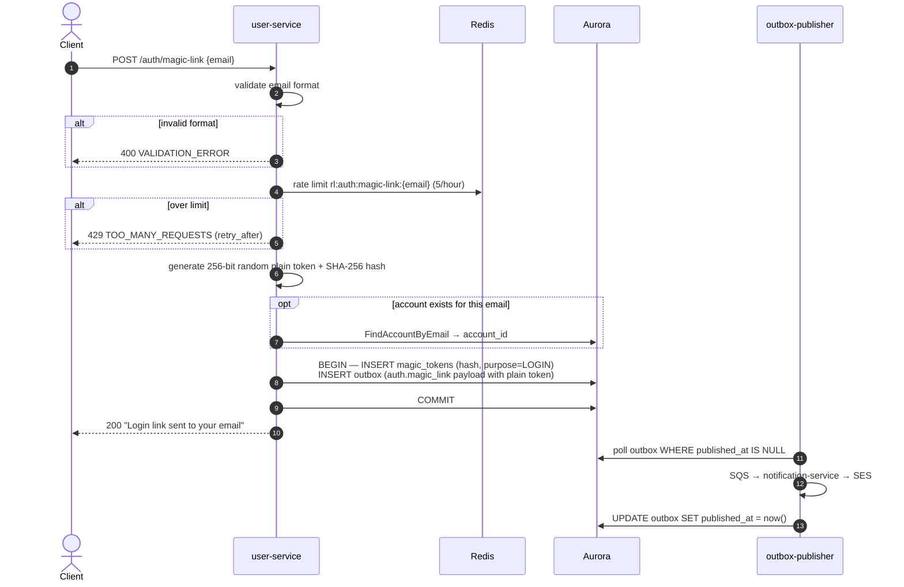

# POST /auth/magic-link — Request Magic Link

| | |
|---|---|
| **Service** | `services/user` (Lambda) |
| **Auth** | None |
| **Contract** | OpenAPI `POST /auth/magic-link` · api-contracts §1.1 |
| **Requirements** | FR-31 |
| **Status** | done |

## 1. Purpose

Issues a one-time login link sent to the supplied email address. The response is
always 200 whether or not an account exists for that address — anything else lets
a caller enumerate which addresses are registered, which is also a privacy leak
given that an address implies a ticket holder.

A token row and its outbox event commit together in a single transaction. A token
with no queued email is a link nobody receives; an email with no token is a link
that cannot be redeemed.

The same handler is shared with `POST /auth/magic-link/resend`; the only difference
is the response message (impl: `handleMagicLink` in `services/user/internal/user/infrastructure/http/auth.go`).

## 2. Flow

## 3. Steps

1. Require `Content-Type: application/json` body; decode and validate `email` field.
2. Normalise email: `strings.ToLower(strings.TrimSpace(email))`.
3. Rate-limit on `auth:magic-link:{email}` — 5 attempts per hour. Fail **open**
   on Redis error (limiter unavailable ≠ login blocked).
4. Generate 32-byte random buffer → base64url plain token, SHA-256 hash. Only the
   hash persists.
5. Attempt `FindAccountByEmail`: if found, attach `account_id` to the token row;
   if not found, leave it empty. Either way the transaction continues.
6. Open one transaction:
   - `INSERT magic_tokens (id, email, token_hash, purpose=LOGIN, expires_at=now+15min)`
   - `INSERT outbox (id, aggregate_id=email, type=auth.magic_link, payload={account_id,email,token})`
7. Commit. Return 200 with a fixed message.

## 4. Data touched

| Store | Key / table | Op | Notes |
|---|---|---|---|
| Redis | `auth:magic-link:{email}` | token bucket | 5 / hour, fail-open |
| Aurora | `accounts` | SELECT | Optional — to attach account_id |
| Aurora | `magic_tokens` | INSERT | `token_hash` only; plain token is in the outbox payload |
| Aurora | `outbox` | INSERT | `auth.magic_link` event; same TX as magic_tokens |

## 5. Responses and errors

| HTTP | Code | When |
|---|---|---|
| 200 | — | Always on success (account may or may not exist) |
| 400 | `VALIDATION_ERROR` | Missing or malformed `email` |
| 429 | `TOO_MANY_REQUESTS` | 5 requests in the last hour for this address |

## 6. Edge cases and decisions

- **Non-enumeration**: the response, timing and HTTP status are identical whether or
  not an account exists. The `FindAccountByEmail` call is a best-effort attachment,
  not a gate.
- **Fail-open rate limiter**: a Redis outage cannot take down login. The downside is
  a brief rate-limit bypass; acceptable given the 15-minute token TTL.
- **Token hash only in DB**: a database read is not enough to authenticate as anyone
  with a live link.
- **Atomic outbox**: if the transaction fails, no orphaned email is queued and no
  token exists to redeem.

## 7. Tests

- [x] unit: valid email → token stored + event queued
- [x] unit: missing email → 400
- [x] unit: invalid email format → 400
- [x] unit: 5th request within window → 200 (allowed), 6th → 429
- [x] unit: limiter error → fail-open, request proceeds
- [x] unit: unknown email → same 200, no account_id in token row

## 8. Tasks

- [x] HTTP handler `RequestMagicLink` + validation
- [x] usecase `RequestMagicLink`: rate limit, token generation, single-TX write
- [x] `SaveMagicTokenWithEvent` adapter (postgres)
- [x] outbox event type `auth.magic_link` in `pkg/events`
- [x] rate limiter adapter (Redis token bucket)
