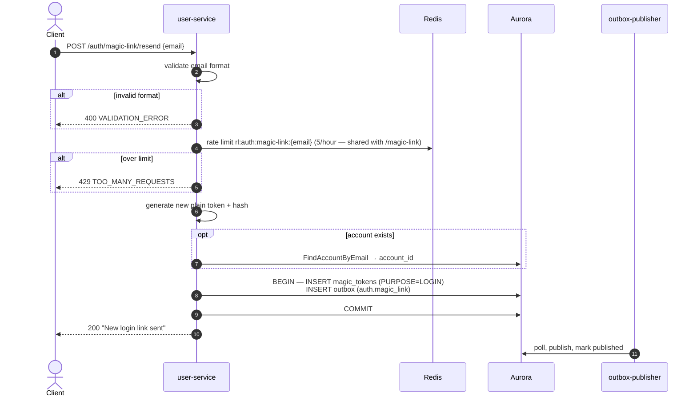

# POST /auth/magic-link/resend — Resend Magic Link

| | |
|---|---|
| **Service** | `services/user` (Lambda) |
| **Auth** | None |
| **Contract** | Apidog `POST /auth/magic-link/resend` · api-contracts §1.2 |
| **Requirements** | FR-31 |
| **Status** | done |

## 1. Purpose

Re-sends a login link to the supplied email. Intended for the "Resend" button on
the "Check your inbox" screen. Shares the same handler and logic as
`POST /auth/magic-link` — the only difference is the response message
(`"New login link sent"`).

This endpoint does **not** invalidate the previous token: the customer may still
redeem whichever link arrives first. Each call creates a new `magic_tokens` row
and a new outbox event.

## 2. Flow

## 3. Steps

Identical to `POST /auth/magic-link` (see [01-request-magic-link.md](01-request-magic-link.md)),
except step 7 uses message `"New login link sent"`.

The rate limit is shared: sending the original link and resending it count against
the same 5-per-hour bucket for that email address.

## 4. Data touched

Same as `POST /auth/magic-link` — see §4 there.

## 5. Responses and errors

| HTTP | Code | When |
|---|---|---|
| 200 | — | Always on success |
| 400 | `VALIDATION_ERROR` | Missing or malformed `email` |
| 429 | `TOO_MANY_REQUESTS` | Combined count of `/magic-link` + `/magic-link/resend` for this address exceeds 5/hour |

## 6. Edge cases and decisions

- **Shared rate-limit bucket**: the 5/hour limit covers both endpoints for the same
  address, so a client looping resend cannot bypass it by toggling between the two.
- Previous tokens remain valid; the new token does not revoke them. A customer
  with three valid links in their inbox can redeem any one of them.

## 7. Tests

- [x] unit: resend produces a new token row; previous row not invalidated
- [x] unit: response message is "New login link sent"
- [x] unit: rate limit shared with /magic-link — 4 requests via /magic-link + 1 resend = 429

## 8. Tasks

- [x] `ResendMagicLink` handler delegates to `handleMagicLink` with different message
