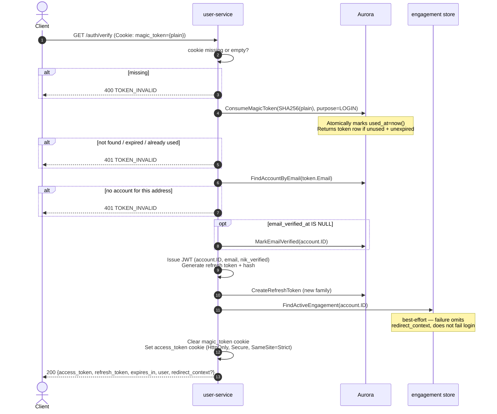

# GET /auth/verify — Verify Magic Link

| | |
|---|---|
| **Service** | `services/user` (Lambda) |
| **Auth** | `magic_token` cookie (single-use link token) |
| **Contract** | Apidog `GET /auth/verify` · api-contracts §1.3 |
| **Requirements** | FR-31, BR-09 |
| **Status** | done |

## 1. Purpose

Redeems a one-time login link and issues a session: a stateless JWT access token
and an opaque rotating refresh token. This is the only path that creates a session.
It does **not** create an account for an unknown address — account creation requires
a Dukcapil-verified NIK and a consent record (FR-31a, FR-31c).

Redeeming a login link also proves control of the address, so `email_verified_at` is
filled in as a side effect if it was not already set.

The token arrives in the `magic_token` cookie (not as a query parameter — a query
parameter would land in browser history, referrer headers and access logs).

## 2. Flow

## 3. Steps

1. Read `magic_token` cookie; return 400 `TOKEN_INVALID` if absent or empty.
2. Compute `SHA-256(cookie value)`.
3. `ConsumeMagicToken(hash, purpose=LOGIN)`: atomically marks the row `used_at=now()`
   and returns it, or errors if not found, already used, or past `expires_at`.
   Two concurrent clicks on one link can race here; the second loses.
4. `FindAccountByEmail(token.Email)`: the address must have an account. A link issued
   to an unregistered address cannot mint a session.
5. Side effect: if `account.email_verified_at IS NULL`, call `MarkEmailVerified`.
   Failure here is logged but does not fail the login — verification is not a
   purchase gate (ADR-005 §12).
6. Issue access token: JWT HS256, claims `sub=accountID`, `email`, `nik_verified`,
   `exp=now+22740s`.
7. Generate refresh token: 256-bit random, store only the SHA-256. Open a new
   `family_id` (a fresh family per login keeps revocation isolated to one device).
   `CreateRefreshToken(refresh)`.
8. Look up `redirect_context` from active engagement (BR-09). Best-effort: a lookup
   failure omits the field but does not fail the login.
9. Clear `magic_token` cookie (MaxAge=-1).
10. Set `access_token` cookie: HttpOnly, Secure (config-driven), SameSite=Strict,
    MaxAge=ExpiresIn.
11. Return 200.

## 4. Data touched

| Store | Key / table | Op | Notes |
|---|---|---|---|
| Aurora | `magic_tokens` | UPDATE used_at | Atomic single-update; concurrent redeem loses |
| Aurora | `accounts` | SELECT, UPDATE email_verified_at | UPDATE is best-effort |
| Aurora | `refresh_tokens` | INSERT | New family per login |
| Aurora | `engagements` / `bookings` | SELECT | Best-effort redirect_context lookup |

## 5. Responses and errors

| HTTP | Code | When |
|---|---|---|
| 200 | — | Session issued; `access_token` cookie set |
| 400 | `TOKEN_INVALID` | `magic_token` cookie absent or empty |
| 401 | `TOKEN_INVALID` | Token not found · already used · expired · no account for address |

## 6. Edge cases and decisions

- **One message for all token failures**: unknown, expired and already-used are
  indistinguishable to the caller. Telling them apart would confirm which addresses
  have had links issued.
- **No account creation here**: to avoid accounts with neither consent nor a verified
  NIK being silently created on first login attempt.
- **22740-second access token**: covers the full queue wait + booking journey
  (`SALE_WINDOW_SECONDS + 930 + 60 + 150`). A shorter token would expire in the
  waiting room for most of the queue (api-contracts §1.3).
- **Refresh token family isolation**: revoking a replayed token cannot log the
  customer out of their other devices.
- **`nik_verified` in JWT**: read from the account row at issue time. A NIK
  verified after registration takes effect on next login or next refresh. **OPEN:**
  an operationally revoked NIK stays claimed for up to 22740 s (ADR-005 §17 #11).

## 7. Tests

- [x] unit: valid cookie → 200, access_token cookie set, magic_token cookie cleared
- [x] unit: missing cookie → 400
- [x] unit: expired token → 401
- [x] unit: already-used token → 401
- [x] unit: valid token but no account → 401
- [x] unit: unverified email → email_verified_at set as side effect
- [x] unit: engagement lookup failure → 200 without redirect_context
- [x] integration: two concurrent requests with the same token → one 200, one 401

## 8. Tasks

- [x] `VerifyMagicLink` HTTP handler — cookie read, clear, access_token set
- [x] usecase `VerifyMagicLink`: consume, account lookup, session issue, redirect context
- [x] `ConsumeMagicToken` adapter — atomic UPDATE with filter on purpose
- [x] `issueSession` helper — JWT issue + refresh token chain creation
- [x] `redirectContext` helper — best-effort engagement lookup via outbound port
