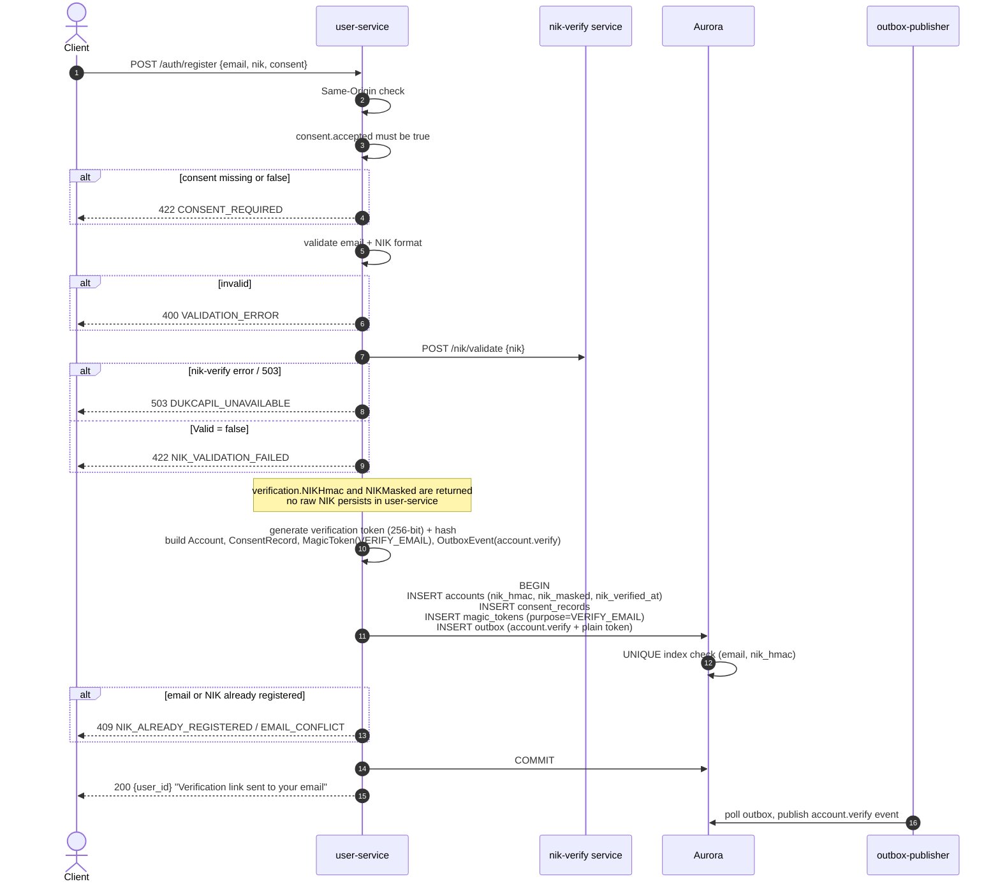

# POST /auth/register — Register Account

| | |
|---|---|
| **Service** | `services/user` (Lambda) |
| **Auth** | Same-Origin required |
| **Contract** | OpenAPI `POST /auth/register` · api-contracts §1.5 |
| **Requirements** | FR-29, FR-30, FR-31 · BR-11, BR-13 · NFR-11 |
| **Status** | done |

## 1. Purpose

Creates a new account tied to a Dukcapil-verified NIK and records the customer's
consent to third-party NIK processing. After this call the customer receives an
email verification link; they do not receive a session — login is always via magic
link (`GET /auth/verify`).

Order is fixed by ADR-005 §8: consent check → NIK verification → one atomic write.
The account, its consent record, the email-verification token, and the outbox event
all commit together or none do. A partial write would leave either an account with
no consent record (a UU PDP violation) or a verification email with no token to
redeem.

NIK is verified exactly once at registration. Subsequent purchases by this account
read `nik_hmac` from the accounts table and skip Dukcapil, which is the primary
cost-saving design for `NIK_Terdaftar` (api-contracts §1.5, NFR-12).

## 2. Flow

## 3. Steps

1. Same-Origin check.
2. Decode body; check `consent` object. A missing `consent` key is a malformed
   request (`VALIDATION_ERROR`). A present object with `accepted: false` is
   `CONSENT_REQUIRED` (422) — the customer explicitly declined.
3. Validate email format and `nik` presence (struct tags). NIK length is **not**
   validated here — nik-verify normalises first.
4. Call `nik-verify POST /nik/validate`. Fail **closed**: any error (network,
   timeout, 503) returns `DUKCAPIL_UNAVAILABLE` to the caller (BR-13).
5. If `verification.Valid = false` → 422 `NIK_VALIDATION_FAILED`.
6. Build domain objects:
   - `Account`: `id=USR-{ULID}`, email, `nik_hmac`, `nik_masked`, `nik_verified_at=now()`,
     `dukcapil_ref`.
   - `ConsentRecord`: `id`, `account_id`, `policy_version`, `consented_at=now()`.
   - `MagicToken`: purpose=`VERIFY_EMAIL`, 15-minute TTL.
   - `OutboxEvent`: type=`account.verify`, payload includes plain token.
7. `RegisterAccount(Registration{...})` — single transaction:
   - INSERT accounts (unique on `lower(email)`, unique on `nik_hmac WHERE NOT NULL`)
   - INSERT consent_records
   - INSERT magic_tokens
   - INSERT outbox
   - Returns conflict `AppError` on duplicate email or NIK.
8. Return 200 with `user_id`. Session is **not** issued; login requires a magic link.

## 4. Data touched

| Store | Key / table | Op | Notes |
|---|---|---|---|
| Aurora | `accounts` | INSERT | `nik_hmac` is HMAC from nik-verify; raw NIK never stored |
| Aurora | `consent_records` | INSERT | Append-only (DB trigger); UU PDP NFR-11 |
| Aurora | `magic_tokens` | INSERT | Purpose = `VERIFY_EMAIL`, TTL 15 min |
| Aurora | `outbox` | INSERT | `account.verify` event with plain verification token |

## 5. Responses and errors

| HTTP | Code | When |
|---|---|---|
| 200 | — | Account created; verification email queued |
| 400 | `VALIDATION_ERROR` | Email format invalid · `nik` missing |
| 409 | `NIK_ALREADY_REGISTERED` | NIK already tied to another account |
| 422 | `CONSENT_REQUIRED` | `consent` absent, or `consent.accepted = false` |
| 422 | `NIK_VALIDATION_FAILED` | NIK rejected by Dukcapil |
| 429 | `TOO_MANY_REQUESTS` | Rate limit (5 registrations / IP / hour) |
| 503 | `DUKCAPIL_UNAVAILABLE` | nik-verify unreachable or returned error |

## 6. Edge cases and decisions

- **Consent before NIK verification**: storing a verified NIK with no consent record
  is a UU PDP violation. The consent check is the first domain gate, not a
  validation afterthought.
- **Fail-closed NIK**: there is no "retry later" path at registration — a 503 here
  means the customer cannot register until nik-verify recovers. That is by design
  (BR-13); proof of identity must be obtained before the account is created.
- **Uniqueness decided by the DB indexes**: a prior SELECT-then-INSERT would race
  between two concurrent registrations for the same email or NIK. Only the database
  sees both; the conflict error bubbles up as `NIK_ALREADY_REGISTERED`.
- **Raw NIK never enters user-service storage**: `nik_hmac` and `nik_masked` come
  from the nik-verify response. The pepper lives only in `services/nik-verify`
  (ADR-005 §8).
- **`consent_records` is append-only**: a DB trigger prevents UPDATE and DELETE,
  so no repair script can rewrite the evidence.

## 7. Tests

- [x] unit: valid request → account + consent + token + outbox event created atomically
- [x] unit: missing consent object → 400
- [x] unit: consent.accepted = false → 422 CONSENT_REQUIRED
- [x] unit: nik-verify returns error → 503
- [x] unit: NIK invalid (Valid=false) → 422 NIK_VALIDATION_FAILED
- [x] unit: duplicate email → 409
- [x] unit: duplicate NIK → 409 NIK_ALREADY_REGISTERED
- [x] integration: crash after outbox INSERT and before COMMIT → account absent, outbox absent

## 8. Tasks

- [x] `Register` HTTP handler — body decode, consent pointer distinction
- [x] usecase `Register`: consent gate, NIK verify call, Registration build, single-TX write
- [x] `RegisterAccount` adapter — four-table transaction with index conflict handling
- [x] `INikVerifier` outbound port + `nik-verify` HTTP client adapter
- [x] `consent_records` append-only trigger in migration `0001_user_domain.up.sql`
