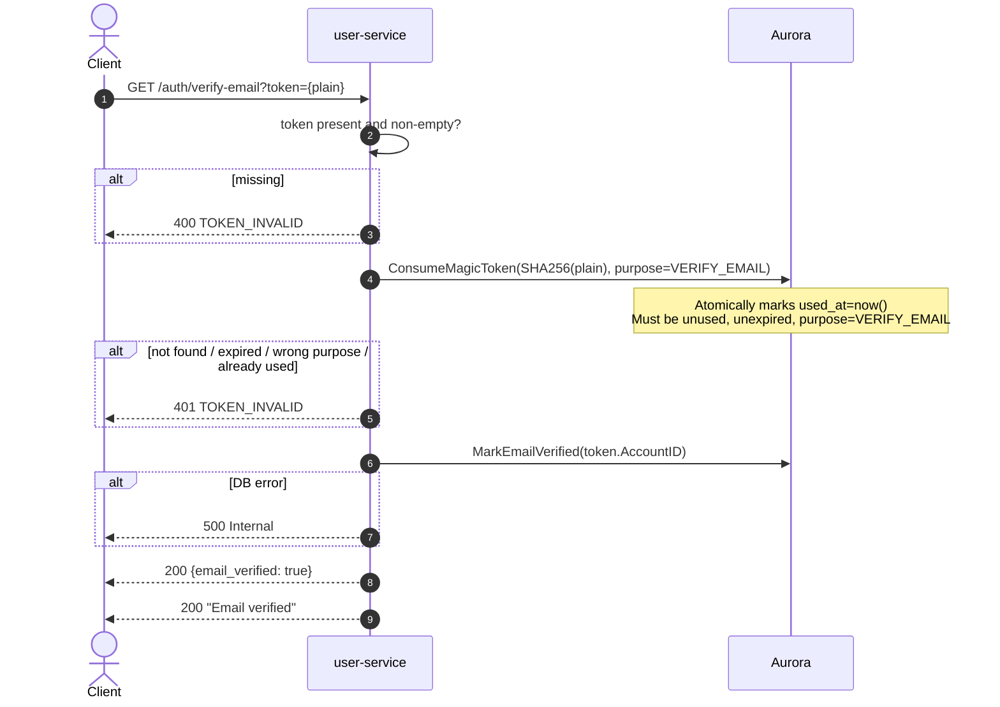

# GET /auth/verify-email — Verify Email Address

| | |
|---|---|
| **Service** | `services/user` (Lambda) |
| **Auth** | `token` query parameter (single-use verification token) |
| **Contract** | Apidog `GET /auth/verify-email` · api-contracts §1.7 |
| **Requirements** | FR-31 |
| **Status** | done |

## 1. Purpose

Confirms ownership of the registered email address by consuming the verification
link sent after `POST /auth/register`. Sets `accounts.email_verified_at` and
**Does not issue any session token** — it proves control
of an address, which is not the same as granting login access.

An unverified account can still purchase tickets (`email_verified_at` is not a
purchase gate; `nik_verified_at IS NULL` is — ADR-005 §12). Email verification
only unlocks order history.

The token is a `magic_tokens` row with `purpose = VERIFY_EMAIL`. The same
single-use, hashed, 15-minute machinery as login tokens, but on a different
purpose so the two cannot be cross-redeemed.

> **There is no resend for this endpoint.** Redeeming a magic-link login
> (`GET /auth/verify`) also sets `email_verified_at`, so a customer whose
> verification link expired only needs to request a new login link
> (api-contracts §1.7).

## 2. Flow

## 3. Steps

1. Read the `token` **query parameter**; return 400 `TOKEN_INVALID` if absent
   or empty. **Not a cookie** — see §6.
2. Compute `SHA-256(token)`.
3. `ConsumeMagicToken(hash, purpose=VERIFY_EMAIL)`: atomically marks used.
   Returns error if not found, expired, already used, or purpose mismatch.
4. `MarkEmailVerified(token.AccountID)` — sets `email_verified_at = COALESCE(email_verified_at, now())`
   (idempotent; first writer wins).
5. Answer 200 with `data {email_verified: true}`.
6. Return 200.

## 4. Data touched

| Store | Key / table | Op | Notes |
|---|---|---|---|
| Aurora | `magic_tokens` | UPDATE used_at | Filter on `purpose = 'VERIFY_EMAIL'` |
| Aurora | `accounts` | UPDATE email_verified_at | `COALESCE` makes it idempotent |

## 5. Responses and errors

| HTTP | Code | When |
|---|---|---|
| 200 | — | Email verified, with `data {email_verified: true}` |
| 400 | `TOKEN_INVALID` | `token` query parameter absent or empty |
| 401 | `TOKEN_INVALID` | Token not found · already used · expired · wrong purpose |

## 6. Edge cases and decisions

- **The token is a query parameter, not a cookie** (api-contracts §1.7). This
  URL is clicked straight out of an email client, so there is no cookie on the
  request and nothing in the registration flow ever set one. The handler read
  `magic_token` until this was corrected, which meant the link in **every**
  verification email answered 400 without the use case ever running — a 400
  that looked like an expired token and was in fact an endpoint that could
  never succeed.

  §1.3 reads a cookie because its flow differs: there the frontend receives the
  login token and sets it before calling the endpoint. The two are not
  interchangeable, which is the point of them being separate endpoints with
  separate token purposes — and a cookie is deliberately **not** accepted here
  as a fallback, because honouring both would hide that one of them never
  worked.
- **No session issued**: confirming an address must not be a login bypass. A
  verification link proves control; a login link grants access.
- **Purpose isolation**: `ConsumeMagicToken` filters on `purpose = VERIFY_EMAIL`.
  A login token cannot be redeemed here, and vice versa.
- **Idempotent write**: if `VerifyMagicLink` (§1.3) already set `email_verified_at`
  (because login also proves address control), this write is a no-op.
- **Token TTL 15 min, no resend path**: the token shares the `MagicTokenTTL`
  constant with login tokens. If it expires, the customer requests a login link
  and the login redemption sets the same column (api-contracts §1.7).
- **One message for all token failures**: same non-enumeration principle as §1.3.

## 7. Tests

- [x] unit: valid token in the query → 200 with `data {email_verified: true}`,
      `email_verified_at` set, token consumed
- [x] unit: missing `token` parameter → 400 `TOKEN_INVALID`
- [x] unit: `?token=` empty → 400, which is what a mail template with an
      unrendered variable produces
- [x] unit: a `magic_token` cookie is **not** accepted in its place
- [x] unit: the response envelope carries `meta.server_time`, like every other
      route (see `envelope_test.go`)
- [x] unit: expired token → 401
- [x] unit: already-used token → 401
- [x] unit: login-purpose token presented here → 401 (purpose mismatch)
- [x] unit: already-verified account → 200 (idempotent)

## 8. Tasks

- [x] `VerifyEmail` HTTP handler
- [x] usecase `VerifyEmail`: consume (VERIFY_EMAIL purpose) + mark verified
- [x] `ConsumeMagicToken` adapter filters on `purpose` column
