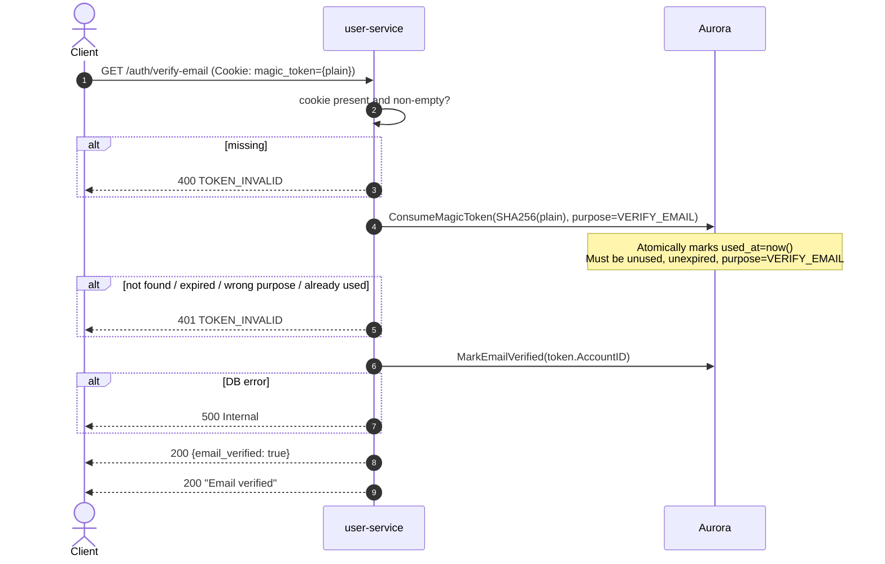

# GET /auth/verify-email — Verify Email Address

| | |
|---|---|
| **Service** | `services/user` (Lambda) |
| **Auth** | `magic_token` cookie (single-use verification token) |
| **Contract** | Apidog `GET /auth/verify-email` · api-contracts §1.7 |
| **Requirements** | FR-31 |
| **Status** | done |

## 1. Purpose

Confirms ownership of the registered email address by consuming the verification
link sent after `POST /auth/register`. Sets `accounts.email_verified_at` and
**Does not issue any session token** — it proves control
of an address, which is not the same as granting login access.

An unverified account can still purchase tickets (`email_verified_at` is not a
purchase gate; `nik_verified_at IS NULL` is — ADR-005 §12). Email verification
only unlocks order history.

The token is a `magic_tokens` row with `purpose = VERIFY_EMAIL`. The same
single-use, hashed, 15-minute machinery as login tokens, but on a different
purpose so the two cannot be cross-redeemed.

> **There is no resend for this endpoint.** Redeeming a magic-link login
> (`GET /auth/verify`) also sets `email_verified_at`, so a customer whose
> verification link expired only needs to request a new login link
> (api-contracts §1.7).

## 2. Flow

## 3. Steps

1. Read the `magic_token` **cookie**; return 400 `TOKEN_INVALID` if absent or
   empty. **Not a query parameter** — see §6.
2. Compute `SHA-256(token)`.
3. `ConsumeMagicToken(hash, purpose=VERIFY_EMAIL)`: atomically marks used.
   Returns error if not found, expired, already used, or purpose mismatch.
4. `MarkEmailVerified(token.AccountID)` — sets `email_verified_at = COALESCE(email_verified_at, now())`
   (idempotent; first writer wins).
5. Answer 200 with `data {email_verified: true}`.
6. Return 200.

## 4. Data touched

| Store | Key / table | Op | Notes |
|---|---|---|---|
| Aurora | `magic_tokens` | UPDATE used_at | Filter on `purpose = 'VERIFY_EMAIL'` |
| Aurora | `accounts` | UPDATE email_verified_at | `COALESCE` makes it idempotent |

## 5. Responses and errors

| HTTP | Code | When |
|---|---|---|
| 200 | — | Email verified, with `data {email_verified: true}` |
| 400 | `TOKEN_INVALID` | `magic_token` cookie absent or empty |
| 401 | `TOKEN_INVALID` | Token not found · already used · expired · wrong purpose |

## 6. Edge cases and decisions

- **The token is a cookie, not a query parameter** — and api-contracts §1.7 said
  the opposite until v2.24, when the *contract* was corrected to match. The
  handler has read the cookie since the endpoint was born (`1417f00`,
  3 Nov 09:26); the contract's query table was written 12 hours later and
  transcribed the shape of the **email link**, not of the request to the API.
  Nothing broke in between only because `?token=` was always answered
  `400 TOKEN_INVALID`, so no working client ever depended on it.

  The delivery path is why the cookie is the right channel, and it is the same
  path as §1.3. `notification-service` builds the link as
  `APP_BASE_URL + "/auth/verify-email?token=" + token`, and `APP_BASE_URL` is
  the **frontend** (default `http://localhost:3000`), not this API. The frontend
  page reads the token out of its own query string, sets `magic_token`, and
  calls here. That `APP_BASE_URL` is a frontend origin is unambiguous in the
  login email, which points at `/auth/login` — a route this API does not have;
  its API route is `GET /auth/verify`.

- **Why that is safer.** A query parameter here would copy a single-use
  credential into this service's access logs, the load balancer's logs,
  CloudWatch, and the `Referer` of anything the response links to. The token
  does still travel in one URL — the frontend's, unavoidable for any emailed
  link — but it stops there. `HttpOnly` keeps it away from script on later
  pages, `SameSite=Strict` stops another origin submitting it, and the spent
  cookie is cleared on success so a dead credential does not ride along on
  every later request to this origin.

- **Still a separate endpoint from §1.3, and a separate token purpose.** Same
  channel, different outcome: this one fills `email_verified_at` and issues
  nothing. If it minted a session, "please confirm your email" would be a login
  bypass. A login token cannot be redeemed here, and vice versa
  (`purpose = VERIFY_EMAIL`).

- **Token TTL 15 min, no resend path**: the token shares the `MagicTokenTTL`
  constant with login tokens. If it expires, the customer requests a login link
  and the login redemption sets the same column (api-contracts §1.7).
- **One message for all token failures**: same non-enumeration principle as §1.3.

## 7. Tests

- [x] unit: valid token in the cookie → 200 with `data {email_verified: true}`,
      `email_verified_at` set, token consumed
- [x] unit: the spent cookie is cleared (`Max-Age=-1`)
- [x] unit: no `access_token` cookie and no token in `data` — verification
      never mints a session
- [x] unit: missing `magic_token` cookie → 400 `TOKEN_INVALID`
- [x] unit: empty cookie value → 400, which is what a mail template with an
      unrendered variable produces
- [x] unit: `?token=` is **not** accepted in its place
- [x] unit: the response envelope carries `meta.server_time`, like every other
      route (see `envelope_test.go`)
- [x] unit: expired token → 401
- [x] unit: already-used token → 401
- [x] unit: login-purpose token presented here → 401 (purpose mismatch)
- [x] unit: already-verified account → 200 (idempotent)

## 8. Tasks

- [x] `VerifyEmail` HTTP handler
- [x] usecase `VerifyEmail`: consume (VERIFY_EMAIL purpose) + mark verified
- [x] `ConsumeMagicToken` adapter filters on `purpose` column
