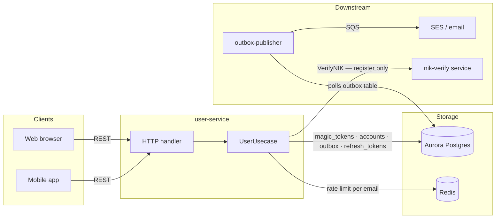

# 01 — Authentication

Passwordless login via magic link, account registration with Dukcapil NIK verification,
session management with rotating refresh tokens, and email confirmation.

**Service**: `services/user` (Lambda + API Gateway)

**Sources**: ADR-005 §4, §7–§9, §12 · api-contracts §1 · requirements FR-29, FR-30, FR-31,
BR-09 , BR-11, BR-13, NFR-02, NFR-07, NFR-10, NFR-11.

## Files

| # | File | Apidog request |
|---|---|---|
| 01 | [01-request-magic-link.md](01-request-magic-link.md) | `POST /auth/magic-link` |
| 02 | [02-resend-magic-link.md](02-resend-magic-link.md) | `POST /auth/magic-link/resend` |
| 03 | [03-verify-magic-link.md](03-verify-magic-link.md) | `GET /auth/verify` |
| 04 | [04-refresh-session.md](04-refresh-session.md) | `POST /auth/refresh` |
| 05 | [05-register.md](05-register.md) | `POST /auth/register` |
| 06 | [06-verify-email.md](06-verify-email.md) | `GET /auth/verify-email` |

## 1. Component overview

## 2. Token types

| Token | Transport | Storage | TTL | Notes |
|---|---|---|---|---|
| Magic link (login) | `magic_token` cookie → email link | `magic_tokens` — SHA-256 hash only | 15 min | Purpose = `LOGIN`. Single-use. |
| Magic link (verify email) | same cookie mechanism | same table | 15 min | Purpose = `VERIFY_EMAIL`. No session issued. |
| Access token | `access_token` cookie (web) · `Authorization: Bearer` (mobile) | None — stateless JWT HS256 | 22740 s | Derived from `SALE_WINDOW_SECONDS + 990 + 150`. |
| Refresh token | response body | `refresh_tokens` — SHA-256 hash only | 30 days | Opaque 256-bit random. Single-use, rotated on each use. |

## 3. Key database tables

| Table | Owner | Notes |
|---|---|---|
| `accounts` | `services/user` | NIK columns all-or-nothing (`CHECK` constraint). |
| `consent_records` | `services/user` | Append-only (DB trigger). UU PDP NFR-11. |
| `magic_tokens` | `services/user` | `purpose IN ('LOGIN','VERIFY_EMAIL')`. |
| `outbox` | shared | `account.verify` and `auth.magic_link` event types. |
| `refresh_tokens` | `services/user` | `family_id` for rotation-chain revocation (OAuth 2.0 BCP §4.13). |

## 4. Open decisions

| # | Decision |
|---|---|
| 1 | **OPEN:** `nik_verified` claim in the JWT is a 6-hour cache of authorisation state. A NIK revoked by operations stays asserted until the token expires (ADR-005 §17 #11). Mitigation plan not yet decided. |
| 2 | **OPEN:** `redirect_context` type `queue` vs `booking` — which wins when both exist. Current impl: engagement lookup picks the active row; booking takes precedence once a grant exists. |
