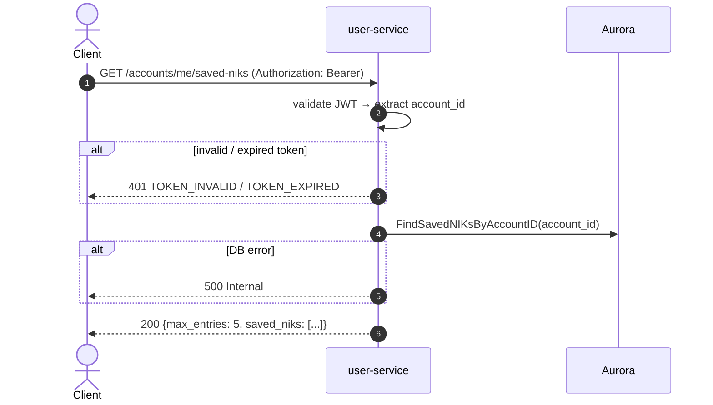

# GET /accounts/me/saved-niks — Get Saved NIKs

| | |
|---|---|
| **Service** | `services/user` (Lambda) |
| **Auth** | `Authorization: Bearer <access_token>` required |
| **Contract** | Apidog `GET /accounts/me/saved-niks` · api-contracts §1.6 |
| **Requirements** | FR-32a, FR-32b, FR-32c |
| **Status** | done |

## 1. Purpose

Returns the account's saved friend-NIK list — pre-verified NIKs the customer
can pick at checkout without triggering another Dukcapil call. Each entry shows
only the masked form; the full 16 digits are never returned (FR-32c). The hard
cap (`max_entries = 5`) is included in the response so the frontend can decide
whether to show the "add" button.

## 2. Flow

## 3. Steps

1. Extract and validate Bearer token; resolve `account_id`.
2. `FindSavedNIKsByAccountID(account_id)`: returns all rows for this account,
   ordered by `created_at ASC`.
3. Map each `entity.SavedNIK` to `dto.SavedNIKItem` (masked only, status always
   `"VERIFIED"` — no row exists without `verified_at`).
4. Return 200 with `max_entries = entity.MaxSavedNIKs` (5) and the list.

## 4. Data touched

| Store | Key / table | Op | Notes |
|---|---|---|---|
| Aurora | `saved_niks` | SELECT WHERE account_id | Returns `nik_masked`, not `nik_hmac` |

## 5. Responses and errors

| HTTP | Code | When |
|---|---|---|
| 200 | — | List returned (may be empty) |
| 401 | `TOKEN_INVALID` / `TOKEN_EXPIRED` | Missing, invalid or expired Bearer token |

## 6. Edge cases and decisions

- **Full NIK never returned**: `nik_hmac` is not in the DTO; `nik_masked` comes
  from the stored column. No handler change could start returning the raw NIK
  because the service never holds it.
- **`status` is always `"VERIFIED"`**: the `CHECK (verified_at IS NOT NULL)` constraint
  makes it impossible to write a row without proof. There is no `PENDING` state.
- An empty list (no saved NIKs) is a valid 200 with `saved_niks: []`.

## 7. Tests

- [x] unit: valid token → 200 with correct saved NIK items
- [x] unit: empty list → 200 with saved_niks: []
- [x] unit: missing/invalid token → 401
- [x] unit: max_entries is always 5 regardless of list length

## 8. Tasks

- [x] `GetSavedNIKs` HTTP handler — auth guard + response mapping
- [x] usecase `GetSavedNIKs` — fetch and map to DTO
- [x] `FindSavedNIKsByAccountID` adapter (postgres)
