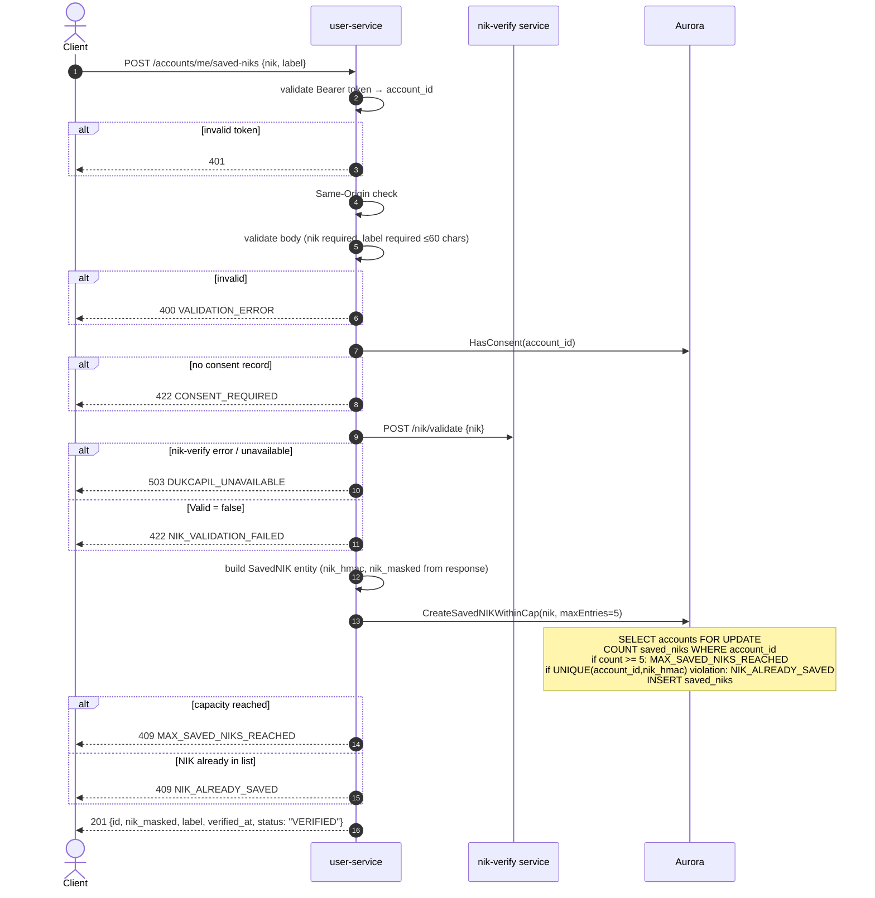

# POST /accounts/me/saved-niks — Add Saved NIK

| | |
|---|---|
| **Service** | `services/user` (Lambda) |
| **Auth** | `Authorization: Bearer <access_token>` + Same-Origin required |
| **Contract** | OpenAPI `POST /accounts/me/saved-niks` · api-contracts §1.6 |
| **Requirements** | FR-15a, FR-32a, FR-32b · BR-12, BR-13 · NFR-11 |
| **Status** | done |

## 1. Purpose

Verifies a friend's NIK via Dukcapil (through `nik-verify`) and — only if valid —
stores the hash and masked form. Dukcapil is called first, the INSERT comes
second; there is deliberately no `PENDING` state. A row without a `verified_at`
would be treated as proof at checkout and skip Dukcapil, moving the fail-closed
hole back one step rather than closing it (ADR-005 §8, api-contracts §1.6).

The 5-entry cap (BR-12) is enforced transactionally under a row lock on the owning
account, so two concurrent POSTs cannot both see four entries and both insert.

Rejecting here costs the customer nothing: no stock is held and no timer is
running, so a retry after a few minutes loses nothing. That is what separates this
from checkout (api-contracts §1.6).

## 2. Flow

## 3. Steps

1. Bearer token validation → `account_id`.
2. Same-Origin check (state-mutation endpoint).
3. Decode and validate body: `nik` required, `label` required with `max=60`.
   No length check on `nik` — nik-verify normalises first.
4. `HasConsent(account_id)` — if false → 422 `CONSENT_REQUIRED`. Accounts
   predating the consent requirement may lack a record.
5. Call `nik-verify POST /nik/validate`. Fail **closed**: any error → 503
   `DUKCAPIL_UNAVAILABLE`. `Valid=false` → 422 `NIK_VALIDATION_FAILED`.
6. Build `entity.SavedNIK`: `id=snk_{ULID}`, `nik_hmac` and `nik_masked` from
   the nik-verify response (the raw NIK never enters this service), `label`,
   `verified_at=now()`, `dukcapil_ref`.
7. `CreateSavedNIKWithinCap(nik, 5)`:
   - `SELECT accounts WHERE id = account_id FOR UPDATE` (row lock)
   - `COUNT(*) FROM saved_niks WHERE account_id` — if ≥ 5 → `MAX_SAVED_NIKS_REACHED`
   - `INSERT saved_niks` — `UNIQUE (account_id, nik_hmac)` violation → `NIK_ALREADY_SAVED`
8. Return 201.

## 4. Data touched

| Store | Key / table | Op | Notes |
|---|---|---|---|
| Aurora | `consent_records` | SELECT COUNT | Read-only; presence check |
| Aurora | `accounts` | SELECT FOR UPDATE | Row lock to enforce BR-12 cap atomically |
| Aurora | `saved_niks` | INSERT | `nik_hmac` from nik-verify, never from input |

## 5. Responses and errors

| HTTP | Code | When |
|---|---|---|
| 201 | — | NIK saved; entry returned |
| 400 | `VALIDATION_ERROR` | `nik` missing · `label` missing or >60 chars |
| 401 | `TOKEN_INVALID` / `TOKEN_EXPIRED` | Auth failure |
| 409 | `MAX_SAVED_NIKS_REACHED` | Already 5 entries for this account |
| 409 | `NIK_ALREADY_SAVED` | This NIK is already in the account's list |
| 422 | `CONSENT_REQUIRED` | No consent record for this account |
| 422 | `NIK_VALIDATION_FAILED` | Dukcapil rejected the NIK |
| 503 | `DUKCAPIL_UNAVAILABLE` | nik-verify unreachable or errored |

## 6. Edge cases and decisions

- **Consent-first order**: stores another person's NIK. No consent record means
  the account predates the requirement — still blocked (UU PDP NFR-11).
- **Verify-before-insert**: the DB `CHECK (verified_at IS NOT NULL)` and the absence
  of a PENDING state make it structurally impossible to create an unverified row.
- **Concurrent cap enforcement**: `SELECT FOR UPDATE` on the account row means two
  concurrent adds cannot both count four and both insert. This is safer than
  an application-level advisory lock.
- **Fail-closed on nik-verify**: different from the magic-link rate limiter (which
  fails open). Here an unavailable nik-verify means the entry is not created;
  no partial row exists.
- **No periodic re-validation**: the stored `nik_hmac` is used at checkout as
  permanent proof. In the POC scope this is acceptable; the check-in gate that
  would re-verify is out of scope (api-contracts §1.6).

## 7. Tests

- [x] unit: valid NIK + consent → 201, nik_masked in response, raw NIK absent
- [x] unit: no consent record → 422 CONSENT_REQUIRED
- [x] unit: nik-verify error → 503
- [x] unit: nik-verify Valid=false → 422 NIK_VALIDATION_FAILED
- [x] unit: 5 existing entries → 409 MAX_SAVED_NIKS_REACHED
- [x] unit: duplicate NIK for this account → 409 NIK_ALREADY_SAVED
- [x] unit: label > 60 chars → 400
- [x] integration: two concurrent POSTs at cap=4 → one 201, one 409

## 8. Tasks

- [x] `AddSavedNIK` HTTP handler
- [x] usecase `AddSavedNIK`: consent check, nik-verify call, capped insert
- [x] `CreateSavedNIKWithinCap` adapter (SELECT FOR UPDATE + count + INSERT)
- [x] `HasConsent` adapter
