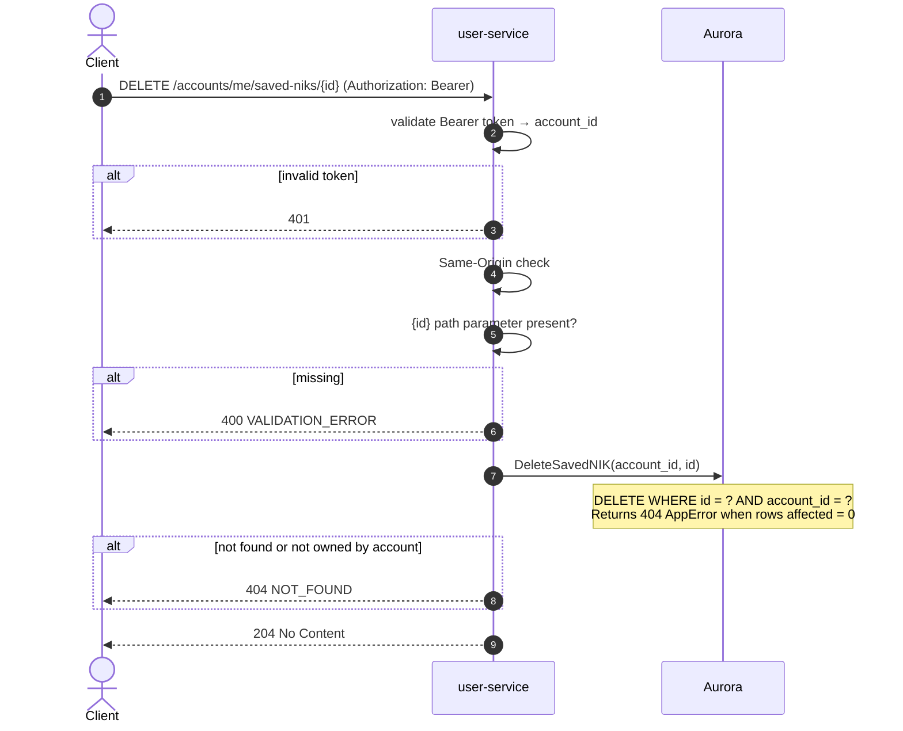

# DELETE /accounts/me/saved-niks/{id} — Delete Saved NIK

| | |
|---|---|
| **Service** | `services/user` (Lambda) |
| **Auth** | `Authorization: Bearer <access_token>` + Same-Origin required |
| **Contract** | OpenAPI `DELETE /accounts/me/saved-niks/{id}` · api-contracts §1.6 |
| **Requirements** | FR-32d |
| **Status** | done |

## 1. Purpose

Removes a saved NIK entry from the account's list. The deletion does not affect
any tickets already purchased with that NIK — the `tickets` table carries its own
`nik_hmac` and is not joined to `saved_niks` (FR-32d).

A missing entry and one belonging to a different account both return 404. Returning
403 for the second case would confirm that the ID exists, which the contract
prohibits (api-contracts §9).

## 2. Flow

## 3. Steps

1. Bearer token validation → `account_id`.
2. Same-Origin check.
3. Read `{id}` path parameter; return 400 if empty.
4. `DeleteSavedNIK(account_id, id)`:
   - `DELETE FROM saved_niks WHERE id = ? AND account_id = ?`
   - If no rows deleted → return 404 `AppError` (covers both missing and wrong-owner).
5. Return 204 No Content.

## 4. Data touched

| Store | Key / table | Op | Notes |
|---|---|---|---|
| Aurora | `saved_niks` | DELETE | Filter on both `id` AND `account_id` |

## 5. Responses and errors

| HTTP | Code | When |
|---|---|---|
| 204 | — | Entry deleted |
| 400 | `VALIDATION_ERROR` | `id` path parameter missing |
| 401 | `TOKEN_INVALID` / `TOKEN_EXPIRED` | Auth failure |
| 404 | `NOT_FOUND` | Entry does not exist OR belongs to a different account |

## 6. Edge cases and decisions

- **404 for wrong-owner, not 403**: returning 403 would confirm the ID exists,
  letting a caller enumerate other accounts' saved-NIK IDs (api-contracts §9).
- **No cascade to tickets**: `saved_niks` is not referenced by `tickets`. A ticket
  already bought carries its own `nik_hmac` snapshot; deleting the saved entry
  has no effect on issued tickets.
- **No consent check needed**: removing a row requires no new processing of the NIK.

## 7. Tests

- [x] unit: valid id owned by caller → 204
- [x] unit: id not in saved_niks → 404
- [x] unit: id exists but owned by different account → 404
- [x] unit: missing path parameter → 400
- [x] unit: invalid token → 401

## 8. Tasks

- [x] `DeleteSavedNIK` HTTP handler — path param extraction + auth guard
- [x] usecase `DeleteSavedNIK` — delegate + error mapping
- [x] `DeleteSavedNIK` adapter — DELETE with two-column filter
