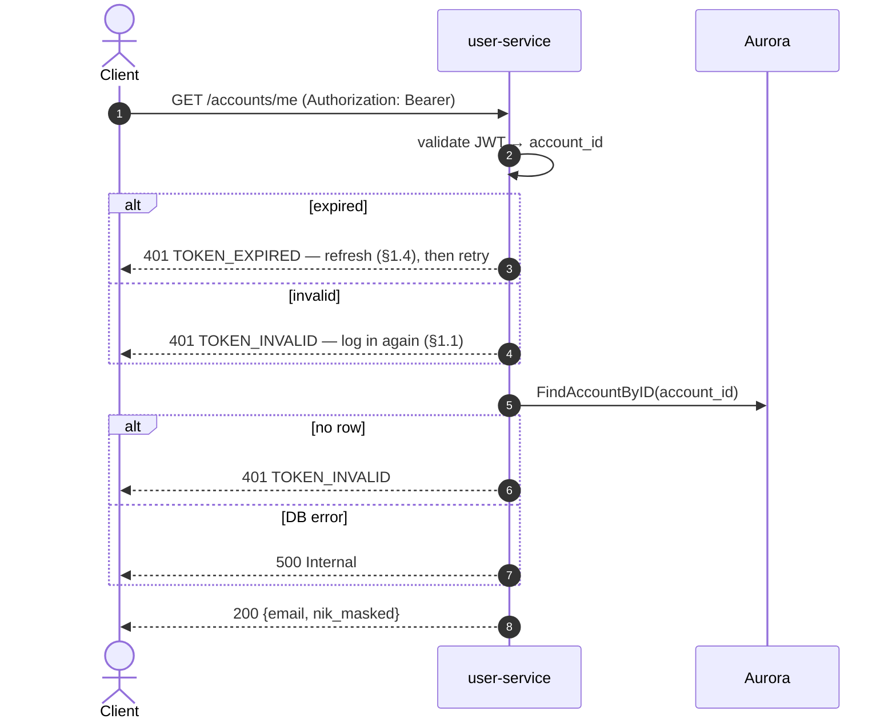

# GET /accounts/me — Get User Profile

| | |
|---|---|
| **Service** | `services/user` (Lambda) |
| **Auth** | `Authorization: Bearer <access_token>` required — and **only** that |
| **Contract** | Apidog `GET /accounts/me` · api-contracts §1.8 |
| **Requirements** | No FR demands it directly; it serves the profile page FR-32a–d describe, and satisfies FR-32c on `nik_masked` |
| **Status** | done |

## 1. Purpose

The profile page's own endpoint: the session owner's email address and their
NIK Terdaftar in masked form. Two fields, and there is no third.

**There is no `name`.** The account does not store one — Dukcapil validates the
NIK alone and a name is collected at no point in this system (FR-15a, contract
§1.5 and §1.8). A profile endpoint is where a name would be noticed missing, so
it is worth saying plainly rather than leaving a reader to wonder: nothing was
dropped from the response, there was never a name to return.

## 2. Flow

## 3. Steps

1. Extract and validate the Bearer token; resolve `account_id` from its subject.
2. `FindAccountByID(account_id)` — one read, no transaction.
3. Map to `{email, nik_masked}` and answer 200.

The account is resolved from the token and from nothing else. There is no path
parameter and no body, so "whose profile" is not a question this endpoint can
be asked — which is what makes it safe for it to carry no ownership check of
its own, unlike every grant-guarded endpoint in §4 and §5.

## 4. Data touched

| Store | Key / table | Op | Notes |
|---|---|---|---|
| Aurora | `accounts` | SELECT WHERE id | Two of eight columns reach the response |

The row also holds `nik_hmac`, `dukcapil_ref` and three timestamps. None of
them belong on a profile page: the hash is what the gate matches against, the
ref is audit material, and the timestamps answer "may this account purchase"
(BR-11) rather than anything a page shows. The mapper names the two fields it
wants instead of copying the entity, so a column added to `accounts` later does
not appear here by default.

## 5. Responses and errors

| HTTP | Code | When |
|---|---|---|
| 200 | — | Profile returned |
| 401 | `TOKEN_EXPIRED` | Session expired. The client refreshes (§1.4) and retries |
| 401 | `TOKEN_INVALID` | Missing, malformed or wrongly-signed token — or a valid token whose account no longer exists |
| 500 | — | Aurora unreachable |

## 6. Edge cases and decisions

- **A valid session for a missing account is 401, not 404.** 404 would be wrong
  twice over: the contract defines only 200 and 401 here, and the resource is
  "me" — it exists exactly as long as the session's subject does. So it is the
  session that cannot be honoured. `TOKEN_INVALID` rather than `TOKEN_EXPIRED`,
  because a refresh would mint another token for the same missing account and
  the client would loop.
- **A database failure is not an authentication failure.** Telling a customer
  their session expired during an outage sends them to a login screen that
  cannot work either. 500, and the driver message is not in it.
- **`nik_masked` is sent even when empty**, never omitted. An account can exist
  without a bound NIK — a magic-link sign-in creates one before registration
  finishes — and for that account the value is `""`, which the page renders as
  "not yet verified". Omitting it would make the client tell the two states
  apart by absence instead.
- **A grant is not a credential here.** `X-Grant-Token` proves its bearer holds
  seats and carries no account identity at all (§9), so there is nothing in one
  that could answer "whose profile" — and honouring it would hand a profile to
  any grant holder.
- **No same-origin check**, unlike the three write handlers in this folder.
  This endpoint changes nothing, and a cross-origin `GET` whose response the
  attacker's page cannot read buys them nothing; refusing it would break a
  profile page served from a second origin for no gain.

## 7. Tests

Implemented in `internal/user/application/usecase/account_test.go`,
`internal/user/infrastructure/http/account_test.go` and
`internal/user/domain/mapper/user_test.go`.

- [x] unit: valid token → 200 with `email` and `nik_masked`
- [x] unit: the response is exactly those two fields, and carries no `nik_hmac`,
      `dukcapil_ref`, id or timestamp
- [x] unit: no `name` field, and the sixteen digits appear nowhere (FR-32c)
- [x] unit: account with no bound NIK → `nik_masked: ""`, sent not omitted
- [x] unit: missing account → 401 `TOKEN_INVALID`, not 404
- [x] unit: repository failure → 500 without the driver message
- [x] unit: missing Bearer → 401; a grant token is not accepted in its place
- [x] unit (handler): `TOKEN_EXPIRED` and `TOKEN_INVALID` pass through distinctly
- [x] unit (handler): the route resolves, and does not shadow
      `GET /accounts/me/saved-niks`
- [x] unit (handler): a cross-origin GET is allowed
- [ ] integration: log in, read the profile, confirm it matches the registered
      email and mask

## 8. Tasks

- [x] `GetMyAccount` usecase — resolve the account from the session subject
- [x] `ToAccountProfile` mapper — two fields, named not copied
- [x] `GetMyAccount` HTTP handler and the `User` interface entry
- [x] route `GET /accounts/me`
- [x] route on the unified API gateway (`infra/api-gateway/template.yaml`)
