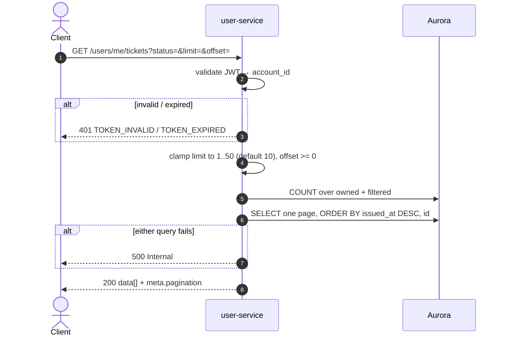

# GET /users/me/tickets — Get My Tickets

| | |
|---|---|
| **Service** | `services/user` (Lambda) |
| **Auth** | `Authorization: Bearer <access_token>` required |
| **Contract** | Apidog `GET /users/me/tickets` · api-contracts §6.1 |
| **Requirements** | FR-27 (the e-ticket this list links to) · FR-32c |
| **Status** | done |

## 1. Purpose

The "Tiket Saya" list: one page of the account's tickets, newest first, each
with the event it admits to and a link to its e-ticket (§6.2).

## 2. Flow

## 3. Steps

1. Validate the Bearer token; resolve `account_id` from its subject.
2. Normalise paging: `limit` defaults to 10 and is capped at 50; `offset`
   below zero becomes zero. An unparseable or negative value falls back rather
   than failing — see §6.
3. `FindTicketsByAccountID` runs two queries against the same filter: a
   `COUNT(*)` for `meta.pagination`, then one page.
4. Map each row to a list item and answer 200 through `WriteList`, so
   `meta.pagination` travels beside the array.

## 4. Data touched

| Store | Key / table | Op | Notes |
|---|---|---|---|
| Aurora | `tickets` | SELECT + COUNT, bound by the ownership clause | booking-service owns the writes; this service only reads |
| Aurora | `events` | LEFT JOIN | Name, date, time, venue, image. `LEFT`, so a ticket outlives a missing event row |
| Aurora | `accounts` | Subquery | Resolves the caller's `nik_hmac` for the second ownership path |

The count is a separate statement rather than a window function, so the page
query stays index-friendly; both run against the same `WHERE`.

## 5. Responses and errors

| HTTP | Code | When |
|---|---|---|
| 200 | — | A page returned. An empty page is a 200 with `data: []` |
| 401 | `TOKEN_INVALID` / `TOKEN_EXPIRED` | Missing, invalid or expired Bearer token |
| 500 | — | Aurora unreachable |

`meta.pagination` carries `totalData`, `totalPage`, `limit` and `offset`.
`totalPage` is at least 1 even for an empty list, so a client never divides by
or renders zero pages.

## 6. Edge cases and decisions

- **Two ways to own a ticket, and `saved_niks` is not one of them.** The clause
  is *you bought it* (`purchaser_account_id`) **or** *your own registered NIK
  holds it* (`tickets.nik_hmac` = the account's `nik_hmac`). Joining through
  `saved_niks` would have put a stranger's purchase into your list the moment
  you saved that NIK, and made its e-ticket readable by you. It also keeps
  FR-32d honest: removing a saved NIK changes nothing here, because this query
  never touches that table.
- **`status` filters on the EVENT DATE, not the ticket status.** A `VALID`
  ticket for a concert that already happened is in the past, which the status
  column alone cannot express. So `upcoming` is `event_date >= today AND status
  = 'VALID'`, and `past` is everything else: a past date **or** a non-`VALID`
  status. `all` and an absent value mean no filter.
- **A bad `limit` or `offset` is not a 400.** This is a read-only listing;
  answering a page is more useful than refusing one over a query string a
  client built wrong. `limit` is also capped at 50 — an implementation
  decision, not a contract one: the contract states only the default of 10, and
  an uncapped `limit` is a request for the whole table.
- **Ordering is `issued_at DESC, id`.** The id breaks ties, because two tickets
  of one booking are issued in the same transaction and share a timestamp —
  without it their relative order could change between pages and a row could be
  shown twice or skipped.
- **A missing event row does not hide the ticket.** The join is `LEFT` and
  every event column is `COALESCE`d to `''`, so a ticket whose event was
  deleted still lists, with empty event fields, rather than vanishing from its
  owner's list.
- **The full NIK is never in the response** (FR-32c): the read model carries
  `nik_masked` and does not carry the hash at all, so nothing in this path
  holds a value that could leak.

## 7. Tests

Implemented in `internal/user/application/usecase/tickets_test.go`,
`internal/user/infrastructure/http/ticket_test.go` and
`internal/user/infrastructure/postgres/ticket_test.go`.

- [x] unit: valid token → 200 with the page and `meta.pagination`
- [x] unit: empty list → 200 with `data: []` and `totalPage: 1`
- [x] unit: `limit` defaults to 10, is capped at 50, and a negative `offset`
      becomes 0
- [x] unit: an unparseable `limit` falls back instead of 400
- [x] unit: missing / invalid token → 401
- [x] unit (adapter): the ownership clause admits the purchaser and the
      registered NIK holder, and nothing else
- [x] unit (adapter): `upcoming` and `past` split on the event date
- [x] unit (adapter): `eticket_url` points at §6.2 for each row
- [ ] integration: a booking confirmed by payment-api appears here for both the
      buyer and the NIK holder

## 8. Tasks

- [x] `GetMyTickets` usecase — paging normalisation and mapping
- [x] `GetMyTickets` HTTP handler — `WriteList` with pagination
- [x] `FindTicketsByAccountID` adapter — count + page, one filter
- [x] `ToMyTicketItem` mapper
- [x] route, and the route on the unified API gateway
