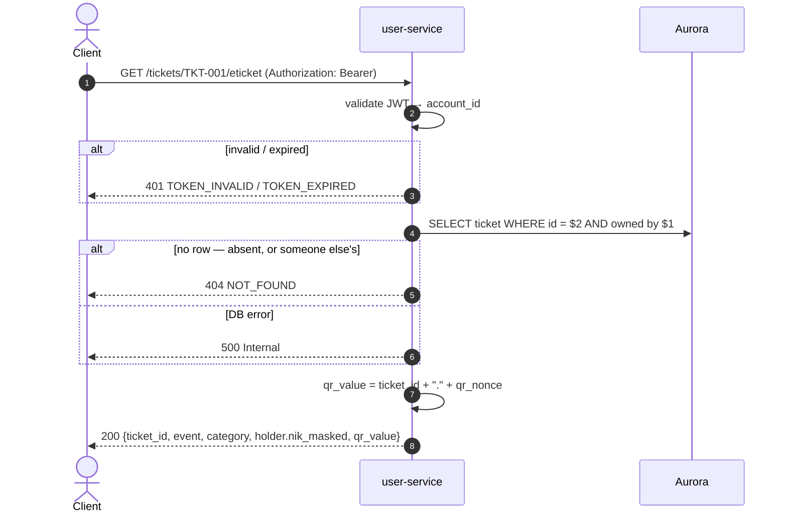

# GET /tickets/{ticket_id}/eticket — Get E-Ticket

| | |
|---|---|
| **Service** | `services/user` (Lambda) |
| **Auth** | `Authorization: Bearer <access_token>` — the `?t=` path §6.2 also requires is **not implemented**, see §6 |
| **Contract** | Apidog `GET /tickets/{ticket_id}/eticket` · api-contracts §6.2 |
| **Requirements** | FR-27 (QR code, holder's NIK) · FR-32c |
| **Status** | **partial** — the account path is done; the e-ticket-token path is not |

## 1. Purpose

One ticket, in the form shown at the venue gate: the event, the category, the
holder's masked NIK and the QR value the gate scans.

## 2. Flow

## 3. Steps

1. Validate the Bearer token; resolve `account_id`.
2. Require a non-empty `ticket_id` path value.
3. `FindTicketByID(account_id, ticket_id)` — ownership is **in the `WHERE`
   clause**, the same clause §6.1 uses, so the query cannot return a ticket the
   caller does not own.
4. Build `qr_value` from the ticket reference and its stored nonce.
5. Answer 200.

## 4. Data touched

| Store | Key / table | Op | Notes |
|---|---|---|---|
| Aurora | `tickets` | SELECT WHERE id AND owned | `qr_nonce` and `nik_masked`; the hash is not read into the model |
| Aurora | `events` | LEFT JOIN | Name, date, time, venue |
| Aurora | `accounts` | Subquery | The caller's `nik_hmac`, for the holder path |

## 5. Responses and errors

| HTTP | Code | When |
|---|---|---|
| 200 | — | The e-ticket |
| 400 | `VALIDATION_ERROR` | Empty `ticket_id` path value |
| 401 | `TOKEN_INVALID` / `TOKEN_EXPIRED` | Missing, invalid or expired Bearer token |
| 404 | `NOT_FOUND` | No such ticket — **or** it belongs to someone else |
| 500 | — | Aurora unreachable |

## 6. Edge cases and decisions

- **Someone else's ticket is 404, never 403.** A 403 confirms the id is real,
  which turns the endpoint into an oracle for enumerating ticket ids (§9 object
  ownership). Because ownership lives in the `WHERE` clause rather than in a
  check after the read, there is no code path that can tell the two apart.
- **The QR carries no identity.** `qr_value` is `{ticket_id}.{qr_nonce}`, where
  the nonce is 256 bits of `crypto/rand` chosen by booking-service and
  deliberately not derived from the ticket id or the NIK. A QR is screenshotted,
  printed and photographed in queues; the gate resolves the ticket from this
  value and matches the attendee's physical KTP against the stored hash, so it
  never needs the digits.

  **This is a deliberate departure from the §6.2 example**, which shows
  `"qr_value": "TKT-001|evt_konser_a|3171xxxxxxxxxx22"` — a full, unmasked NIK
  in a value printed on paper. That contradicts FR-32c and the masking design
  the rest of the contract is built on, so the implementation does not follow
  it. **The contract example should be corrected.**
- **`qr_code` currently repeats `qr_value`** rather than carrying the
  `data:image/png;base64,…` the contract shows. Rendering the PNG is a
  presentation concern that nothing in the API needs to own, and a client can
  draw a QR from the value; but the field as specified is not what ships.
  Either the contract drops `qr_code` or the service starts rendering one.
- **The holder is masked only.** `ETicketHolder` has exactly one field,
  `nik_masked`, so there is no shape in which this response could carry a name
  — and the account stores none anyway (FR-15a).

## 7. Known gap — the `?t=` e-ticket token

Contract §6.2 states plainly that there are **two ways in and both must
exist**: the account session, and `?t={eticket_token}` for everyone who
receives a forwarded e-ticket link. **Only the first is implemented.**

Today `GetETicket` resolves the caller through `requireAuth` and nothing else.
`services/user` neither imports `pkg/eticket` nor loads `ETICKET_SIGNING_KEY`,
so a `?t=` on the URL is ignored and the request is judged on its `Authorization`
header alone.

What that costs, in the contract's own words: since ADR-006 §8.15 every
e-ticket of a booking goes to the **buyer's** `contact_email`, and the buyer
forwards each link on to the second and third NIK holders — who are usually not
account holders at all. For them, and for a guest buyer whose queue credential
§3.3 has already deleted, the "Buka e-tiket" button in the email answers
**401**. The primary delivery path of FR-26 does not work for the people FR-26
was written for.

The machinery exists and is already used elsewhere: `pkg/eticket` has
`Signer.Mint`, `Signer.Verify` and `ExpiresAt(eventDate)`, and booking-service
resolves `ETICKET_SIGNING_KEY` from the same secret notification signs links
with. Closing the gap is wiring, not design:

- [ ] load `ETICKET_SIGNING_KEY` in `services/user/internal/config` (required
      outside local, as booking does)
- [ ] build an `eticket.Signer` in `internal/delivery` and hand it to the
      controller
- [ ] in `GetETicket`: when `?t=` is present, verify it against the path's
      `ticket_id` and resolve the ticket **without** an account; when it is
      absent, keep today's Bearer path
- [ ] read the ticket by id alone on the token path — the token's scope **is**
      the authorisation, and it covers exactly one ticket
- [ ] 401 `TOKEN_INVALID` for a bad or expired token, and 404 for a good token
      naming a ticket that does not exist
- [ ] env and both templates (`template.yaml`, `template-cfn.yaml`)

## 8. Tests

Implemented in `internal/user/application/usecase/tickets_test.go`,
`internal/user/infrastructure/http/ticket_test.go` and
`internal/user/infrastructure/postgres/ticket_test.go`.

- [x] unit: owner → 200 with the event, category, masked holder and QR value
- [x] unit: another account's ticket → 404, and the body says nothing more
- [x] unit: unknown ticket → 404, identical to the above
- [x] unit: empty `ticket_id` → 400
- [x] unit: missing / invalid token → 401
- [x] unit: `qr_value` is `{ticket_id}.{qr_nonce}` and contains neither the NIK
      nor the hash
- [x] unit (adapter): the ownership clause admits purchaser and NIK holder
- [ ] unit: a valid `?t=` opens the ticket with no session — **blocked on §7**
- [ ] unit: a `?t=` for another ticket does not open this one — **blocked on §7**
- [ ] integration: follow the link from a delivered e-ticket email

## 9. Tasks

- [x] `GetETicket` usecase — ownership in the query, 404 not 403
- [x] `GetETicket` HTTP handler and route
- [x] `FindTicketByID` adapter
- [x] `ToETicketResponse` mapper
- [x] route on the unified API gateway
- [ ] the `?t=` path (§7)
- [ ] decide `qr_code`: render a PNG, or drop the field from the contract (§6)
- [ ] correct the §6.2 `qr_value` example, which shows an unmasked NIK (§6)
