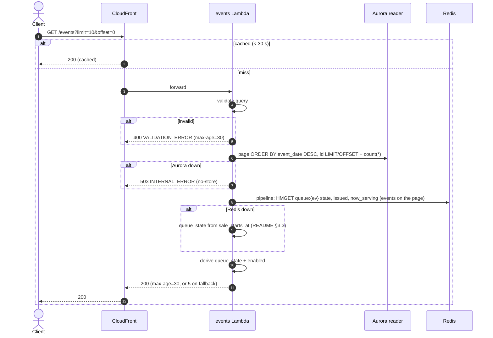

# GET /events — List Events

| | |
|---|---|
| **Service** | `services/events` (Lambda, CloudFront 30 s) |
| **Auth** | none (public) |
| **Contract** | Apidog `GET /events` · api-contracts §2.1 |
| **Requirements** | FR-01, FR-02, FR-03, FR-03a–e |
| **Status** | built |

## 1. Purpose

The home page "Daftar Event": every event, newest event date first, each with its `queue_state` and whether the
button can be pressed. Shared rules: [README §3](README.md#3-shared-rules-one-pure-package-domain).

## 2. Flow



## 3. Steps

1. **Validate** `limit` integer 1–50 (default 10) and `offset` integer ≥ 0 (default 0). Anything else → 400
   `VALIDATION_ERROR`. There is no `filter`: a `filter` parameter from an older client is ignored.
2. **Read Aurora** in one batch: the page (`ORDER BY event_date DESC, id LIMIT $limit OFFSET $offset`) and
   `count(*)` for `totalData`. Past events are included (they show `CLOSED`).
3. **Read Redis** in one pipeline: `HMGET queue:{ev} state issued now_serving` for the events on this page only
   (at most 50). No stock reads.
4. **Derive** `queue_state` (README §3.1) and `display.enabled` (§3.2).
5. **Answer** with `meta.pagination` (`totalPage = ceil(totalData / limit)`) and `Cache-Control` (README §3.3).
   An offset past the end → `data: []`, still 200.

The frontend shows every event and styles each card from `queue_state` / `display.enabled`.

## 4. Data touched

| Store | Key / table | Op | Notes |
|---|---|---|---|
| Aurora reader | `events` | SELECT | index `events_listing_idx (event_date DESC, id)` |
| Redis | `queue:{ev}` | HMGET `state`, `issued`, `now_serving` | read only |

## 5. Response

```json
{
  "meta": { "code": 200, "message": "Success", "pagination": { "totalData": 1, "totalPage": 1, "limit": 10, "offset": 0 },
            "server_time": "2026-11-03T09:12:00.412Z" },
  "data": [
    { "id": "evt_konser_a", "name": "Konser A", "category": "LIVE MUSIC",
      "location": { "venue": "GBK", "city": "Jakarta" }, "date": "2026-12-25",
      "image_url": "https://cdn.rusuh.id/events/konser-a.jpg",
      "queue_state": "FULL_QUEUE", "sale_starts_at": "2026-11-10T02:00:00Z",
      "display": { "enabled": false } }
  ]
}
```

| HTTP | Code | When |
|---|---|---|
| 200 | — | list (possibly empty) |
| 400 | `VALIDATION_ERROR` | bad `limit` / `offset` |
| 503 | `INTERNAL_ERROR` | Aurora unreachable |

## 6. Edge cases

- **Event in Aurora, not yet seeded in Redis** → `SCHEDULED`.
- **`sale_starts_at` NULL** → listed, `SCHEDULED`, `sale_starts_at: null`.
- **Same event date** → ordered by `id`, so pages never overlap.
- **`queue_state` is up to 30 s old** (CDN); join's atomic check is the gate.

## 7. Tests

- [x] unit (domain): `DeriveQueueState` every branch (missing, SCHEDULED, unknown, CLOSED, FULL_BOOKED,
      depth == capacity, depth < capacity, CLOSED with a full queue → `CLOSED`); `Enabled` true only for `OPEN` and `FULL_BOOKED`
- [x] unit (usecase, fakes): sort order newest first, past event included; Aurora asked for the requested page only;
      total kept; offset past end → empty page; Redis error → state from `sale_starts_at` + metric + max-age 5; Aurora error → 503
- [x] unit (http): query validation table → 400; `Cache-Control` per case; JSON matches Apidog field order
- [x] integration (`pkg/pgtest` + `REDIS_ADDR`): seeded events + `queue:{ev}` hashes → expected states and order

## 8. Tasks

- [x] Repository `ListEvents(ctx, max)`
- [x] Redis `QueueStates(ctx, eventIDs)` pipeline
- [x] Use case `ListEvents` + handler + route
- [x] Tests above
