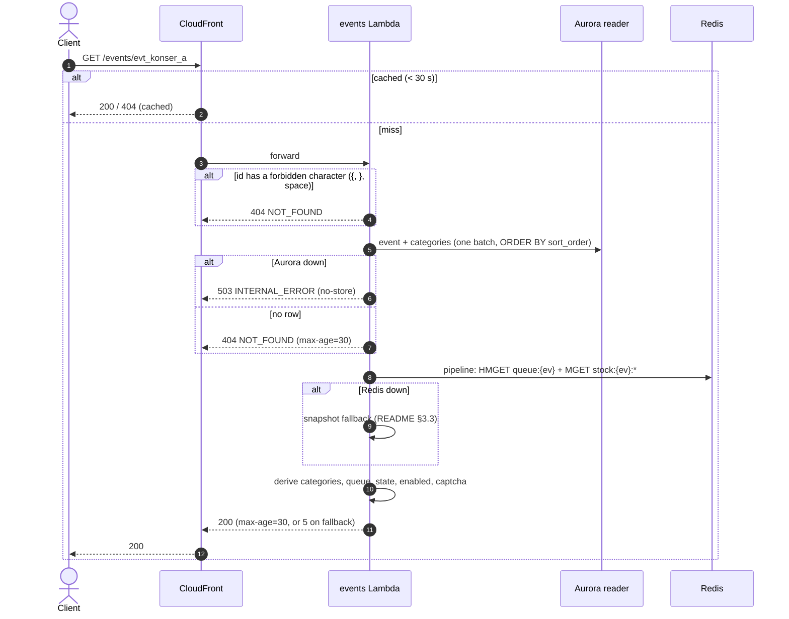

# GET /events/{event_id} — Get Event Detail

| | |
|---|---|
| **Service** | `services/events` (Lambda, CloudFront 30 s) |
| **Auth** | none (public) |
| **Contract** | Apidog `GET /events/{event_id}` · api-contracts §2.2 |
| **Requirements** | FR-11, FR-12, FR-03a–e |
| **Status** | built |

## 1. Purpose

The event page before the queue: event info, each category with price and seats left, the same `queue_state` and
`display.enabled` as the home card, and the CAPTCHA site key so the client can fetch a Turnstile token **before** the
sale opens and refresh it every ~60 s (contract §2.2 note). Shared rules:
[README §3](README.md#3-shared-rules-one-pure-package-domain).

Not the ticket selection page: that is `GET /events/{event_id}/tickets` (05-booking/01), behind a grant.

## 2. Flow



## 3. Steps

1. **Check the id** with `rediskeys.NewEvent` (it goes into Redis keys). Invalid → 404 `NOT_FOUND`, no I/O.
2. **Read Aurora** in one batch: the event row; its categories `ORDER BY sort_order, id`. No row → 404.
   Past events are returned too (a shared link keeps working; they show `CLOSED`).
3. **Read Redis** in one pipeline: `HMGET queue:{ev} state issued now_serving` and `MGET` of the category stock keys.
   A missing stock key falls back to the snapshot for that category only.
4. **Derive**: category `available = max(0, stock)` and `status`; `queue_state`; `display.enabled`;
   `captcha = {provider: "turnstile", site_key: TURNSTILE_SITE_KEY}`.
5. **Answer** 200 with `Cache-Control` (README §3.3).

## 4. Data touched

| Store | Key / table | Op | Notes |
|---|---|---|---|
| Aurora reader | `events` | SELECT by PK | |
| Aurora reader | `ticket_categories` | SELECT by `event_id` | index `ticket_categories_event_idx (event_id, sort_order)` |
| Redis | `queue:{ev}` | HMGET `state`, `issued`, `now_serving` | |
| Redis | `stock:{ev}:<cat>` | MGET | |

## 5. Response

```json
{
  "meta": { "code": 200, "message": "Success", "server_time": "2026-11-03T09:12:00.412Z" },
  "data": {
    "id": "evt_konser_a", "name": "Konser A", "category": "LIVE MUSIC",
    "location": { "venue": "GBK", "city": "Jakarta" }, "date": "2026-12-25", "time": "19:00",
    "image_url": "https://cdn.rusuh.id/events/konser-a.jpg", "description": "Energi panggung.",
    "queue_state": "OPEN", "sale_starts_at": "2026-11-10T02:00:00Z",
    "display": { "enabled": true },
    "ticket_categories": [
      { "id": "cat_vip", "name": "VIP", "description": "Lebih dekat.", "price": 1500000, "available": 12, "status": "AVAILABLE" },
      { "id": "cat_tribune", "name": "Tribune", "description": "Area tribun.", "price": 500000, "available": 0, "status": "SOLD_OUT" }
    ],
    "captcha": { "provider": "turnstile", "site_key": "0x4AAAAAAA..." }
  }
}
```

| HTTP | Code | When |
|---|---|---|
| 200 | — | event found |
| 404 | `NOT_FOUND` | no such event, or an id that cannot be a Redis key |
| 503 | `INTERNAL_ERROR` | Aurora unreachable |

## 6. Edge cases

- **`max_per_order` is not in this response**; the ticket page (behind the grant) owns it.
- **Empty `TURNSTILE_SITE_KEY`** → config validation fails at start (join would reject every token).
- **Category without a stock key** while the sale is open → snapshot value; the ticket page answers 503
  `STOCK_UNINITIALIZED` for the same case, which is the stricter check where seats are chosen.

## 7. Tests

- [x] unit (usecase, fakes): found → categories in `sort_order`, category statuses, `queue_state`, `enabled`;
      not found → 404; bad id → 404 without any repository call; Redis error → snapshot + max-age 5; Aurora error → 503
- [x] unit (http): JSON matches Apidog field order; `Cache-Control` on 200 / 404 / 503
- [x] integration (`pkg/pgtest` + `REDIS_ADDR`): seeded event with three categories (one at stock 0); state `CLOSED`
      → `CLOSED`, `FULL_BOOKED` → `FULL_BOOKED`, depth at capacity → `FULL_QUEUE`

## 8. Tasks

- [x] Repository `GetEvent(ctx, id)` (event + categories batch)
- [x] Use case `GetEvent` + handler + route
- [x] Tests above
