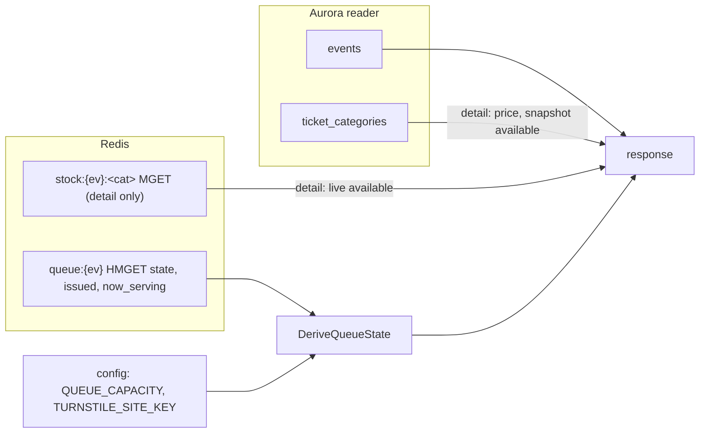
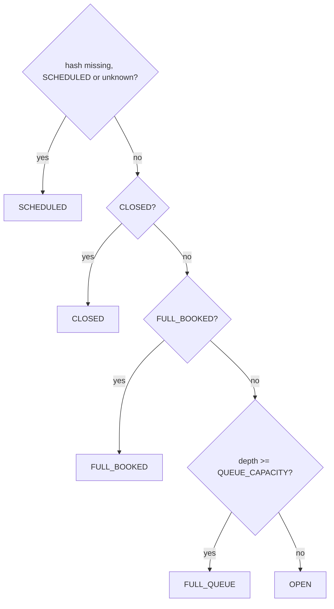

# 03 — Events

Plans for the Apidog **Events** folder: the home page list and the event detail page. Both are public, read-only and
cached by the CDN for 30 seconds, so one response serves everyone who opens the page in that window.

| # | Endpoint | Plan | Status |
|---|---|---|---|
| 01 | `GET /events` | [01-list-events.md](01-list-events.md) | planning |
| 02 | `GET /events/{event_id}` | [02-get-event-detail.md](02-get-event-detail.md) | planning |

**Service:** `services/events` (new), Lambda + API Gateway, CloudFront in front (ADR-005 §5 "FR-01", impl-plan §6).
Reads only: Aurora **reader** endpoint + Redis. It writes nothing.

## 1. In simple terms

Each event card tells the customer one thing: **where the sale is right now**, as `queue_state`. The server also sends
`display.enabled`, so the frontend never decides whether the button can be pressed; it only picks the text for the
state from its translation table.

| `queue_state` | Meaning | Button (`display.enabled`) |
|---|---|---|
| `SCHEDULED` | sale not open yet (`sale_starts_at` ahead) | false |
| `OPEN` | open, the customer can join the queue | true |
| `FULL_QUEUE` | the queue has reached its maximum length | false |
| `FULL_BOOKED` | every seat is held by someone; the customer can still join and waits for seats that come back when holds expire | true |
| `CLOSED` | sold out, final | false |

Example: at the peak "Konser A" has 300,000 people in line → `FULL_QUEUE`, button off. Ten minutes later the line
is shorter but every seat is held → `FULL_BOOKED`. When the last payment is done and the sale closes → `CLOSED`.

## 2. Where each field comes from



| Field | Source | Rule |
|---|---|---|
| `id`, `name`, `category`, `location.{venue,city}`, `date`, `time`, `image_url`, `description`, `sale_starts_at` | `events` | `date` = `event_date` (`YYYY-MM-DD`), `time` = `event_time` (`HH:MM`, detail only); `sale_starts_at` null until scheduled |
| `queue_state` | `queue:{ev}` + config `QUEUE_CAPACITY` | rule 3.1 |
| `display.enabled` | `queue_state` | rule 3.2 |
| category `available` (detail) | `stock:{ev}:<cat>` | `max(0, value)`; key missing or Redis down → `ticket_categories.available` (snapshot) |
| category `status` (detail) | category `available` | `AVAILABLE` when > 0, else `SOLD_OUT` |
| `captcha` (detail) | config `TURNSTILE_SITE_KEY`, provider `turnstile` | |

`QUEUE_CAPACITY` is read from config (the same value the queue service enforces), not stored per event.

## 3. Shared rules (one pure package, `domain`)

### 3.1 `DeriveQueueState(internal, depth, capacity)`

`internal` is `queue:{ev}.state` ∈ `SCHEDULED | OPEN | FULL_BOOKED | CLOSED` (ADR-006 §8.10, §8.12);
`depth = max(0, issued − now_serving)`. The checks run in the same order as join's gates (api-contracts §3.1), so the
card and join agree:



- `CLOSED` always gives `CLOSED`, even if a returned seat makes Redis show stock: join answers 410 `SALE_CLOSED`, so
  the sale is over for the customer.
- An unknown state string counts in a metric and shows `SCHEDULED` (join answers 503 `QUEUE_NOT_READY` for it).

### 3.2 `display.enabled`

`enabled = queue_state ∈ {OPEN, FULL_BOOKED}`. The button always calls `POST /events/{event_id}/queue/join`, which
accepts new customers in both states (04-queue/01 step 7).

### 3.3 Caching and failure

| Case | HTTP | `Cache-Control` |
|---|---|---|
| success, Redis read OK | 200 | `public, max-age=30` (`EVENTS_CACHE_MAX_AGE_SECONDS`) |
| success, Redis down (fallback) | 200 | `public, max-age=5` + metric `EventsRedisFallback` |
| 404 `NOT_FOUND` (detail) | 404 | `public, max-age=30` (bots hammering an unknown id hit the CDN, not Lambda) |
| 400 `VALIDATION_ERROR` (list) | 400 | `public, max-age=30` |
| Aurora down | 503 `INTERNAL_ERROR` | `no-store` |

Redis-down fallback: `queue_state` from `sale_starts_at` only (`SCHEDULED` before it or when null, `OPEN` after);
category `available` from `ticket_categories.available`. The page stays up; join's atomic check is the real gate.
Never answer 500 for a Redis hiccup on the home page.

### 3.4 `meta.server_time` on a cached response

Every response carries `meta.server_time` (BR-10: the client corrects its clock with it, for countdowns). A CDN copy
is up to 30 s old, so this value is up to 30 s old too. **These two endpoints must not be used for clock sync**; the
waiting room syncs from the SSE `serverTime`. The home page shows `sale_starts_at` as an absolute time
("Buka 10 Nov 09:00"), not a countdown, so it needs no exact clock.

## 4. Database

`events` (migration 0002) has only what the ticket list needs. Migration **0011_event_catalog** (built) adds the
catalog columns; the HELD-sweep index of 05-booking/02 moves to 0012:

```sql
ALTER TABLE events
    ADD COLUMN IF NOT EXISTS category       TEXT        NOT NULL DEFAULT '',
    ADD COLUMN IF NOT EXISTS description    TEXT        NOT NULL DEFAULT '',
    ADD COLUMN IF NOT EXISTS location_city  TEXT        NOT NULL DEFAULT '',
    ADD COLUMN IF NOT EXISTS sale_starts_at TIMESTAMPTZ,          -- NULL = not scheduled yet
    ADD COLUMN IF NOT EXISTS updated_at     TIMESTAMPTZ NOT NULL DEFAULT now();
CREATE INDEX IF NOT EXISTS events_listing_idx ON events (event_date DESC, id);
```

The sale state is not stored in Aurora; it lives in `queue:{ev}` (ADR-006 §8.12). `ticket_categories` (0008) already
has `price`, `capacity`, `available` (snapshot) and `sort_order`.

Who writes these rows: nobody through the API. Local/dev uses a seed SQL file; sale-ops (not built) seeds Aurora and
then `queue:{ev}` + `stock:` keys.

## 5. Service layout (same hexagonal shape as `services/booking`)

```
services/events/
  cmd/lambda/main.go, cmd/server/main.go
  internal/config/
  internal/delivery/
  internal/event/
    domain/            entity, DeriveQueueState, Enabled, ScheduleState
    application/usecase/list_events.go, get_event.go
    port/outbound/     EventRepository (Aurora), LiveState (Redis)
    infrastructure/postgres, infrastructure/redis, infrastructure/http
  template.yaml, Makefile, example.env
```

Config: `DATABASE_READER_URL` (Aurora reader; falls back to `DATABASE_URL` locally), `REDIS_ADDR`, `QUEUE_CAPACITY` (300000),
`EVENTS_CACHE_MAX_AGE_SECONDS` (30), `EVENTS_DEGRADED_MAX_AGE_SECONDS` (5), `TURNSTILE_SITE_KEY`
(required outside local).

Redis reads per request: one pipeline of `HMGET queue:{ev}` (one per event) and, on the detail page, one `MGET` of the
stock keys (same `{ev}` slot). Keys come from `pkg/rediskeys` only.

## 6. Decisions

- **No `filter` on the list.** Paging runs in SQL (limit, offset, count) and Redis is read only for the events on the
  page. The frontend shows every event and styles each card from `queue_state`.
- **`FULL_BOOKED` lets new customers join.** They wait in line for seats that come back. This needs a join change
  (04-queue/01 step 7) and an ADR-006 row; the events service only reports the state.
- **Category `status`** on the detail page stays (`AVAILABLE` / `SOLD_OUT`, from `available`).
- **`display` keeps one field, `enabled`** (FR-03e: the server decides the button).

## 7. Contract and requirement changes (documentations, ask before commit)

- Apidog + api-contracts §2.1/§2.2: remove `status`, `queue_depth`, `queue_capacity`, `min_price`, `max_price`,
  `display.action`, `display.label_key`, `display.badge_key`; `queue_state` enum `SCHEDULED | OPEN | FULL_QUEUE |
  FULL_BOOKED | CLOSED`; `sale_starts_at` nullable; list sorted newest event date first,
  past events included; 400 `VALIDATION_ERROR` (list); 503 `INTERNAL_ERROR` (both); the `server_time` note (§3.4).
- api-contracts §3.1 (join): no 409 `FULL_BOOKED` for new joiners; `data.queue_state` uses the same enum
  (`SALE_NOT_OPEN` → `SCHEDULED`, `QUEUE_FULL` → `FULL_QUEUE`).
- requirements FR-03a–e (no `status` field, `queue_state` enum above, `display` = `enabled` only).
- ADR-006: new row "`FULL_BOOKED` menerima pendatang baru" (replaces the 2026-11-06 decision in 04-queue/01).

## 8. Tasks (whole module)

- [ ] Contract, Apidog, requirement and ADR updates (§7)
- [x] Join change: accept new customers in `FULL_BOOKED`, new `queue_state` values in join's error data (04-queue/01)
- [x] Migration `0011_event_catalog` (+ down)
- [ ] Seed SQL for local
- [x] `services/events` (config, Lambda + local server, health), in `go.work`
- [x] `template.yaml`, `template-cfn.yaml`, `cicd.yml` (path filter, `deploy-events`, preflight, smoke) and the unified gateway routes
- [ ] CloudFront in front of the two routes (infra, not in this repo)
- [ ] A reader-endpoint secret for `DATABASE_READER_URL` (the Lambda uses the writer secret until then)
- [x] `domain`: `DeriveQueueState`, `Enabled`, `ScheduleState` + truth-table tests
- [x] 01 `GET /events` ([plan](01-list-events.md))
- [x] 02 `GET /events/{event_id}` ([plan](02-get-event-detail.md))
- [ ] `docs/README.md` layout row → in progress / built
