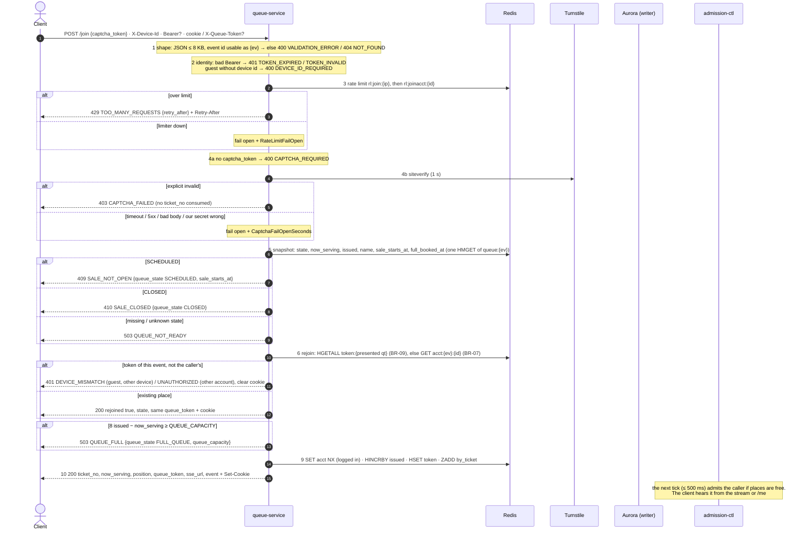

# POST /events/{event_id}/queue/join — Join Queue

| | |
|---|---|
| **Service** | `services/queue` (Lambda + API Gateway, provisioned concurrency from T-30 min) |
| **Auth** | none required · optional `Authorization: Bearer` (enables BR-07) · `X-Device-Id` required for guests |
| **Contract** | Apidog `POST /events/{event_id}/queue/join` · api-contracts §3.1 |
| **Requirements** | FR-04, FR-05 (met by about one tick in the queue, §6), FR-10a, FR-10d..f, BR-07, BR-09, BR-16, NFR-05, NFR-13 |
| **Detail** | impl-plan §7.2 (stale order, see §3) · ADR-005 §5, §6 · **ADR-006 §4** (S2), **§8.14** (no straight-in) |
| **Specs** | `services/queue/features/join_*.feature`, `captcha_turnstile.feature` (90 scenarios) |
| **Status** | **built (step 4, branch `feature/step-4-join-queue`); straight-in (FR-05 v1/v2) removed by ADR-006 §8.14 (2026-11-09): code, tests and docs done, `make verify` green, waiting for review and commit approval** |

## 1. Purpose

Gives the caller a `ticket_no` (their FCFS place) and a `queue_token`, **in the body and in an HttpOnly
cookie**. **Join never grants and never waits for a grant**: admission-ctl is the only writer (S2) and the
customer learns about the turn from the stream and `GET /queue/me`. There is **no straight-in**: even when
places are free, the customer goes through the waiting room, which admission-ctl empties on its next tick
(≤ 500 ms). The hot path is **Redis only**. Aurora is read once, on a rejoin after the customer's turn came.

Called when the customer presses the event button: "Masuk Antrian" (`queue_state: OPEN`) **and** "Beli
Tiket" (`DIRECT`, places free). Both start with join. Coming back (refresh, bank app) is `GET /queue/me`,
not join.

## 2. Flow

## 3. Steps

Approved order (2026-11-06; `services/queue/features/join_gates.feature`). Every rejection happens before
`INCR`, so a rejected call never burns a ticket number. Rate limit comes before CAPTCHA, so rejected
attempts never cost an external call (ADR-005 §6). impl-plan §7.2 still shows capacity before BR-07; this
order wins.

1. **Request shape**: JSON body ≤ 8 KB with a string `captcha_token` (else 400 `VALIDATION_ERROR`); event id
   without `{`, `}` or whitespace (else 404 `NOT_FOUND`)
2. **Identity**: a Bearer must verify (expired → 401 `TOKEN_EXPIRED`, anything else → 401 `TOKEN_INVALID`,
   never a silent guest). Device id: required for guests, optional when logged in, any non-empty value
   (no format check since contract v2.9)
3. **Rate limit**: IP (20 / 5 min), then account (3 / min). Limiter outage fails open (`RateLimitFailOpen`)
4. **CAPTCHA**: missing → 400 `CAPTCHA_REQUIRED`; explicit invalid → 403 `CAPTCHA_FAILED`; provider trouble
   fails open (`CaptchaFailOpenSeconds`)
5. **Sale state**: `SCHEDULED` → 409 `SALE_NOT_OPEN`, `CLOSED` → 410 `SALE_CLOSED`, missing or unknown → 503
   `QUEUE_NOT_READY`
6. **Rejoin, before fully-booked and capacity**, so a customer who already has a place is never refused:
   - BR-09: the presented `queue_token` (`X-Queue-Token`, else cookie) of this event, **owned by the caller**:
     a guest token needs a guest on the same device (`device_hash`), a logged-in token the same account. Not the
     caller's → 401 `DEVICE_MISMATCH` / `UNAUTHORIZED` and the cookie is cleared. A logged-in caller never takes
     over a guest place: it gets its own (BR-07 cannot be bypassed)
   - BR-07: `acct:{ev}:{account_id}` → token. A pointer whose token does not appear within 300 ms is stale and
     is replaced on issue (compare-and-set), not deleted
   - Still waiting (`ticket_no > now_serving`): a place missing from `by_ticket` (a join that died between
     `HSET` and `ZADD`) is put back with `ZADD NX` under `WATCH queue:{ev}`, only while still ahead of
     `now_serving` (`JoinRepaired`). A served ticket is never re-added
   - Turn has come: `state` is the booking row's status; no row yet = pending grant (`QUEUED`). A failed
     lookup is 503, never a guess
7. **Fully booked**: no gate. In `FULL_BOOKED` a new customer joins like in `OPEN` and waits for seats that come
   back when holds expire (the home page shows the button enabled, 03-events §3.2)
8. **Capacity**: `issued − now_serving ≥ QUEUE_CAPACITY` → 503 `QUEUE_FULL` (fail fast, no buffering)
9. **Issue**: `SET acct NX` (logged in; a lost race waits up to 2 s for the winner's token and returns that
   place) → `HINCRBY issued` → `HSET token` (+ TTL) → `ZADD by_ticket`. Token before `by_ticket`, so
   admission-ctl never sees a member without its hash. A failure releases `acct` and answers 503
10. **Respond**: `queue_token` in the body and `Set-Cookie: queue_token=…; Domain=my-rusuh.my.id; Path=/events/{event_id};
    Max-Age={SALE_WINDOW_SECONDS}; HttpOnly; Secure; SameSite=Strict`. **Mobile** keeps the body token in
    secure storage and sends `X-Queue-Token`. **Web** ignores it and relies on the cookie (the stream's
    `EventSource` cannot send headers; never put it in `localStorage`)

## 4. Data touched

Full catalog: [`../redis-keys.md`](../redis-keys.md).

| Store | Key / table | Op | Notes |
|---|---|---|---|
| Redis | `rl:join:{ip}`, `rl:joinacct:{id}` | token bucket (`pkg/ratelimit` Lua) | 20 / 5 min, 3 / min |
| Redis | `queue:{ev}` (`state`, `now_serving`, `issued`, `full_booked_at`, `name`, `sale_starts_at`) | one `HMGET` (ADR-006 §8.12) | `name` and `sale_starts_at` are seeded by sale-ops |
| Redis | `token:{queue_token}` | HGETALL (rejoin), HSET + EXPIRE | `qt_` + ULID. Fields `ticket_no`, `event_id`, `joined_at`, `account_id` (logged in), `device_hash` (`HMAC(DEVICE_PEPPER, device id)`, whenever a device id is sent). TTL `SALE_WINDOW_SECONDS`. admission-ctl adds `grant_token`, `booking_id`, `booking_expires_at` when it grants (read by `/me`, not by join) |
| Redis | `acct:{ev}:{account_id}` | GET, SET NX EX, WATCH/MULTI replace | logged-in only |
| Redis | `queue:{ev}:by_ticket` | ZADD on issue; ZADD NX under WATCH on repair | score = `ticket_no` |
| Aurora | `bookings` (migration `0006`: `grant_token`, `UNIQUE (event_id, queue_token)`) | SELECT on the writer | one read on a rejoin after the turn |

Join never runs the admission Lua, never publishes and never writes to Aurora.

## 5. Responses and errors

| HTTP | Code | When |
|---|---|---|
| 200 | — | **queued**: `ticket_no`, `now_serving`, `position`, `queue_token`, `sse_url`, `event {id, name}` · **rejoined** (BR-09 or BR-07): same place fields + `rejoined: true`, `state` (§3.3 values; not `QUEUED` → route by state) · no `granted` answer any more (ADR-006 §8.14). No wait estimate ([README §8](README.md#8-wait-time-estimate-fr-09)) |
| 400 | `VALIDATION_ERROR` | bad body or device id format |
| 400 | `DEVICE_ID_REQUIRED` · `CAPTCHA_REQUIRED` | guest without `X-Device-Id` · no `captcha_token` |
| 401 | `TOKEN_EXPIRED` · `TOKEN_INVALID` | bad Bearer (also `Bearer ` with nothing after it) |
| 401 | `DEVICE_MISMATCH` | guest `queue_token` presented from another device (or with no `device_hash`); clears the cookie |
| 401 | `UNAUTHORIZED` | logged-in `queue_token` presented by another account or by a guest; clears the cookie |
| 403 | `CAPTCHA_FAILED` | explicit CAPTCHA rejection |
| 404 | `NOT_FOUND` | event id that cannot be a Redis hash tag |
| 409 | `SALE_NOT_OPEN` | state `SCHEDULED`; data `{queue_state: SCHEDULED, sale_starts_at}` |
| 410 | `SALE_CLOSED` | state `CLOSED`; data `{queue_state: CLOSED}` |
| 429 | `TOO_MANY_REQUESTS` | rate limit; data `{retry_after}` (seconds) and a `Retry-After` header |
| 503 | `QUEUE_FULL` | data `{queue_state: FULL_QUEUE, queue_capacity}` |
| 503 | `QUEUE_NOT_READY` | event never seeded or unknown state (new code) |
| 503 | `INTERNAL_ERROR` | Redis down or a failed write; fail closed, retry later (new code: any 5xx without its own code) |

`sse_url` is `SSE_BASE_URL` + `/events/{event_id}/queue/stream` (absolute in AWS: the stream is on
`events.my-rusuh.my.id`, join on `api.my-rusuh.my.id`).

## 6. Edge cases and decisions

- **DECIDED (S2): join never grants.** ADR-005's bypass ran `advance_now_serving.lua` and the INSERT inside
  the Lambda, a second writer. Now the Lambda only reads, and since §8.14 it does not even wait.
- **DECIDED (2026-11-09, ADR-006 §8.14): no straight-in.** Removes FR-05 v1 ("only `ticket_no == now_serving + 1`
  waits") and FR-05 v2 ("everyone who fits waits", §8.11). Join answers at once; the customer is admitted by the
  next tick (≤ 500 ms) and hears it from the stream or `/me`. FR-05 ("no queue → straight to Detail Ticket") is
  met by the app: with free places the waiting room lasts about one tick. **Why:** the wait held a Lambda up to
  1 s per joiner (up to `JOIN_DIRECT_MAX` = 500 at T0), needed `free_slots` in the Lua, three config values and a
  response branch the client had to special-case, to save one tick of waiting room.
  - **Removed:** `granted: true` answer; the wait and "fits" rule in `Join`; `free_slots` / `free_slots_at` in the
    snapshot and the advance Lua (admission-ctl still ticks `SCHEDULED` events, which now write nothing); `JOIN_GRANT_WAIT_MS`, `JOIN_DIRECT_MAX`, `JOIN_FREE_SLOTS_MAX_AGE_SECONDS`.
  - **Kept:** admission-ctl still copies `grant_token`, `booking_id`, `booking_expires_at` into `token:{qt}` (only
    if it exists); `/me` reads that copy to skip Aurora ([03](03-get-queue-state.md)).
  - **Client:** route on `rejoined` / `state` only. "Beli Tiket" (`DIRECT`) still calls join, then opens the stream;
    the first message usually arrives within one tick, so the app can show a short "Memproses…" instead of the
    waiting-room screen (frontend choice, not a contract change).
- **DECIDED (2026-11-07): a presented token rejoins only for its owner.** Guest token: `X-Device-Id` must hash to
  `device_hash` (no rebind; a guest who clears site data starts again). Logged-in token: the Bearer account must be its
  `account_id`, from any device. Otherwise 401 and the cookie is cleared, so the next join is fresh. A logged-in caller
  with a guest token gets its own place. Unknown or other-event tokens are ignored (`join_token_binding.feature`).
- **DECIDED (2026-11-06): token in body and cookie**, cookie `Domain=my-rusuh.my.id` (`COOKIE_DOMAIN`).
- **`FULL_BOOKED` accepts new joiners** (2026-11-11). Everyone in line, old or new, waits for seats that come back;
  the queue capacity still caps the line. `queue_state` values in error data use the home page enum
  (`SCHEDULED`, `OPEN`, `FULL_QUEUE`, `FULL_BOOKED`, `CLOSED`).
- **OPEN: frozen `.feature` files** `join_gates.feature`, `join_rejoin.feature`, `join_token_binding.feature` assert
  the old 409 `FULL_BOOKED`. Proposed: edit those scenarios (Erma's approval needed, the files are frozen).
- **Capacity overshoot accepted:** the gate reads then INCRs (not atomic), so up to (parallel joins − 1) extra
  numbers can pass `QUEUE_CAPACITY` under a race. The cap is a safety net; the home page shows `FULL_QUEUE` first.
- **Crash between `INCR` and `HSET`:** a harmless gap (admission-ctl only grants `by_ticket` members).
  **Between `HSET` and `ZADD`:** repaired by the next rejoin (step 6).
- A **guest** whose join response failed will retry and get a new token. The orphaned first token can still
  be granted and then LAPSES unclaimed, holding one slot for the booking TTL. Accepted.
- **DECIDED (2026-11-05): Cloudflare Turnstile**, invisible, behind the `Captcha` port. `siteverify` with a
  1 s deadline. Timeout, 5xx, 429, a non-JSON body, `internal-error`, and `missing-/invalid-input-secret`
  (our misconfiguration, plus `CaptchaMisconfigured`) all fail open. Only an explicit rejection of the token
  is 403. Tests and k6 use the mock adapter (`CAPTCHA_PROVIDER=mock`, refused in production).
- **Still open (ADR §17 #8, T-7 days):** confirm Turnstile can absorb about 300k `siteverify` calls in about
  60 s for our plan. The client must refresh a token close to expiring.
- **DEFERRED: qpersist** (ADR-006 §9); the POC relies on Redis Multi-AZ.

## 7. Tests

All in `services/queue/features/` (godog, strict) plus Go unit tests under `internal/`.

- [x] unit: gate order (shape → identity → rate limit → CAPTCHA → state → rejoin → capacity), each branch returns the right code and later gates are not called
- [x] unit: guest without device id → 400. Logged-in without device id → OK
- [x] integration: rejoin by account (another device) and by token (cookie / header) → same place, `rejoined: true`
- [x] integration: token ownership: guest token from another device → 401 `DEVICE_MISMATCH`; logged-in token of another account or a guest → 401 `UNAUTHORIZED`; cookie cleared (`join_token_binding.feature`)
- [x] integration: capacity reached → `QUEUE_FULL`, `issued` not incremented; a rejoiner is not refused
- [ ] unit: error data says `SCHEDULED` (`SALE_NOT_OPEN`) and `FULL_QUEUE` (`QUEUE_FULL`)
- [ ] integration: `FULL_BOOKED` → a new joiner gets a place (200 queued), a rejoiner keeps theirs
- [x] unit: places free + a controller that grants at once → join still answers queued within 100 ms (`TestJoin_withFreePlacesStillAnswersQueuedAtOnce`)
- [ ] e2e after step 3: real admission-ctl admits the joiner on the next tick and `/me` returns `GRANTED`
- [x] concurrency: 10k parallel joins → `ticket_no` 1..10k each once, `by_ticket` size = 10k; 10 parallel joins of one account → one place
- [x] contract: the documented responses validate against the Apidog schemas

## 8. Tasks

- [x] `services/queue` scaffold (hexagonal, `cmd/lambda` + `cmd/server`)
- [x] outbound ports: `QueueStore`, `BookingReader`, `Captcha`, `RateLimiter`, `TokenVerifier`, `Metrics`
- [x] redis adapter: snapshot, engagement, acct claim / release, line repair
- [x] Turnstile adapter (`siteverify`, timeout, fail-open) + mock adapter
- [x] config: secrets (`TURNSTILE_SECRET_KEY`, `DEVICE_PEPPER`, `JWT_SECRET`, `DATABASE_URL`) from Secrets Manager, never in the repo
- [x] usecase `Join` + HTTP handler + cookie
- [x] ~~FR-05 bounded wait for the grant row~~ · ~~FR-05 v2 (ADR-006 §8.11)~~ built, then **removed by §8.14**
- [x] remove straight-in from code (ADR-006 §8.14): `Join` wait + `fits` + `Granted` outcome, `granted` JSON branch, snapshot `free_slots*`, `Store.Grant`, config `JOIN_*`, `template.yaml`, `example.env`, Lambda timeout comment
- [x] `join_empty_queue.feature` and its stand-in controller, hook and steps deleted; the "no wait" rule is a Go test
- [x] `template.yaml` route + provisioned concurrency parameter
- [x] contract updates in `documentations` (api-contracts v2.8.0 + Apidog: codes, cookie, `sse_url`, all join responses). Edited on branch `docs/queue-adr-006`, **not committed yet**
- [ ] CI: Redis + Postgres services so `@integration` runs in CI (today CI runs unit level only)
