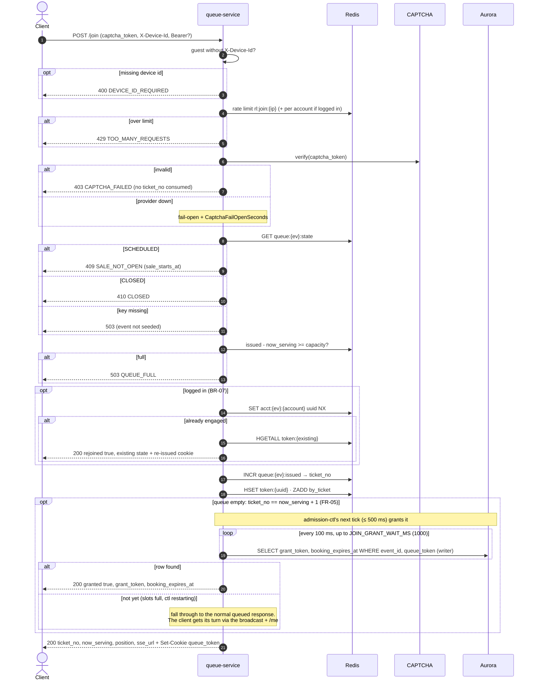

# POST /events/{event_id}/queue/join — Join Queue

| | |
|---|---|
| **Service** | `services/queue` (Lambda + API Gateway, provisioned concurrency from T-30 min) |
| **Auth** | none required · optional `Authorization: Bearer` (enables BR-07) · `X-Device-Id` required for guests |
| **Contract** | Apidog `POST /events/{event_id}/queue/join` · api-contracts §3.1 |
| **Requirements** | FR-04, FR-05, FR-10a, FR-10d..f, BR-07, BR-16, NFR-05, NFR-13 |
| **Detail** | impl-plan §7.2 · ADR-005 §5, §6 · **ADR-006 §4** (S2) |
| **Status** | planning |

## 1. Purpose

Gives the caller a `ticket_no` (their FCFS place) and a `queue_token` cookie. **Join never
grants**: admission-ctl is the only writer (S2). If the queue is empty, join waits up to
`JOIN_GRANT_WAIT_MS` (1000) for admission-ctl's next regular tick (every 500 ms) to grant it, so
FR-05 still answers `granted: true` in the same response. The hot path is **Redis only**. Aurora is read only, and
only on the empty-queue path.

## 2. Flow

## 3. Steps

Order matters: **rate limit before CAPTCHA**, so we don't pay for an external call on rejected
attempts (ADR-005 §6). The full pseudo-code is in impl-plan §7.2, steps 1–12.

1. Resolve `ip`, optional `accountID` from Bearer, and `deviceID`
2. Rate limit (IP, then account)
3. CAPTCHA verify, fail-open
4. Sale state gate
5. Capacity gate (fail fast, no buffering)
6. BR-07 recover-not-reject, logged in only
7. `INCR issued`, `HSET token`, `ZADD by_ticket`
8. FR-05: if the queue is empty, wait ≤ 1 s for the grant row (read only)
9. Set cookie (`Max-Age` = `SALE_WINDOW_SECONDS`) and respond with `queue_token` in the body too.
   **Mobile** has no cookie store: it keeps `queue_token` in secure storage and sends `X-Queue-Token`.
   **Web** ignores the body field and relies on the HttpOnly cookie (never put it in `localStorage`)

## 4. Data touched

| Store | Key / table | Op | Notes |
|---|---|---|---|
| Redis | `rl:join:{ip}`, `rl:joinacct:{id}` | token bucket | 20 / 5 min, 3 / min |
| Redis | `queue:{ev}:state`, `queue:{ev}:issued`, `queue:{ev}` | GET / INCR / HGET | |
| Redis | `acct:{ev}:{account_id}` | SET NX EX | logged-in only |
| Redis | `token:{uuid}` | HSET EX | `device_hash` for guests only |
| Redis | `queue:{ev}:by_ticket` | ZADD | score = ticket_no |
| Aurora | `bookings` | SELECT (writer) | empty-queue wait only, ≤ 10 reads |

## 5. Responses and errors

| HTTP | Code | When |
|---|---|---|
| 200 | — | queued, or `granted: true` (empty queue, ctl granted within 1 s), or `rejoined: true` (BR-07). Queued responses carry `ticket_no`, `now_serving`, `position`, **`queue_token`** and `sse_url`; no wait estimate (frontend computes it, [README §8](README.md#8-wait-time-estimate-fr-09)) |
| 400 | `DEVICE_ID_REQUIRED`, `CAPTCHA_REQUIRED` | |
| 403 | `CAPTCHA_FAILED` | |
| 409 | `SALE_NOT_OPEN` | state SCHEDULED |
| 410 | `CLOSED` | state CLOSED |
| 429 | `TOO_MANY_REQUESTS` | rate limit |
| 503 | `QUEUE_FULL` · event not seeded | |

## 6. Edge cases and decisions

- **DECIDED (S2): join never grants.** ADR-005's bypass ran `advance_now_serving.lua` and the
  INSERT inside the Lambda, which made a second writer. With admission counts read from Aurora (S1), two writers
  could over-admit, and the Lambda needed its own crash path. Now the Lambda only reads. If it dies while waiting, nothing is lost: the ctl grants anyway and the client finds out
  from the broadcast + `/me`.
- **"Queue empty" check:** `ticket_no == now_serving + 1` right after the `INCR`. A race with
  another join is harmless: both wait, and the ctl grants whoever fits.
- **Wait budget:** 1 s at most (covers at least one full 500 ms tick plus the INSERT), and only on an
  empty queue (low traffic by definition). Typical wait about 250–500 ms. The Lambda timeout must be well above 1 s.
- **DEFERRED: qpersist.** ADR-005 also `RPUSH`ed each join to `qpersist:{ev}` for durable positions
  in `queue_entries`. Deferred to production (ADR-006 §9); the POC relies on Redis Multi-AZ.
- A **guest** whose join response failed will retry and get a new token. The orphaned first
  token can still be granted and then LAPSES unclaimed, holding one slot for the booking TTL. Accepted.
- **DECIDED (2026-11-05): Cloudflare Turnstile**, invisible mode, behind the `Captcha` port.
  The client gets the token before the sale opens (README §2). The server calls Turnstile
  `siteverify` with a short timeout. A timeout or 5xx means fail-open plus the `CaptchaFailOpenSeconds`
  alarm. An explicit "invalid" means `403 CAPTCHA_FAILED`. Tests and k6 use the mock adapter, or
  Turnstile's published test keys, so load tests never call the real service.
- **Still open (ADR §17 #8, T-7 days):** confirm Turnstile can absorb about 300k `siteverify`
  calls in about 60 s for our account and plan. Tokens are single-use and short-lived, so a token
  fetched too early before the sale can expire. The client must refresh it if it's close to expiring.
- `acct` exists but `token:{uuid}` is gone: `DEL acct` and continue as a new join (impl-plan §7.2 step 6).
- `INCR issued` happens after every gate, so rejected calls never burn a ticket number.

## 7. Tests

- [ ] unit: gate order (rate limit → CAPTCHA → state → capacity → BR-07), each branch returns the right code
- [ ] unit: guest without device id → 400. Logged-in without device id → OK
- [ ] integration: 2 joins with the same account → one token, second returns `rejoined: true`
- [ ] integration: capacity reached → `QUEUE_FULL`, `issued` not incremented
- [ ] integration: empty queue + ctl running → `granted: true` within 1 s, row written by the ctl (join wrote nothing to Aurora)
- [ ] integration: empty queue + ctl stopped → normal queued response after ≤ 1 s, no row
- [ ] integration: non-empty queue → no wait, no Aurora call
- [ ] concurrency: 10k parallel joins → `ticket_no` unique and contiguous, `by_ticket` size = 10k

## 8. Tasks

- [ ] `services/queue` scaffold (copy booking hexagonal layout, `cmd/lambda` + `cmd/server`)
- [ ] outbound ports: `QueueStore`, `GrantStore`, `BookingReader`, `Captcha`
- [ ] redis adapter: engagement, queue_state, acct
- [ ] Turnstile adapter (`siteverify`, timeout, fail-open on error) + mock adapter
- [ ] config: `TURNSTILE_SECRET_KEY` from Secrets Manager / SSM, never in the repo
- [ ] usecase `Join` + HTTP handler + cookie
- [ ] FR-05 bounded wait for the grant row (after 05 admission-ctl lands)
- [ ] `template.yaml` route + provisioned concurrency
