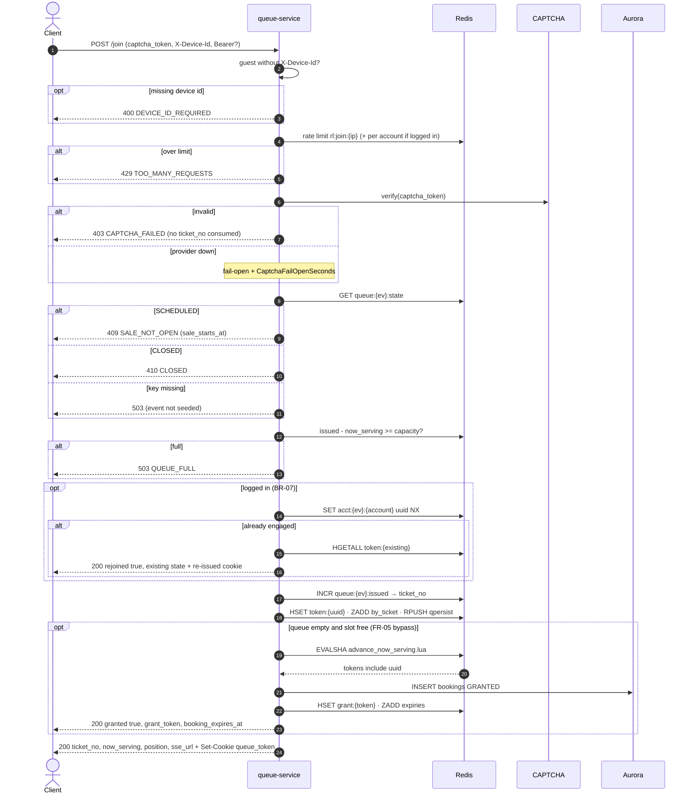

# POST /events/{event_id}/queue/join — Join Queue

| | |
|---|---|
| **Service** | `services/queue` (Lambda + API Gateway, provisioned concurrency from T-30 min) |
| **Auth** | none required · optional `Authorization: Bearer` (enables BR-07) · `X-Device-Id` required for guests |
| **Contract** | OpenAPI `POST /events/{event_id}/queue/join` · api-contracts §3.1 |
| **Requirements** | FR-04, FR-05, FR-10a, FR-10d..f, BR-07, BR-16, NFR-05, NFR-13 |
| **Detail** | impl-plan §7.2 · ADR-005 §5, §6 |
| **Status** | planning |

## 1. Purpose

Gives the caller a `ticket_no` (their FCFS place) and a `queue_token` cookie. If the queue is
empty and a slot is free, it grants immediately (FR-05 bypass). The hot path is **Redis only**:
Aurora is touched only by the bypass.

## 2. Flow

## 3. Steps

Order matters: **rate limit before CAPTCHA**, so we don't pay for an external call on rejected
attempts (ADR-005 §6). The full pseudo-code is in impl-plan §7.2, steps 1–12.

1. Resolve `ip`, optional `accountID` from Bearer, and `deviceID`
2. Rate limit (IP, then account)
3. CAPTCHA verify, fail-open
4. Sale state gate
5. Capacity gate (fail fast, no buffering)
6. BR-07 recover-not-reject, logged in only
7. `INCR issued`, `HSET token`, `ZADD by_ticket`, `RPUSH qpersist`
8. FR-05 bypass, using **the same Lua script** as admission-ctl
9. Set cookie (`Max-Age` = `SALE_WINDOW_SECONDS`) and respond

## 4. Data touched

| Store | Key / table | Op | Notes |
|---|---|---|---|
| Redis | `rl:join:{ip}`, `rl:joinacct:{id}` | token bucket | 20 / 5 min, 3 / min |
| Redis | `queue:{ev}:state`, `queue:{ev}:issued`, `queue:{ev}` | GET / INCR / HGET | |
| Redis | `acct:{ev}:{account_id}` | SET NX EX | logged-in only |
| Redis | `token:{uuid}` | HSET EX | `device_hash` for guests only |
| Redis | `queue:{ev}:by_ticket` | ZADD | score = ticket_no |
| Redis | `qpersist:{ev}` | RPUSH | drained by ctl |
| Aurora | `bookings` | INSERT | bypass only, writer endpoint |

## 5. Responses and errors

| HTTP | Code | When |
|---|---|---|
| 200 | — | queued, or `granted: true` via bypass, or `rejoined: true` (BR-07) |
| 400 | `DEVICE_ID_REQUIRED`, `CAPTCHA_REQUIRED` | |
| 403 | `CAPTCHA_FAILED` | |
| 409 | `SALE_NOT_OPEN` | state SCHEDULED |
| 410 | `CLOSED` | state CLOSED |
| 429 | `TOO_MANY_REQUESTS` | rate limit |
| 503 | `QUEUE_FULL` · event not seeded | |

## 6. Edge cases and decisions

- **OPEN:** The bypass has the same crash window as admission-ctl. If the Lambda dies or times
  out after `EVALSHA` and before `INSERT`, the customer is dropped. Apply the `granting` fix from
  [05 §6](05-admission-controller.md#6-edge-cases-and-decisions) here too.
- **OPEN:** POC CAPTCHA provider (Turnstile?) and mock strategy for load tests. 300k verifies in
  about 60 s hits provider quota (ADR §17 #8).
- `acct` exists but `token:{uuid}` is gone: `DEL acct` and continue as a new join (impl-plan §7.2 step 6).
- `INCR issued` happens after every gate, so rejected calls never burn a ticket number.

## 7. Tests

- [ ] unit: gate order (rate limit → CAPTCHA → state → capacity → BR-07), each branch returns the right code
- [ ] unit: guest without device id → 400. Logged-in without device id → OK
- [ ] integration: 2 joins with the same account → one token, second returns `rejoined: true`
- [ ] integration: capacity reached → `QUEUE_FULL`, `issued` not incremented
- [ ] integration: empty queue → bypass grants, booking row exists **before** response
- [ ] concurrency: 10k parallel joins → `ticket_no` unique and contiguous, `by_ticket` size = 10k

## 8. Tasks

- [ ] `services/queue` scaffold (copy booking hexagonal layout, `cmd/lambda` + `cmd/server`)
- [ ] outbound ports: `QueueStore`, `GrantStore`, `BookingReader`, `Captcha`
- [ ] redis adapter: engagement, queue_state, acct, persist
- [ ] captcha adapter + mock, fail-open
- [ ] usecase `Join` + HTTP handler + cookie
- [ ] FR-05 bypass (after 05 admission-ctl lands)
- [ ] `template.yaml` route + provisioned concurrency
