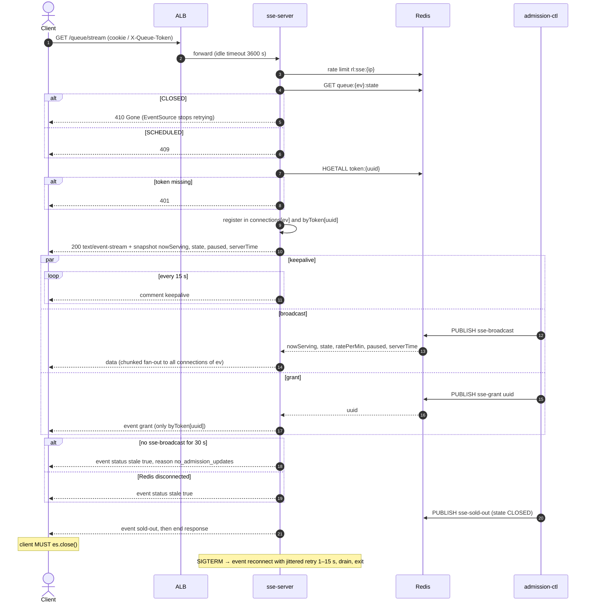

# GET /events/{event_id}/queue/stream — Queue Status Stream (SSE)

| | |
|---|---|
| **Service** | `services/sse-server` (ECS Fargate behind ALB `events.rusuhtiket.com`, **not** API Gateway) |
| **Auth** | cookie `queue_token` (web) · `X-Queue-Token` (mobile). Never in the query string |
| **Contract** | OpenAPI `GET /events/{event_id}/queue/stream` · api-contracts §3.2 |
| **Requirements** | FR-06, FR-07, FR-08, FR-10, NFR-06 (p95 < 1 s), NFR-14, BR-10, BR-21 |
| **Detail** | impl-plan §8 · ADR-005 §4, §11 |
| **Status** | planning |

## 1. Purpose

Pushes one global value (`nowServing`) to every waiting client, plus a targeted `grant` event
to the one connection whose turn arrived. Clients compute `position = ticket_no − nowServing`
locally. The server holds no per-client position.

## 2. Flow

## 3. Steps

1. Rate limit per IP (`5 conn/s`)
2. State gate: `CLOSED` → 410, `SCHEDULED` → 409, `SOLD_OUT` → open as normal (stock can return)
3. Resolve token → `ticket_no`, `event_id`
4. Headers: `text/event-stream`, `Cache-Control: no-cache`, `X-Accel-Buffering: no`
5. Initial snapshot with SSE `id` (FR-10: position is right immediately after refresh)
6. Register in both maps, and remove from both on close
7. Subscriber goroutine per task: `sse-broadcast`, `sse-grant`, `sse-sold-out`
8. Stale detector and `CtlHeartbeatAge` metric (impl-plan §8.5–8.6)

## 4. Data touched

| Store | Key | Op |
|---|---|---|
| Redis | `rl:sse:{ip}` | token bucket |
| Redis | `queue:{ev}:state`, `queue:{ev}` | GET / HGET |
| Redis | `token:{uuid}` | HGETALL |
| Redis pub/sub | `sse-broadcast`, `sse-grant`, `sse-sold-out` | SUBSCRIBE |

## 5. Events sent

| SSE event | Payload | Client action |
|---|---|---|
| (default `data`) | `nowServing, state, ratePerMin, paused, serverTime, id` | recompute position, show pause banner, sync clock |
| `grant` | `{}` | call `GET /queue/me` |
| `status` | `stale, reason` | show "reconnecting…" indicator |
| `sold-out` | `{}` | show terminal screen, `es.close()` |
| `reconnect` | retry hint | let EventSource reconnect |

## 6. Edge cases and decisions

- **OPEN:** Measured connections per task (ADR §17 #4). This drives `max_tasks` (currently 60).
  Measure it in the load test before fixing the number.
- **OPEN:** Redis cluster pub/sub. Classic `PUBLISH` is broadcast to every node. Consider
  sharded pub/sub (`SSUBSCRIBE`/`SPUBLISH`, Redis 7) keyed by `{ev}`.
- Slow clients: write with backpressure, and drop the connection when the buffer is full
  (`SSEWriteBackpressure`). Never block the fan-out loop.
- Grant arrives while the client is disconnected: nothing is lost. On reconnect the client calls
  `/me`, which reads Aurora.

## 7. Tests

- [ ] unit: state gate codes. Token missing → 401
- [ ] unit: connection maps register and unregister (no leak after close)
- [ ] integration: publish broadcast → all N test clients receive it in < 1 s
- [ ] integration: publish grant uuid → only that client receives `grant`
- [ ] integration: stop publishing 30 s → `status stale`
- [ ] load: X connections per 2 vCPU / 4 GB task, fan-out p95

## 8. Tasks

- [ ] `services/sse-server` scaffold (ECS, plain `net/http`, no Lambda entrypoint)
- [ ] connection manager (impl-plan §8.2)
- [ ] stream handler + snapshot
- [ ] Redis subscriber + chunked fan-out
- [ ] stale detector + `CtlHeartbeatAge`
- [ ] SIGTERM drain
- [ ] Dockerfile + ECS task def + ALB target group (health `/health`, slow start 30 s)
