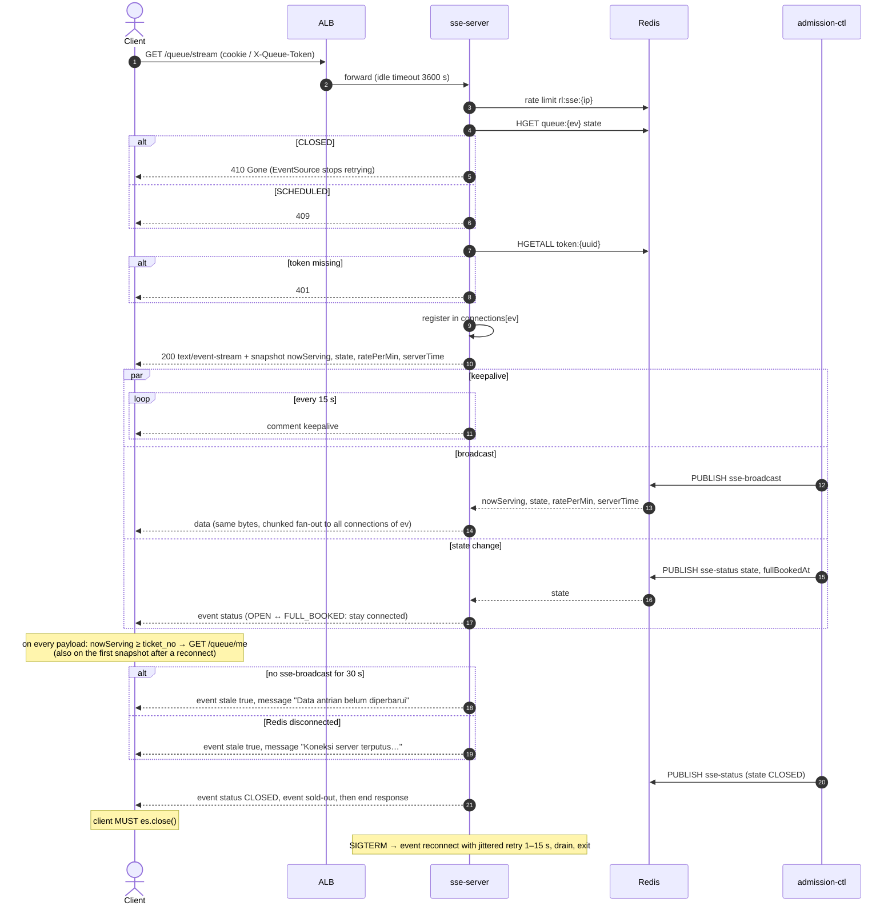

# GET /events/{event_id}/queue/stream — Queue Status Stream (SSE)

| | |
|---|---|
| **Service** | `services/sse-server` (ECS Fargate behind ALB `events.my-rusuh.my.id`, **not** API Gateway) |
| **Auth** | cookie `queue_token` (web) · `X-Queue-Token` (mobile). Never in the query string |
| **Contract** | Apidog `GET /events/{event_id}/queue/stream` · api-contracts §3.2 |
| **Requirements** | FR-06, FR-07, FR-08, FR-10, NFR-06 (p95 < 1 s), NFR-14, BR-10, BR-21 |
| **Detail** | impl-plan §8 · ADR-005 §4, §11 · **ADR-006 §4** (S3) |
| **Status** | planning |

## 1. Purpose

Pushes **one global payload** (`nowServing`, `state`, `ratePerMin`, `serverTime`) to every waiting
client of an event. **The same bytes go to everyone.** There is no per-customer event (S3). The
frontend does all the per-customer logic:

```
position = ticket_no − nowServing              (FR-06)
nowServing ≥ ticket_no → GET /queue/me         (FR-08, "my turn")
minutes  = ceil(position / ratePerMin), rounded up   (FR-09, README §8, api-contracts §3.5)
```

It also sends a named **`status`** event whenever the sale state changes (`OPEN → FULL_BOOKED`,
`FULL_BOOKED → OPEN`, `→ CLOSED`), so the client doesn't have to diff payloads to notice a sell-out.

The server holds no per-client position and needs no token → connection map, just a list of
connections per event.

## 2. Flow



## 3. Steps

1. Rate limit per IP (`5 conn/s`)
2. State gate: `CLOSED` → 410, `SCHEDULED` → 409, `FULL_BOOKED` → open as normal (stock can return)
3. Resolve token → `ticket_no`, `event_id`
4. Headers: `text/event-stream`, `Cache-Control: no-cache`, `X-Accel-Buffering: no`
5. Initial snapshot with SSE `id` (FR-10: position is right immediately after refresh)
6. Register in `connections[ev]`, remove on close
7. Subscriber goroutine per task: `sse-broadcast`, `sse-status`
8. Stale detector and `CtlHeartbeatAge` metric (impl-plan §8.5–8.6)

## 4. Data touched

| Store | Key | Op |
|---|---|---|
| Redis | `rl:sse:{ip}` | token bucket |
| Redis | `queue:{ev}` (`state`, `now_serving`, `rate_per_min`) | HGET / HMGET |
| Redis | `token:{uuid}` | HGETALL |
| Redis pub/sub | `sse-broadcast`, `sse-status` | SUBSCRIBE |

## 5. Events sent

| SSE event | Payload | Client action |
|---|---|---|
| (default `data`) | `nowServing, state, ratePerMin, serverTime` + `id` | compute position and minutes (README §8.4), sync clock. **If `nowServing ≥ ticket_no` → `GET /queue/me`** |
| `status` | `state, fullBookedAt, serverTime` | `FULL_BOOKED`: fully-booked message, hide the estimate, stay connected · `OPEN`: resume · `CLOSED`: `sold-out` follows |
| `stale` | `stale, state, message?, serverTime` (message only when `stale` is true) | dim the numbers, show "Memperbarui…". Never reconnect on it (was named `status` until v2.6) |
| `sold-out` | `state: CLOSED, message, serverTime` | right after `status CLOSED`: terminal screen, `es.close()` |
| `reconnect` | `retry:` hint + `state, message, serverTime` | let EventSource reconnect |

**One shape (contract v2.12):** every event carries `state` and `serverTime`; `message` (ready-to-show Indonesian text) is on `stale` true, `sold-out` and `reconnect`. The app branches on the event name, `stale` and `state`, never on `message`.

Full JSON schemas per event: the Apidog stream response `itemSchema` (`QueueStreamUpdate`,
`QueueStreamStatus`, `QueueStreamStale`, `QueueStreamSoldOut`), one example per event.

## 6. Edge cases and decisions

- **DECIDED (2026-11-05): load-test output.** Connections per task (ADR §17 #4) is measured in build step 8,
  not chosen now. It drives `max_tasks` (assumed 60 until then). Record the result in ADR §17 #4.
- **DECIDED (2026-11-05): classic pub/sub; sharded pub/sub DEFERRED to production** (ADR-006 §9).
  In cluster mode, classic `PUBLISH` is copied to every node. That's fine at POC scale. Keep the
  publish and subscribe calls behind one interface so moving to `SPUBLISH` / `SSUBSCRIBE` (Redis 7,
  keyed by `{ev}`) later is a single adapter change.
- Slow clients: write with backpressure, and drop the connection when the buffer is full
  (`SSEWriteBackpressure`). Never block the fan-out loop.
- **DECIDED (S3): no `grant` event.** ADR-005 sent `event: grant` to one connection, which needed
  a token → connection map on every task and a `sse-grant` channel. Now "my turn" is derived from
  the broadcast. admission-ctl publishes the broadcast **after** the tick's INSERTs, so `/me`
  normally finds the row on the first call. If not (pending grant, replica lag), `/me` answers
  `QUEUED` "almost there" and the client retries after 1 s.
- **Disconnected when the turn came:** nothing is lost. The first snapshot after reconnect
  shows `nowServing ≥ ticket_no`, so the client calls `/me`. Recovery and normal entry are the same path.
- **Contract change:** the `grant` event is removed from Apidog and api-contracts §3.2 (ADR-006 §7).
  Clients must not wait for it.

## 7. Tests

Specs: `services/sse-server/features/stream_{connect,updates,reliability}.feature` (62 scenarios; 4 run on the real Redis cluster).

- [x] unit: state gate codes (404 / 409 / 410), token missing or other event → 401, query string and Bearer ignored
- [x] unit: connection registry (no leak after 1000 connect-and-leave cycles)
- [x] integration: publish broadcast → customers on two servers receive it in < 1 s, identical bytes
- [x] unit: every connection of an event receives **identical bytes**, built once
- [ ] client contract test: payload with `nowServing ≥ ticket_no` → client calls `/me` exactly once per crossing (frontend)
- [x] unit + integration: `sse-status` FULL_BOOKED → `event: status`, stream stays open; CLOSED → `status` then `sold-out`, then the response ends (on every server)
- [x] unit: 30 s without a broadcast → `event: stale` once; `stale false` with the next broadcast
- [x] integration: fan-out p95 < 1 s with 5,000 connections on one server (a smoke bound; the real figure is the ECS load test)
- [ ] load: X connections per 2 vCPU / 4 GB task (ECS load test, ADR-005 §17 #4)

## 8. Tasks

- [x] `services/sse-server` scaffold (plain `net/http`, no Lambda entrypoint; `cmd/server`, `internal/{config,metrics,stream}`)
- [x] connection manager: one room per event, no token index (impl-plan §8.2, simplified by S3)
- [x] stream handler + snapshot
- [x] Redis subscriber (classic pub/sub behind `stream.Source`) + non-blocking fan-out
- [x] stale detector + `CtlHeartbeatAge`
- [x] SIGTERM drain (`Drain`, hard close at 20 s)
- [ ] Dockerfile + ECS task def + ALB target group (health `/health`, slow start 30 s)
