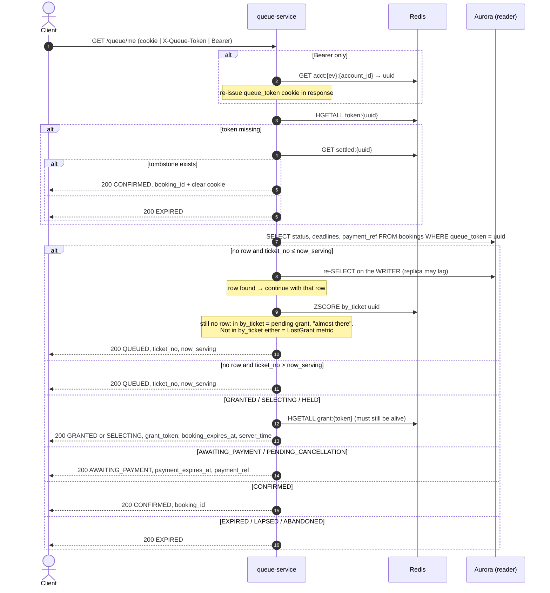

# GET /events/{event_id}/queue/me — Get Queue State (Re-entrancy)

| | |
|---|---|
| **Service** | `services/queue` (Lambda) |
| **Auth** | **one of** cookie `queue_token` · `X-Queue-Token` · `Authorization: Bearer` (cross-device recovery) |
| **Contract** | Apidog `GET /events/{event_id}/queue/me` · api-contracts §3.3 |
| **Requirements** | FR-08, FR-10, BR-09, NFR-02 |
| **Detail** | impl-plan §7.3 · ADR-005 §12 (queue recovery) |
| **Status** | planning |

## 1. Purpose

The **only** recovery path, and it's a read. It answers "where should this customer be right
now?": waiting room, Detail Ticket, Payment, done, or expired. It also hands out the
`grant_token` once the broadcast shows `nowServing ≥ ticket_no` (S3: this is how every customer
enters, not only a fallback). No CAPTCHA and no join rate limit (ADR-005 §12).

## 2. Flow

## 3. State mapping

| `bookings.status` | `data.state` returned | Client page |
|---|---|---|
| no row | `QUEUED` (`ticket_no`, `now_serving`) | Waiting Room |
| `GRANTED` | `GRANTED` | Detail Ticket |
| `SELECTING`, `HELD` | `SELECTING` | Detail Ticket (countdown continues) |
| `AWAITING_PAYMENT`, `PENDING_CANCELLATION` | `AWAITING_PAYMENT` | Payment ("verifying payment…" during grace) |
| `CONFIRMED` | `CONFIRMED` | Success |
| `EXPIRED`, `LAPSED`, `ABANDONED` | `EXPIRED` | Expired screen |

Deadlines are **always read from Aurora** and returned as absolute timestamps; the client counts
down against `server_time`. They never shift (pause and BR-22 removed, ADR-006 §4.3).

## 4. Data touched

| Store | Key / table | Op |
|---|---|---|
| Redis | `acct:{ev}:{account_id}` | GET (Bearer path) |
| Redis | `token:{uuid}`, `settled:{uuid}`, `grant:{token}` | HGETALL / GET |
| Redis | `queue:{ev}` → `now_serving` | HGET |
| Redis | `queue:{ev}:by_ticket` | ZSCORE (no-row path only) |
| Aurora | `bookings` | SELECT (reader) |

## 5. Responses and errors

| HTTP | Code | When |
|---|---|---|
| 200 | — | every resolved state, including `EXPIRED` |
| 401 | `UNAUTHORIZED` | no credential, or Bearer with no `acct` for this event |

## 6. Edge cases and decisions

- **"No row" plus `ticket_no <= now_serving`** means the grant is **pending** (option B,
  [05 §3.1](05-admission-controller.md#31-pending-grant-rule)). It normally
  resolves within one tick. Return `QUEUED` (with `ticket_no ≤ now_serving`, which the client shows as "almost there") and let the client retry after 1 s.
  If the uuid is **also missing from `by_ticket`**, the grant has been lost, which should be
  impossible. Emit the metric `LostGrant` and log the uuid.
- **DECIDED (2026-11-05): reader lag.** A just-inserted `GRANTED` row may not be on the replica yet when the
  client calls right after the broadcast shows its turn. Under option B the token has also left `by_ticket`,
  so without a fix `/me` would answer `QUEUED` *and* fire a false `LostGrant`. Rule: **"no row"
  with `ticket_no ≤ now_serving` is re-checked once on the writer** before answering or emitting
  the metric. Customers still behind `now_serving` never reach the writer, so writer load stays limited
  to the few customers being granted at that moment.
- Polling `/me` is not cacheable (`Cache-Control: no-store`).

## 7. Tests

- [ ] unit: every row of the mapping table
- [ ] unit: tombstone path returns `CONFIRMED` and clears the cookie
- [ ] unit: no row + pending (in `by_ticket`, score ≤ now_serving) → `QUEUED` position 0; no row + not in `by_ticket` → `QUEUED` + `LostGrant` metric
- [ ] integration: Bearer-only recovery re-issues the cookie for the existing uuid
- [ ] integration: LAPSED → `grant:{token}` deleted → returns `EXPIRED`, never a dead grant token
- [ ] integration: replica lag simulation (row only on writer) → `GRANTED` on first call, no `LostGrant`
- [ ] unit: `ticket_no > now_serving` + no row → `QUEUED` with **no** writer call

## 8. Tasks

- [ ] postgres adapter `BookingReader.FindByQueueToken` with a reader and a writer pool (writer used only for the re-check)
- [ ] usecase `GetMe` + mapper
- [ ] auth resolution middleware (cookie | header | Bearer)
- [ ] metric `LostGrant`
