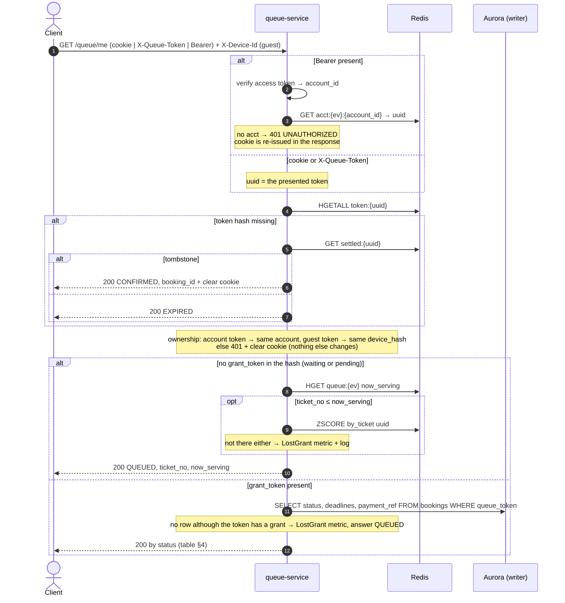

# GET /events/{event_id}/queue/me — Get Queue State (Re-entrancy)

| | |
|---|---|
| **Service** | `services/queue` (Lambda) |
| **Auth** | **one of** cookie `queue_token` · `X-Queue-Token` · `Authorization: Bearer` (cross-device recovery). Guests also send `X-Device-Id` |
| **Contract** | Apidog `GET /events/{event_id}/queue/me` · api-contracts §3.3 |
| **Requirements** | FR-08, FR-10, BR-09, NFR-02 |
| **Detail** | impl-plan §7.3 · ADR-005 §12 (queue recovery) · ADR-006 §8.9 (token ownership), §8.11, §8.13 |
| **Status** | **built 2026-11-09** (OPEN items 1, 2, 4, 5 accepted; item 3: one Aurora connection for now); mounted by `internal/delivery` |

## 1. Purpose

The **only** recovery path, and it's a read. It answers "where should this customer be right
now?": waiting room, Detail Ticket, Payment, done, or expired. It also hands out the
`grant_token` once the broadcast shows `nowServing ≥ ticket_no` (S3: this is how every customer
enters, not only a fallback). No CAPTCHA and no join rate limit (ADR-005 §12).

## 2. What changed since the first plan

admission-ctl (built 2026-11-08) copies `grant_token`, `booking_id` and `booking_expires_at` into `token:{uuid}`
**after** the GRANTED row exists and **before** the token leaves `by_ticket`. That makes the token hash the answer to
"has this customer been granted?", and removes two things the first plan needed:

- **Waiting customers never touch Aurora.** No `grant_token` in the token hash means "still waiting" (or "pending"), so
  `/me` answers from Redis alone. Only a customer who *already has* a grant reads a `bookings` row, to learn the current status.
- **No reader-lag handling is needed for now.** `/me` uses the same single (writer) Aurora connection as join. A token hash with
  `grant_token` proves the row exists, so a missing row is a real inconsistency (`LostGrant`), not lag. A reader pool can be added later
  without changing the use case.

## 3. Flow

## 4. State mapping

| Where we learn it | `bookings.status` | `data.state` | `data` | Client page |
|---|---|---|---|---|
| token hash, no `grant_token` | — | `QUEUED` | `ticket_no`, `now_serving` | Waiting Room ("almost there" when `ticket_no ≤ now_serving`) |
| Aurora | `GRANTED` | `GRANTED` | `grant_token`, `booking_expires_at`, `server_time` | Detail Ticket |
| Aurora | `SELECTING`, `HELD` | `SELECTING` | + `booking_id` | Detail Ticket (countdown continues) |
| Aurora | `AWAITING_PAYMENT`, `PENDING_CANCELLATION` | `AWAITING_PAYMENT` | `grant_token`, `booking_id`, `payment_expires_at`, `payment_ref`, `server_time` | Payment |
| Aurora, or `settled:{uuid}` | `CONFIRMED` | `CONFIRMED` | `booking_id` (tombstone also clears the cookie) | Success |
| Aurora, or no token and no tombstone | `EXPIRED`, `LAPSED`, `ABANDONED` | `EXPIRED` | — | Expired screen |

Deadlines are **always read from Aurora** and returned as absolute timestamps; the client counts down against
`server_time`. They never shift (ADR-006 §4.3). `grant_token` and `booking_id` come from the `bookings` row, which is
the authority on the current status.

## 5. Data touched

| Store | Key / table | Op |
|---|---|---|
| Redis | `acct:{ev}:{account_id}` | GET (Bearer path) |
| Redis | `token:{uuid}` | HGETALL |
| Redis | `settled:{uuid}` | GET (token missing only) — new builder `rediskeys.Settled`, written by payment later |
| Redis | `queue:{ev}` → `now_serving` | HGET (waiting path) |
| Redis | `queue:{ev}:by_ticket` | ZSCORE (only when `ticket_no ≤ now_serving` and no grant yet) |
| Aurora | `bookings` | SELECT on the single (writer) connection, only for customers who already have a grant |

## 6. Responses and errors

| HTTP | Code | When |
|---|---|---|
| 200 | — | every resolved state, including `EXPIRED`. `Cache-Control: no-store` |
| 400 | `DEVICE_ID_REQUIRED` | guest token without `X-Device-Id` (same as join) |
| 401 | `UNAUTHORIZED` | no credential · Bearer with no `acct` for this event · account token presented by another account |
| 401 | `DEVICE_MISMATCH` | guest token presented from another device. The response clears the `queue_token` cookie |
| 401 | `TOKEN_INVALID` / `TOKEN_EXPIRED` | the Bearer access token fails verification (same codes as join) |
| 503 | `SERVICE_UNAVAILABLE` | Redis or Aurora unreachable |

## 7. Edge cases and decisions

- **DECIDED (2026-11-09): waiting customers never reach Aurora** (see §2). At 300k people in line this keeps `/me` polls
  off the database.
- **"Pending" (`ticket_no ≤ now_serving`, no `grant_token` yet):** answer `QUEUED` and let the client retry after 1 s. It
  normally resolves within one tick. If the uuid is **also missing from `by_ticket`** the place was lost, which should be impossible:
  emit `LostGrant` and log the uuid.
- **Replica lag: not handled for now.** One Aurora connection (the writer), so a row written by admission-ctl is visible at once. When a
  reader pool is added, a customer with a `grant_token` and no row on the reader gets one re-read on the writer.
- **`CONFIRMED` after the token is gone:** the tombstone `settled:{uuid}` answers it and the response clears the cookie.
- **Bearer and a guest cookie together:** the account's own place wins; the guest token is ignored, not taken over (BR-07).
- **A token of another event, or an unknown token:** treated as missing (`EXPIRED`).
- Polling `/me` is not cacheable.

### DECIDED (2026-11-09, Erma)

1. **Guests send `X-Device-Id` on `/me`**, exactly like join: `400 DEVICE_ID_REQUIRED`, `401 DEVICE_MISMATCH` (+ cookie cleared). ADR-006 §8.9.
2. **No `grant:{token}` liveness read.** The `bookings` row status is the authority (a lapse updates the row first).
3. **One Aurora connection** (`DATABASE_URL`, the writer) for `/me` and join. No `DATABASE_READER_URL` for now; reader and re-check later.
4. **`booking_id` prefix `RB-`.** admission-ctl changes from `BK-<ULID>` to `RB-<ULID>` so the contract examples are true.
5. **`EXPIRED` does not clear the cookie.** Only the tombstone (`CONFIRMED`) and a foreign token clear it. admission-ctl keeps `token:{uuid}` and `acct` after a lapse so
   join can answer `rejoined: true, state LAPSED`; api-contracts §3.3 gets one sentence saying so.

## 8. Tests (written first, next to the code)

Unit (fakes for the ports):
- [x] every row of the state mapping table (`TestMeMapsEveryBookingStatus`)
- [x] a waiting customer is answered from Redis and Aurora is never called
- [x] pending (`ticket_no ≤ now_serving`, no grant): `QUEUED`; missing from `by_ticket` too → `LostGrant`
- [x] no row anywhere although a `grant_token` exists → `QUEUED` and `LostGrant`
- [x] tombstone → `CONFIRMED` and clears the cookie; no tombstone → `EXPIRED`
- [x] ownership: account token from another account → 401 `UNAUTHORIZED`; guest token from another device → 401 `DEVICE_MISMATCH` + cookie cleared; missing device id → 400
- [x] Bearer only: finds the account's token, re-issues the cookie; Bearer without `acct` → 401; Bearer + guest cookie → the account's own place
- [x] token of another event or unknown token → `EXPIRED`
- [x] Redis or Aurora failure → 503

HTTP (handler): headers, `Cache-Control: no-store`, error body shape, cookie attributes (same as join).

Integration (real Redis cluster + `pgtest`):
- [x] after admission-ctl grants, `/me` returns `GRANTED` with the same `grant_token` join would have returned
- [x] lapse (`LAPSED`) → `EXPIRED`, never a grant token

## 9. Tasks

- [x] `rediskeys.Settled` builder + `docs/redis-keys.md` row
- [x] postgres adapter: `BookingReader.Detail(ctx, eventID, queueToken)` on the single connection
- [x] usecase `GetMe` + mapper (reuses join's `owns` and identity code: move to a shared file in the usecase package)
- [x] HTTP handler + route, `Cache-Control: no-store`, cookie re-issue / clear
- [x] metric `LostGrant` (reuse `DeviceMismatch`, `TokenAccountMismatch`)
- [x] admission-ctl: booking id prefix `RB-` (decision 4)
- [x] API docs: api-contracts §3.3 one sentence for decision 5 (`EXPIRED` keeps the cookie) and the `X-Device-Id` line for guests (decision 1)
