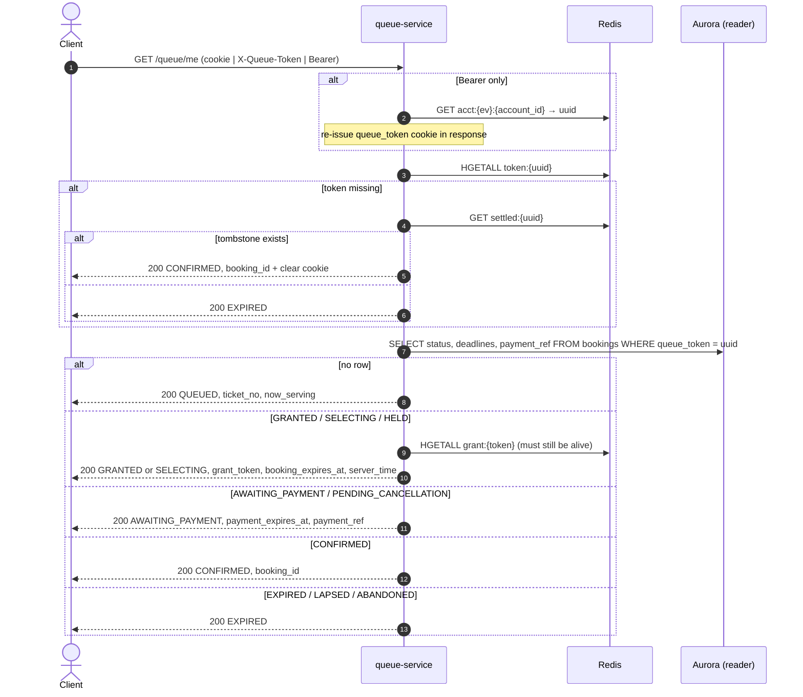

# GET /events/{event_id}/queue/me — Get Queue State (Re-entrancy)

| | |
|---|---|
| **Service** | `services/queue` (Lambda) |
| **Auth** | **one of** cookie `queue_token` · `X-Queue-Token` · `Authorization: Bearer` (cross-device recovery) |
| **Contract** | OpenAPI `GET /events/{event_id}/queue/me` · api-contracts §3.3 |
| **Requirements** | FR-08, FR-10, BR-09, NFR-02 |
| **Detail** | impl-plan §7.3 · ADR-005 §12 (queue recovery) |
| **Status** | planning |

## 1. Purpose

The **only** recovery path, and it's a read. It answers "where should this customer be right
now?": waiting room, Detail Ticket, Payment, done, or expired. It also hands out the
`grant_token` after the `grant` SSE event. No CAPTCHA and no join rate limit (ADR-005 §12).

## 2. Flow

## 3. State mapping

| `bookings.status` | `data.state` returned | Client page |
|---|---|---|
| no row | `QUEUED` | Waiting Room |
| `GRANTED` | `GRANTED` | Detail Ticket |
| `SELECTING`, `HELD` | `SELECTING` | Detail Ticket (countdown continues) |
| `AWAITING_PAYMENT`, `PENDING_CANCELLATION` | `AWAITING_PAYMENT` | Payment ("verifying payment…" during grace) |
| `CONFIRMED` | `CONFIRMED` | Success |
| `EXPIRED`, `LAPSED`, `ABANDONED` | `EXPIRED` | Expired screen |

Deadlines are **always read from Aurora**. A pause can shift them by `PAUSE_TTL_GRACE_SECONDS`
(BR-22), so never compute them from `granted_at` + constant.

## 4. Data touched

| Store | Key / table | Op |
|---|---|---|
| Redis | `acct:{ev}:{account_id}` | GET (Bearer path) |
| Redis | `token:{uuid}`, `settled:{uuid}`, `grant:{token}` | HGETALL / GET |
| Redis | `queue:{ev}` → `now_serving` | HGET |
| Aurora | `bookings` | SELECT (reader) |

## 5. Responses and errors

| HTTP | Code | When |
|---|---|---|
| 200 | — | every resolved state, including `EXPIRED` |
| 401 | `UNAUTHORIZED` | no credential, or Bearer with no `acct` for this event |

## 6. Edge cases and decisions

- **OPEN:** "no row" plus `ticket_no <= now_serving` is the **symptom of a dropped grant** (see
  [05 §6](05-admission-controller.md#6-edge-cases-and-decisions)). With the `granting` fix,
  this endpoint should check `queue:{ev}:granting` and report `QUEUED` with "almost there". Without
  the fix, the customer waits forever. Emit a metric whenever this case is seen.
- **OPEN:** Reader lag. A just-inserted `GRANTED` row may not be on the replica yet when the
  client calls right after the `grant` event. Read from the writer for the `grant`-triggered
  call, or retry once on "no row and ticket_no <= now_serving".
- Polling `/me` is not cacheable (`Cache-Control: no-store`).

## 7. Tests

- [ ] unit: every row of the mapping table
- [ ] unit: tombstone path returns `CONFIRMED` and clears the cookie
- [ ] integration: Bearer-only recovery re-issues the cookie for the existing uuid
- [ ] integration: LAPSED → `grant:{token}` deleted → returns `EXPIRED`, never a dead grant token
- [ ] integration: replica lag simulation → client still gets `GRANTED` on first call after `grant`

## 8. Tasks

- [ ] postgres reader adapter `BookingReader.FindByQueueToken`
- [ ] usecase `GetMe` + mapper
- [ ] auth resolution middleware (cookie | header | Bearer)
- [ ] metric `QueuedBehindWatermark`
