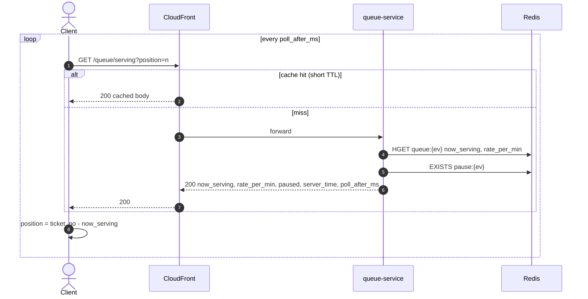
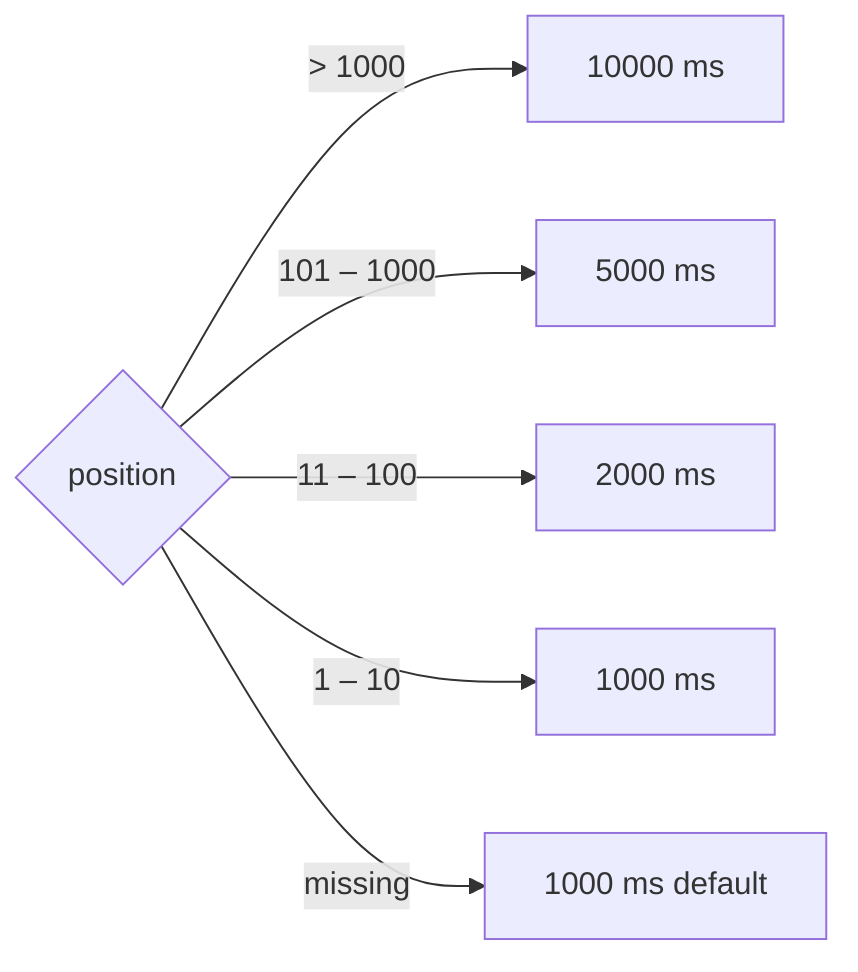

# GET /events/{event_id}/queue/serving — Get Now Serving (Polling Fallback)

| | |
|---|---|
| **Service** | `services/queue` (Lambda, behind CloudFront) |
| **Auth** | none. Identical response for every caller, so it's CDN-cacheable |
| **Contract** | OpenAPI `GET /events/{event_id}/queue/serving` · api-contracts §3.4 |
| **Requirements** | FR-07, NFR-06 (fallback path), requirements §5 "Fallback interval" |
| **Detail** | impl-plan §7.4 · ADR-005 §13 |
| **Status** | planning |

## 1. Purpose

Fallback when SSE can't be used: networks that block `text/event-stream`, the degraded
SSE tier, or initial hydration before the stream opens. **Not** the primary transport.

## 2. Flow

## 3. Poll interval (server-decided)

`valueobject.PollInterval(position)`, impl-plan §7.4.

## 4. Data touched

| Store | Key | Op |
|---|---|---|
| Redis | `queue:{ev}` → `now_serving`, `rate_per_min` | HGET |
| Redis | `pause:{ev}` | EXISTS |

## 5. Responses

| HTTP | When |
|---|---|
| 200 | always (event unknown → treat per contract) |

## 6. Edge cases and decisions

- **OPEN:** `?position=` in the cache key splits the CDN cache into 4 buckets at most if the
  client sends the bucket, but into thousands if it sends the raw number. Proposal: the client
  sends the bucket (`?tier=1..4`), or CloudFront ignores the query and the client applies the
  interval table itself from `ticket_no − now_serving`.
- **OPEN:** CloudFront TTL. 1 s keeps NFR-06 close. Origin load is then ≤ 1 req/s per edge
  location regardless of crowd size.
- Never returns per-user data. If someone proposes adding a token here, it breaks caching.

## 7. Tests

- [ ] unit: `PollInterval` boundaries (1, 10, 11, 100, 101, 1000, 1001, missing)
- [ ] unit: paused flag reflected
- [ ] integration: response has no `Set-Cookie` and has correct `Cache-Control`

## 8. Tasks

- [ ] usecase `GetServing` + `PollInterval` value object
- [ ] handler with `Cache-Control: public, max-age=1`
- [ ] CloudFront behaviour for `/events/*/queue/serving` (infra)
