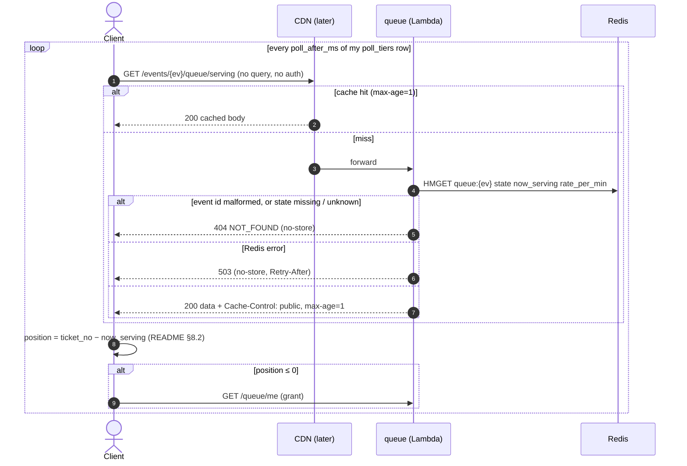
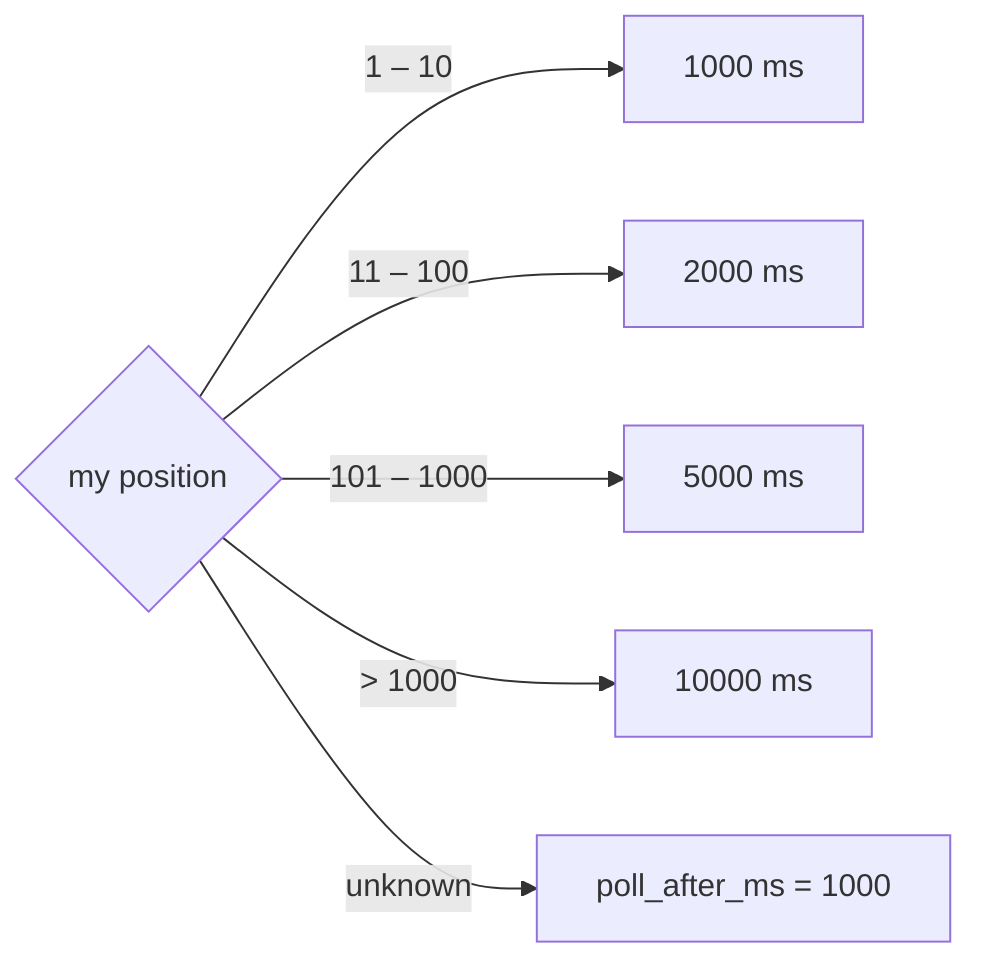

# GET /events/{event_id}/queue/serving — Get Now Serving (Polling Fallback)

| | |
|---|---|
| **Service** | `services/queue` (Lambda, unified HTTP API; CloudFront later) |
| **Auth** | none. Same answer for every caller, so a CDN can cache it |
| **Contract** | Apidog `GET /events/{event_id}/queue/serving` (`getNowServing`) · api-contracts §3.4 |
| **Requirements** | FR-07 (fallback), FR-09 (inputs for the estimate), NFR-08, requirements §5 "Fallback interval" |
| **Detail** | ADR-006 §8.5 · [README §8.2](README.md#82-the-rule-frontend) (frontend estimate rule) |
| **Status** | built (CloudFront behaviour still open) |

## 1. Purpose

The waiting room normally listens to the SSE stream. When it can't (a network that blocks
`text/event-stream`, the SSE tier is down, or the first paint before the stream opens), it polls this
endpoint instead. The answer holds the same facts as one SSE `update` frame: `now_serving`, `state`,
`rate_per_min`, plus the server's poll interval table. **Not** the main transport.

Example: Budi holds ticket 31842. The poll answers `now_serving: 31600, rate_per_min: 318`. The app shows
position 242, about 1 minute, and picks the `max_position: 1000` row, so it polls again in 5 s. When
`now_serving ≥ 31842` it calls `GET /queue/me` for its grant, exactly as in SSE mode.

## 2. Flow



## 3. Steps

1. Parse `event_id` with `rediskeys.NewEvent`. Malformed → 404 `NOT_FOUND`.
2. One `HMGET queue:{ev} state now_serving rate_per_min` (one hash, one slot).
3. `state` missing → 404 `NOT_FOUND` (the event is not seeded, same as the SSE stream). `state` present but not one
   of `SCHEDULED | OPEN | FULL_BOOKED | CLOSED` → 503 (a data fault: the client retries, not "event gone").
4. `now_serving` or `rate_per_min` missing → 0. A value that is not an integer, or negative → 503 (log it; never invent a
   number the client would compute a position from).
5. Answer 200 with `Cache-Control: public, max-age=1`, no `Set-Cookie`, nothing per caller:

```json
{
  "meta": { "code": 200, "message": "Success", "server_time": "2026-11-13T09:12:00.412Z" },
  "data": {
    "now_serving": 31600,
    "rate_per_min": 318,
    "state": "OPEN",
    "server_time": "2026-11-13T09:12:00.412Z",
    "poll_after_ms": 1000,
    "poll_tiers": [
      { "max_position": 10,   "poll_after_ms": 1000 },
      { "max_position": 100,  "poll_after_ms": 2000 },
      { "max_position": 1000, "poll_after_ms": 5000 },
      { "max_position": null, "poll_after_ms": 10000 }
    ]
  }
}
```

`data.server_time` has the same format as `meta.server_time` (`2006-01-02T15:04:05.000Z`, UTC).

## 4. Poll interval (server-owned table, client picks the row)



The endpoint takes no query string (one CDN entry per event), so the server can't know the caller's
position. It sends the whole table; the client picks the first row with `max_position ≥ position`
(`null` = no limit). The table is a constant in `domain` (`PollTiers`, `DefaultPollAfter`), the same
profile as requirements §5. Not configurable: nobody has asked to tune it, and a constant is one less env var.

## 5. Data touched

| Store | Key | Op | Notes |
|---|---|---|---|
| Redis | `queue:{ev}` → `state`, `now_serving`, `rate_per_min` | HMGET | read only; admission-ctl writes all three |

No Aurora, no rate limiter, no token lookup. The Lambda does not need the DB for this route.

## 6. Responses and errors

| HTTP | Code | When | Cache-Control |
|---|---|---|---|
| 200 | — | event seeded, any of the four states | `public, max-age=1` |
| 404 | `NOT_FOUND` | event id malformed, or `queue:{ev}.state` missing | `no-store` |
| 503 | `50300` (queue's existing "Antrian sedang tidak tersedia") + `Retry-After: 1` | Redis error, an unknown state, or a non-integer / negative counter | `no-store` |

## 7. Rules and edge cases

- **All four states answer 200.** Unlike the SSE stream (409 for SCHEDULED, 410 for CLOSED), polling is how
  the client *learns* the state, so it gets the state in the body and decides (README §3.1).
- **Never per-user data.** No auth, no cookies read or written. Adding a token here breaks caching.
- **Cache key:** no query string, cookies or headers. Cache-Control `public, max-age=1`: `now_serving` is at
  most about 1 s stale, origin load is at most about 1 req/s per edge location.
- **CloudFront is not deployed** (DEPLOY.md POC cut). Until it is, every poll reaches the Lambda: one HMGET,
  no DB. Lambda concurrency is the limit; the SSE path stays the main one.
- The route goes on the unified HTTP API (`infra/api-gateway/template.yaml`), like `/queue/me`.
- **Errors are never cached** (`no-store`): a brief Redis error must not be served to the crowd from the edge, and
  an event must show up as soon as it is seeded.
- The poll interval table is a constant; the client rule (first row with `max_position ≥ position`) is tested in
  `domain/serving_test.go` so web and mobile have a reference.

## 8. Code shape (hexagonal, like `/queue/me`)

| Layer | File | What |
|---|---|---|
| domain | `domain/serving.go` | `Serving{State, NowServing, RatePerMin}`, `PollTier`, `PollTiers`, `DefaultPollAfter` |
| port | `port/outbound/outbound.go` | `ServingReader.Serving(ctx, ev) (domain.Serving, found bool, err)` |
| redis | `infrastructure/redis/store.go` | `Store.Serving`: one HMGET (replaces `RatePerMin`) |
| usecase | `application/usecase/serving.go` | `GetServing.Get(ctx, eventID) (ServingResult, error)`: steps 1–4, clock for `server_time` |
| http | `infrastructure/http/serving.go` | handler, JSON shape, Cache-Control |
| wiring | `delivery/server.go` | always mounted (Redis only) |

## 9. Tests

- [x] domain: `PollTiers` serialises to the contract table (null on the last row); boundaries 10/11, 100/101, 1000/1001 pick the right row
- [x] usecase: each of the four states → 200 data; missing state → NOT_FOUND; unknown state → NOT_FOUND; malformed id → NOT_FOUND; store error → 503; missing counters → 0
- [x] http: 200 has `Cache-Control: public, max-age=1`, no `Set-Cookie`, body matches the Apidog schema (all six required fields); 404 / 503 are `no-store`; 503 has `Retry-After`
- [x] http: ignores `Authorization`, `X-Device-Id`, cookies and query strings (same body)
- [x] redis integration (`REDIS_ADDR`): `Store.Serving` reads a seeded hash; missing hash → not found; non-integer `now_serving` → error
- [x] wiring: `Wire` mounts the route even without a DB

## 10. Tasks

- [x] domain + port + Redis adapter (`Store.Serving`, drop `RatePerMin`)
- [x] usecase `GetServing`
- [x] handler + route + wiring
- [x] gateway: keep `RouteQueueServing`, add the route to the `ApiUrl` output list
- [x] `docs/04-queue/README.md` status row; `redis-keys.md` reader list for `queue:{ev}` if it lists readers
- [ ] later (infra, not this step): CloudFront behaviour for `/events/*/queue/serving` (no query string, cookies or headers in the cache key; TTL from origin)
- [x] Apidog + api-contracts: shape incl. `poll_tiers` and `state` (v2.6, v2.25 current)
