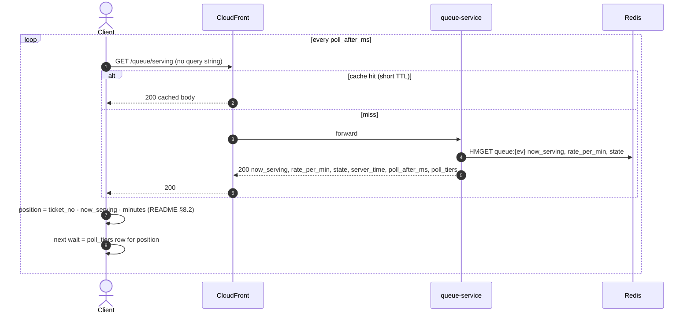
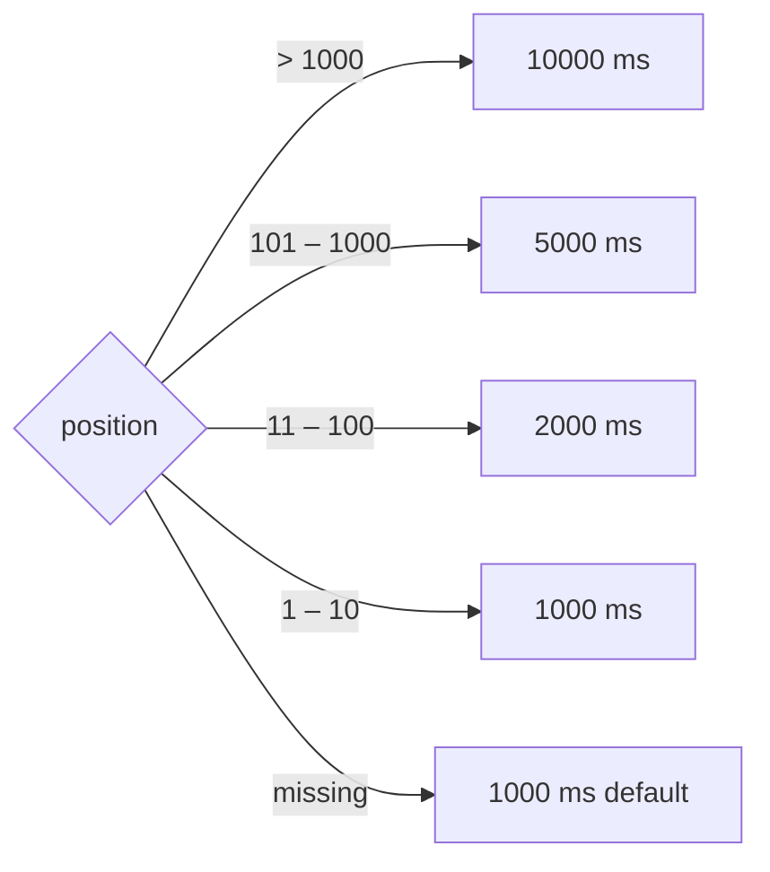

# GET /events/{event_id}/queue/serving — Get Now Serving (Polling Fallback)

| | |
|---|---|
| **Service** | `services/queue` (Lambda, behind CloudFront) |
| **Auth** | none. Identical response for every caller, so it's CDN-cacheable |
| **Contract** | Apidog `GET /events/{event_id}/queue/serving` · api-contracts §3.4 |
| **Requirements** | FR-07, NFR-06 (fallback path), requirements §5 "Fallback interval" |
| **Detail** | impl-plan §7.4 · ADR-005 §13 |
| **Status** | planning |

## 1. Purpose

Fallback when SSE can't be used: networks that block `text/event-stream`, the degraded
SSE tier, or initial hydration before the stream opens. **Not** the primary transport.

## 2. Flow



## 3. Poll interval (server-decided table, client-selected row)



`valueobject.PollInterval(position)`, impl-plan §7.4. **The server owns the table**, the client only
picks the row for its own position:

```json
"poll_after_ms": 1000,
"poll_tiers": [
  {"max_position": 10,   "poll_after_ms": 1000},
  {"max_position": 100,  "poll_after_ms": 2000},
  {"max_position": 1000, "poll_after_ms": 5000},
  {"max_position": null, "poll_after_ms": 10000}
]
```

`poll_after_ms` stays as the default for unknown positions, so existing clients keep working.
**Contract change (done, v2.6):** add `poll_tiers` to `getNowServing` (the current text says
"decided by the server based on position", but the endpoint takes no position, so the server
can't do that). Needs a PR to `documentations/api/`.

## 4. Data touched

| Store | Key | Op |
|---|---|---|
| Redis | `queue:{ev}` → `now_serving`, `rate_per_min`, `state` | HMGET |

## 5. Responses

| HTTP | When |
|---|---|
| 200 | always (event unknown → treat per contract) |

## 6. Edge cases and decisions

- **DECIDED (2026-11-05): cache key.** No query string. The CloudFront cache policy ignores all query strings,
  cookies and headers, so there is **one cache entry per event**. The client picks its interval
  from `poll_tiers` (§3).
- **DECIDED (2026-11-05): CloudFront TTL = 1 s** (`Cache-Control: public, max-age=1`). Origin load is ≤ 1 req/s
  per edge location regardless of crowd size, and `now_serving` is at most about 1 s stale.
- Never returns per-user data. If someone proposes adding a token here, it breaks caching.
- **DECIDED (2026-11-05): `paused` replaced by `state`** (pause removed, ADR-006 §4.3). In polling
  mode the frontend computes position and minutes from `now_serving` + `rate_per_min` with the
  same rule as SSE ([README §8.2](README.md#82-the-rule-frontend)), and reads `state` for FULL_BOOKED / CLOSED.

## 7. Tests

- [ ] unit: `PollInterval` boundaries (1, 10, 11, 100, 101, 1000, 1001, missing), and `poll_tiers` serialises the same table
- [ ] contract: response validates against the Apidog response schema
- [ ] unit: `state` reflected (OPEN, FULL_BOOKED, CLOSED)
- [ ] integration: response has no `Set-Cookie` and has correct `Cache-Control`

## 8. Tasks

- [ ] usecase `GetServing` + `PollInterval` value object
- [ ] handler with `Cache-Control: public, max-age=1`
- [ ] CloudFront behaviour for `/events/*/queue/serving` (infra): cache policy with no query string, cookies or headers, TTL honoured from origin
- [x] Apidog + api-contracts: `poll_tiers` (v2.6)
