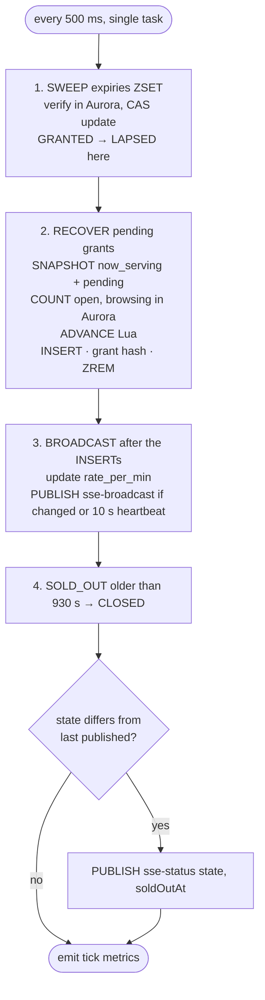
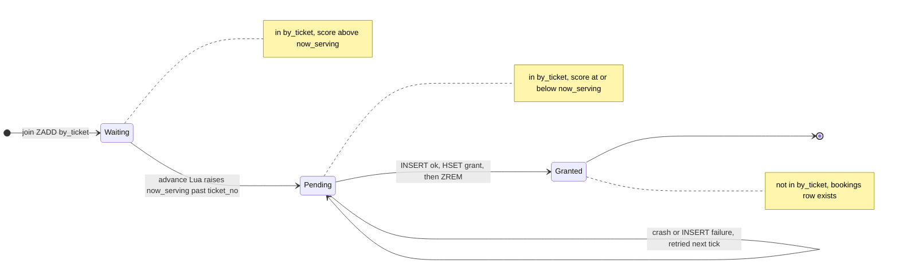
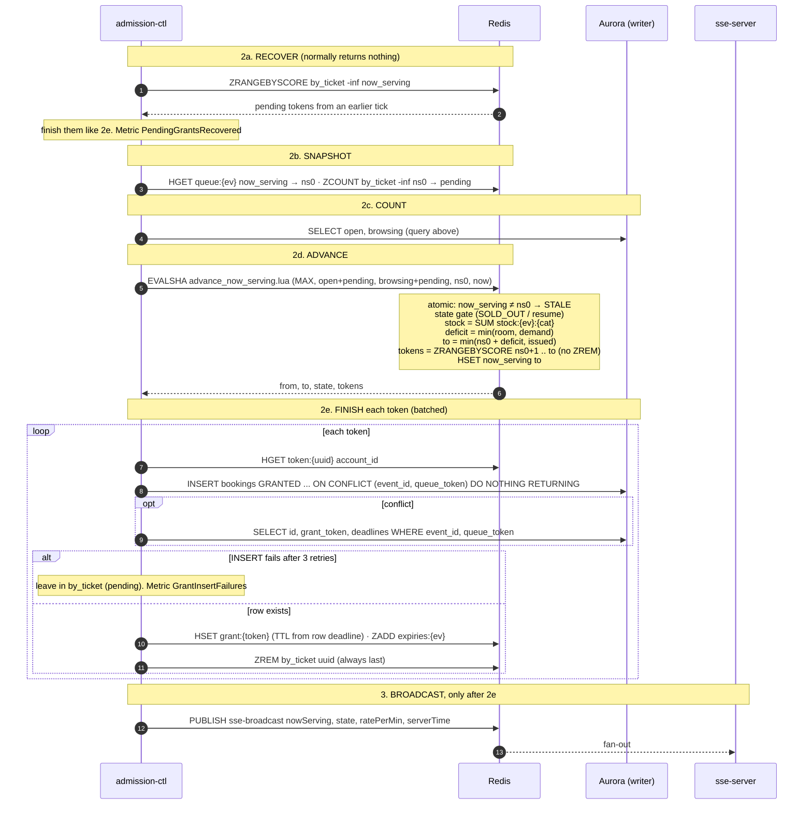
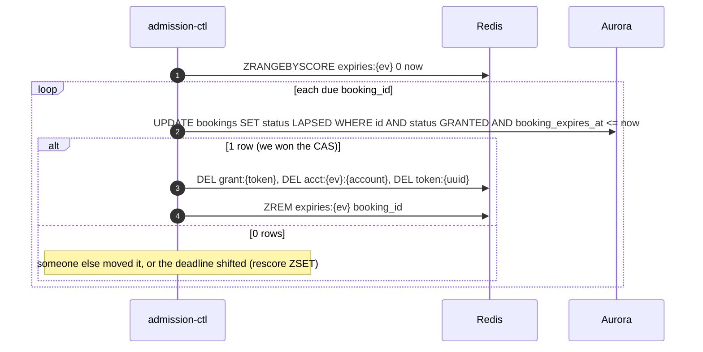

# Admission Controller — internal loop (no endpoint)

| | |
|---|---|
| **Service** | `services/admission-ctl` (ECS Fargate, 0.5 vCPU, **1 task** in POC; deployment `minimumHealthyPercent 0` / `maximumPercent 100` so two never run at once) |
| **Trigger** | 500 ms tick (EventBridge's 1-minute minimum is too slow, ADR-005 §3) |
| **Requirements** | FR-05, FR-08, FR-09, FR-18, BR-04, BR-13a, BR-17, BR-21, BR-22, NFR-02, NFR-04, NFR-14 |
| **Detail** | impl-plan §9 · ADR-005 §4, §6, §7, §11 · **ADR-006** §2, §3, §4 |
| **Status** | planning |

## 1. Purpose

The **only** component that grants. It moves `now_serving` forward, writes `GRANTED` rows, expires
no-shows, and broadcasts the one number every waiting client renders. If it stops, the queue
freezes and nothing is lost (pending grants, §3.1). In the POC, ECS restarts the task (about 30–60 s);
the leader lease + standby is **deferred to production** (§6).

**Queue-domain scope of this file:** RECOVER, ADVANCE, LAPSED sweep, broadcast,
`rate_per_min`, SOLD_OUT → CLOSED. The booking and payment sweeps, stock/NIK
reconciliation and the charge reconciler run in the same loop but are planned in `05-booking/` and
`07-payment/`.

## 2. One tick



**No pause (ADR-006 §4.3).** The tick never stops granting because Dukcapil or the payment
gateway is down. Their breakers only make those calls fail fast; the next tick grants as usual.

**State changes are published once.** The ctl keeps the last state it published per event. When
the state it reads after ADVANCE / step 4 differs (`OPEN → SOLD_OUT`, `SOLD_OUT → OPEN`,
`→ CLOSED`), it publishes `sse-status`. After a restart it publishes the current state once, which
is harmless (clients treat a repeated state as a no-op).

**No early ticks.** A place freed by a payment, an expiry or a cancel is picked up by the next
regular tick through the Aurora COUNT (≤ 500 ms). No other service signals the ctl.

## 3. ADVANCE, in detail

### 3.1 Pending-grant rule

Redis and Aurora can't be written atomically, so the grant is made **recoverable** instead (ADR-006 §2):

> A member of `queue:{ev}:by_ticket` whose score (ticket_no) is **≤ `now_serving`** is a
> **pending grant**: admitted in Redis, row not confirmed yet. **`ZREM by_ticket` is always the
> last step**, after the `GRANTED` row and the grant hash exist.



- **A crash at any point is safe.** The next tick (also after a task restart) finds the token with
  `ZRANGEBYSCORE by_ticket -inf now_serving` and finishes it.
- **The INSERT is idempotent:** `UNIQUE (event_id, queue_token)` + `ON CONFLICT DO NOTHING`. On
  conflict, the existing row is read back, so a retry reuses the same `booking_id`, `grant_token`
  and deadlines.
- **`regrant:{ev}` is removed.** A failed INSERT just stays pending and is retried.
- **`ZCARD by_ticket` is not the queue depth.** Depth is always `issued − now_serving`.

### 3.2 Admission formula

```
room    = MAX − (open + pending)                       capacity: everyone inside
demand  = ceil(stock / 3) − (browsing + pending)       inventory: only customers who can still take stock
deficit = min(room, demand)                            ≤ 0 → admit nobody this tick
```

- `open`, `browsing`: counted from Aurora (§3.3). `pending`: `ZCOUNT by_ticket -inf now_serving`.
  `stock`: `SUM stock:{ev}:{cat}`, read **inside** the Lua.
- **Why ÷ 3:** a customer can buy up to 3 tickets, so every customer admitted at the tail can
  still buy a full order. ADR-005's `min(MAX, stock)` admitted one customer per ticket.
- **Why `browsing` and not `open` against stock:** customers holding seats have already had
  their seats removed from `stock`. Counting them again freezes the queue for up to 10 min while
  tickets are free. Example (MAX 100): 240 free, 70 paying, 10 browsing. ADR-005 gives
  `min(100, 80) − 80 = 0`; this gives `min(20, 70) = 20`.
- **Early in the sale nothing changes:** `demand` is huge, so `deficit = MAX − open`.
- A per-category shortage is still possible (stock is summed across categories). The customer
  then picks another category.
- **`now_serving` is capped at `issued`** (`to = min(ns + deficit, issued)`). ADR-005's
  `INCRBY now_serving deficit` could jump past numbers not yet issued when few people wait. The next
  joiners then got `ticket_no ≤ now_serving` and were never picked. Under pending grants, RECOVER would
  grant them without counting them against MAX. The full Lua is in ADR-006 §3.4.

### 3.3 Why a non-atomic count is safe

Counting from Aurora (S1) means the count and the Lua are **not** one atomic step. It's safe
because every mistake leans towards admitting **fewer**:

| Event between the COUNT and the Lua | True `open` / `browsing` | Our count is | Effect |
|---|---|---|---|
| CONFIRMED, EXPIRED, LAPSED, ABANDONED | goes down | too high | admit fewer for ≤ 1 tick ✅ |
| SELECTING → HELD | `browsing` down, stock down | `browsing` too high, stock fresh (read later) | fewer ✅ |
| GRANTED → SELECTING | unchanged | exact | ✅ |
| **a new grant** | goes up | too low | ⚠️ prevented by rules 1 and 2 |

Four rules make it hold:

1. **One writer.** Only admission-ctl grants (S2).
2. **CAS fence on `now_serving`.** The ctl passes the value it read in the snapshot; the Lua
   returns `STALE` and does nothing if it has changed. In the POC there is one task, but an
   accidental overlap (a misconfigured deploy, a manual second task) is still safe.
3. **Fixed read order: Redis snapshot → Aurora COUNT → Lua.** Then every grant is counted at
   least once: as a row (if it existed before the COUNT), as pending (if pending at the snapshot),
   or both (if it moved in between). A grant created after the snapshot would have changed
   `now_serving`, so rule 2 aborts.
4. **Stock is read inside the Lua, after the COUNT.** A hold in between shows up as low stock
   plus high `browsing`, which is safe. Reading stock first could show high stock with low
   `browsing` and over-admit by about 2.

Plus the invariant from README §3.2: **no transition goes back into GRANTED or SELECTING.**

```sql
-- step 2 COUNT, writer endpoint, 2× per second
SELECT count(*)                                                  AS open,
       count(*) FILTER (WHERE status IN ('GRANTED','SELECTING')) AS browsing
FROM bookings
WHERE event_id = $1
  AND status IN ('GRANTED','SELECTING','HELD','AWAITING_PAYMENT','PENDING_CANCELLATION');
-- partial index: ON bookings (event_id, status) WHERE status IN (…active…)
-- at most MAX rows match → about 1 ms
```

### 3.4 Sequence



**Order rule:** INSERT → grant hash → ZREM → BROADCAST. Clients learn it's their turn from the
broadcast (S3), so by the time they call `/me` the row normally exists. A token still pending
(INSERT failing) gets "almost there" from `/me` and the client retries.

### 3.5 `rate_per_min`

`rate_per_min` = **how many ticket numbers `now_serving` passes per minute**. It's in ticket
numbers, not grants, so gaps (customers who left) are included, exactly like
`position = ticket_no − now_serving`. Same unit, so `position / rate` is consistent. The backend
It's broadcast as `ratePerMin`; the **frontend** turns it into minutes ([README §8](README.md#8-wait-time-estimate-fr-09)).

```
every tick (step 3, BROADCAST):
  if state == OPEN:
      push (now, now_serving) into a ring buffer; keep the last 60 s of OPEN samples
  if the buffer covers < 60 s (sale just opened, or the task just restarted):
      rate = MAX_CONCURRENT_SLOTS / ETA_SEED_SLOT_MINUTES (5)
  else:
      rate = (newest.now_serving − oldest.now_serving) / (newest.t − oldest.t) × 60
  while SOLD_OUT: keep the last value (don't decay to 0)
  HSET queue:{ev} rate_per_min round(rate) ; include ratePerMin in sse-broadcast
```

- **The T0 burst is excluded.** The first tick grants up to `MAX` at once; those samples fall in
  the first 60 s, which use the seed, so early estimates aren't too optimistic.
- **SOLD_OUT time is excluded,** so the rate doesn't drop to 0 when stock comes back.
- **A restarted task starts with the seed** (the ring buffer is in memory). Good enough for an estimate.

Tests: rate = seed while the window covers < 60 s, Δ/Δt afterwards · SOLD_OUT samples not pushed,
rate unchanged across a 3-min SOLD_OUT · value kept (not 0) while SOLD_OUT.

## 4. LAPSED (queue-owned part of SWEEP)



LAPSED is **final**: no second chance (ADR-005 §7, requirements §5). The freed place shows up in
the next tick's COUNT automatically, with no counter to decrement.

## 5. Data touched

| Store | Key / table | Op |
|---|---|---|
| Redis | `breaker:dukcapil:state`, `breaker:payment-gateway:state` | GET |
| Redis | `queue:{ev}`, `queue:{ev}:state`, `queue:{ev}:by_ticket`, `queue:{ev}:issued`, `stock:{ev}:{cat}`, `queue:{ev}:sold_out_at`, `queue:{ev}:resume` | advance Lua (stock read only) |
| Redis | `queue:{ev}:by_ticket` | ZRANGEBYSCORE / ZCOUNT `-inf now_serving` · ZREM (last step of grant) |
| Redis | `grant:{token}`, `expiries:{ev}` | HSET / ZADD / DEL |
| Redis pub/sub | `sse-broadcast`, `sse-status` | PUBLISH |
| Aurora | `bookings` | **COUNT (writer)** / INSERT / CAS UPDATE |
| Aurora | `event_queue_state` | UPDATE |

## 6. Edge cases and decisions

- **DECIDED: pending grants (ADR-006 §2).** Rejected: a separate `queue:{ev}:granting` zset (an
  extra key for little gain); insert-first with a CAS (moves the decision out of the Lua). Cost:
  `by_ticket` has two meanings (waiting / pending), which must be documented in `pkg/rediskeys`
  and the Lua header.
- **Pending is retried, never given up.** This replaces ADR-005's `GRANT_INSERT_MAX_RETRIES` + `regrant`.
  Alert when `ZCOUNT by_ticket -inf now_serving > 0` for more than 10 ticks (5 s); the fix is manual.
- **Two tasks at once (shouldn't happen in POC):** the CAS fence (§3.3 rule 2) stops the second ADVANCE;
  a double RECOVER is harmless (idempotent INSERT, double ZREM is a no-op).
- **DECIDED: counts from Aurora (S1, ADR-006 §3).** This replaces ADR-005 §6 "Kepemilikan slots:open"
  and its reconciliation. A count can't drift, because it's recomputed every tick. If the
  writer is unreachable, the COUNT fails, the tick skips ADVANCE (the queue freezes, nothing is lost), and
  the INSERTs would have failed anyway.
- **DECIDED: one writer (S2, ADR-006 §4).** Join, webhook, outbox and cancel never grant and never
  signal the ctl; the next tick finds freed places by itself. See [01 §2](01-join-queue.md#2-flow).
- **DECIDED: broadcast only (S3, ADR-006 §4).** No `sse-grant`. Because BROADCAST runs after
  the INSERTs, a client's `/me` normally finds the row on the first call.
- **DEFERRED to production (ADR-006 §9): leader lease + standby.** POC runs **one task**. If it dies,
  ECS replaces it in about 30–60 s: the queue freezes (the stale indicator shows after 30 s,
  `CtlHeartbeatAge` pages), and nothing is lost, because pending grants are finished by the next task.
  **Deviation:** requirements NFR-14 names the leader lease as the recovery mechanism; for the POC
  recovery is the ECS restart, and detection is unchanged. The resource-side guards (CAS sweep,
  `grace_applied NX`, the `now_serving` fence) already make a later move to 2 tasks safe (ADR-005 §11).
- **DEFERRED to production: qpersist + `queue_entries` + rebuild from Aurora.** POC relies on Redis
  Multi-AZ. A *total* Redis loss would lose queue positions (paid and held seats are safe in Aurora);
  this is accepted for the POC.
- `MAX_CONCURRENT_SLOTS` value is still open (ADR-005 §17 #5): config, set from the load test.

## 7. Tests

**Lua (real Redis, testcontainers)**
- [ ] ÷ 3 boundary with MAX = 100, open = browsing = pending = 0: stock 1000 → 100 · 300 → 100 · 298 → 100 · 297 → 99 · 1 → 1 · 0 → SOLD_OUT
- [ ] scenario A (early) stock 9820, open 95, browsing 40 → 5 (room limits)
- [ ] scenario B (tail) stock 240, open 80, browsing 10 → **20** (ADR-005 formula gave 0)
- [ ] scenario C1 stock 9, open 50, browsing 3 → 0 · C2 stock 9, open 49, browsing 2 → 1
- [ ] `pending` counted in both terms: open 95, pending 5 → room 0
- [ ] CAS fence: `now_serving` changed since snapshot → `STALE`, nothing written
- [ ] returned tokens are **still in `by_ticket`** (no ZREM), and a second call doesn't return them again
- [ ] gaps in `by_ticket` (LAPSED / removed tokens) → fewer tokens than deficit, `now_serving` still moves to `to`
- [ ] **`now_serving` never passes `issued`:** deficit 1000, 10 waiting → `now_serving` += 10, the next joiner gets `ticket_no = now_serving + 1`
- [ ] SOLD_OUT ↔ OPEN transitions, CLOSED no-op

**Tick**
- [ ] Dukcapil / payment breaker OPEN → tick still COUNTs and ADVANCEs (no pause)
- [ ] `sse-status` published exactly once per state change; not on unchanged ticks
- [ ] BROADCAST is published **after** every INSERT of the tick (order assertion)
- [ ] INSERT fails → token still in `by_ticket`, broadcast still sent, next tick with DB healthy → granted
- [ ] **crash test:** stop after EVALSHA, before INSERT → next tick RECOVER grants, exactly one row
- [ ] crash test: stop after INSERT, before ZREM → RECOVER reuses the same `booking_id` / `grant_token`
- [ ] RECOVER on an empty pending set does 1 ZRANGEBYSCORE and nothing else
- [ ] Aurora writer down → ADVANCE skipped, no grant, no broadcast change

**Invariant (property test, random interleavings)**
- [ ] random grant / claim / hold / pay / expire / lapse / second-task steps → at every step
      `active rows + pending ≤ MAX` and every admitted browsing customer can buy 3: `browsing × 3 ≤ stock + 2`
- [ ] LAPSED CAS: two sweepers on the same row → exactly one transition

## 8. Tasks

- [ ] `pkg/redisscript` + `advance_now_serving.lua` (ADR-006 §3.4) + Lua tests
- [ ] migration: `UNIQUE (event_id, queue_token)` + partial index on active statuses
- [ ] `services/admission-ctl` scaffold (ECS, `cmd/worker`)
- [ ] tick loop skeleton (500 ms ticker) with step functions and per-step metrics
- [ ] postgres `AdmissionCounter.Count(ev)` on the writer pool
- [ ] RECOVER → SNAPSHOT → COUNT → ADVANCE → FINISH, + `PendingGrants` gauge and alert
- [ ] SWEEP: GRANTED → LAPSED
- [ ] BROADCAST + heartbeat + `rate_per_min` ([§3.5](#35-rate_per_min), config `ETA_SEED_SLOT_MINUTES`)
- [ ] SOLD_OUT → CLOSED + `sse-status` on each state change
- [ ] ECS service: 1 task, deployment min 0 % / max 100 %, `CtlHeartbeatAge` alarm

**Deferred (production path, ADR-006 §9):** leader lease + epoch + standby, qpersist drain → `queue_entries` + rebuild.
