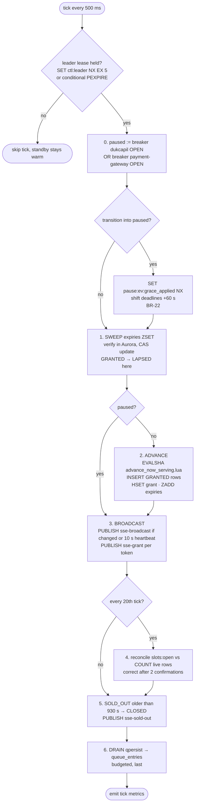
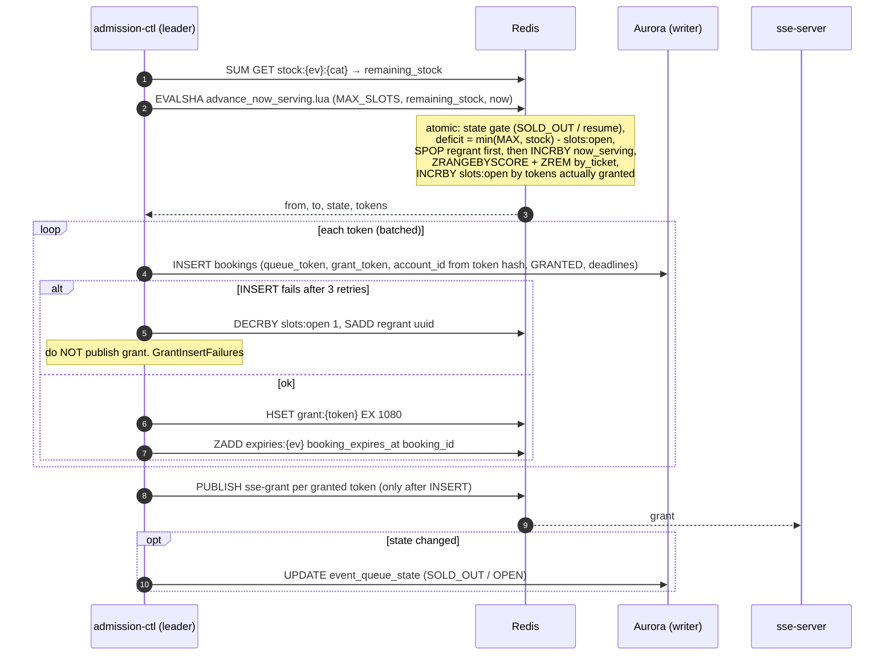

# Admission Controller — internal loop (no endpoint)

| | |
|---|---|
| **Service** | `services/admission-ctl` (ECS Fargate, `desired_count 2`: 1 leader + 1 standby, 0.5 vCPU) |
| **Trigger** | 500 ms tick (EventBridge's 1-minute minimum is too slow, ADR-005 §3) |
| **Requirements** | FR-08, FR-18, BR-04, BR-13a, BR-17, BR-21, BR-22, NFR-02, NFR-04, NFR-14 |
| **Detail** | impl-plan §9 · ADR-005 §4, §6, §7, §11 |
| **Status** | planning |

## 1. Purpose

The single writer that moves `now_serving` forward, grants slots, and releases them. It also
broadcasts the queue state that every waiting client renders. If it stops, the queue freezes,
so it runs with a leader lease and a standby.

**Queue-domain scope of this file:** lease, pause gate, ADVANCE, LAPSED sweep, broadcast,
`slots:open` reconciliation, SOLD_OUT → CLOSED, qpersist drain. The booking and payment sweeps,
stock/NIK reconciliation, and the charge reconciler run in the same loop but are planned in
`05-booking/` and `07-payment/`.

## 2. One tick



## 3. ADVANCE, in detail



**Order rule:** INSERT first, PUBLISH second. Telling a customer "your turn" for a slot that is
then rolled back is the most direct violation of NFR-02 (ADR-005 §6).

## 4. LAPSED (queue-owned part of SWEEP)

```mermaid
sequenceDiagram
    autonumber
    participant CTL as admission-ctl
    participant R as Redis
    participant DB as Aurora

    CTL->>R: ZRANGEBYSCORE expiries:{ev} 0 now
    loop each due booking_id
        CTL->>DB: UPDATE bookings SET status LAPSED WHERE id AND status GRANTED AND booking_expires_at <= now
        alt 1 row (we won the CAS)
            CTL->>R: DECR slots:open
            CTL->>R: DEL grant:{token}, DEL acct:{ev}:{account}, DEL token:{uuid}
            CTL->>R: ZREM expiries:{ev} booking_id
        else 0 rows
            Note over CTL: someone else moved it, or the deadline shifted (rescore ZSET)
        end
    end
```



LAPSED is **final**: no `regrant` and no second chance (ADR-005 §6 decision, requirements §5).

## 5. Data touched

| Store | Key / table | Op |
|---|---|---|
| Redis | `ctl:leader`, `ctl:epoch` | SET NX EX / conditional PEXPIRE / INCR |
| Redis | `breaker:dukcapil:state`, `breaker:payment-gateway:state` | GET |
| Redis | `queue:{ev}`, `queue:{ev}:state`, `queue:{ev}:by_ticket`, `slots:open:{ev}`, `regrant:{ev}`, `queue:{ev}:sold_out_at`, `queue:{ev}:resume` | advance Lua |
| Redis | `grant:{token}`, `expiries:{ev}` | HSET / ZADD / DEL |
| Redis | `qpersist:{ev}` | LPOP batch |
| Redis pub/sub | `sse-broadcast`, `sse-grant`, `sse-sold-out` | PUBLISH |
| Aurora | `bookings`, `event_queue_state`, `queue_entries` | INSERT / CAS UPDATE / SELECT COUNT |

## 6. Edge cases and decisions

- **OPEN (critical): crash between EVALSHA and INSERT.** The Lua has already removed tokens from
  `by_ticket` and raised `slots:open`. If the leader dies (crash, ECS replace, lease lost), the
  tokens are in neither `by_ticket` nor `regrant` and have no row. Reconciliation fixes the
  counter, but **the customers are never served** and `/me` shows `QUEUED` forever.
  Proposed fix:

  ```mermaid
  sequenceDiagram
      participant CTL as admission-ctl (any leader)
      participant R as Redis
      participant DB as Aurora
      CTL->>R: advance Lua also ZADD queue:{ev}:granting now uuid
      CTL->>DB: INSERT ... ON CONFLICT (event_id, queue_token) DO NOTHING
      CTL->>R: PUBLISH sse-grant
      CTL->>R: ZREM queue:{ev}:granting uuid
      Note over CTL,R: every tick, before ADVANCE:<br/>ZRANGEBYSCORE granting 0 (now - 5 s)<br/>re-run INSERT (idempotent) + PUBLISH + ZREM
  ```

  Needs `UNIQUE (event_id, queue_token)` on `bookings`, and `granting` added to the Lua `KEYS`.
  Needs a team decision and an ADR-005 amendment.
- **OPEN: tail formula.** `deficit = min(MAX, total_stock) − open` admits one user per remaining
  ticket, but each wants up to 3, possibly in an empty category. Proposal: use `ceil(remaining / 3)`
  once `remaining < MAX × 3` (ADR §17 #5).
- **OPEN: POC lease.** Ship 1 task first with lease code in place. Turn on the standby once
  the tick is stable. Resource-side guards (CAS sweep, `grace_applied NX`, compare-and-adjust)
  keep double execution safe either way (ADR-005 §11).
- `regrant` drain doesn't advance `now_serving`, so waiting customers may see a slot freed
  without their position moving. Expected behaviour, documented for support.

## 7. Tests

- [ ] Lua unit (against real Redis): deficit math, regrant first, `slots:open` += actual tokens, SOLD_OUT ↔ OPEN, CLOSED no-op
- [ ] Lua: gaps in `by_ticket` (LAPSED / removed tokens) → fewer tokens than deficit, next tick catches up
- [ ] tick: paused → no EVALSHA, sweep and broadcast still run
- [ ] tick: INSERT fails → `regrant` + `slots:open` restored + no grant published
- [ ] **crash test:** kill the process after EVALSHA, before INSERT → customer still granted after restart (needs the `granting` fix)
- [ ] two leaders at once (lease forced) → no double grant, no negative `slots:open`
- [ ] LAPSED CAS: two sweepers on the same row → exactly one DECR
- [ ] reconciliation: inject drift → corrected after 2 confirmations, never on 1

## 8. Tasks

- [ ] `pkg/redisscript` + `advance_now_serving.lua` + Lua tests
- [ ] `services/admission-ctl` scaffold (ECS, `cmd/worker`)
- [ ] tick loop skeleton with step functions and per-step metrics
- [ ] ADVANCE + INSERT + PUBLISH (+ `granting` recovery once decided)
- [ ] SWEEP: GRANTED → LAPSED
- [ ] BROADCAST + heartbeat
- [ ] `slots:open` reconciliation
- [ ] pause gate + BR-22 grace
- [ ] SOLD_OUT → CLOSED
- [ ] leader lease + epoch
- [ ] qpersist drain
