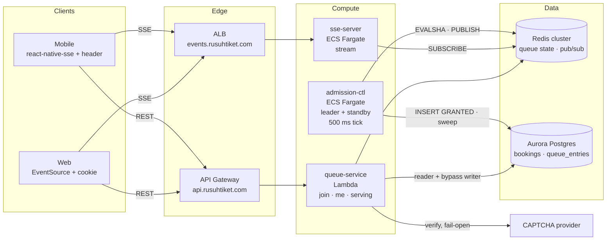
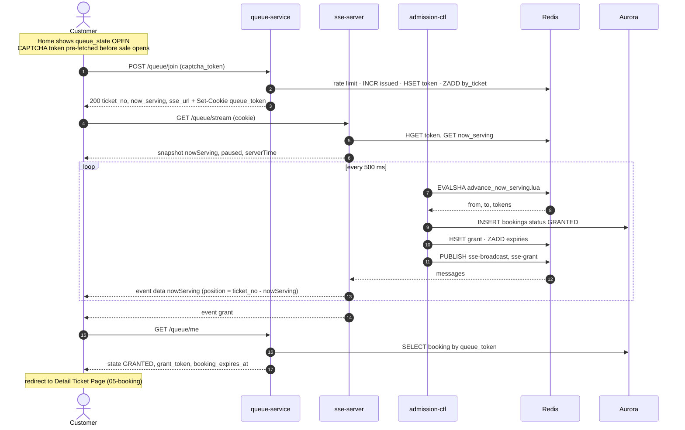
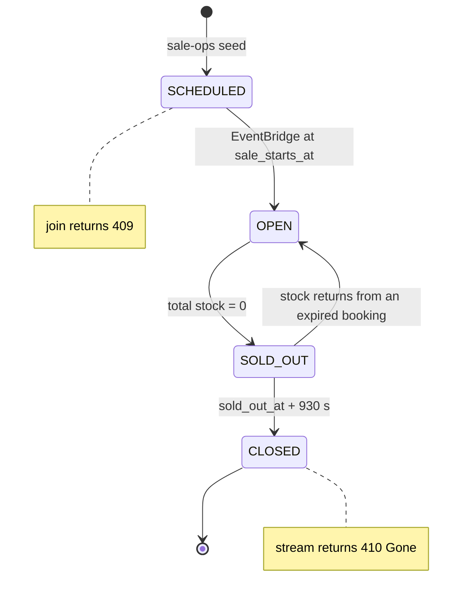
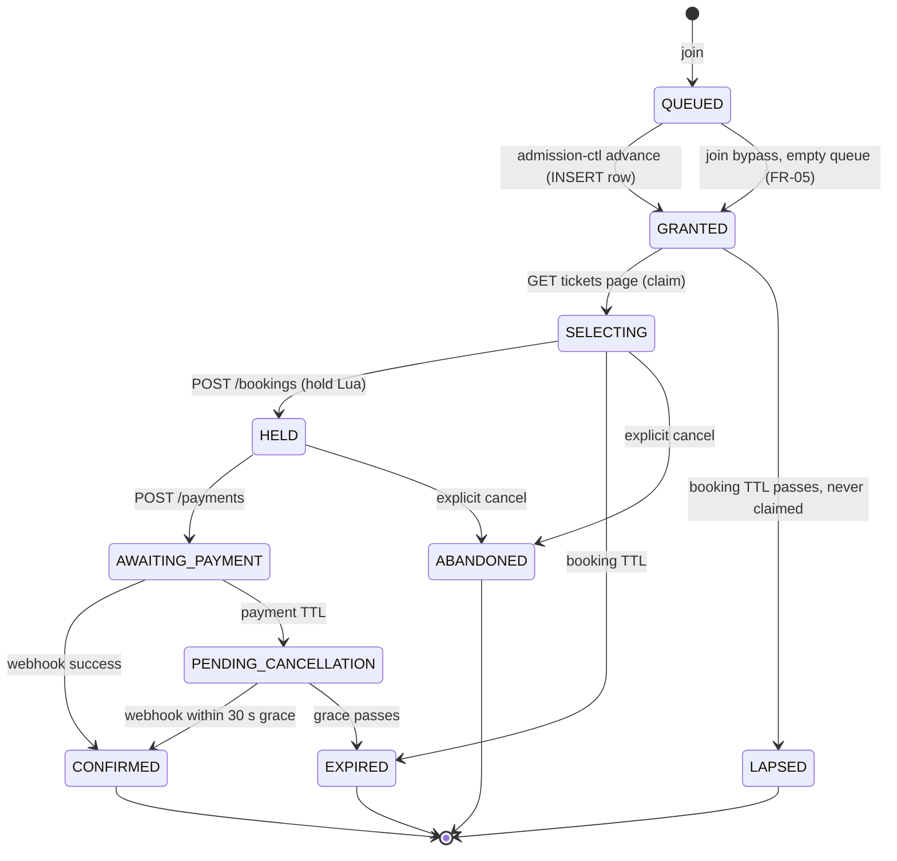

# 04 — Queue (Virtual Waiting Room)

Admits customers from a 300,000-person queue into the booking flow, first come first
served, without overselling slots and without dropping anyone who has been told
"it's your turn".

**Sources:** ADR-005 §5–§7, §11–§12 · impl-plan §7 (queue), §8 (sse-server), §9 (admission-ctl)
· api-contracts §3 · requirements FR-04..FR-10f, BR-07, BR-09, BR-13a, BR-16, BR-17, BR-21, BR-22.

## Files

| # | File | Apidog request | Component |
|---|---|---|---|
| 01 | [01-join-queue.md](01-join-queue.md) | `POST /events/{event_id}/queue/join` | `services/queue` (Lambda) |
| 02 | [02-queue-status-stream.md](02-queue-status-stream.md) | `GET /events/{event_id}/queue/stream` | `services/sse-server` (ECS) |
| 03 | [03-get-queue-state.md](03-get-queue-state.md) | `GET /events/{event_id}/queue/me` | `services/queue` (Lambda) |
| 04 | [04-get-now-serving.md](04-get-now-serving.md) | `GET /events/{event_id}/queue/serving` | `services/queue` (Lambda) |
| 05 | [05-admission-controller.md](05-admission-controller.md) | none (internal loop) | `services/admission-ctl` (ECS) |

## 1. Components

## 2. End-to-end flow

## 3. State machines

### 3.1 Sale state per event (`queue:{ev}:state`)

Home page `queue_state` (`NOT_OPEN / DIRECT / OPEN / FULL`) is **derived** from this state plus
depth. It is not stored. See `03-events/`.

### 3.2 Customer engagement (Redis token, then `bookings.status`)

The queue domain owns `QUEUED → GRANTED` and `GRANTED → LAPSED`. Everything after
`SELECTING` belongs to `05-booking/` and `07-payment/`. `slots:open` increases only at
`GRANTED`. It decreases only at terminal states (ADR-005 §6, "Kepemilikan slots:open").

## 4. Redis keyspace (queue domain)

All names come from `pkg/rediskeys` (impl-plan §3.1). Never hand-write a key string.

| Key | Type | Writer | Readers |
|---|---|---|---|
| `queue:{ev}:state` | string | sale-ops, advance Lua | all |
| `queue:{ev}:issued` | counter | join | join, events |
| `queue:{ev}` → `now_serving`, `rate_per_min` | hash | advance Lua, ctl | all |
| `queue:{ev}:by_ticket` | zset (score = ticket_no) | join, advance Lua | advance Lua |
| `slots:open:{ev}` | counter | advance Lua (+), terminal transitions (−), reconciliation | advance Lua |
| `regrant:{ev}` | set | ctl on INSERT failure | advance Lua |
| `token:{uuid}` | hash, EX sale window | join | me, stream, ctl |
| `acct:{ev}:{account_id}` | string NX | join | join, me |
| `grant:{token}` | hash, EX 1080 | ctl, join bypass | me, booking (`pkg/grantauth`) |
| `qpersist:{ev}` | list | join | ctl drain |
| `ctl:leader`, `ctl:epoch` | string / counter | ctl | ctl |
| `pause:{ev}` | flag | ctl | serving, stream |
| `rl:join:{ip}`, `rl:sse:{ip}` | token bucket | join, stream | — |

All keys tagged `{ev}` hash to the same cluster slot, so **one event = one Redis shard**.
Load-test that shard (§6, #2).

## 5. Build order

Each step is demoable alone.

1. **Shared pkg:** `pkg/rediskeys`, `pkg/redisscript` (loader + `advance_now_serving.lua` + tests), `pkg/ratelimit`
2. **Local env:** docker compose with Redis (cluster mode) + Postgres, plus migrations for `bookings` columns needed here (`grant_token`, `UNIQUE (event_id, queue_token)`)
3. **05 admission-ctl:** tick loop with ADVANCE only (single task, no lease yet), then INSERT, then PUBLISH
4. **01 join**, without CAPTCHA and bypass first
5. **04 serving**, then **03 me**
6. **02 sse-server:** snapshot, broadcast fan-out, grant delivery
7. Harden: leader lease, sweep LAPSED, reconciliation, CAPTCHA, FR-05 bypass, qpersist drain
8. Load test: 300k synthetic joins + SSE fan-out (k6)

## 6. Open decisions

Decide these before step 3. Grep `OPEN:` across this folder for local ones.

| # | Decision | Recommendation | Where |
|---|---|---|---|
| 1 | **Crash between advance Lua and INSERT drops customers.** Tokens leave `by_ticket` and are not in `regrant`, so `/me` shows `QUEUED` behind `now_serving` forever. Applies to ctl ADVANCE and the join bypass | Lua moves tokens into `queue:{ev}:granting` (zset, score = now). Make INSERT idempotent with `UNIQUE (event_id, queue_token)` + `ON CONFLICT DO NOTHING`. Remove from `granting` only after INSERT + PUBLISH. Each tick re-processes entries older than 5 s | [05](05-admission-controller.md) |
| 2 | One Redis shard per event | Accept for POC; state it in ADR; load-test about 30k ops/s on one primary | §4 |
| 3 | `MAX_CONCURRENT_SLOTS` and tail formula (ADR §17 #5). `min(MAX, stock)` admits users who may find their category empty | Switch to `ceil(remaining / 3)` when `remaining < MAX × 3` | [05](05-admission-controller.md) |
| 4 | POC scope: CAPTCHA, device binding, qpersist + rebuild | Real CAPTCHA behind an interface with mock provider; device binding on; qpersist write on, drain later | [01](01-join-queue.md) |
| 5 | `SALE_WINDOW_SECONDS` value (ADR §17 #10) | 21600 default for POC | config |
