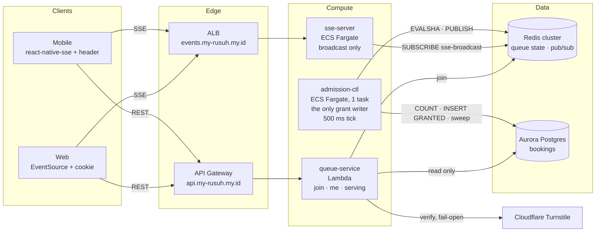
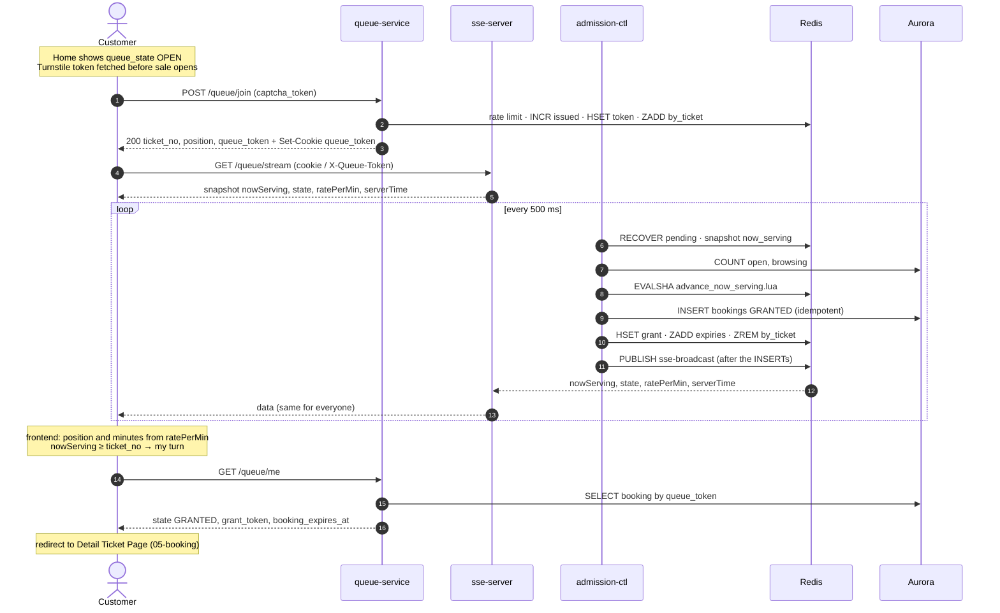
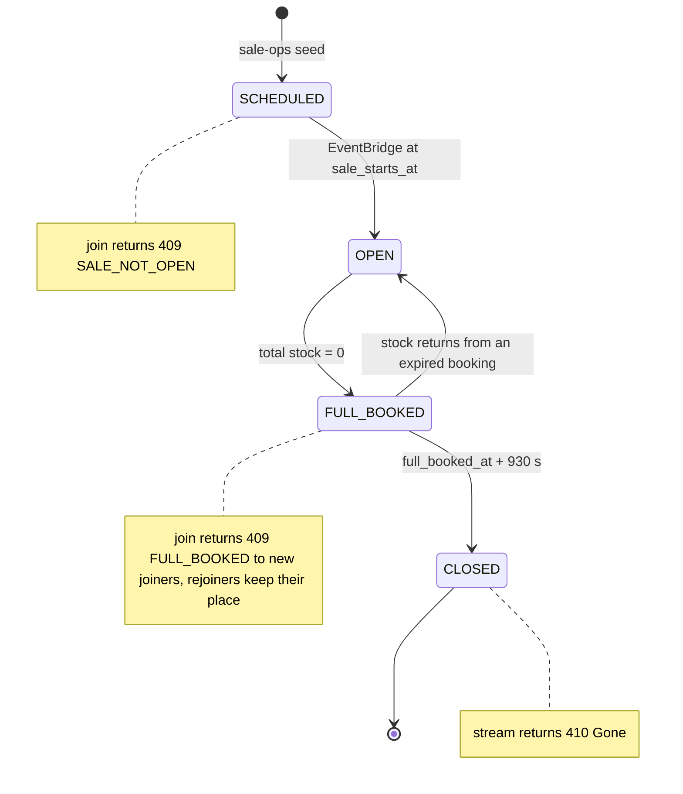
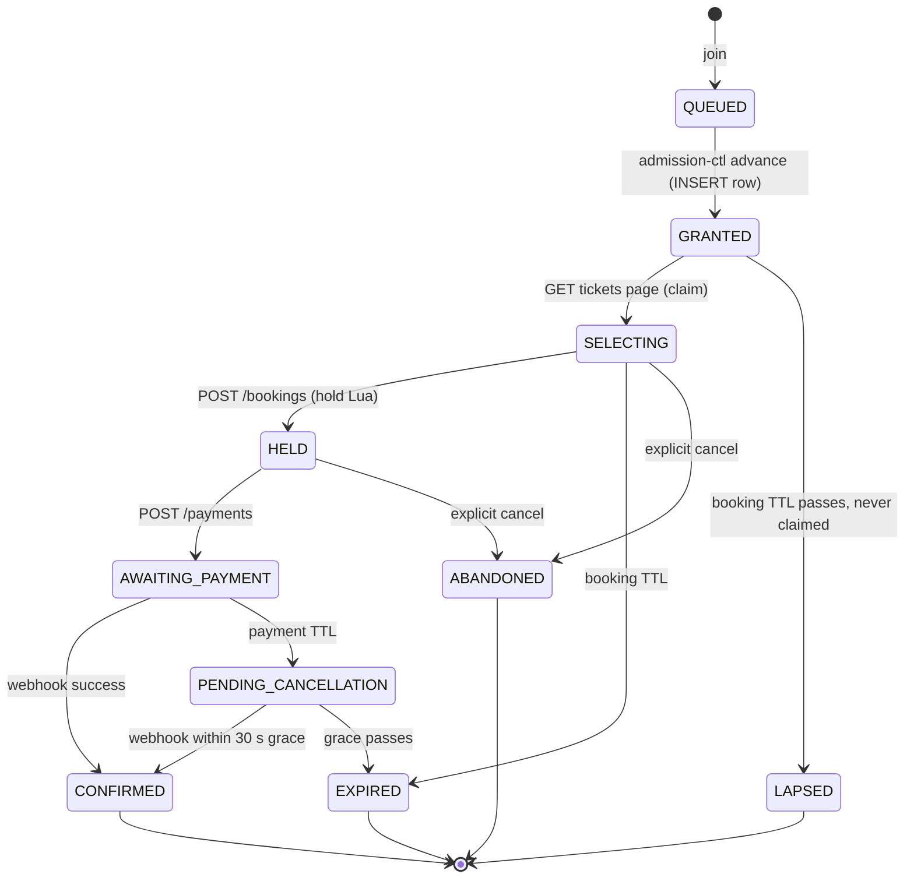
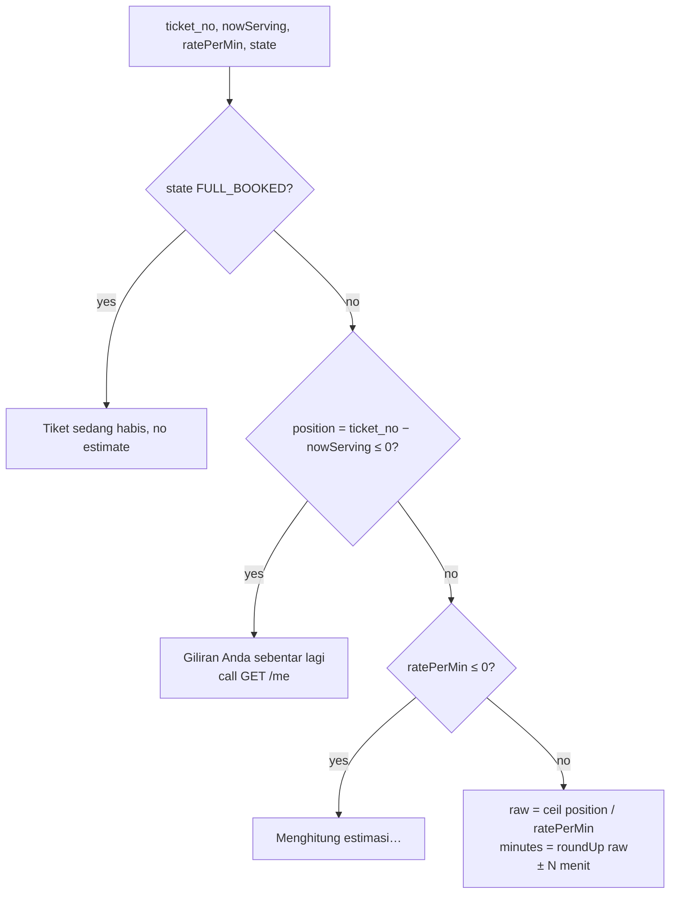

# 04 — Queue (Virtual Waiting Room)

Admits customers from a 300,000-person queue into the booking flow, first come first
served, without overselling slots and without dropping anyone who has been told
"it's your turn".

**Sources:** ADR-005 §5–§7, §11–§12, **as amended by ADR-006** · impl-plan §7 (queue), §8 (sse-server),
§9 (admission-ctl) · api-contracts §3 · requirements FR-04..FR-10f, BR-07, BR-09, BR-13a, BR-16,
BR-17, BR-21, BR-22.

## Files

| # | File | Apidog request | Component |
|---|---|---|---|
| 01 | [01-join-queue.md](01-join-queue.md) | `POST /events/{event_id}/queue/join` | `services/queue` (Lambda) |
| 02 | [02-queue-status-stream.md](02-queue-status-stream.md) | `GET /events/{event_id}/queue/stream` | `services/sse-server` (ECS) |
| 03 | [03-get-queue-state.md](03-get-queue-state.md) | `GET /events/{event_id}/queue/me` | `services/queue` (Lambda) |
| 04 | [04-get-now-serving.md](04-get-now-serving.md) | `GET /events/{event_id}/queue/serving` | `services/queue` (Lambda) |
| 05 | [05-admission-controller.md](05-admission-controller.md) | none (internal loop) | `services/admission-ctl` (ECS) |

The wait-time estimate (FR-09) is not an endpoint: it's fields on join, `/me` and the stream. It lives in
[§8](#8-wait-time-estimate-fr-09) below, with the `rate_per_min` measurement in [05 §3.5](05-admission-controller.md#35-rate_per_min).

## 0. The design in five rules

1. **One writer.** Only admission-ctl grants, on a fixed 500 ms tick. Join never grants; on an empty
   queue it just waits up to 1 s for the next tick to grant it (S2).
2. **One broadcast.** Everyone receives the same bytes (`nowServing`, `state`, `ratePerMin`,
   `serverTime`). There is no per-customer push. When `nowServing ≥ ticket_no`, the client calls
   `/me` to collect its `grant_token` (S3). A named `status` event marks each sale-state change.
   **No admission pause** (ADR-006 §4.3): the queue keeps moving when a dependency is down.
3. **Counts come from Aurora.** Each tick reads `open` and `browsing` from `bookings` on the writer.
   There are no Redis slot counters to keep in sync across services (S1).
4. **Nobody is lost.** A token stays in `by_ticket` until its `GRANTED` row exists. A score
   ≤ `now_serving` means a pending grant, which is retried every tick (decision #1).
5. **Every error leans towards admitting fewer.** Stale counts can only make the ctl admit
   less for one tick, never more ([05 §3.3](05-admission-controller.md#33-why-a-non-atomic-count-is-safe)).

## 1. Components



## 2. End-to-end flow



## 3. State machines

### 3.1 Sale state per event (`queue:{ev}:state`)



Home page `queue_state` (`NOT_OPEN / DIRECT / OPEN / FULL`) is **derived** from this state plus
depth. It is not stored. See `03-events/`.

### 3.2 Customer engagement (Redis token, then `bookings.status`)



The queue domain owns `QUEUED → GRANTED` and `GRANTED → LAPSED`. Everything after
`SELECTING` belongs to `05-booking/` and `07-payment/`.

**Two sets of statuses drive admission.** They are counted from Aurora each tick (S1), so no other
domain has to update a queue counter:

| Name | Statuses | Used for |
|---|---|---|
| `open` (everyone inside) | GRANTED, SELECTING, HELD, AWAITING_PAYMENT, PENDING_CANCELLATION | capacity: `MAX − open` |
| `browsing` (inside, not holding seats) | GRANTED, SELECTING | inventory: `ceil(stock / 3) − browsing` |

**Invariant the counting relies on:** no transition goes *back into* GRANTED or SELECTING.
If `05-booking/` ever adds one (e.g. HELD → SELECTING to change seats), revisit
[05 §3.3](05-admission-controller.md#33-why-a-non-atomic-count-is-safe).

## 4. Redis keyspace (queue domain)

All names come from `pkg/rediskeys` (impl-plan §3.1). Never hand-write a key string.
**The full list (type, TTL, writer, readers, meaning) is in [`../redis-keys.md`](../redis-keys.md)**,
kept in step with the code by a test in `pkg/rediskeys`. In short:

| Group | Keys |
|---|---|
| Event (slot `{ev}`) | `queue:{ev}` (`now_serving`, `rate_per_min`, `name`, `sale_starts_at`), `queue:{ev}:state`, `queue:{ev}:issued`, `queue:{ev}:by_ticket` (score ≤ `now_serving` = **pending grant**), `queue:{ev}:full_booked_at`, `expiries:{ev}`, `stock:{ev}:{cat}`, `acct:{ev}:{account_id}` |
| Customer (no tag) | `token:{queue_token}`, `grant:{grant_token}`, `rl:join:{ip}`, `rl:joinacct:{account_id}`, `rl:sse:{ip}` |
| Channels | `sse-broadcast`, `sse-status` (state changes, incl. CLOSED) |

**Removed** compared with ADR-005: `regrant:{ev}` (decision #1), `slots:open:{ev}` (S1), the
`sse-grant` channel (S3), `pause:{ev}` + `pause:{ev}:grace_applied` (ADR-006 §4.3), `sse-sold-out`
(folded into `sse-status`). `slots:browsing:{ev}` was proposed and then dropped by S1.
**Deferred to production** (§7): `qpersist:{ev}`, `ctl:leader`, `ctl:epoch`.

All keys tagged `{ev}` hash to the same cluster slot, so **one event = one Redis shard**.
Load-test that shard (§6, #2).

## 5. Build order

Each step is demoable alone.

1. **Shared pkg:** `pkg/rediskeys`, `pkg/redisscript` (loader + `advance_now_serving.lua` + tests), `pkg/ratelimit`
2. **Local env:** docker compose with Redis (cluster mode) + Postgres, plus migrations for `bookings`
   (`grant_token`, `UNIQUE (event_id, queue_token)`, partial index on active statuses)
3. **05 admission-ctl:** tick loop: COUNT → ADVANCE → idempotent INSERT → ZREM → BROADCAST, then RECOVER
4. **01 join**, without CAPTCHA first; empty-queue wait for the grant after step 3
5. **04 serving**, then **03 me**
6. **02 sse-server:** snapshot + broadcast fan-out (no per-token routing)
7. **Wait-time estimate (§8):** `rate_per_min` window in ctl; frontend rule from api-contracts §3.5
8. Harden: sweep LAPSED, Turnstile, FULL_BOOKED → CLOSED + `status` events
9. Load test: 300k synthetic joins + SSE fan-out (k6)

## 6. Decisions

All queue decisions are closed (2026-11-05) and recorded in **ADR-006**. Grep `OPEN:` across this
folder for anything local.

| # | Decision | Outcome | Where |
|---|---|---|---|
| 1 | Crash between advance Lua and INSERT drops customers | **`by_ticket` as the tray (option B).** The Lua doesn't `ZREM`. Score ≤ `now_serving` = pending. INSERT is idempotent (`UNIQUE (event_id, queue_token)`). `ZREM` comes last. Each tick RECOVERs first. `regrant` removed | [05 §3.1](05-admission-controller.md#31-pending-grant-rule) |
| 2 | One Redis shard per event | **Accept for POC.** The multi-key Lua scripts need it anyway. Load-test about 30k ops/s; if short, scale the node. Sharded pub/sub is deferred (§7) | §4 |
| 3 | Tail formula + tail stall (#3a) | **`deficit = min(MAX − open, ceil(stock / 3) − browsing)`.** ÷ 3 so every admitted customer can buy a full order. `browsing` so customers already holding seats aren't counted against stock twice | [05 §3.2](05-admission-controller.md#32-admission-formula) |
| 4 | POC scope | **Cloudflare Turnstile** behind a `Captcha` port + mock. Device binding on. qpersist **deferred** (§7) | [01 §6](01-join-queue.md#6-edge-cases-and-decisions) |
| 5 | `SALE_WINDOW_SECONDS` | **21600 (6 h)** for POC | config |
| 6 | Idle or leaving customers | **Keep the locked rule.** No eviction while waiting; a no-show is reclaimed by the 5-min booking TTL → `LAPSED`, final | [05 §4](05-admission-controller.md#4-lapsed-queue-owned-part-of-sweep) |
| 7 | `/serving` cache key | **No query string**, one CDN entry. Server returns `poll_tiers` | [04 §3](04-get-now-serving.md#3-poll-interval-server-decided-table-client-selected-row) |
| 8 | CloudFront TTL | **1 s** | [04 §6](04-get-now-serving.md#6-edge-cases-and-decisions) |
| 9 | `/me` reader lag | **Re-check once on the writer** when there's no row and `ticket_no ≤ now_serving` | [03 §6](03-get-queue-state.md#6-edge-cases-and-decisions) |
| 10 | POC lease | **Deferred** (§7). One task; ECS restarts it; deploy min 0 % / max 100 % | [05 §6](05-admission-controller.md#6-edge-cases-and-decisions) |
| 11 | SSE connections per task · sharded pub/sub | Connections per task: **load-test output**. Classic `PUBLISH` behind an interface; sharded pub/sub **deferred** (§7) | [02 §6](02-queue-status-stream.md#6-edge-cases-and-decisions) |
| S1 | Where admission counts come from | **Aurora COUNT each tick** (writer, partial index). Redis `slots:open` / `slots:browsing` removed, so booking, payment and webhook no longer touch queue counters | [05 §3.3](05-admission-controller.md#33-why-a-non-atomic-count-is-safe) |
| S2 | Who grants | **admission-ctl only.** Empty-queue join waits ≤ 1 s for the next tick's grant, so FR-05 `granted: true` is kept. Webhook, outbox and cancel do nothing queue-related; the next tick uses the freed place | [01 §2](01-join-queue.md#2-flow) |
| S3 | How a customer learns it's their turn | **From the broadcast:** `nowServing ≥ ticket_no` → `GET /me`. The `grant` SSE event is removed | [02 §1](02-queue-status-stream.md#1-purpose) |
| 12 | Wait-time estimate (FR-09) | **Frontend computes it** from `ratePerMin` (ctl: 60 s window while OPEN, seeded at T0): `ceil(position / ratePerMin)`, rounded **up**, shown as "± N menit". No estimate field in any API | [§8](#8-wait-time-estimate-fr-09) |
| 13 | Admission pause (BR-13a, BR-22) | **Removed.** Breakers fail fast; the queue keeps moving; deadlines never shift | ADR-006 §4.3 |

**Still open, not blocking the build:** `MAX_CONCURRENT_SLOTS` value (ADR-005 §17 #5), slow-start
ramp at T0, pre-queue randomization at T0 (requirement change, NFR-05), SSE reconnect jitter,
sell-out hint in the waiting room (tender owner, ADR-005 §17 #3). See ADR-006 §9.

## 7. POC scope vs production path

The POC builds everything the tender and requirements v1.1 ask for. These three are **deferred**:
they matter only for availability at real 300k load, and the POC design already leaves room
for them (ADR-006 §9).

| Deferred | POC instead | Cost of deferring | To add later |
|---|---|---|---|
| **Leader lease + standby** for admission-ctl (`ctl:leader`, `ctl:epoch`) | 1 task. ECS replaces it on failure (about 30–60 s). Deploy min 0 % / max 100 % | queue freezes up to about 1 min on a crash; nothing is lost (pending grants). NFR-14 detection unchanged, recovery is the ECS restart instead of the lease | lease + epoch per ADR-005 §11; the CAS fence and CAS sweeps already make 2 tasks safe |
| **qpersist + `queue_entries` + rebuild from Aurora** | Redis Multi-AZ only | a *total* Redis loss loses queue positions. Paid and held seats are safe in Aurora | join `RPUSH qpersist`, ctl drain, rebuild job (ADR-005 §12) |
| **Sharded pub/sub** (`SPUBLISH`/`SSUBSCRIBE`) | classic `PUBLISH`, behind one interface | cross-node pub/sub traffic at very large fan-out | swap the adapter |

## 8. Wait-time estimate (FR-09)

**In one sentence:** admission-ctl measures how fast the queue moves (`ratePerMin`) and broadcasts
it; the **frontend** turns it into "± N menit". No API response carries an estimate.

Contract: api-contracts §3.5 · decision: ADR-006 §6.2.

### 8.1 Who does what

| Piece | Where | What |
|---|---|---|
| `rate_per_min` | admission-ctl, every tick ([05 §3.5](05-admission-controller.md#35-rate_per_min)) | ticket numbers `now_serving` passes per minute, last 60 s while `OPEN`; `HSET queue:{ev} rate_per_min` |
| `ratePerMin` | SSE default event (02) | same value, every broadcast |
| `rate_per_min` | `/serving` (04) | same value, for polling mode |
| minutes + text | web and mobile | rule below; written once in api-contracts §3.5 |

### 8.2 The rule (frontend)



| Raw minutes | Rounded **up** to | Example |
|---|---|---|
| 1–10 | whole minute | 4 → 4 |
| 11–30 | next multiple of 5 | 12 → 15 |
| 31–60 | next multiple of 10 | 33 → 40 |
| > 60 | next multiple of 30 | 725 → 750 |

| minutes | Text |
|---|---|
| 1–59 | "Estimasi waktu tunggu ± {m} menit" (tender wireframe §9.2) |
| 60–180 | "Estimasi waktu tunggu ± {m/60} jam" (90 → "± 1,5 jam") |
| > 180 | "Estimasi waktu tunggu lebih dari 3 jam" |

Rounding up makes the estimate lean pessimistic, and the big steps stop it flickering every 500 ms.

### 8.3 Inputs the backend sends

```
SSE default event:   {"nowServing":31604,"state":"OPEN","ratePerMin":318,"serverTime":"…"}
/serving data:       {"now_serving":31600,"rate_per_min":318,"state":"OPEN","server_time":"…", "poll_after_ms":…, "poll_tiers":[…]}
join data:           {"ticket_no":32748,"now_serving":31500,"position":1248,"queue_token":"qt_xyz789","sse_url":"https://events.my-rusuh.my.id/events/evt_konser_a/queue/stream","event":{…}}
```

`ticket_no` comes from join (or `/me`); `ratePerMin` arrives with the first SSE snapshot, so the
estimate appears within the first second.

### 8.4 Worked example

`ratePerMin = 200`:

| ticket_no | nowServing | position | raw | minutes | Shown |
|---|---|---|---|---|---|
| 5,150 | 5,000 | 150 | 1 | 1 | ± 1 menit |
| 6,000 | 5,000 | 1,000 | 5 | 5 | ± 5 menit |
| 7,400 | 5,000 | 2,400 | 12 | 15 | ± 15 menit |
| 11,000 | 5,000 | 6,000 | 30 | 30 | ± 30 menit |
| 150,000 | 5,000 | 145,000 | 725 | 750 | lebih dari 3 jam |

The last row will almost certainly never get a turn: the tickets run out first (§8.5).

### 8.5 Sale-level estimate (planning, not shown to customers)

```
throughput (admitted / min)      ≈ MAX_CONCURRENT_SLOTS / avg_slot_minutes
buyers needed                    ≈ total_tickets / avg_basket
admitted needed                  ≈ buyers_needed / conversion
time to sell out (min)           ≈ admitted_needed / throughput
share of the queue with a turn   ≈ admitted_needed / queue_size
```

Assumptions (replace with load-test or first-sale data): 10,000 tickets, 300,000 queue,
`avg_basket` 2, `conversion` 70 %, `avg_slot_minutes` 5. Result: about **7,150** admitted
customers sell out, ≈ **2.4 %** of the queue; about 292,000 never get a turn.

| MAX | Throughput | Time to sell out |
|---|---|---|
| 500 | 100 / min | ≈ 72 min |
| 1,000 | 200 / min | ≈ 36 min |
| 2,000 | 400 / min | ≈ 18 min |

The cut-off (≈ 7,150 turns) doesn't depend on MAX, only the speed does. Pick MAX from the load test
against Dukcapil and payment limits, not from the wished-for sale length.

**Proposed, not decided (tender owner, ADR-005 §17 #3, ADR-006 §6.4):** a global
`likelyServedUntil` on the broadcast so customers past it see "Tiket kemungkinan habis sebelum
giliran Anda". Behind flag `SHOW_SELLOUT_HINT`, off.

### 8.6 Decisions

- **DECIDED: frontend computes, backend only sends `ratePerMin`** (ADR-006 §6.2). Rejected:
  backend-computed `estimated_wait_minutes` + `wait_status` (per-connection SSE bytes; impossible on
  the CDN-cached `/serving`).
- **DECIDED: one rounded-up number, "± N menit"**, matching the tender wireframe. Rejected: a range;
  a p25 rate (revisit if the first sale shows estimates too optimistic).
- `ETA_SEED_SLOT_MINUTES` (5) is an assumption; replace after the load test.

### 8.7 Tests and tasks

- [ ] ctl unit: `rate_per_min` window, seed, FULL_BOOKED exclusion ([05 §3.5](05-admission-controller.md#35-rate_per_min))
- [ ] contract: SSE examples validate against `QueueStreamUpdate`; `/serving` against `NowServingData`
- [ ] client unit (web + mobile, shared fixtures): every branch of §8.2; rounding boundaries 10/11, 30/31, 60/61; never rounds down
- [ ] metrics per sale: `RatePerMin`, `AvgSlotMinutes`, `AvgBasket`, `Conversion`, `GapRatio`, `TimeToSellOut`
- [ ] client spec for web and mobile: §8.2 strings
- [ ] dashboard: §8.5 inputs measured live
