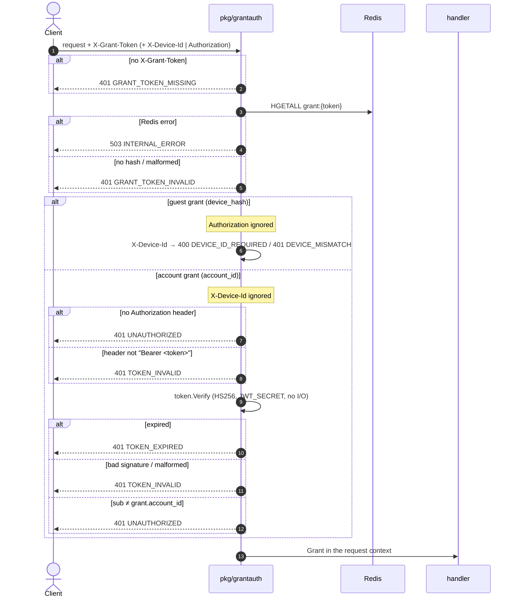

# Grant authorization — `Authorization: Bearer` for account grants

| | |
|---|---|
| **Service** | `pkg/grantauth` (used by `services/booking` now, `services/payment` later) |
| **Auth** | `X-Grant-Token` · `X-Device-Id` (guest grant) · `Authorization: Bearer` (account grant) |
| **Contract** | api-contracts §4 header table and order (v2.20); the 401 rows of §4.1, §4.3, §4.4 and §5; Apidog 401 `UNAUTHORIZED` / `TOKEN_EXPIRED` / `TOKEN_INVALID` on every grant endpoint |
| **Requirements** | FR-02 (guests buy), NFR-11 · ADR-005 Bagian 12 ("konjungsi kedua") as amended by ADR-006 §8.17 |
| **Status** | built (step B4a) |

## 1. Purpose

A grant that belongs to a logged-in account must come with that account's session. Today `pkg/grantauth` checks the
grant and, for a guest, the device; an account grant passes on the grant alone. So a leaked account grant opens the
ticket page and the booking detail of someone else, and later would let a stranger pick that account's saved NIKs.

Simple picture: the grant is the wristband. A guest's wristband is tied to their phone (device id). A member's wristband
is tied to their membership card (the access token): showing the wristband without the card, or with someone else's
card, gets you turned away.

This step adds that check in one place, so every grant endpoint (ticket page, booking detail, `POST /bookings`,
payment) gets it through the middleware.

## 2. Flow

## 3. Steps

1. **Unchanged:** `X-Grant-Token` missing → 401 `GRANT_TOKEN_MISSING`; `HGETALL grant:{token}`; Redis error → 503;
   no hash or a malformed one → 401 `GRANT_TOKEN_INVALID`.
2. **Guest grant** (`device_hash` set): unchanged device check. `Authorization` is **ignored**, even when it is
   present and invalid: a guest who also happens to be logged in elsewhere, or sends a stale token, is served as the
   guest the grant was issued to (contract §4: "Tamu yang mengirim `Authorization` tetap dilayani sebagai tamu").
3. **Account grant** (`account_id` set), in this order:
   1. no `Authorization` header → 401 `UNAUTHORIZED`;
   2. a header that is not `Bearer <token>` (case-insensitive scheme, non-empty token) → 401 `TOKEN_INVALID`. The same
      parsing as queue's join and `/queue/me` (`bearerToken`), moved to `pkg/grantauth` so both use one rule;
   3. `token.Verify` (`pkg/token`, HS256 with `JWT_SECRET`, the same check queue does): `ErrExpired` → 401
      `TOKEN_EXPIRED`; any other error → 401 `TOKEN_INVALID`;
   4. `claims.Subject ≠ grant.AccountID` → 401 `UNAUTHORIZED` (a valid session of **another** account), logged with
      `metric=GrantAccountMismatch` (the `slog` metric field nik-verify uses; `pkg/grantauth` has no metrics port).
      Compared in constant time, like the device hash.
   `X-Device-Id` is not checked for an account grant (the account binds more strongly; README §2 rule 2.4).
4. The `Grant` goes into the context as today. **`grant.AccountID` stays the source of the booking's account**; the
   token only checks it (contract §4: "Sesi tidak menentukan akun booking").

Order of checks, as in the contract: grant → device (guest) → `Authorization` (account). An expired grant with a valid
token is still `GRANT_TOKEN_INVALID`.

### 3.1 Configuration

- `grantauth.Config` gains `Tokens`, a small interface `Verify(raw string) (token.Claims, error)` that `*token.Issuer`
  satisfies. `Middleware` refuses to build with a nil `Tokens` (fail at start, never at the first account request).
- booking: `JWT_SECRET` in `config.Load` (required outside `APP_ENV=local`, no default, the same error text as queue:
  "a known signing key forges sessions"); `token.NewIssuer(JWT_SECRET, "rusuh-user", time.Hour)` as in queue's wiring.
- booking `template-cfn.yaml`: `JWT_SECRET: '{{resolve:secretsmanager:rusuh-${Environment}/jwt-signing:SecretString}}'`,
  the same secret user-service signs with and queue verifies with. No new CI variable.
- `services/booking/example.env`: `JWT_SECRET` with **the same value as `services/user/example.env`**, so a token from
  the local login verifies on the local booking. `services/queue/example.env` uses a different value today (a token
  from the local login fails there); it is aligned in the same change.

## 4. Data touched

| Store | Key / table | Op | Notes |
|---|---|---|---|
| Redis | `grant:{token}` | HGETALL | unchanged |
| — | access token | HMAC verify in memory | no Redis, no Aurora: the check adds no round trip |

## 5. Responses and errors

New on every grant endpoint (the rest of each endpoint's table is unchanged):

| HTTP | Code | When |
|---|---|---|
| 401 | `UNAUTHORIZED` | account grant without `Authorization`, or with a valid token of another account |
| 401 | `TOKEN_EXPIRED` | account grant with an expired token; the client refreshes (`POST /auth/refresh`) and repeats |
| 401 | `TOKEN_INVALID` | account grant with a malformed header, a bad signature, or an unreadable token; the client logs in again |

The grant and the booking are untouched by any of these: after a refresh the same call succeeds, with the same
deadline.

## 6. Edge cases

- **Session expires mid-sale.** user-service issues access tokens for at least the sale window plus a margin
  (`ACCESS_TOKEN_TTL_SECONDS`, checked against `SALE_WINDOW_SECONDS` at start), and a grant lives at most 18 minutes,
  so this is rare. When it happens the customer gets `TOKEN_EXPIRED`, refreshes and continues. Nothing is lost.
- **Logged out on this device, logged in as someone else.** The token is valid but `sub` differs → `UNAUTHORIZED`. The
  grant stays with the account it was issued to.
- **Guest grant, logged-in caller.** Served as the guest (step 2); the purchase stays a guest purchase. Same rule as
  queue's `owns` (a guest token with a logged-in caller is not an error).
- **Order of 401s.** A dead grant is reported before a bad token, so the client goes to `GET /queue/me` first, which is
  the only place that can hand out a new grant.
- **`nik_verified` claim is not used.** Whether the account has a verified NIK is read from `accounts` where it matters
  (`use_account_nik`, 02 §3.1 step 4), not from a claim that is only as fresh as the token.
- **Payment later.** `services/payment` uses the same middleware with the same `Config`; nothing payment-specific here.

## 7. Tests

Unit, `pkg/grantauth` (miniredis, a real `token.Issuer` with a test secret):

- [x] an account grant without `Authorization` answers 401 `UNAUTHORIZED`
- [x] an account grant with `Basic …`, `Bearer` with no token, or a garbage token answers 401 `TOKEN_INVALID`
- [x] an account grant with an expired token answers 401 `TOKEN_EXPIRED`
- [x] an account grant with a token signed by another secret answers 401 `TOKEN_INVALID`
- [x] an account grant with a valid token of another account answers 401 `UNAUTHORIZED` and logs `GrantAccountMismatch`
- [x] an account grant with its own valid token passes, and the context carries the grant's account id
- [x] an account grant passes without `X-Device-Id`
- [x] a guest grant ignores `Authorization`: no header, a valid token, an invalid token and an expired token all pass
      with the right device
- [x] an unknown grant with a valid token still answers `GRANT_TOKEN_INVALID` (grant checked first)
- [x] `Middleware` with no token verifier refuses to build
- [x] `bearerToken` accepts `bearer x` and `Bearer  x ` and rejects `Bearer`, `Basic x`, `x`

Unit, `services/booking`:

- [x] config: `JWT_SECRET` required outside local
- [x] ticket page and booking detail routes: each of the three 401s through the real middleware (route test, as
      `routes_test.go` does for the grant codes)

Unit, `services/queue`: its join and `/queue/me` tests pass unchanged after `bearerToken` moves to `pkg/grantauth`.

## 8. Tasks

- [x] `pkg/grantauth`: `Config.Tokens`, the account branch, `BearerToken`, the mismatch log, tests
- [x] queue: use `grantauth.BearerToken` instead of its own `bearerToken`
- [x] booking: `JWT_SECRET` in config, wiring (`token.NewIssuer`), `template-cfn.yaml`, `example.env`; queue's
      `example.env` aligned with user's
- [x] booking route tests for the three 401s on both built routes
- [x] `make verify`; fresh-subagent review (grant tokens are on the risky list)
