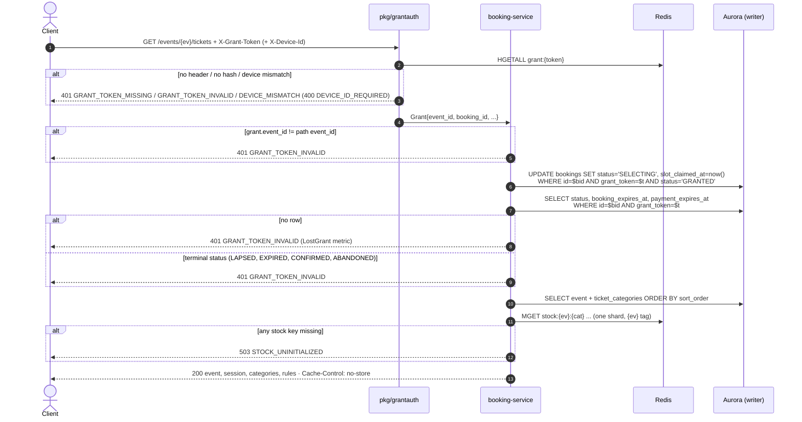
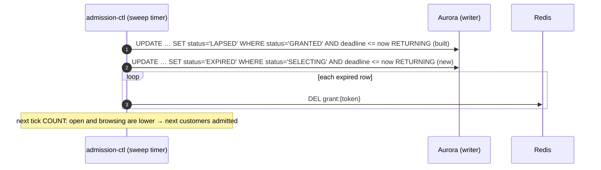

# GET /events/{event_id}/tickets — Get Ticket Selection Page

| | |
|---|---|
| **Service** | `services/booking` (Lambda); the SELECTING sweep runs in `services/admission-ctl` (ECS) |
| **Auth** | `X-Grant-Token` (required) · `X-Device-Id` (required for a guest grant) · `Authorization: Bearer` (required when the grant belongs to a logged-in account) |
| **Contract** | Apidog `GET /events/{event_id}/tickets` · api-contracts §4.1 |
| **Requirements** | FR-11, FR-12, FR-13, FR-17, BR-01, BR-02, BR-03, BR-04 |
| **Detail** | impl-plan §2.2, §2.4, §5.3 · ADR-005 §6–§7 · ADR-006 §3.2, §8.12, §8.13 |
| **Status** | built; the `account` field (§3.1 step 8) is planned with `POST /bookings` |

## 1. Purpose

Renders the Detail Ticket Page: event, categories with price and seats left, the purchase rules, and the 5-minute
countdown. **Loading it is the claim** (impl-plan §2.4): the booking moves `GRANTED → SELECTING` and
`slot_claimed_at` is recorded. The deadline does **not** change; it was fixed at GRANT (`granted_at + 300`, BR-03).

Simple picture: the grant is the wristband, this page is the seat-picking counter. Walking up to the counter is
recorded (SELECTING), but the counter's clock started when the wristband was handed out.

Because SELECTING rows are no longer swept by the GRANTED lapse sweep, **this step also adds the SELECTING → EXPIRED
sweep** (§3.2). Without it the queue stalls (05-booking README §2).

## 2. Flow



## 3. Steps

### 3.1 The endpoint

1. `pkg/grantauth` verifies the grant (README §2 rule 2) and puts `Grant` in the context.
2. **Event check:** `grant.EventID ≠ {event_id}` → 401 `GRANT_TOKEN_INVALID`.
3. **Claim, idempotent:** `UPDATE … WHERE id = $grant.BookingID AND grant_token = $grant.Token AND status = 'GRANTED'`.
   0 rows is not an error (already SELECTING, or later).
4. **Read the row** (writer, same clause without the status filter):

   | Status | Result |
   |---|---|
   | SELECTING | render, `session.expires_at = booking_expires_at` |
   | HELD, AWAITING_PAYMENT, PENDING_CANCELLATION | render (customer pressed Back), `session.expires_at = payment_expires_at` |
   | LAPSED, EXPIRED, CONFIRMED, ABANDONED | 401 `GRANT_TOKEN_INVALID` |
   | no row | 401 `GRANT_TOKEN_INVALID` + metric `LostGrant` (a live hash without a row should not exist) |

   The claim only happens before the deadline, on Aurora's clock (the sweeps' clock): a load after the 5 minutes ran
   out, before the sweep reached the row, leaves it GRANTED, so it lapses instead of turning into an "opened, did not
   pay" EXPIRED. Such a load still renders with the passed `expires_at`; the client shows the expired screen from the countdown.
5. **Event:** `SELECT id, name, event_date, venue, image_url FROM events WHERE id = $1`. Missing → 404 `NOT_FOUND`
   (data error: a grant exists for an unknown event).
6. **Categories:** `SELECT id, name, description, price, max_per_order FROM ticket_categories WHERE event_id = $1 ORDER BY sort_order, id`.
7. **Stock:** one `MGET` of `rediskeys.Event(ev).Stock(cat)` for every category (all on the event's shard). Any key
   missing → 503 `STOCK_UNINITIALIZED` (ADR-005 §8: unknown is not sold out). A negative value is shown as 0.
8. **Build the response:**
   - `available = max(0, stock)`
   - `max_per_order = min(category.max_per_order, available, MAX_TICKETS_PER_TRANSACTION)` (impl-plan §5.3; Tribune with
     0 left → 0)
   - `session = {expires_at, server_time = now}`: the client counts down from `expires_at`, with its clock corrected by
     `server_time` (there is no seconds-left field)
   - `rules = {max_tickets_per_order: MAX_TICKETS_PER_TRANSACTION, one_nik_per_ticket: true}`
   - `account = {email, nik_masked}` from `accounts` for a logged-in grant (`grant.AccountID`), `null` for a guest. It
     pre-fills `contact_email` and the first seat; `nik_masked` is `null` when the account has no verified NIK.
     **Planned** with `POST /bookings`: the built page does not send it yet
   - header `Cache-Control: no-store`

`MAX_TICKETS_PER_TRANSACTION` (default 3, BR-01) is booking config, not a constant, so a test can change it.

### 3.2 SELECTING → EXPIRED sweep (admission-ctl)

Same shape as the built LAPSED sweep (ADR-006 §8.12): Aurora is the only record, one compare-and-set statement.

```sql
UPDATE bookings SET status = 'EXPIRED'
 WHERE status = 'SELECTING' AND booking_expires_at <= $1
RETURNING id, event_id, grant_token
```

- Runs in the same timer as the LAPSED sweep, right after it, on the writer.
- For each returned row: `DEL grant:{token}`. A failed `DEL` is logged; the hash dies on its TTL and every use is
  already rejected by the status check (README §2 rule 3).
- **No stock or NIK release:** a SELECTING row holds nothing (stock is taken only at HELD, ADR-005 §8).
- Credentials: the same as LAPSED today: keep `token:{uuid}` and `acct:{ev}:{id}`, so `/queue/me` answers `EXPIRED`
  and a rejoin finds the old engagement instead of a fresh place.
- Metric `BookingsSelectingExpired` per row (next to `BookingsLapsed`), `SweepFailures` on a failed statement (as the LAPSED sweep).
- Index: `bookings (booking_expires_at) WHERE status = 'SELECTING'` (`0008`).
- The next tick's COUNT no longer sees the row, so its place goes to the next person (no counter to fix, ADR-006 §3).



## 4. Data touched

| Store | Key / table | Op | Notes |
|---|---|---|---|
| Redis | `grant:{token}` | HGETALL (booking), DEL (sweep) | via `pkg/grantauth`; key from `rediskeys.Grant` |
| Redis | `stock:{ev}:{cat}` | MGET | read only; written by sale-ops seed and the hold Lua (B4) |
| Aurora | `bookings` | UPDATE (claim), SELECT, UPDATE (sweep) | writer |
| Aurora | `events` | SELECT | `0002` |
| Aurora | `ticket_categories` | SELECT | `0007` |

## 5. Responses and errors

| HTTP | Code | When |
|---|---|---|
| 200 | — | page data (claim done or already done) |
| 400 | `DEVICE_ID_REQUIRED` | guest grant without `X-Device-Id` |
| 401 | `GRANT_TOKEN_MISSING` | no `X-Grant-Token` |
| 401 | `GRANT_TOKEN_INVALID` | no hash; wrong event; booking finished; no row |
| 401 | `DEVICE_MISMATCH` | guest grant from another device |
| 401 | `UNAUTHORIZED` / `TOKEN_EXPIRED` / `TOKEN_INVALID` | account grant without `Authorization`, of another account, expired, invalid |
| 404 | `NOT_FOUND` | event row missing |
| 503 | `STOCK_UNINITIALIZED` | a stock key is missing in Redis |
| 503 | `INTERNAL_ERROR` | Redis or Aurora unreachable |

## 6. Edge cases

- **Grant used on another event's URL → 401 `GRANT_TOKEN_INVALID`.** The grant is not valid *here*; the answer reveals
  nothing about the other event, and the client already routes a 401 to `/queue/me` for a fresh grant.
- **Booking already finished while the grant hash is alive → 401 `GRANT_TOKEN_INVALID`.** Happens when admission-ctl dies
  between its UPDATE and the `DEL`, or after CONFIRMED. Same answer as a dead hash, so the client has one path
  (`/queue/me` then says EXPIRED or CONFIRMED). One code, not a second 409 `BOOKING_EXPIRED`, for one situation.
- **Countdown after HELD shows `payment_expires_at`**, the deadline that currently applies. Showing the passed 5-minute
  deadline to someone who pressed Back from Payment would tell them their time is up while they still hold seats.
  The frontend normally routes a HELD customer to Payment (`/queue/me` gives `booking_id`).
- **SELECTING → EXPIRED deletes only the grant hash**, as LAPSED does. `token:` and `acct:` stay until the sale window
  ends, so the customer cannot rejoin for a second turn (BR-03, BR-04). `/queue/me` answers `EXPIRED` either way.
- **Stock shown is a snapshot.** `available` can be stale by the time the customer presses Pay; the hold Lua (B4)
  decides, and a failed hold keeps the customer SELECTING with the rest of the time (ADR-005 §8).
- **No Aurora fallback for a missing stock key.** Rare (flush/failover), reconciliation restores it, and the hold
  would fail the same way.
- **Not rate limited.** The grant already limits who can call it (≤ `MAX_CONCURRENT_SLOTS` people); a reload costs one
  no-op UPDATE, one SELECT, one MGET.
- **A logged-in grant from another device works** (no device check, README §2 rule 2.4): the account, proven by
  `Authorization`, is what binds it.

## 7. Tests

Unit (`services/booking/.../usecase`, fakes for ports; `pkg/grantauth` on miniredis):

- [x] grantauth: missing header → `GRANT_TOKEN_MISSING`; unknown token → `GRANT_TOKEN_INVALID`; guest without device id →
      `DEVICE_ID_REQUIRED`; guest with another device → `DEVICE_MISMATCH`; guest with its device → passes; logged-in grant
      without device id → passes; Redis error → 503
- [x] a grant for event A on event B's page is rejected with `GRANT_TOKEN_INVALID`
- [x] the first load moves GRANTED to SELECTING and keeps `booking_expires_at`
- [x] a reload while SELECTING changes nothing and renders the same deadline
- [x] HELD renders the page with the payment deadline
- [x] a lapsed, expired, confirmed or abandoned booking is rejected with `GRANT_TOKEN_INVALID`
- [x] `max_per_order` is the smallest of the category limit, seats left and the per-order limit; 0 when sold out
- [x] a missing stock key answers `STOCK_UNINITIALIZED`, a negative stock shows 0
- [x] categories come back in `sort_order`
- [x] the response has no seconds-left field
- [x] the response carries `Cache-Control: no-store` and the contract envelope

Integration (real Postgres via `pkg/pgtest`, Redis cluster via `REDIS_ADDR`):

- [x] claim UPDATE is a compare-and-set: two concurrent loads → one row updated, both render
- [x] stock MGET works on the cluster (all keys on the `{ev}` shard)
- [x] admission-ctl: a SELECTING row past its deadline becomes EXPIRED and its grant hash is gone; one second before,
      it stays SELECTING
- [x] admission-ctl: two sweepers on the same row → exactly one gets it back
- [x] admission-ctl: after the sweep, the next tick admits the next customer (COUNT dropped)
- [x] admission-ctl: the sweep never touches HELD or later rows
- [x] the SELECTING sweep query uses the partial index (EXPLAIN, generic plan as in `bookings_test.go`)

## 8. Tasks

- [x] use case `GetTicketSelection` + handler + route in `services/booking`
- [x] SELECTING sweep in `services/admission-ctl` (SQL, use case, metric)
- [x] `make verify` green; independent reviews done
- [ ] `account {email, nik_masked}` field (with `POST /bookings`)
