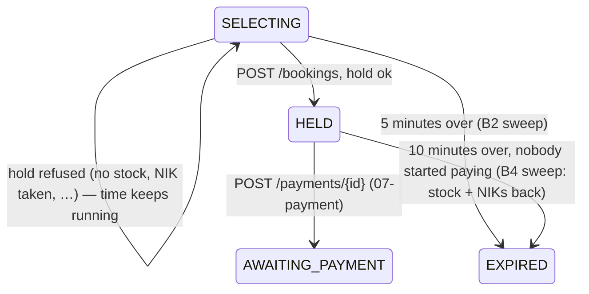

# POST /bookings — Create Booking

| | |
|---|---|
| **Service** | `services/booking` (Lambda); the HELD → EXPIRED sweep runs in `services/admission-ctl` (ECS) |
| **Auth** | `X-Grant-Token` (required) · `X-Device-Id` (required for a guest grant) · no `Authorization` |
| **Contract** | Apidog `POST /bookings` · api-contracts §4.3 (response shape to be aligned, §6) |
| **Requirements** | FR-13, FR-13a, FR-13b, FR-14, FR-15, FR-15b, FR-15c, FR-16, FR-26, BR-01, BR-02, BR-05, NFR-02, NFR-04, NFR-11 |
| **Detail** | ADR-005 §7 (deadlines), §8 (hold, NIK proof, idempotency) as amended by ADR-006 §4.3 (no pause) · impl-plan §5.4, §14.2 · README §4 (two B4 rules) |
| **Status** | **planning** — awaiting review (build step B4, needs B1–B3) |

## 1. Purpose

The "Lanjut ke Pembayaran" button. In one go it:

1. checks the order (1–3 seats in total, any mix of categories, one NIK per seat, every NIK verified before);
2. **holds** the seats and the NIKs in Redis, all or nothing;
3. moves the booking `SELECTING → HELD`, writes one `booking_items` row per seat and one `nik_claims` row per NIK;
4. starts the **10-minute payment countdown** (`payment_expires_at = held_at + 600`, BR-05).

Simple picture: until now the customer only *looked* at the shelf. Pressing Pay takes the seats off the shelf and puts
them in a basket with their name on it for 10 minutes. If anything fails before the basket is closed, the seats go back
on the shelf and the customer keeps choosing, with the time they had left.

A failed hold (no stock, NIK already used, too many seats) **does not lose the turn**: the booking stays `SELECTING`
with the rest of its 5 minutes (ADR-005 §8, NFR-02).

## 2. Flow

```mermaid
sequenceDiagram
    autonumber
    actor C as Client
    participant G as pkg/grantauth
    participant B as booking-service
    participant R as Redis
    participant DB as Aurora (writer)
    participant N as nik-verify

    C->>G: POST /bookings + X-Grant-Token (+ X-Device-Id)
    G->>B: Grant{event_id, booking_id, account_id | device_hash}
    B->>B: validate body (1–3 seats, 16-digit NIKs, no duplicate, emails, terms_version, event = grant's event)
    B->>DB: categories of the event (price, name, exists?)
    B->>N: POST /nik/validate per NIK, in parallel (≤ 3)
    Note over N: hash with NIK_PEPPER · stored proof → 24 h cache → Dukcapil only on a miss
    N-->>B: nik_hmac, nik_masked, valid, status
    alt a NIK is not valid
        B-->>C: 400 NIK_NOT_FOUND / NIK_INACTIVE (index)
    else nik-verify or Dukcapil unreachable
        B-->>C: 503 DUKCAPIL_UNAVAILABLE (fail closed)
    end
    B->>DB: BEGIN; SELECT … FOR UPDATE WHERE id AND grant_token
    alt already HELD or later
        B->>DB: COMMIT
        B-->>C: 200 the existing booking (idempotent retry)
    else not SELECTING, or 5 minutes over (Aurora now())
        B->>DB: COMMIT
        B-->>C: 409 BOOKING_STATUS_INVALID / BOOKING_EXPIRED
    end
    B->>R: EVALSHA hold_booking (stock per category, nik:used per NIK)
    alt NO_STOCK / NIK_TAKEN / QTY_*
        B->>DB: COMMIT (nothing changed, still SELECTING)
        B-->>C: 409 / 400 with the failing index
    else STOCK_UNINITIALIZED / STOCK_NEGATIVE
        B->>DB: COMMIT
        B-->>C: 503
    end
    B->>DB: UPDATE … SET HELD, held_at, payment_expires_at, contact_email, terms
    B->>DB: INSERT booking_items, nik_claims
    alt any statement fails
        B->>DB: ROLLBACK
        B->>R: EVALSHA release_hold (give stock and NIKs back)
        B-->>C: 503 INTERNAL_ERROR
    end
    B->>DB: COMMIT
    B-->>C: 201 booking (same shape as GET /bookings/{id}), payment_ttl 600 s
```



## 3. Steps

### 3.1 Before the transaction (no state changes)

1. `pkg/grantauth` verifies the grant.
2. **Body checks** → 400, nothing touched:
   - `event_id` must equal `grant.EventID`, else 401 `GRANT_TOKEN_INVALID` (same rule as the ticket page).
   - `tickets`: 1 to `MAX_TICKETS_PER_TRANSACTION` (3) seats **in total** → `QTY_EXCEEDED`; empty → `VALIDATION_ERROR`.
   - each `nik`: digits only after removing spaces and separators, exactly 16 → `VALIDATION_ERROR` with the seat index
     (a cheap pre-check; nik-verify normalizes again and is the authority).
   - the same NIK twice in one order → `VALIDATION_ERROR` (BR-02). Compared on the `nik_hmac` nik-verify returns, so
     `"3171 1234 5678 9012"` and `"3171123456789012"` are one NIK.
   - `contact_email` valid; each `holder_email` valid or empty (empty = `contact_email`, FR-26).
   - `terms_version` must equal `TERMS_VERSION` → else 400 `TERMS_NOT_ACCEPTED`.
3. **Categories:** one read of `ticket_categories` for the event; an unknown `category_id` → `VALIDATION_ERROR`
   with the seat index. Price and name are copied into `booking_items` (the price at the time of purchase).
4. **NIK check, fail closed** (ADR-005 §8, FR-15/15b/15c): one `POST /nik/validate` per NIK to nik-verify, in parallel
   (at most 3), the same call the form makes on blur. nik-verify is the only holder of `NIK_PEPPER` (ADR-005 §8: a
   service with the pepper can enumerate every stored NIK offline, and the pepper can never be rotated), so booking
   never hashes a NIK itself; it stores the `nik_hmac` and `nik_masked` it is handed, as user-service does.
   nik-verify answers from stored proof (registered or saved NIK), then its 24 h cache, and calls Dukcapil only on a miss;
   after the on-blur check the answer is normally a cache hit.
   - `valid: false` → 400 `NIK_NOT_FOUND` / `NIK_INACTIVE` (from `status`) with the seat index.
   - transport error, timeout or non-2xx → 503 `DUKCAPIL_UNAVAILABLE` (fail closed: no hold without proof).

### 3.2 The transaction

5. `BEGIN`; `SELECT status, booking_expires_at > now() … FROM bookings WHERE id = $grant.BookingID AND grant_token = $t FOR UPDATE`.
   - no row → 401 `GRANT_TOKEN_INVALID` (+ `LostGrant`).
   - `HELD`, `AWAITING_PAYMENT`, `PENDING_CANCELLATION`, `CONFIRMED` → `COMMIT`, **200** with the existing booking
     (idempotent retry; without this a double-click fails with `NIK_ALREADY_USED` on the customer's own NIKs).
   - `GRANTED` → 409 `BOOKING_STATUS_INVALID` (the ticket page was never opened, so there was nothing to choose).
   - `SELECTING` but the deadline has passed → 409 `BOOKING_EXPIRED`.
   - `LAPSED`, `EXPIRED`, `ABANDONED` → 409 `BOOKING_EXPIRED`.

   **This lock is what settles the race with the SELECTING sweep** (README §4 rule): the deadline is checked on Aurora's
   clock while the row is locked. The sweep's `UPDATE … WHERE status = 'SELECTING'` waits for the lock, then sees `HELD`
   and skips the row. If the sweep got the row first, this `SELECT` sees `EXPIRED`. The hold Lua therefore never runs for
   a booking the sweep will end.
6. **Hold** (`pkg/redisscript` `hold_booking.lua`, ADR-005 §8 logic, written fresh): keys
   `stock:{ev}:<cat>` per category and `nik:used:{ev}:<hmac>` per seat, all on the event's shard. Phase 1 checks every
   category, phase 2 claims every NIK (`SET NX EX`), phase 3 decrements; any failure undoes what the script did.
   It does not touch any queue counter (ADR-006).

   | Lua result | Answer | Booking |
   |---|---|---|
   | `HELD` | continue | — |
   | `NO_STOCK` (index) | 409 `INSUFFICIENT_STOCK` `{category_id, available, requested}` | stays `SELECTING` |
   | `NIK_TAKEN` (index) | 409 `NIK_ALREADY_USED` `{index}` | stays `SELECTING` |
   | `QTY_EXCEEDED` / `QTY_INVALID` / `NIK_COUNT_MISMATCH` | 400 (cannot happen after step 2; a guard) | stays `SELECTING` |
   | `STOCK_UNINITIALIZED` | 503 `STOCK_UNINITIALIZED` + metric | stays `SELECTING` |
   | `STOCK_NEGATIVE` | 503 `STOCK_NEGATIVE` + alarm | stays `SELECTING` |

   On a refusal the transaction **commits with no change**: there is nothing to undo, and `SELECTING` must stay.
7. `UPDATE bookings SET status = 'HELD', held_at = now(), payment_expires_at = now() + 600 s, contact_email, terms_version,
   terms_accepted_at = now() WHERE id = $1 AND status = 'SELECTING'`. One row, guaranteed by the lock.
8. `INSERT booking_items` (one per seat, `created_at = clock_timestamp()` so GET lists them in the order chosen,
   README §4 rule) and `INSERT nik_claims` (one per NIK). A `nik_claims` conflict means Redis missed something
   (flush, failover): the database refuses it (BR-02 is a database invariant).
9. `COMMIT` → 201.

### 3.3 When the transaction fails after the hold

10. **Compensation is required** (Redis is not in the transaction): `ROLLBACK`, then `release_hold.lua` gives the stock
    back (`INCRBY`) and deletes the NIK keys, atomically. Metric `HoldCompensated`; the answer is 503 `INTERNAL_ERROR`.
    The booking stays `SELECTING` (the rollback undid step 7), so the customer can press Pay again.
11. **If the compensation itself fails** (Redis down at that moment), stock and NIKs stay held without a booking until
    stock reconciliation repairs them (see OPEN item, §6).

### 3.4 HELD → EXPIRED sweep (admission-ctl)

Nobody started paying within 10 minutes. Same shape as the other two sweeps, plus a release:

```sql
UPDATE bookings SET status = 'EXPIRED'
 WHERE status = 'HELD' AND payment_expires_at <= $1
RETURNING id, event_id, grant_token
```

then, per row, in one Aurora statement the seats and NIK claims are read and `nik_claims` deleted, and in Redis
`release_hold.lua` gives back each category's stock and deletes `nik:used`, then `DEL grant:{token}`.
`AWAITING_PAYMENT` and `PENDING_CANCELLATION` (a payment is in flight) belong to 07-payment, which asks Midtrans first.

```mermaid
sequenceDiagram
    autonumber
    participant CTL as admission-ctl (sweep timer)
    participant DB as Aurora (writer)
    participant R as Redis
    CTL->>DB: UPDATE … SET EXPIRED WHERE status='HELD' AND payment_expires_at <= now RETURNING
    loop each expired booking
        CTL->>DB: DELETE FROM nik_claims WHERE booking_id … RETURNING nik_hmac; SELECT category, count(*) FROM booking_items
        CTL->>R: EVALSHA release_hold (INCRBY stock, DEL nik:used)
        CTL->>R: DEL grant:{token}
    end
    Note over CTL: next tick COUNT: open drops → next customer admitted
```

## 4. Data touched

| Store | Key / table | Op |
|---|---|---|
| Redis | `grant:{token}` | HGETALL (grantauth), DEL (sweep) |
| Redis | `stock:{ev}:<cat>`, `nik:used:{ev}:<hmac>` | hold / release Lua |
| Aurora | `bookings` | SELECT FOR UPDATE, UPDATE (HELD), UPDATE (sweep) |
| Aurora | `ticket_categories` | SELECT |
| nik-verify | `POST /nik/validate` | one per NIK (hash, mask, proof) |
| Aurora | `booking_items`, `nik_claims` | INSERT (hold), DELETE `nik_claims` (sweep) |

New code: booking's nik-verify client (same pattern as user-service's `infrastructure/nikverify`, `NIK_VERIFY_BASE_URL`),
`rediskeys` `Event.NIKUsed`, `pkg/redisscript` `hold_booking.lua` + `release_hold.lua`.

## 5. Responses and errors

| HTTP | Code | When |
|---|---|---|
| 201 | — | held; body = the `GET /bookings/{id}` shape (`PENDING_PAYMENT`, `payment_ttl` 600 s) |
| 200 | — | already held or later: the existing booking, unchanged |
| 400 | `VALIDATION_ERROR` | bad body (with `data.index` for a seat) |
| 400 | `QTY_EXCEEDED` | more than 3 seats in total |
| 400 | `TERMS_NOT_ACCEPTED` | `terms_version` is not the current one |
| 400 | `NIK_NOT_FOUND` / `NIK_INACTIVE` | nik-verify says a NIK is not valid (`data.index`) |
| 400 | `DEVICE_ID_REQUIRED` | guest grant without `X-Device-Id` |
| 401 | `GRANT_TOKEN_MISSING` / `GRANT_TOKEN_INVALID` / `DEVICE_MISMATCH` | bad grant, or `event_id` of another event |
| 409 | `INSUFFICIENT_STOCK` | not enough seats in a category (`data: {category_id, available, requested}`) |
| 409 | `NIK_ALREADY_USED` | a NIK already holds a seat for this event (`data.index`) |
| 409 | `BOOKING_STATUS_INVALID` | the ticket page was never opened (`GRANTED`) |
| 409 | `BOOKING_EXPIRED` | the 5 minutes are over, or the booking already ended |
| 503 | `DUKCAPIL_UNAVAILABLE` | nik-verify or Dukcapil cannot answer (fail closed) |
| 503 | `STOCK_UNINITIALIZED` / `STOCK_NEGATIVE` | stock unknown / last guard fired |
| 503 | `INTERNAL_ERROR` | database or Redis failure (hold compensated) |

## 6. Edge cases and decisions

- **OPEN: (1) how booking reaches nik-verify.** Proposal: HTTP to nik-verify's existing `POST /nik/validate`
  (`NIK_VERIFY_BASE_URL`, as user-service), forwarding the caller's `X-Grant-Token` and `X-Device-Id` so nik-verify's
  own guard accepts it. Alternative: a private internal route without the grant guard. Either way booking never holds
  `NIK_PEPPER`.
- **OPEN: (2) the §4.3 response becomes the `GET /bookings/{id}` shape.** The contract's §4.3 example is stale
  (`summary {subtotal, service_fee}`, no `image_url`, no `server_time`/`error_code`, `redirect_url`). Proposal: 201 returns
  exactly what `GET /bookings/{id}` returns for `PENDING_PAYMENT` (one model for the frontend); `redirect_url` is dropped
  (the Payment page route belongs to the frontend). Breaking for a client that reads `subtotal`, `service_fee` or
  `redirect_url`: contract change C7.
- **OPEN: (3) error codes on refusals.** The contract's §4.3 examples carry no `error_code`. Proposal: the codes of §5
  with `data.index` (seat position) for NIK errors and `{category_id, available, requested}` for stock, so the form can
  mark the exact field. Contract change C8.
- **OPEN: (4) `holder_email` optional.** Proposal: empty = `contact_email` (impl-plan §4.2 default); a given one must
  be valid. FR-26 still holds: every seat has an address.
- **OPEN: (5) a retry with a different body.** Proposal: once `HELD`, any `POST /bookings` with the same grant returns
  the existing booking (200), whatever the body says. Changing seats after Pay is not supported (the invariant "nothing
  goes back to SELECTING", README §2).
- **OPEN: (6) stock reconciliation is not built.** A crash or Redis outage exactly between the hold and its
  compensation (or in the sweep between the `UPDATE` and the release) leaves stock and NIK keys held with no booking.
  ADR-005 §6 has a reconciliation every ~60 s that repairs this from Aurora. Proposal: B4 ships without it, and
  reconciliation becomes its own step (B5) before the load test; until then the window is one Redis call wide and
  metered (`HoldCompensationFailed`, `ReleaseFailed`).
- **Dukcapil down does not pause the queue** (ADR-006 §4.3). A NIK already proven (registered, saved, or cached in the
  last 24 h) still passes; an unproven one gets 503 `DUKCAPIL_UNAVAILABLE` and the customer can retry or change it.
- **`NIK_USED_TTL_SECONDS` = `SALE_WINDOW_SECONDS`.** A leaked NIK key (rollback after hold without compensation) blocks
  that NIK for at most the sale, not forever.
- **Two clocks never decide one race.** Every deadline check (claim, hold, both sweeps) uses Aurora's `now()`.

## 7. Tests

Unit (fakes; Lua on miniredis, which runs the real script):

- [ ] each body rule answers 400 with its code and seat index, and touches neither Redis nor Aurora
- [ ] the same NIK typed with spaces and without is one NIK (same `nik_hmac` from nik-verify → duplicate)
- [ ] an `event_id` of another event is rejected as `GRANT_TOKEN_INVALID`
- [ ] a NIK nik-verify calls invalid is refused with its index and code; nik-verify unreachable or slow → 503, no hold
- [ ] the nik-verify client forwards the grant headers and reads `nik_hmac`, `nik_masked`, `valid`, `status`
- [ ] hold Lua: all-or-nothing across categories (one short category holds nothing), 3 seats across 3 categories pass,
      a taken NIK releases the NIKs claimed before it, missing stock key is `STOCK_UNINITIALIZED` not `NO_STOCK`
- [ ] release Lua gives back exactly what the hold took
- [ ] each refusal leaves the booking `SELECTING` and answers its code
- [ ] a failure after the hold compensates once and answers 503
- [ ] the 201 body equals what `GET /bookings/{id}` returns for the same booking, `ttl_seconds` 600
- [ ] a second submit after `HELD` answers 200 with the same booking and runs no hold

Integration (real Postgres + Redis cluster):

- [ ] hold → `HELD` row, `payment_expires_at = held_at + 600 s`, items in the order sent, one `nik_claims` per NIK
- [ ] two concurrent submits of one booking: one hold, both answer with the same booking
- [ ] two bookings racing for the last seat: one `HELD`, one `INSUFFICIENT_STOCK`, stock ends at 0, never below
- [ ] two bookings with the same NIK: one wins, the other `NIK_ALREADY_USED`; `nik_claims` refuses a forced second row
- [ ] submit at the deadline while the SELECTING sweep runs: exactly one wins; if the sweep wins, no stock or NIK is held
- [ ] HELD sweep: past `payment_expires_at` → `EXPIRED`, stock back, NIK keys and claims gone, grant gone; one second before,
      untouched; `AWAITING_PAYMENT` never touched; two sweepers end it once; the sweep query uses its partial index

## 8. Tasks

- [ ] plan review, OPEN 1–6 decided
- [ ] nik-verify client, `rediskeys` builder, `hold_booking.lua` + `release_hold.lua` (`docs/lua-scripts.md`)
- [ ] migration `0009`: partial index `bookings (payment_expires_at) WHERE status = 'HELD'`
- [ ] tests red → list reviewed
- [ ] use case `CreateBooking` + handler + route (`POST /bookings` mounted again)
- [ ] HELD sweep in admission-ctl
- [ ] `make verify`; fresh-subagent review (Lua + admission-ctl), `/code-review` (booking)
- [ ] contract/Apidog C7, C8 (documentations)
