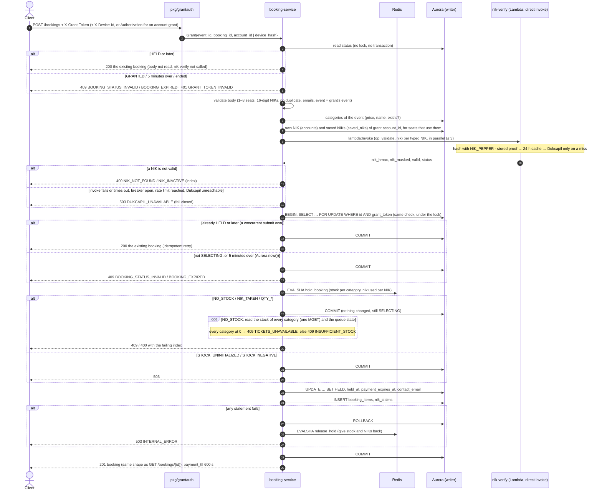
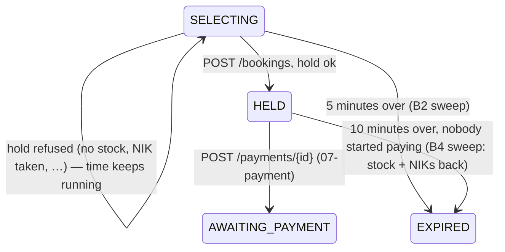
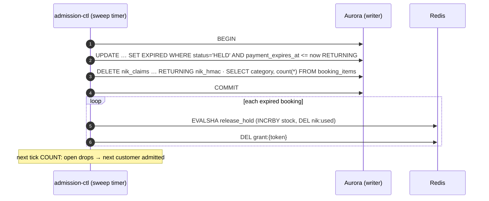

# POST /bookings — Create Booking

| | |
|---|---|
| **Service** | `services/booking` (Lambda); the HELD → EXPIRED sweep runs in `services/admission-ctl` (ECS) |
| **Auth** | `X-Grant-Token` (required) · `X-Device-Id` (required for a guest grant) · `Authorization: Bearer` (required when the grant belongs to a logged-in account) |
| **Contract** | Apidog `POST /bookings` · api-contracts §4.3 |
| **Requirements** | FR-13, FR-13a, FR-13b, FR-14, FR-15, FR-15b, FR-15c, FR-16, FR-26, BR-01, BR-02, BR-05, NFR-02, NFR-04, NFR-11 |
| **Detail** | ADR-005 §7 (deadlines), §8 (hold, NIK proof, idempotency) as amended by ADR-006 §4.3 (no pause) · impl-plan §5.4, §14.2 |
| **Status** | approved (B4c–B4f); updated for the nik-verify Lambda call and contract v2.23, awaiting re-approval |

## 1. Purpose

The "Lanjut ke Pembayaran" button. In one go it:

1. checks the order (1–3 seats in total, any mix of categories, one NIK per seat, every NIK verified before);
2. **holds** the seats and the NIKs in Redis, all or nothing;
3. moves the booking `SELECTING → HELD`, writes one `booking_items` row per seat and one `nik_claims` row per NIK;
4. starts the **10-minute payment countdown** (`payment_expires_at = held_at + 600`, BR-05).

Simple picture: until now the customer only *looked* at the shelf. Pressing Pay takes the seats off the shelf and puts
them in a basket with their name on it for 10 minutes. If anything fails before the basket is closed, the seats go back
on the shelf and the customer keeps choosing, with the time they had left.

A failed hold (no stock, NIK already used, too many seats) **does not lose the turn**: the booking stays `SELECTING`
with the rest of its 5 minutes (ADR-005 §8, NFR-02).

## 2. Flow





## 3. Steps

### 3.1 Before the transaction (no state changes)

1. `pkg/grantauth` verifies the grant and, for an account grant, the Bearer token (README §2 rule 2). Seats that use
   `saved_nik_id` or `use_account_nik` rely on this: `grant.AccountID` is an account the caller has proven.
1a. **Status first** (no lock, no transaction): one read of the booking,
   `SELECT status, booking_expires_at > now() FROM bookings WHERE id = $grant.BookingID AND grant_token = $t`, answered
   exactly as step 5 does: `HELD` or later → **200** with the existing booking; `GRANTED` or `SELECTING` past the
   deadline → 409 `BOOKING_EXPIRED`; `GRANTED` within it → 409 `BOOKING_STATUS_INVALID`; no row or ended → 401
   `GRANT_TOKEN_INVALID`. Only a
   `SELECTING` booking inside its 5 minutes goes on. This keeps the contract's promise (§4.3, v2.21): a double-click
   answers 200 **whatever the body says and even when nik-verify is down**, and no Dukcapil call is spent on a booking
   that is already held or over. It does not replace step 5: two submits can both pass it, and the lock decides.
2. **Body checks** → 400, nothing touched:
   - `event_id` must equal `grant.EventID`, else 401 `GRANT_TOKEN_INVALID` (same rule as the ticket page).
   - `tickets`: 1 to `MAX_TICKETS_PER_TRANSACTION` (3) seats **in total** → `QTY_EXCEEDED`; empty → `VALIDATION_ERROR`.
   - each seat carries **exactly one** of `nik` (typed), `saved_nik_id` (Daftar NIK Teman) or `use_account_nik: true`
     (the logged-in customer's own registered NIK); zero or two → `VALIDATION_ERROR` with the seat index.
   - `use_account_nik` on at most one seat; `saved_nik_id` and `use_account_nik` need a logged-in grant
     (`grant.AccountID`): from a guest → `VALIDATION_ERROR` with the index.
   - each typed `nik`: normalised **exactly as nik-verify does** (`Normalize`: every character that is not a digit is
     dropped, so `3171 0000 0000 0022` and `3171-0000-0000-0022` pass), then exactly 16 digits, else `VALIDATION_ERROR`
     with the seat index. One shared function (task in §8), so booking never refuses what `POST /nik/validate` accepted
     on blur, or the reverse. nik-verify normalises again and stays the authority for the hash. The shared package
     holds only `Normalize` and `IsValidFormat`: pure code, no pepper.
   - the same NIK twice in one order → `VALIDATION_ERROR` (BR-02), checked after step 4 on the `nik_hmac` of every seat,
     whatever its source: `"3171 1234 5678 9012"`, `"3171123456789012"` and the same NIK picked from the saved list are one
     NIK.
   - `contact_email` valid. It is the only email of the booking: every e-ticket goes there (FR-26 as changed,
     ADR-006 §8.15). There is no per-seat email; a `tickets[].holder_email` from an old client is ignored.
   - No terms field: consent (PDP and terms) is recorded at registration (ADR-006 §8.16).
3. **Categories:** one read of `ticket_categories` for the event; an unknown `category_id` → `VALIDATION_ERROR`
   with the seat index. Price and name are copied into `booking_items` (the price at the time of purchase).
4. **Resolve each seat's NIK to `nik_hmac` + `nik_masked`:**
   - `use_account_nik` → `accounts.nik_hmac`, `nik_masked` of `grant.AccountID`, which must have `nik_verified_at`;
   - `saved_nik_id` → `saved_niks` row `WHERE id = $1 AND account_id = grant.AccountID` (always verified);
   - both in **one** Aurora query; no row → 400 `VALIDATION_ERROR` with the index (an unknown id, another account's
     id and a deleted entry look the same). These seats skip nik-verify: their proof is already stored (FR-15b).

   **Typed NIKs, fail closed** (ADR-005 §8, FR-15/15c): booking **invokes the nik-verify Lambda directly**
   (`lambda:Invoke`, `RequestResponse`), one invocation per typed NIK, in parallel (at most 3). There is no HTTP route
   for this call, so it can never be reached from the internet; IAM decides who may invoke (§4). nik-verify runs the
   same validation as `POST /nik/validate` (stored proof, 24 h cache, breaker, Dukcapil rate limit, Dukcapil) and
   answers with `nik_hmac`, `nik_masked`, `valid`, `status`. Only nik-verify holds `NIK_PEPPER`: booking never hashes a
   NIK itself, it stores the `nik_hmac` and `nik_masked` it is handed. After the on-blur check the answer is normally a
   cache hit.
   - `valid: false` → 400 `NIK_NOT_FOUND` / `NIK_INACTIVE` (from `status`) with the seat index.
   - nik-verify answers `DUKCAPIL_UNAVAILABLE` (breaker open, shared rate limit reached, Dukcapil error, stored-proof
     read failing) → 503 `DUKCAPIL_UNAVAILABLE`.
   - the invocation itself fails → 503 `DUKCAPIL_UNAVAILABLE` (fail closed: no hold without proof). That covers an
     Invoke API error, throttling, booking's deadline for the call (`NIK_VERIFY_TIMEOUT_MS`, 3 s) and a **function
     error**: Lambda answers a crashed or timed-out function with HTTP 200 and `FunctionError` set, so the adapter
     must check that field, never the HTTP status alone.
   - There is no per-customer 429 on this path: the only limit is the shared Dukcapil one, answered 503.

### 3.2 The transaction

5. `BEGIN`; `SELECT status, booking_expires_at > now() … FROM bookings WHERE id = $grant.BookingID AND grant_token = $t FOR UPDATE`.
   The same answers as step 1a, now under the lock: step 1a filters the common cases cheaply, this one settles two
   submits that passed 1a together, and the race with the sweep.
   - no row → 401 `GRANT_TOKEN_INVALID` (+ `LostGrant`).
   - `HELD`, `AWAITING_PAYMENT`, `PENDING_CANCELLATION`, `CONFIRMED` → `COMMIT`, **200** with the existing booking
     (idempotent retry; without this a double-click fails with `NIK_ALREADY_USED` on the customer's own NIKs).
   - `GRANTED` or `SELECTING` with the deadline passed → 409 `BOOKING_EXPIRED`. The deadline is checked first: a page
     opened after the 5 minutes does not claim (01 §3.1 step 4), so the booking is still `GRANTED`, and the customer
     ran out of time.
   - `GRANTED` within the deadline → 409 `BOOKING_STATUS_INVALID` (the ticket page was never opened, so there was
     nothing to choose).
   - `LAPSED`, `EXPIRED`, `ABANDONED` → 401 `GRANT_TOKEN_INVALID`, the same answer as the ticket page: the booking ended
     and its grant is deleted, so the client routes through `GET /queue/me`. `BOOKING_EXPIRED` is only for a booking
     still `GRANTED` or `SELECTING` whose deadline has just passed (the sweep has not run), so the customer sees
     "waktu habis".

   **This lock is what settles the race with the SELECTING sweep** (see the race note below): the deadline is checked on Aurora's
   clock while the row is locked. The sweep's `UPDATE … WHERE status = 'SELECTING'` waits for the lock, then sees `HELD`
   and skips the row. If the sweep got the row first, this `SELECT` sees `EXPIRED`. The hold Lua therefore never runs for
   a booking the sweep will end.
6. **Hold** (`pkg/redisscript` `hold_booking.lua`, ADR-005 §8 logic, written fresh): keys
   `stock:{ev}:<cat>` per category and `nik:used:{ev}:<hmac>` per seat, all on the event's shard. Phase 1 checks every
   category, phase 2 claims every NIK (`SET NX EX`), phase 3 decrements; any failure undoes what the script did.
   It does not touch any queue counter (ADR-006).

   | Lua result | Answer | Booking |
   |---|---|---|
   | `HELD` | continue | — |
   | `NO_STOCK` (index), at least one other category has seats | 409 `INSUFFICIENT_STOCK` `{category_id, available, requested}` (partly sold out) | stays `SELECTING` |
   | `NO_STOCK` (index), **every** category of the event is at 0 | 409 `TICKETS_UNAVAILABLE` `{queue_state, full_booked_at}` (totally sold out) | stays `SELECTING` |
   | `NIK_TAKEN` (index) | 409 `NIK_ALREADY_USED` `{index}` | stays `SELECTING` |
   | `QTY_EXCEEDED` / `QTY_INVALID` / `NIK_COUNT_MISMATCH` | cannot happen after step 2 (one seat = one ticket): a guard, answered 503 `INTERNAL_ERROR` and logged | stays `SELECTING` |
   | `STOCK_UNINITIALIZED` | 503 `STOCK_UNINITIALIZED` + metric | stays `SELECTING` |
   | `STOCK_NEGATIVE` | 503 `STOCK_NEGATIVE` + alarm | stays `SELECTING` |

   On a refusal the transaction **commits with no change**: there is nothing to undo, and `SELECTING` must stay.

   **Partly vs totally sold out** (contract §4.3). Only on `NO_STOCK`, after the commit, booking reads the
   `stock:{ev}:<cat>` of **every** category of the event (one `MGET`; it already has the category list from step 3):
   - all ≤ 0 → `TICKETS_UNAVAILABLE`, with `queue_state` and `full_booked_at` from the `queue:{ev}` hash (one
     `HMGET state full_booked_at`). `queue_state` is **only** `CLOSED` or `FULL_BOOKED`: `CLOSED` when the hash says
     `CLOSED`, `FULL_BOOKED` for anything else. admission-ctl flips the state on its next tick (≤ 500 ms), so right after
     the last seat goes the hash still says `OPEN`. `full_booked_at`: epoch → ISO 8601, or `null` when not written
     yet;
   - otherwise → `INSUFFICIENT_STOCK` for the failing category, with its `available` read from the same `MGET`.

   Stock is the truth for "sold out"; the queue state only labels it (it can lag by one tick, 500 ms). A missing key
   in that `MGET` is not sold out: it answers `STOCK_UNINITIALIZED`, as in step 6. The frontend sends the first to the
   "tiket habis" page and keeps the second on the ticket page.
7. `UPDATE bookings SET status = 'HELD', held_at = now(), payment_expires_at = now() + 600 s, contact_email
   WHERE id = $1 AND status = 'SELECTING'`. One row, guaranteed by the lock.
8. `INSERT booking_items` (one per seat, no email column; `created_at = clock_timestamp()` so GET lists
   them in the order chosen) and `INSERT nik_claims` (one per NIK). A `nik_claims` conflict means Redis missed something
   (flush, failover): the database refuses it (BR-02 is a database invariant).
9. `COMMIT` → 201.

### 3.2a Transactions

| Unit | Statements | Why one transaction (or none) |
|---|---|---|
| Status read (1a) | one `SELECT` | none needed: a read; step 5 repeats it under the lock |
| Reads before the hold (3, 4) | categories, `accounts` / `saved_niks`, nik-verify invocations | **outside** the transaction on purpose: the row lock is never held across a call to nik-verify (up to `NIK_VERIFY_TIMEOUT_MS`), only for the few milliseconds of steps 5–9 |
| **Hold (5–9)** | `SELECT … FOR UPDATE` → hold Lua → `UPDATE … HELD` → `INSERT booking_items` → `INSERT nik_claims` → `COMMIT` | all or nothing in Aurora: a `HELD` booking without its seats or NIK claims, or claims without a `HELD` booking, must never exist. Redis is not in it, so a failure after the Lua compensates (§3.3). A `nik_claims` unique conflict → `ROLLBACK`, `release_hold`, 409 `NIK_ALREADY_USED` |
| Response (201 / 200) | the `GET /bookings/{id}` read, after `COMMIT` | not in the transaction: it reads committed data, so the 201 body is exactly what GET returns |
| **HELD sweep (§3.4)** | `UPDATE … EXPIRED … RETURNING` → `DELETE nik_claims … RETURNING` → seat counts per category → `COMMIT`; then Redis | one transaction per sweep batch: if the status became `EXPIRED` but the claims stayed, those NIKs would be blocked for this event for good (`UNIQUE (event_id, nik_hmac)`). Redis is released after `COMMIT`; a crash in between leaves stock held, which B5 repairs |

The ticket page claim and the SELECTING sweep stay single statements (one `UPDATE` each), so they need no transaction.

### 3.3 When the transaction fails after the hold

10. **Compensation is required** (Redis is not in the transaction): `ROLLBACK`, then `release_hold.lua` gives the stock
    back (`INCRBY`) and deletes the NIK keys, atomically. Metric `HoldCompensated`; the answer is 503 `INTERNAL_ERROR`.
    The booking stays `SELECTING` (the rollback undid step 7), so the customer can press Pay again.
11. **If the compensation itself fails** (Redis down at that moment), stock and NIKs stay held without a booking until
    stock reconciliation repairs them (open item 2, §6).

### 3.4 HELD → EXPIRED sweep (admission-ctl)

Nobody started paying within 10 minutes. Same shape as the other two sweeps, plus a release:

```sql
UPDATE bookings SET status = 'EXPIRED'
 WHERE status = 'HELD' AND payment_expires_at <= $1
RETURNING id, event_id, grant_token
```

in **one transaction** with `DELETE FROM nik_claims WHERE booking_id = ANY($ids) RETURNING booking_id, nik_hmac` and the
seat count per category from `booking_items` (§3.2a). After `COMMIT`, per booking, `release_hold.lua` gives back each
category's stock and deletes `nik:used` in Redis, then `DEL grant:{token}`.
`AWAITING_PAYMENT` and `PENDING_CANCELLATION` (a payment is in flight) belong to 07-payment, which asks Midtrans first.



## 4. Data touched

| Store | Key / table | Op |
|---|---|---|
| Redis | `grant:{token}` | HGETALL (grantauth), DEL (sweep) |
| Redis | `stock:{ev}:<cat>`, `nik:used:{ev}:<hmac>` | hold / release Lua |
| Aurora | `bookings` | SELECT FOR UPDATE, UPDATE (HELD), UPDATE (sweep) |
| Redis | `stock:{ev}:<cat>` (all categories), `queue:{ev}` hash | MGET + HMGET, only after a `NO_STOCK` refusal |
| Aurora | `ticket_categories` | SELECT |
| Aurora | `accounts`, `saved_niks` | SELECT (seats with `use_account_nik` / `saved_nik_id`, one query) |
| nik-verify | Lambda `rusuh-<env>-nik-verify`, event `{op: validate}` | one invocation per typed NIK (hash, mask, proof) |
| Aurora | `booking_items`, `nik_claims` | INSERT (hold), DELETE `nik_claims` (sweep) |

New code:

- **nik-verify, internal event** (additive; agreed with nik-verify's owner). Its Lambda `main` today hands every event
  to the HTTP adapter. It learns a second event shape, told apart before the HTTP adapter sees it:

  ```json
  request:  {"op": "validate", "nik": "3171 0000 0000 0022"}
  response: {"nik_hmac": "…", "nik_masked": "3171********0022", "valid": true, "status": "ACTIVE", "source": "verified"}
  error:    {"error_code": "DUKCAPIL_UNAVAILABLE"}  or  {"error_code": "VALIDATION_ERROR"}
  ```

  It calls the same use case as `POST /nik/validate`. The public route, its guard and its response do not change.
- **booking, port `NIKVerifier`** with two adapters: Lambda invoke (`aws-sdk-go-v2/service/lambda`) in AWS, and a fake
  for unit tests and local runs (local nik-verify runs as an HTTP server, not a Lambda). Selected by
  `NIK_VERIFY_FUNCTION_NAME` (set → invoke; unset in `APP_ENV=local` → fake; unset elsewhere → refuse to start).
- **booking template**: `NIK_VERIFY_FUNCTION_NAME: rusuh-${Environment}-nik-verify`, `NIK_VERIFY_TIMEOUT_MS`, and an
  IAM statement `lambda:InvokeFunction` on that one function's ARN.
- **Network**: booking runs in private subnets and the Lambda API is an AWS endpoint, reached through the NAT gateway
  (on by default in the foundation). With NAT off, the foundation needs an interface VPC endpoint
  `com.amazonaws.<region>.lambda`, as it has for S3 and Secrets Manager.
- `rediskeys` `Event.NIKUsed`, `pkg/redisscript` `hold_booking.lua` + `release_hold.lua`.

## 5. Responses and errors

The contract (§4.3) is the source; this table is the build checklist. `index` = seat position in `tickets[]`, from 0.

| HTTP | Code | When | `data` | Booking after |
|---|---|---|---|---|
| 201 | — | held; the `GET /bookings/{id}` shape (`PENDING_PAYMENT`, `payment_ttl.expires_at` = now + 10 min) | booking | `HELD` |
| 200 | — | already `HELD` or later (double-click, retry): the existing booking, no second hold, body ignored | booking | unchanged |
| 400 | `DEVICE_ID_REQUIRED` | guest grant without `X-Device-Id` | — | unchanged |
| 401 | `GRANT_TOKEN_MISSING` / `GRANT_TOKEN_INVALID` / `DEVICE_MISMATCH` | bad grant, `event_id` of another event, no booking row, or booking ended (`LAPSED`, `EXPIRED`, `ABANDONED`) | — | unchanged / ended |
| 401 | `UNAUTHORIZED` / `TOKEN_EXPIRED` / `TOKEN_INVALID` | account grant without `Authorization`, of another account, expired, invalid | — | unchanged |
| 400 | `VALIDATION_ERROR` | bad body, a seat without exactly one NIK field, a picked NIK that does not apply, duplicate NIK | `{index}` for a seat | unchanged |
| 400 | `QTY_EXCEEDED` | more than 3 seats in total | — | unchanged |
| 400 | `NIK_NOT_FOUND` / `NIK_INACTIVE` | nik-verify says the NIK is not valid | `{index}` | unchanged |
| 503 | `DUKCAPIL_UNAVAILABLE` | nik-verify cannot be invoked or times out, or Dukcapil cannot answer (breaker open, rate limit reached, error) (fail closed) | — | unchanged |
| 409 | `BOOKING_STATUS_INVALID` | ticket page never opened (`GRANTED`), still within the 5 minutes | — | `GRANTED` |
| 409 | `BOOKING_EXPIRED` | 5 minutes over before Pay, still `GRANTED` or `SELECTING` | — | `LAPSED` / `EXPIRED` soon |
| 409 | `INSUFFICIENT_STOCK` | partly sold out: a category is short, another still has seats | `{category_id, available, requested}` | `SELECTING` |
| 409 | `TICKETS_UNAVAILABLE` | totally sold out: every category at 0 | `{queue_state, full_booked_at}` | `SELECTING` |
| 409 | `NIK_ALREADY_USED` | a NIK already holds a seat for this event: refused by Redis, or by `nik_claims` when Redis missed it (then the hold is released) | `{index}` | `SELECTING` |
| 503 | `STOCK_UNINITIALIZED` / `STOCK_NEGATIVE` | stock unknown / last guard fired | — | `SELECTING` |
| 503 | `INTERNAL_ERROR` | database or Redis failure after the hold (compensated), or a Lua guard that cannot happen | — | `SELECTING` |

Messages never contain a NIK, only `index`. A `saved_nik_id` that is unknown, another account's or deleted gets the same
`VALIDATION_ERROR`, so no id of another account leaks. Not used here: `QTY_INVALID`, `NIK_COUNT_MISMATCH`,
`NIK_UNVERIFIED`, `NIK_VALIDATION_FAILED`.

## 6. Edge cases and decisions

- **Booking reaches nik-verify by direct Lambda invocation.** The public `POST /nik/validate` does not return
  `nik_hmac` (contract §4.2) and must not: a browser has no use for it. A direct invocation has no route, so it cannot
  leak to the internet, and IAM is the guard. `NIK_PEPPER` stays in nik-verify only. Rejected: an internal HTTP route
  (one more route to guard and keep off the gateway), and running nik-verify's code inside booking (booking would hold
  the pepper, which can never be rotated, and the Dukcapil key).
- **Costs of the invocation, accepted:** booking's up to 3 invocations per Pay press share nik-verify's concurrency
  with the on-blur calls; a cold nik-verify adds a few hundred ms (booking's 3 s deadline covers it); every failure of
  the invocation is fail closed.
- **No 429 on `POST /bookings`.** The internal invocation has no per-customer limit, only the shared Dukcapil one,
  which answers 503 `DUKCAPIL_UNAVAILABLE`.
- **The 201 body is the `GET /bookings/{id}` shape.** One model for the frontend; There is no `subtotal`, `service_fee` or
  `redirect_url`.
- **A failed hold keeps the turn.** Every stock or NIK refusal commits with no change and leaves the booking
  `SELECTING` with its remaining time; the customer fixes the order and presses Pay again.
- **A retry after `HELD` returns the existing booking (200), whatever the body says.** Changing seats after Pay is not
  supported (nothing goes back to `SELECTING`, README §1).
- **DECIDED (2026-11-10): (2) B4 ships without stock reconciliation.** A crash or Redis outage exactly between the hold and its
  compensation (or in the sweep between the `UPDATE` and the release) leaves stock and NIK keys held with no booking.
  ADR-005 §6 has a reconciliation every ~60 s that repairs this from Aurora. Planned: B4 ships without it, and
  reconciliation becomes its own step (B5) before the load test; until then the window is one Redis call wide and
  metered (`HoldCompensationFailed`, `ReleaseFailed`).
- **Dukcapil down does not pause the queue** (ADR-006 §4.3). A NIK already proven (registered, saved, or cached in the
  last 24 h) still passes; an unproven one gets 503 `DUKCAPIL_UNAVAILABLE` and the customer can retry or change it.
- **`NIK_USED_TTL_SECONDS` = `SALE_WINDOW_SECONDS`.** A leaked NIK key (rollback after hold without compensation) blocks
  that NIK for at most the sale, not forever.
- **Two clocks never decide one race.** Every deadline check (claim, hold, both sweeps) uses Aurora's `now()`.

## 7. Tests

Unit (fakes; Lua on miniredis, which runs the real script):

- [ ] a submit on a `HELD` (or later) booking answers 200 with the existing booking even with an invalid body or
      nik-verify down, and calls nik-verify zero times
- [ ] `GRANTED`, `SELECTING` past its deadline and an ended booking are answered before the body is read or nik-verify called
- [ ] each body rule answers 400 with its code and seat index, and touches neither Redis nor Aurora
- [ ] a typed NIK with spaces, dots or dashes is accepted exactly when nik-verify's `Normalize` accepts it
- [ ] the same NIK typed with spaces and without is one NIK (same `nik_hmac` from nik-verify → duplicate)
- [ ] a seat with zero or two of `nik` / `saved_nik_id` / `use_account_nik` is refused with its index
- [ ] `use_account_nik` uses the account's own NIK, only once per order, never for a guest or an account without a NIK
- [ ] `saved_nik_id` of this account resolves without nik-verify; another account's or an unknown id → same 400
- [ ] a typed NIK equal to a saved or the account NIK in the same order is a duplicate
- [ ] an `event_id` of another event is rejected as `GRANT_TOKEN_INVALID`
- [ ] a NIK nik-verify calls invalid is refused with its index and code; nik-verify unreachable, slow or answering
      `DUKCAPIL_UNAVAILABLE` → 503, no hold
- [ ] the invoke adapter sends `{op: validate, nik}`, reads `nik_hmac`, `nik_masked`, `valid`, `status`, and treats an
      Invoke error, a throttle, the 3 s deadline and a response with `FunctionError` set as unavailable
- [ ] nik-verify: the internal event returns the same answer as `POST /nik/validate` for the same NIK, plus `nik_hmac`;
      an API Gateway event still goes to the HTTP routes
- [ ] hold Lua: all-or-nothing across categories (one short category holds nothing), 3 seats across 3 categories pass,
      a taken NIK releases the NIKs claimed before it, missing stock key is `STOCK_UNINITIALIZED` not `NO_STOCK`
- [ ] release Lua gives back exactly what the hold took
- [ ] each refusal leaves the booking `SELECTING` and answers its code
- [ ] a short category while another has seats answers `INSUFFICIENT_STOCK` with that category and its `available`
- [ ] every category at 0 answers `TICKETS_UNAVAILABLE` with `queue_state` `FULL_BOOKED` (and `full_booked_at`), and with
      `CLOSED` once the queue is closed
- [ ] every category at 0 while the queue hash still says `OPEN` answers `FULL_BOOKED` with `full_booked_at` `null`
- [ ] a `GRANTED` booking past its deadline answers `BOOKING_EXPIRED`; within it, `BOOKING_STATUS_INVALID`
- [ ] a missing stock key in the follow-up read answers `STOCK_UNINITIALIZED`, never `TICKETS_UNAVAILABLE`
- [ ] a failure after the hold compensates once and answers 503
- [ ] the 201 body equals what `GET /bookings/{id}` returns for the same booking, `expires_at` 10 minutes after `held_at` (no `ttl_seconds`)
- [ ] a second submit after `HELD` answers 200 with the same booking and runs no hold

Integration (real Postgres + Redis cluster):

- [ ] hold → `HELD` row, `payment_expires_at = held_at + 600 s`, items in the order sent, one `nik_claims` per NIK
- [ ] two concurrent submits of one booking: one hold, both answer with the same booking
- [ ] two bookings racing for the last seat: one `HELD`, one `INSUFFICIENT_STOCK` (partly) or `TICKETS_UNAVAILABLE`
      (when it was the last seat of the event), stock ends at 0, never below
- [ ] two bookings with the same NIK: one wins, the other `NIK_ALREADY_USED`; `nik_claims` refuses a forced second row
- [ ] submit at the deadline while the SELECTING sweep runs: exactly one wins; if the sweep wins, no stock or NIK is held
- [ ] HELD sweep: a failure after the `UPDATE` rolls the status back too, so no `EXPIRED` booking keeps its `nik_claims`
- [ ] a `nik_claims` conflict inside the hold transaction rolls back, releases the hold and answers `NIK_ALREADY_USED`
- [ ] HELD sweep: past `payment_expires_at` → `EXPIRED`, stock back, NIK keys and claims gone, grant gone; one second before,
      untouched; `AWAITING_PAYMENT` never touched; two sweepers end it once; the sweep query uses its partial index

## 8. Tasks

- [x] decide the open items (§6): direct invocation of the nik-verify Lambda; B4 without reconciliation, B5 before the
      load test; no 429 (contract v2.23)
- [x] migration `0010`: the terms columns, their check and `booking_items.holder_email` are gone (the HELD update
      writes neither)
- [x] B4c: nik-verify's `Normalize` / `IsValidFormat` live in `pkg/nikformat`; nik-verify delegates to it, booking will call it
- [ ] B4d: nik-verify: internal `{op: validate}` event in the Lambda entry point (agreed with nik-verify's owner)
- [ ] B4d: booking: `NIKVerifier` port, Lambda-invoke adapter, fake; `NIK_VERIFY_FUNCTION_NAME` / `NIK_VERIFY_TIMEOUT_MS` in
      config; template env and the `lambda:InvokeFunction` statement
- [x] B4c: `rediskeys` builder for `nik:used`, `hold_booking.lua` + `release_hold.lua`
      (`docs/lua-scripts.md`)
- [ ] B4f: migration `0012` with the HELD → EXPIRED sweep: partial index `bookings (payment_expires_at) WHERE status = 'HELD'`
- [ ] B4e: tests and the use case `CreateBooking`, the handler, and mounting `POST /bookings`
- [ ] B4f: HELD sweep in admission-ctl
- [ ] `make verify`; fresh-subagent review (Lua + admission-ctl), `/code-review` (booking)
- [ ] 07-payment: the ticket issuer fills `tickets.holder_email` (kept, migration `0002`) and the email payload with
      the booking's `contact_email`
