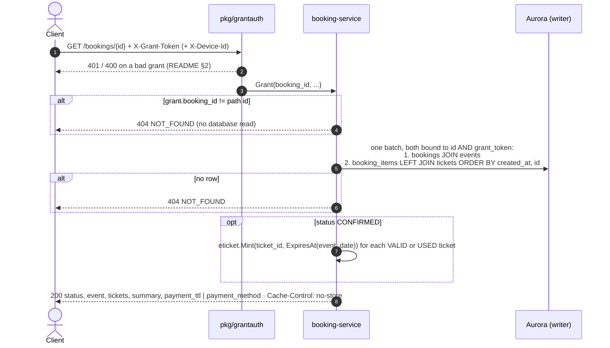

# GET /bookings/{booking_id} — Get Booking Detail

| | |
|---|---|
| **Service** | `services/booking` (Lambda) |
| **Auth** | `X-Grant-Token` (required) · `X-Device-Id` (required for a guest grant) · `Authorization: Bearer` (required when the grant belongs to a logged-in account) |
| **Contract** | Apidog `GET /bookings/{booking_id}` · api-contracts §4.4 |
| **Requirements** | FR-21, FR-22, FR-27, NFR-10, BR-05, BR-10 |
| **Detail** | impl-plan §3.7, §3.10, §5.5 · ADR-005 §12 (ownership) · ADR-006 §8.8 (the e-ticket link), §8.13 |
| **Status** | built |

## 1. Purpose

One read for two pages:

- **Payment page:** what is being paid for (event, seats, masked NIKs, total) and the 10-minute countdown.
- **Success page:** the same, plus a link per ticket that opens the e-ticket **without an account and without
  waiting for the email** (`eticket_url` already carries `?t=`, NFR-10).

It never changes state.

## 2. Flow

## 3. Steps

1. `pkg/grantauth` verifies the grant (README §2).
2. **Ownership first** (ADR-005 §12): `grant.BookingID ≠ {booking_id}` → 404; then
   `WHERE b.id = $1 AND b.grant_token = $2` on the writer; no row → **404 `NOT_FOUND`**. Nothing about the status is
   looked at before this.
3. **Map the status** with `pkg/bookingstate.DetailStatus`:

   | `bookings.status` | `data.status` | Page |
   |---|---|---|
   | GRANTED, SELECTING | `SELECTING` | back to Detail Ticket |
   | HELD, AWAITING_PAYMENT, PENDING_CANCELLATION | `PENDING_PAYMENT` | Payment (countdown) |
   | CONFIRMED | `PAID` | Success |
   | EXPIRED, LAPSED, ABANDONED | `EXPIRED` | expired screen |

4. **Items:** `booking_items` (`category_name`, `unit_price`, `nik_masked`) with their ticket (`id`, `status`), ordered by
   `created_at, id`. Empty before HELD. B4 writes the seats of one order with increasing `created_at`
   (`clock_timestamp()`): `now()` is the transaction start, the same for every seat.
5. **By status:**
   - `PENDING_PAYMENT`: `payment_ttl = {expires_at: payment_expires_at, server_time}`; the client counts down from `expires_at`.
     For PENDING_CANCELLATION `expires_at` has passed (grace running); the frontend shows
     "memverifikasi pembayaran…" from `GET /payments/{id}/status` (§5.4), not an expired screen.
   - `PAID`: join `tickets` on `booking_item_id`. Per ticket: `ticket_id` and
     `eticket_url = "/tickets/{ticket_id}/eticket?t=" + eticket.Mint(ticket_id, event_date + 1 day)`.
     `payment_method` mapped from `bookings.payment_method` (`bank_transfer` → "Virtual Account", `gopay` → "GoPay");
     no payment time. No `payment_ttl`.
     An item without a `tickets` row yet: no `ticket_id`, no `eticket_url`. A REVOKED or EXPIRED ticket keeps its
     `ticket_id` but gets no link. An unknown `payment_method` is shown as stored and counted (`UnknownPaymentMethod`).
   - `SELECTING`, `EXPIRED`: no `payment_ttl`, no `payment_method`; `tickets` as stored (usually empty).
6. **Summary:** `{quantity = len(items), total = Σ unit_price}`. Prices per seat are in `tickets[].price` (§6).
7. Header `Cache-Control: no-store`.

### 3.1 `pkg/eticket` (built in this step)

impl-plan §3.10, with the key held by a `Signer`: `NewSigner(key)`, then `Mint(ticketID, expiresAt) (string, error)` and
`Verify(token, ticketID, now) error`; `ExpiresAt(eventDate)` gives the link's end.
HMAC-SHA256 over `ticket_id` + `exp`, token = `base64url(exp) + "." + base64url(mac)`, `hmac.Equal`, key
`ETICKET_SIGNING_KEY` (required outside local, no default, not rotated during a sale). `Verify` is used later by
user-service `GET /tickets/{id}/eticket` (02-accounts/tickets); notification uses `Mint` for the email link, so all
three share one definition.

The token expires at **event_date + 1 day, 00:00 Asia/Jakarta** (the gate opens on event day).

## 4. Data touched

| Store | Key / table | Op | Notes |
|---|---|---|---|
| Redis | `grant:{token}` | HGETALL | via `pkg/grantauth` |
| Aurora | `bookings` JOIN `events` | SELECT | writer; ownership clause |
| Aurora | `booking_items` | SELECT | `0008` |
| Aurora | `tickets` | SELECT | `0002` + `booking_item_id` (`0008`); written by the ticket issuer (07-payment / outbox) |

## 5. Responses and errors

| HTTP | Code | When |
|---|---|---|
| 200 | — | booking found (any status) |
| 400 | `DEVICE_ID_REQUIRED` | guest grant without `X-Device-Id` |
| 401 | `GRANT_TOKEN_MISSING` / `GRANT_TOKEN_INVALID` / `DEVICE_MISMATCH` | bad grant |
| 401 | `UNAUTHORIZED` / `TOKEN_EXPIRED` / `TOKEN_INVALID` | account grant without `Authorization`, of another account, expired, invalid |
| 404 | `NOT_FOUND` | no booking with this id **for this grant** (not distinguished from "does not exist") |
| 503 | `INTERNAL_ERROR` | Redis or Aurora unreachable |

## 6. Edge cases

- **Four `data.status` values** (§3 step 3). `PENDING_CANCELLATION` shows as `PENDING_PAYMENT` because the payment may
  still arrive (ADR-005 §7, 30 s grace). Not the §5.4 vocabulary (`PENDING`/`FAILED`), which is about the payment, not
  the booking.
- **PAID before the tickets are issued.** CONFIRMED is written by the webhook; the `tickets` rows come from the issuer
  right after (inline or outbox). The answer is `PAID` with the items but without `ticket_id` / `eticket_url`; the
  Success page polls this endpoint (e.g. every 2 s, up to 30 s) until every ticket has a link.
- **No payment time in the response**: `bookings` has no column for it. `payment_method` is shown as a label: `bank_transfer` → "Virtual Account", `gopay` → "GoPay".
- **No price per ticket in `summary`.** It would have no correct value when an order mixes categories (FR-13a); each
  `tickets[].price` is the price. `summary` = `{quantity, total}`.
- **After the grant expires** (1080 s from `granted_at`) this endpoint answers 401. The customer already has the
  `eticket_url` links, the email, and `/queue/me` answering CONFIRMED from the tombstone.
- **CONFIRMED must not delete the grant.** If admission-ctl or the webhook `DEL`s `grant:{token}` on CONFIRMED, the
  Success page fails at once. Nothing deletes it on CONFIRMED today; 07-payment keeps it that way.
- **`booking_id` is guessable** (`RB-00912`): the ownership clause, not the id, protects it. A wrong id and a foreign id
  give the same 404.
- **No `ticket_no`, no `queue_token`, no `grant_token`, no NIK in the response.** Only `nik_masked`.

## 7. Tests

Unit (fakes for ports):

- [x] a booking of another grant answers 404, exactly like an unknown id
- [x] a path id different from the grant's booking id answers 404 without a database read
- [x] each stored status maps to its `data.status` (table test over all nine)
- [x] a held booking shows the payment deadline and a ttl that never goes below 0
- [x] a paid booking has a working e-ticket link per issued ticket and none for a ticket not issued yet
- [x] the payment method label is present only when paid, and the response never has `paid_at`
- [x] the summary has the ticket count and the sum of the ticket prices, and no price per ticket (also for mixed categories)
- [x] the response carries `Cache-Control: no-store` and the contract envelope

`pkg/eticket` (impl-plan §3.10 test list):

- [x] a minted token verifies for its ticket
- [x] a token for ticket A is rejected on ticket B
- [x] an expired token is rejected; a changed `exp` is rejected; one flipped MAC bit is rejected
- [x] a malformed token is rejected without panicking
- [x] config without `ETICKET_SIGNING_KEY` fails outside local

Integration (real Postgres via `pkg/pgtest`):

- [x] the ownership query returns the row only with the matching grant token
- [x] items and tickets join on `booking_item_id`; a second `tickets` row for the same item is refused (`UNIQUE`)

## 8. Tasks

- [x] `pkg/eticket`
- [x] use case `GetBooking` + handler + route
- [x] `make verify` green; independent review done
- [ ] 07-payment: the webhook keeps `grant:{token}` on CONFIRMED
- [ ] user-service: `GET /tickets/{id}/eticket?t=…` verifies the link with `eticket.Verify`
