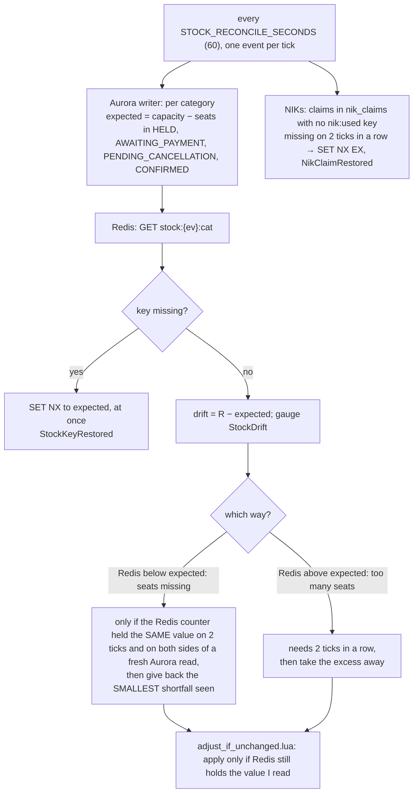

# Stock reconciliation — repair Redis stock and NIK locks from Aurora

| | |
|---|---|
| **Service** | `services/admission-ctl` (ECS), a fourth periodic job next to the three booking sweeps |
| **Auth** | none (internal job, no endpoint) |
| **Contract** | none; metrics only |
| **Requirements** | NFR-04 (atomic stock), BR-02 (1 NIK = 1 seat), BR-01 |
| **Detail** | ADR-005 §6 "Rekonsiliasi stok" (still valid, see ADR-006 §3 note) · `docs/lua-scripts.md` §5 · `docs/redis-keys.md` |
| **Status** | built (step B5) with the defaults of §10; ADR-006 §8.19 and a callout in ADR-005 §6 record it |

## 1. Purpose

Redis is the fast counter; **Aurora is the truth**. Booking takes seats in Redis (`hold_booking.lua`) and writes the
booking in Aurora, but Redis is not part of the Aurora transaction. Three situations leave the two out of step, and until
now they are only counted (`HoldCompensationFailed`, `ReleaseFailed`, `ReleaseStockMissing`):

| Situation | Redis | Effect |
|---|---|---|
| The booking transaction fails after the hold and giving the hold back also fails | seats and NIK locks stay held | seats vanish from sale, the customer's NIKs are locked, no booking exists |
| A HELD booking expires (committed) and the release fails or the worker dies before it | same | same |
| A stock key is lost (failover, eviction) | key missing | every hold of that category answers `STOCK_UNINITIALIZED`: the category is dead |
| `nik:used` keys are lost | key missing | the database still refuses a duplicate NIK, but the customer learns it only after pressing Pay |

Simple picture: the whiteboard tally (Redis) is wrong. Once a minute a manager compares it with the cash register (Aurora)
and fixes the tally, **but never by guessing**: a sale in progress looks like a wrong tally for a few milliseconds.

## 2. Flow



## 3. Rules

1. **Expected stock** of a category = `capacity − count(booking_items)` of the bookings whose seats are taken: `HELD`,
   `AWAITING_PAYMENT`, **`PENDING_CANCELLATION`** and `CONFIRMED`. (ADR-005 §6 lists three statuses and leaves out
   `PENDING_CANCELLATION`, which still holds its seats during the 30 s grace; this plan includes it.) `EXPIRED`, `LAPSED`,
   `ABANDONED`, `SELECTING` and `GRANTED` hold nothing. One query per event on the **writer** (a replica's lag would read a
   fresh booking as missing).
2. **The category list comes from Aurora** (`ticket_categories` of the event), not from Redis: admission-ctl discovers
   categories from the stock keys that exist, so a lost key would otherwise be invisible to its own repair.
3. **Which events:** those the controller ticks whose queue state is `OPEN` or `FULL_BOOKED`. Not `SCHEDULED` (stock may
   not be seeded yet, and a missing key there is a seeding mistake to see, not to hide) and not `CLOSED`.
4. **A missing stock key is restored at once** to the expected value with `SET … NX` (never over a key that came back in the
   meantime). It is not drift: it blocks every hold of the category.
5. **A transient drift is not a leak, and the dangerous direction is giving seats back.** The hold script lowers Redis
   *before* Aurora commits, and the sweep raises Redis *after* it commits, so Redis is *below* expected for as long as a
   hold is in flight. During a flash sale holds are in flight **all the time** (about rate × hold time, say 15 at once at
   1000 holds/s and 15 ms), so readings of −15, −14, −15 are the sale, not a leak, and no number of such readings can tell
   them apart: giving the seats back would oversell when those holds commit. What does tell them apart: **a hold in flight
   moves the Redis counter**. Therefore, for **drift < 0** (seats missing), seats are given back only if
   - the Redis counter held **exactly the same value** on two ticks in a row (60 s apart), and
   - a **fresh confirm** reads Redis, then Aurora, then Redis again, and the counter is still that same value on **both
     sides** of the Aurora read (so no hold landed while Aurora was being read), and
   - the correction is then the **smallest** shortfall of the three readings, never more.
   Under steady load the counter never holds still, so a real leak is repaired when the sale goes quiet (a lull, or
   `FULL_BOOKED`). That is slower and it is safe: undersell, never oversell. The HELD sweep needs no special case: it runs
   in the same single-threaded worker, before the reconciler in a tick, so its commit and its release are both done.
   Drift in the other direction (> 0, Redis above expected) cannot come from a sale in flight, so it needs only the two
   ticks; the correction takes seats away (the safe direction).
6. **Compare-and-adjust, never a blind add.** `adjust_if_unchanged.lua` re-reads the key and applies the delta only if it
   still holds the value the reconciler observed, and never lets it go below zero. A second reconciler (a restart, a future
   standby) can therefore never correct twice.
7. **Limits.** A drift below `STOCK_DRIFT_THRESHOLD` (default 1) is left alone. A drift beyond `STOCK_MAX_CORRECTION`
   (default 20 seats per category per run) is **not** corrected automatically: it means a changed capacity, a flush or a bug
   that a person must look at; the metric `StockDriftTooLarge` is raised instead.
8. **`capacity` must not change during a sale.** Every drift is measured against it (migration 0008). A change goes in
   between sales.
9. **NIK locks, one direction only.** A claim in `nik_claims` whose `nik:used:{ev}:{hmac}` key is missing for **two ticks in a
   row** gets its key back with `SET NX EX <sale window>`. Two ticks because the HELD sweep commits (claims gone) before it
   deletes the Redis key: a single reading could restore the lock of a booking that has just expired and block that NIK for
   the whole sale. The claim must still exist when the key is restored. The other direction (a key with no claim) is
   **never deleted**: it may be a hold that has not committed yet. It dies on its own TTL and is counted by `NikOrphans`.
10. **Not corrected here:** a full Redis flush (queue state and every key gone). The event is not even discovered then; that
    is the rebuild procedure of ADR-005 §6, outside B5.

## 4. Steps

Per tick, for **one** event whose last run is at least `STOCK_RECONCILE_SECONDS` old (events take turns, so a tick never
carries more than one event's reconciliation and stays near its 500 ms budget):

1. **Read Aurora** (rule 1): per category `capacity` and the number of seats taken.
2. **Read Redis**: `MGET stock:{ev}:<cat>` for every category of the event (one shard, `{ev}` tag).
3. **Per category:**
   - key missing → `SET NX` expected, metric `StockKeyRestored`, forget its history;
   - else `drift = R − expected`, gauge `StockDrift{category}`;
   - `|drift| < threshold` → forget its history, done;
   - `|drift| > STOCK_MAX_CORRECTION` → `StockDriftTooLarge`, no correction, keep alarming;
   - otherwise remember `(drift, Redis value)` and compare with the previous tick's: a first sighting, a drift of the other
     sign, or (for drift < 0) a Redis value that differs from the previous tick's waits and starts over; for drift < 0 also
     take the fresh confirm (rule 5); then `adjust_if_unchanged.lua` with `ARGV = the observed value, −smallest drift`.
     Answers: applied (`StockAdjusted`), refused because the value moved (`StockAdjustRefused`, harmless, next run decides).
4. **NIK locks** (rule 9): read the event's claims (`SELECT nik_hmac FROM nik_claims WHERE event_id = $1`), pipeline
   `EXISTS` on the keys, restore the ones missing on two ticks in a row (`SET NX EX`, `NikClaimRestored`).
5. **Orphan count:** `SCAN` the `nik:used:{ev}:*` keys on the **one node that owns the event's slot** and count those with no
   claim → gauge `NikOrphans` (alarm when large; never deleted). A `SCAN` walks that node's whole keyspace (tokens
   included), so it runs on the first run of an event and then once every 10 runs, not every minute.
6. A failure of any step is counted (`ReconcileFailures`) and skipped; the next run repairs. It never stops the tick.

The history (last drift per category, keys missing last time) lives in memory, like the rest of the controller's caches:
losing it (a restart) only delays a correction by one run.

### 4.1 `adjust_if_unchanged.lua`

```
KEYS[1] = stock:{ev}:<cat>      ARGV = observed (the value the reconciler read), delta
RET     {code, value}
  ADJUSTED   value = the new count         (key == observed, observed + delta >= 0)
  CHANGED    value = the current count     (key != observed: nothing written)
  MISSING    value = -1                    (key gone: the caller restores it with SET NX instead)
  BELOW_ZERO value = the current count     (observed + delta < 0: nothing written)
```
One key, so one shard. Writes only that key.

## 5. Data touched

| Store | Key / table | Op |
|---|---|---|
| Aurora (writer) | `ticket_categories` | SELECT `id`, `capacity` |
| Aurora (writer) | `booking_items` JOIN `bookings` | COUNT of taken seats per category (index `booking_items_event_category_idx`) |
| Aurora (writer) | `nik_claims` | SELECT `nik_hmac` of an event |
| Redis | `stock:{ev}:<cat>` | MGET, SET NX (restore), `adjust_if_unchanged.lua` |
| Redis | `nik:used:{ev}:<hmac>` | EXISTS, SET NX EX, SCAN (orphans) |

## 6. Configuration (admission-ctl)

| Variable | Default | Meaning |
|---|---|---|
| `STOCK_RECONCILE_SECONDS` | 60 | minimum time between two runs for one event; 0 turns the job off |
| `STOCK_DRIFT_THRESHOLD` | 1 | smaller drifts are ignored |
| `STOCK_MAX_CORRECTION` | 20 | larger drifts are alarmed, not corrected |
| `SALE_WINDOW_SECONDS` | 21600 | TTL of a restored NIK lock (the same value booking uses) |

## 7. Metrics

`StockDrift` (gauge: the largest absolute drift of the last run; the metrics port has no dimensions, so the event and
category are in the log line of a correction) · `StockKeyRestored` · `StockAdjusted` · `StockAdjustRefused` · `StockDriftTooLarge` ·
`NikClaimRestored` · `NikOrphans` (gauge) · `ReconcileFailures`. Alarms: `StockDriftTooLarge` > 0, `NikOrphans` high,
`ReconcileFailures` > 0 for 3 runs.

## 8. Edge cases

- **A sale in flight while the job runs.** Covered by rule 5: seats are given back only when the Redis counter did not
  move at all across the ticks and the confirm. A coincidence of three identical counter readings while a hold is in flight
  needs the counter to stand still for 60 s, which a hold in flight prevents; the only gap left is a hold landing between
  the last Redis read and the adjust, and the script's compare-and-adjust closes it (the counter would have moved).
- **A stock key lost while holds are in flight.** A missing key is restored at once to the expected count. If a hold had
  lowered Redis and the key was then lost before the hold committed, those seats are counted twice until the next drift
  correction takes them away. It needs the key lost during a sale (an eviction or a failover); waiting would leave the whole
  category refusing every hold. Accepted and alarmed (`StockKeyRestored`).
- **Other paths that end a booking must delete its claims.** Only the HELD expiry deletes `nik_claims` today. When the
  cancel, failed-payment and lapse paths of 07-payment are built, each must delete the booking's claims in the same
  transaction, before it releases Redis; otherwise this job restores the NIK locks of those bookings for the whole sale.
- **Oversell vs undersell.** Every choice here prefers undersell: a leak costs seats until corrected, a wrong correction
  could sell a seat twice.
- **Two reconcilers** (a restart overlap): the compare-and-adjust script makes the second one a no-op.
- **An event with no categories in Aurora:** nothing to reconcile, counted once.
- **Capacity changed mid-sale:** the drift is huge and constant → `StockDriftTooLarge`; nothing is corrected.
- **A stock value that is not an integer:** the hold script already answers `STOCK_UNINITIALIZED` for it; the reconciler
  treats it as a missing key and overwrites it with the expected count.

## 9. Tests

Unit (fakes):

- [x] expected stock counts exactly the four taking statuses (and never `SELECTING`, `GRANTED`, `EXPIRED`, `LAPSED`)
- [x] a missing key is restored at once with `SET NX`, and a key that came back first is not overwritten
- [x] drift < threshold changes nothing; drift beyond the maximum is alarmed and not corrected
- [x] a shortfall seen once is not corrected; seen on two ticks it still needs the fresh confirm; a shortfall that is gone at
      the confirm is not corrected
- [x] **a shortfall while the Redis counter keeps moving (the constant in-flight load of a flash sale) is never corrected**,
      even when every reading is within the maximum; a counter that moves between the ticks, or between the two Redis reads
      of the confirm, starts over; once it holds still it is corrected
- [x] an unreadable (non-integer) stock value is overwritten, a readable one never
- [x] the orphan scan runs on the first run and then every 10th; the state of an ended event is dropped
- [x] the correction is the smallest of the observed shortfalls
- [x] drift > 0 is taken away after two ticks, never after one
- [x] a drift of the other sign resets the history
- [x] the category list comes from Aurora: a lost key of a category Redis no longer lists is restored
- [x] only `OPEN` and `FULL_BOOKED` events are reconciled, one event per tick, no more often than the interval
- [x] a failing step is counted and skipped, and the tick goes on
- [x] a NIK lock missing on one tick is not restored; missing on two it is, and only while the claim still exists
- [x] a Redis key with no claim is never deleted, and is counted as an orphan

Lua (miniredis and the real cluster, one test body, as `hold_booking.lua`):

- [x] `adjust_if_unchanged.lua`: applied, changed, missing, below zero; writes nothing but its key; two runs with the same
      observed value apply once

Integration (real Postgres and Redis):

- [x] the expected-stock query on every status mix, with the index
- [x] repair end to end: a failed compensation (held seats, no booking), an expired hold whose release failed, a deleted stock
      key and deleted NIK locks are each repaired within the right number of runs
- [x] a sale in flight (holds decremented, bookings not yet committed) is **not** "corrected"
- [x] the HELD sweep racing the reconciler does not recreate the lock of an expired booking

## 10. OPEN

- **OPEN-1, thresholds.** Defaults: run every 60 s, threshold 1, maximum correction 20. Proposed: as listed; tune after the
  load test.
- **OPEN-2, where it runs.** Proposed: inline in the controller's loop, one event per tick, with the tick's overrun counter
  as the alarm. Alternative: its own goroutine (more concurrency to reason about for little gain at one event).
- **OPEN-3, the ADR text.** ADR-005 §6 lists three statuses; this plan adds `PENDING_CANCELLATION` and the asymmetric,
  confirmed correction. Proposed: a short ADR-006 §8.19 note and a callout in ADR-005 §6 when the plan is approved.
- **OPEN-4, orphans.** `NikOrphans` needs a `SCAN` per event per run. Proposed: include it (about 10 000 keys at most).
- **OPEN-5, full flush.** Out of scope (rule 10). Proposed: a separate rebuild step before production; B5 only covers partial
  loss.

## 11. Tasks

- [x] plan approved with the defaults of §10; ADR-006 §8.19 and the ADR-005 §6 callout written
- [x] `adjust_if_unchanged.lua` + `redisscript.AdjustIfUnchanged`, with tests (`docs/lua-scripts.md` §5)
- [x] Aurora reads: expected stock per category, claims of an event (`infrastructure/postgres`)
- [x] Redis reads and writes: stock MGET, restore, adjust, claim EXISTS/restore, orphan count (`infrastructure/redis`)
- [x] use case `Reconcile` (history, rules 4-9) + `Tick` wiring, config, metrics
- [x] fill in `docs/lua-scripts.md` §5, `docs/redis-keys.md`, admission-ctl README
- [ ] `make verify`; fresh-subagent review (Lua + admission-ctl)
