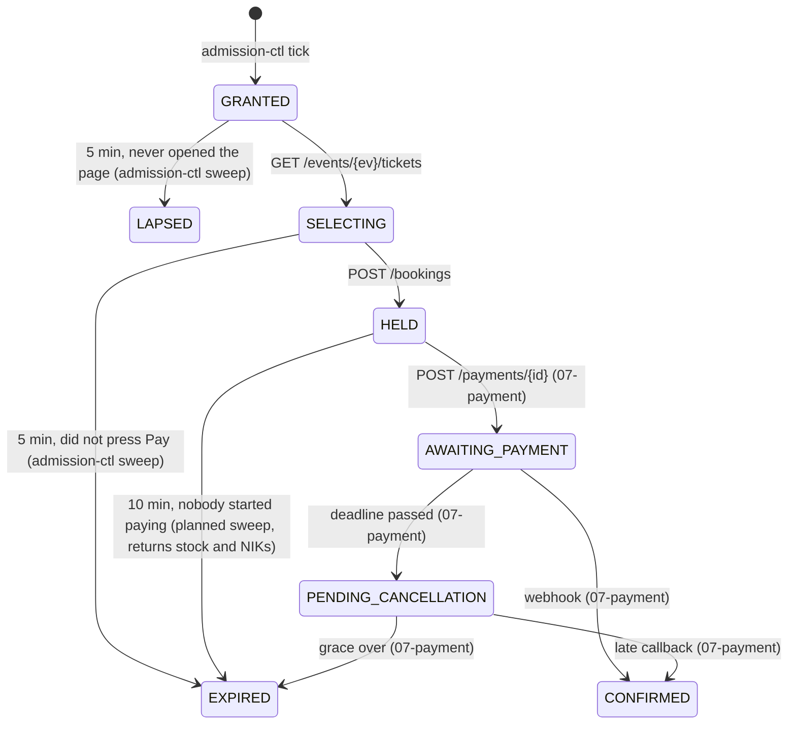

# 05 Booking — `services/booking`

The Booking folder of the Apidog collection: the Detail Ticket page, the Pay button and the Payment / Success page data.
Behaviour comes from the contract (`documentations/api/api-contracts.md` §4) and ADR-005 as amended by ADR-006; these
files plan how it is built.

| # | Endpoint | Plan | Status |
|---|---|---|---|
| 01 | `GET /events/{event_id}/tickets` — ticket selection page | [01-get-ticket-selection-page.md](01-get-ticket-selection-page.md) | built |
| 02 | `POST /bookings` — create booking | [02-create-booking.md](02-create-booking.md) | plan approved (B4) |
| 03 | `GET /bookings/{booking_id}` — booking detail | [03-get-booking-detail.md](03-get-booking-detail.md) | built |
| 00 | `Authorization: Bearer` for account grants, on every grant endpoint (`pkg/grantauth`) | [00-grant-authorization.md](00-grant-authorization.md) | built (B4a) |

`POST /nik/validate` belongs to the NIK folder (`06-nik/`, `services/nik-verify`).

## 1. How a booking moves

Nothing moves back into `GRANTED` or `SELECTING`, so changing seats after Pay is not supported. The admission count
(`open`, `browsing`) relies on this (`04-queue/README` §3.2).

The two admission-ctl sweeps are what free a place for the next customer. A `SELECTING` booking that nobody ends would
keep its admission place for ever, so that sweep ships with the ticket page.

## 2. Rules every booking endpoint follows

1. **The grant, plus the account for a logged-in customer.** Everyone sends `X-Grant-Token`. A guest also sends
   `X-Device-Id`. A grant that belongs to an account also needs `Authorization: Bearer` of **that account**: a leaked grant
   alone is not enough.
2. **`pkg/grantauth` checks the grant first**, in this order:
   1. no header → 401 `GRANT_TOKEN_MISSING`
   2. no `grant:{token}` hash, or a malformed one → 401 `GRANT_TOKEN_INVALID`
   3. guest grant (has `device_hash`): no `X-Device-Id` → 400 `DEVICE_ID_REQUIRED`; another device → 401 `DEVICE_MISMATCH`
      (no rebind)
   4. logged-in grant (has `account_id`): no device check; `Authorization` is required. Missing, or a token of another
      account (`sub` ≠ `account_id`) → 401 `UNAUTHORIZED`; expired → 401 `TOKEN_EXPIRED`; invalid → 401 `TOKEN_INVALID`.
      The client refreshes the session and repeats the call; the grant and the booking are unaffected
   5. the `Grant{Token, EventID, BookingID, QueueToken, AccountID, DeviceHash}` goes into the request context

   A guest grant ignores `Authorization`. The booking's `account_id` still comes from the grant, never from the header:
   the session only **checks**, so a dead session is a visible error, not a booking recorded as a guest's.
   Redis down → 503, never a pass.
3. **The hash never decides access alone.** It can outlive its booking (admission-ctl may die between ending a booking and
   deleting the hash), so every use case also reads the booking row and checks its status.
4. **Ownership:** every path id is read with `WHERE id = $1 AND grant_token = $2`; a mismatch is 404, never 403, and is
   checked before any status.
5. **Aurora writer** for every read: volumes are small, and replica lag would show a paid booking as pending.
6. **`pkg/apinizer` envelope** (`server_time`, `error_code`, `data {}`) and `Cache-Control: no-store` on every response.
7. **Countdowns come from server deadlines** (`booking_expires_at`, `payment_expires_at`) and `server_time`; the client
   counts down from the deadline, there is no seconds-left field. Deadlines never move.
8. **Aurora's clock decides every deadline race** (claim, hold, both sweeps), so two clocks never decide one case.

## 3. What is built

| Piece | Where |
|---|---|
| Grant check | `pkg/grantauth` (`Middleware`, `FromContext`, `DeviceHash` and `BearerToken` shared with queue's join): the grant, the device of a guest, and the access token of an account grant |
| Status model | `pkg/bookingstate` (nine statuses, which are final, the four API statuses) |
| E-ticket link token | `pkg/eticket` (`Signer`: `Mint`, `Verify`; `ExpiresAt`) |
| Metrics writer | `pkg/emf` (CloudWatch EMF lines; queue uses it too) |
| Ticket page | `GET /events/{event_id}/tickets`, with `account {email, nik_masked}` for an account grant |
| Create booking | `POST /bookings` |
| Booking detail | `GET /bookings/{booking_id}` |
| SELECTING → EXPIRED sweep | admission-ctl, right after the GRANTED → LAPSED sweep |
| HELD → EXPIRED sweep | admission-ctl, third in the same timer: ends a hold nobody started paying for and gives its seats and NIK locks back |
| Service wiring | real Aurora writer + Redis, config (`DATABASE_URL`, `REDIS_ADDR`, `DEVICE_PEPPER`, `JWT_SECRET`, `ETICKET_SIGNING_KEY`, `MAX_TICKETS_PER_TRANSACTION`), SAM template with VPC and secrets |

`POST /bookings` is mounted behind the grant. It checks typed NIKs through nik-verify's internal Lambda event (B4d, open); the HELD → EXPIRED sweep that returns held seats (B4f) is not built yet.

## 4. Database

| Migration | Adds |
|---|---|
| `0008_ticket_categories` | `ticket_categories` (price, capacity, `max_per_order`, `sort_order`, …) |
| `0009_booking_domain` | `booking_items` (one row per seat, with the category name, price and masked NIK as bought), `nik_claims` (one NIK = one seat per event, a database rule), `tickets.booking_item_id` (one ticket per seat), the SELECTING deadline index, and email required **from HELD on** |
| `0010_drop_terms_and_holder_email` | removes the terms columns and check from `bookings` and `holder_email` from `booking_items` (consent is recorded at registration; the buyer's email receives every e-ticket). `tickets.holder_email` stays: it is the e-ticket's address |
| `0012_held_deadline_index` | the partial index the HELD → EXPIRED sweep reads (`bookings (payment_expires_at) WHERE status = 'HELD'`) |

## 5. What is left

| Step | Scope |
|---|---|
| ~~B4a~~ | built: `Authorization: Bearer` check for account grants in `pkg/grantauth`; `JWT_SECRET` in booking. [00-grant-authorization.md](00-grant-authorization.md) |
| ~~B4b~~ | built: ticket page `account {email, nik_masked}`. [01 §3.3](01-get-ticket-selection-page.md) |
| ~~B4c~~ | built: `pkg/nikformat` (shared `Normalize` / `IsValidFormat`), `rediskeys` `NIKUsed`, `hold_booking.lua` + `release_hold.lua` with `redisscript.Hold` / `Release`. [02 §4, §8](02-create-booking.md), [lua-scripts.md §4](../lua-scripts.md) |
| ~~B4d~~ | built: `NIKVerifier` port, Lambda-invoke adapter, local fake, config, IAM statement; nik-verify's internal `{op: validate}` Lambda event (`services/nik-verify/internal/delivery/event.go`, additive, public route unchanged). **Needs nik-verify's owner's agreement before it merges and deploys**; until then a deployed booking answers 503 for typed NIKs. Plan: [02 §3.1 step 4, §4](02-create-booking.md) |
| ~~B4e~~ | built: `POST /bookings` (use case, handler, Redis hold and queue adapters, Postgres transaction, route). Until nik-verify's internal event ships (B4d), the deployed booking answers 503 for a typed NIK. [02](02-create-booking.md) |
| ~~B4f~~ | built: HELD → EXPIRED sweep in admission-ctl (stock and NIK locks given back after the commit), migration `0012`. Needs `0012` applied before the worker runs it. [02 §3.4](02-create-booking.md) |
| **B5** | Stock reconciliation: repairs stock and NIK keys left held after a crash. Before the load test |
| 07-payment | The webhook that sets `CONFIRMED`; the ticket issuer, which writes `tickets.holder_email` = the booking's `contact_email`; keep `grant:{token}` after `CONFIRMED` |
| user-service | `GET /tickets/{ticket_id}/eticket?t=…` checks the link with `eticket.Verify` |
| Shared secret | `ETICKET_SIGNING_KEY` must be the same in booking, notification and user-service |
| nik-verify | The internal `{op: validate}` Lambda event that returns `nik_hmac` is built (booking invokes it directly, 02 §3.1 step 4) and waits for the owner's agreement. Separately, its public `POST /nik/validate` does not yet match contract §4.2: no grant guard, no per-customer 429, no `already_used`, `nik_masked`/`status` where the contract says `nik`/`reason`, and it returns `nik_hmac` |

Each step: plan approved, tests and code together, `make verify`, review, then commit after approval.
