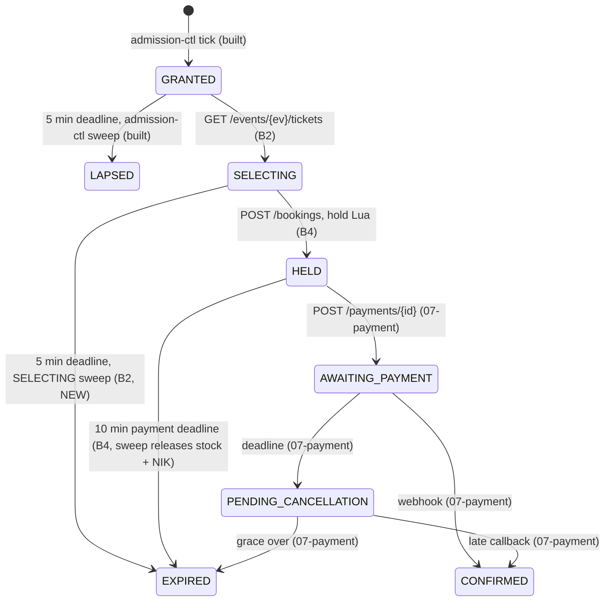

# 05 Booking — `services/booking`

Plans for the Apidog folder **Booking**. Read with ADR-005 §6–§8, §12 (as amended by ADR-006 §8.8, §8.9, §8.12,
§8.13), api-contracts §4 and impl-plan §2.1–§2.4, §3.5, §3.7, §3.10, §4.2, §5 (queue parts stale, see its banner).

| # | Endpoint | Plan | Status |
|---|---|---|---|
| 01 | `GET /events/{event_id}/tickets` — Get Ticket Selection Page | [01-get-ticket-selection-page.md](01-get-ticket-selection-page.md) | built (B2) |
| 02 | `POST /bookings` — Create Booking | not written yet | — |
| 03 | `GET /bookings/{booking_id}` — Get Booking Detail | [03-get-booking-detail.md](03-get-booking-detail.md) | built (B3) |

`POST /nik/validate` is in Apidog folder *NIK* (`06-nik/`, `services/nik-verify`), even though api-contracts lists it as §4.2.

## 1. What exists today

| Piece | State |
|---|---|
| `services/booking` | **scaffold**: in-memory repo, hard-coded categories, its own `Envelope` without `server_time`, response DTO with `subtotal`/`service_fee` (not the contract). Replaced, not patched (impl-plan §5) |
| `bookings` table | `0004` (shape) + `0005` (`grant_token`, `UNIQUE (event_id, queue_token)`) + `0006` (admission indexes) |
| GRANTED rows, `grant:{token}` hash | written by admission-ctl (built). Hash fields: `event_id`, `booking_id`, `queue_token` + `account_id` (login) **or** `device_hash` (guest); TTL 1080 s from `granted_at` (ADR-006 §8.13) |
| GRANTED → LAPSED sweep | built in admission-ctl (`SweepSQL`, `WHERE status = 'GRANTED'`) |
| `GET /queue/me` | built; answers HELD as `SELECTING` + `booking_id`, so the client always knows its booking id |
| `ticket_categories`, `booking_items`, `nik_claims`, `tickets.booking_item_id` | **not built** (impl-plan §4.1/§4.2 designed them as `0005`/`0006`; those numbers are taken → `0007`, `0008`) |
| `pkg/grantauth`, `pkg/bookingstate`, `pkg/eticket` | **not built** (designed in impl-plan §3.5, §3.7, §3.10) |
| `stock:{ev}:{cat}` seeding | sale-ops (impl-plan §11), not built. Tests seed it directly |

## 2. Who moves a booking, and what is missing



**The gap that blocks the queue.** Today nothing expires a `SELECTING` row. The admission COUNT counts it in `open`
and `browsing` (ADR-006 §3.2) for ever, so every customer who opens the ticket page and closes the tab takes one
admission place permanently; after `MAX_CONCURRENT_SLOTS` such tabs nobody else is let in. **The SELECTING sweep
therefore ships in the same step as the claim (B2)**, never after it. It runs in admission-ctl's loop (which already
has the clock, the writer pool and the 1 s sweep), but it is planned here, as `05-admission-controller.md` §1 says.

**Invariant kept:** no transition goes back into GRANTED or SELECTING (`04-queue/README` §3.2). Nothing in this
folder adds one; "change seats after HELD" is not supported.

## 3. Shared rules for every booking endpoint

1. **The grant is the only credential** (api-contracts §4). `Authorization` is not sent.
2. **`pkg/grantauth` middleware**, checks in this order (impl-plan §3.5 as amended by ADR-006 §8.9, §8.13):
   1. no `X-Grant-Token` → 401 `GRANT_TOKEN_MISSING`
   2. `HGETALL grant:{token}` empty → 401 `GRANT_TOKEN_INVALID`
   3. hash has `device_hash` (guest): no `X-Device-Id` → 400 `DEVICE_ID_REQUIRED`; `HMAC(DEVICE_PEPPER, X-Device-Id)` ≠
      `device_hash` (constant time) → 401 `DEVICE_MISMATCH`. **No rebind.**
   4. hash has `account_id` (logged in): no device check; the account is bound at grant time.
   5. puts `Grant{Token, EventID, BookingID, QueueToken, AccountID, DeviceHash}` in the request context.
   Redis down → 503 `INTERNAL_ERROR` (fail closed: no credential check, no access).
3. **The hash alone never decides access.** It may outlive its booking (ctl crash between UPDATE and `DEL`, ADR-006
   §8.13 (c)), so every use case also reads the booking row and checks its status.
4. **Ownership clause** on every path id: `WHERE id = $1 AND grant_token = $2`; mismatch → **404**, never 403, checked
   before any status check (ADR-005 §12).
5. **Aurora writer** for every read here. Volumes are small (≤ `MAX_CONCURRENT_SLOTS` people inside), and replica lag
   would show a just-paid booking as pending.
6. **Envelope from `pkg/apinizer`** (`server_time`, `error_code`, `data {}`); `Cache-Control: no-store` on every response
   (a grant-bound response must never be cached by a CDN or the browser).
7. **Countdowns come from server deadlines** (`booking_expires_at`, `payment_expires_at`) and `server_time`; deadlines never
   move (ADR-006 §4.3).

## 4. Build steps

Each step: plan approved → Go tests first (red) → code (green) → `make verify` → review → commit approval
(`docs/DEVELOPMENT-FLOW.md`).

| Step | Scope | Depends on |
|---|---|---|
| **B1** | `pkg/grantauth`, `pkg/bookingstate` (status enum, `IsTerminal`, API mapping), migrations `0007` (`ticket_categories`) and `0008` (`booking_items`, `nik_claims`, `tickets.booking_item_id`, SELECTING deadline index); booking scaffold replaced (config, Postgres + Redis adapters, `pkg/apinizer`) | — |
| **B2** | `GET /events/{event_id}/tickets` + SELECTING → EXPIRED sweep in admission-ctl | B1 |
| **B3** | `GET /bookings/{booking_id}` + `pkg/eticket` (`Mint`, `Verify`) | B1 |
| **B4** | `POST /bookings` (hold Lua, NIK, HELD sweep with stock/NIK release) — plan `02-create-booking.md` written later | B1, B2 |

B3 does not need B4: its tests seed HELD / CONFIRMED rows directly.

**Rule for B4 (from the B2 review).** The SELECTING sweep and the hold race on the same row at the 5-minute deadline.
The Aurora compare-and-set makes exactly one of them win, but Redis is outside that transaction: if the hold Lua takes
stock and NIK and then its `UPDATE … WHERE status = 'SELECTING'` matches 0 rows (the sweep won), the stock and NIK must
be given back. `02-create-booking.md` must either check the deadline in the same compare-and-set
(`AND booking_expires_at > now()`, one clock: Aurora's) or always undo the Lua on 0 rows, and test that race.

**Rule for B4 (from the B3 review).** `GET /bookings/{id}` lists seats by `created_at, id`. The hold writes the seats of
one order in one transaction, where `now()` is the same for all of them, so it sets `created_at = clock_timestamp()`
(or the ids are increasing) to keep the order the customer chose.

### 4.1 B1 in detail

B1 has no endpoint; it is what B2 and B3 stand on.

**`pkg/grantauth`** (new; impl-plan §3.5 as amended by ADR-006 §8.9, §8.13)

```go
type Grant struct{ Token, EventID, BookingID, QueueToken, AccountID, DeviceHash string }
type Config struct{ DevicePepper []byte }

func Middleware(rdb redis.UniversalClient, cfg Config) func(http.Handler) http.Handler
func FromContext(ctx context.Context) (Grant, bool)
func DeviceHash(pepper []byte, deviceID string) string // HMAC-SHA256, hex: the same bytes queue's join writes
```

- Check order and codes exactly as §3 rule 2; errors written with `pkg/apinizer` (envelope, `error_code`).
- Device hashes compared in constant time; a guest hash with an empty `device_hash` matches nothing (fail closed, as join).
- A hash with **both** or **neither** of `account_id` / `device_hash` is treated as invalid (401 `GRANT_TOKEN_INVALID`
  + log): admission-ctl never writes it, so it means a bug or tampering.
- Field names come from `pkg/rediskeys`: add `FieldEventID`, `FieldQueueToken` next to the existing `FieldBookingID`,
  `FieldAccountID`, `FieldDeviceHash`, and switch admission-ctl's `HSET grant` (today literal strings in
  `infrastructure/redis/queue.go:92`) to the constants. One-line change in admission-ctl, covered by its existing tests.

**`pkg/bookingstate`** (new; impl-plan §3.7 without the `slots:open` parts, which ADR-006 removed)

```go
type Status string // GRANTED … ABANDONED, the nine values of the bookings_status CHECK
func (s Status) IsTerminal() bool       // CONFIRMED, EXPIRED, LAPSED, ABANDONED
func (s Status) DetailStatus() string   // §4.4 mapping: SELECTING / PENDING_PAYMENT / PAID / EXPIRED
func Parse(s string) (Status, error)    // unknown value → error, never a silent default
```

`CanTransition`, `DecrementsSlot` and the §5.4 / §3.3 mappings are **not** built now (no caller yet; payment and queue
add them when they need them).

**Migrations** `0007_ticket_categories`, `0008_booking_domain` (§5 below), each with a `.down.sql`.

**Booking scaffold replaced**

- Delete: `infrastructure/memory`, `domain/valueobject/category.go` (hard-coded categories), the scaffold's
  `create_booking.go` / `get_booking.go` and their tests, `dto.Envelope`, the generated mocks for them.
- **`POST /bookings` is unmounted until B4**: the scaffold's version writes to memory with the wrong shape;
  keeping it would look like a working endpoint. The route returns 404 until B4 builds the real one.
- Config (`internal/config`): `DATABASE_URL` (writer, always required: an empty DSN falls back to libpq defaults),
  `REDIS_ADDR`, `DEVICE_PEPPER` (required outside local, same value as queue), `MAX_TICKETS_PER_TRANSACTION` (default 3).
  `APP_ENV` must be set inside Lambda (its `local` default would skip the checks). `ETICKET_SIGNING_KEY` comes in B3.
- `template.yaml` follows queue's: VPC, secrets for `DATABASE_URL` and `DEVICE_PEPPER`, `APP_ENV: production`;
  only `/sys/ping` is routed until B2.
- Delivery wires a pgx pool + Redis cluster client, `pkg/grantauth.Middleware` on every booking route, `pkg/apinizer`
  for responses. Health route kept.
- Hexagonal layout as impl-plan §5.1, only the parts B2/B3 need (no NIK verifier, no hold Lua yet).

**Tests (B1)**

- [x] grantauth: missing header → 401 `GRANT_TOKEN_MISSING`
- [x] grantauth: unknown token → 401 `GRANT_TOKEN_INVALID`
- [x] grantauth: guest grant without device id → 400 `DEVICE_ID_REQUIRED`
- [x] grantauth: guest grant from another device → 401 `DEVICE_MISMATCH`
- [x] grantauth: guest grant from its own device passes and puts every field in the context
- [x] grantauth: logged-in grant passes without a device id
- [x] grantauth: a hash with both or neither identity field is rejected as invalid
- [x] grantauth: Redis unreachable → 503, never a pass
- [x] grantauth: `DeviceHash` equals queue join's hash for the same pepper and device id
- [x] grantauth (integration, Redis cluster): a grant written by admission-ctl's store is accepted
- [x] bookingstate: each of the nine statuses maps to its detail status; exactly four are terminal; an unknown value is an error
- [x] bookingstate: the status list equals the `bookings_status` CHECK in the migrations (integration, reads the constraint)
- [x] migrations (integration): `0007`/`0008` apply on top of `0001`–`0006` and their down files reverse them
- [x] migrations: a second item with the same NIK in one booking is refused; a second claim of a NIK in one event is refused
- [x] migrations: a second ticket for the same booking item is refused
- [x] migrations: the SELECTING deadline query uses the partial index (EXPLAIN, generic plan)
- [x] migrations: a booking without email or terms can be SELECTING, EXPIRED or ABANDONED; from HELD on both are required
- [x] booking config: `DATABASE_URL` is always required, `DEVICE_PEPPER` outside local; `APP_ENV=local` is refused inside Lambda; defaults apply locally; a per-order limit below 1 is rejected
- [x] booking delivery: `/sys/ping` needs no grant; `POST /bookings` answers 404 (unmounted)

"Every booking route answers 401 without a grant" is tested with the routes themselves, in B2 and B3.

**Tasks (B1)**

- [x] plan approved
- [x] tests red → list reviewed
- [x] code green → `make verify` → `/code-review` (10 findings: 8 fixed, 2 kept with reasons)
- [x] commit approval (B1 committed)

## 5. Migrations

Numbers continue from `0006`. Shapes are impl-plan §4.1/§4.2, cut to what booking needs.

| File | Adds | Why here |
|---|---|---|
| `0007_ticket_categories` | `ticket_categories(id, event_id → events, name, description, price, capacity, available, max_per_order, sort_order, created_at, updated_at)`, index `(event_id, sort_order)` | §4.1 reads it. Only this table from impl-plan §4.1: the extra `events` columns and `event_queue_state` belong to `03-events` / sale-ops |
| `0008_booking_domain` | `booking_items` (incl. `category_name`, `unit_price`, `nik_masked`, `holder_email`), `nik_claims`, `tickets.booking_item_id` + partial `UNIQUE`, partial index `bookings_selecting_deadline_idx` on `bookings (booking_expires_at) WHERE status = 'SELECTING'`, and the two `0004` checks restated (below) | §4.4 renders items; B2's sweep needs the index; B4 writes items and claims |

**`0008` restates two `0004` checks.** `0004` allows a missing `contact_email` only for GRANTED and LAPSED, and missing
terms only for GRANTED, SELECTING and LAPSED. Both are entered at `POST /bookings` (HELD), so the ticket-page claim
(GRANTED → SELECTING) and the SELECTING → EXPIRED sweep would be refused by the database. `0008` drops and re-adds them
as "required from HELD on":

```sql
CHECK (status NOT IN ('HELD','AWAITING_PAYMENT','PENDING_CANCELLATION','CONFIRMED') OR contact_email IS NOT NULL)
CHECK (status NOT IN ('HELD','AWAITING_PAYMENT','PENDING_CANCELLATION','CONFIRMED') OR terms_accepted_at IS NOT NULL)
```

The down file restores the `0004` versions (it fails if rows that only the new rule allows exist, which is correct).

`sort_order` is new (not in impl-plan): the page must list VIP, Festival, Tribune in a fixed order, not by id.

## 6. Contract and Apidog changes these plans need

Made in the `documentations` repo (shared: changes are reviewed before they are committed).

| # | Endpoint | Change | Breaking? |
|---|---|---|---|
| C1 | §4 intro, §4.1 | add 400 `DEVICE_ID_REQUIRED`, 401 `DEVICE_MISMATCH`, 503 `STOCK_UNINITIALIZED` responses + examples; the §4 header table says a missing `X-Device-Id` gives 401 `DEVICE_MISMATCH`, Appendix A says 400 `DEVICE_ID_REQUIRED`: the table follows Appendix A | no |
| C2 | §4.1 | document `max_per_order = min(category max, available, 3)` and `Cache-Control: no-store` | no |
| C3 | §4.4 | `status` enum `SELECTING` / `PENDING_PAYMENT` / `PAID` / `EXPIRED` + mapping table | no (new values documented) |
| C4 | §4.4 | `payment_method` added to the 200 schema (label: "Virtual Account" / "GoPay"); **`paid_at` removed** from the Paid example | yes, small: tell web + mobile |
| C5 | §4.4 | **remove** `summary.price_per_ticket`: `summary = {quantity, total}`, prices are in `tickets[].price` | **yes, small**: tell web + mobile |
| C6 | §4.4 | 400 / 401 grant responses listed (same as C1) | no |

## 7. Tasks

- [x] plans `01` and `03` reviewed
- [x] B1 shared packages + migrations + scaffold replacement (built, awaiting commit)
- [x] B2 ticket page + SELECTING sweep (committed)
- [x] B3 booking detail + `pkg/eticket` (built, awaiting commit)
- [ ] Contract/Apidog changes C1–C6 (documentations, after approval)
- [ ] `02-create-booking.md` plan (B4)
- [ ] Later, when queue code is touched again: queue's `caller.deviceHash` reuses `pkg/grantauth.DeviceHash` (one HMAC definition)
