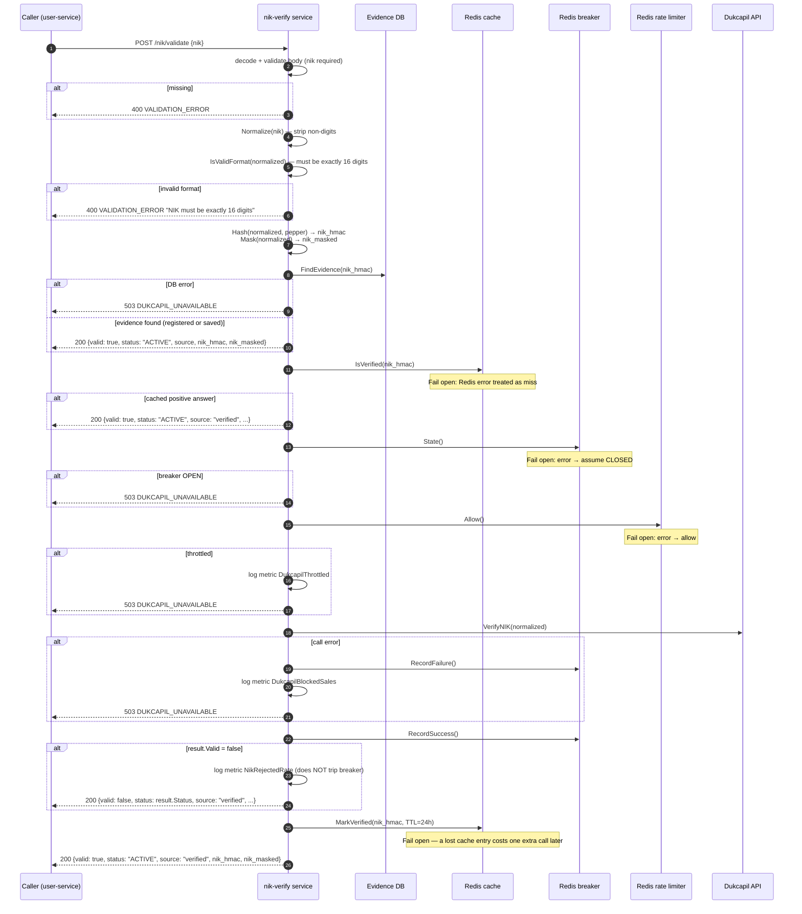

# POST /nik/validate — Validate NIK

| | |
|---|---|
| **Service** | `services/nik-verify` (Lambda) |
| **Auth** | None (internal service; network-level isolation in VPC) |
| **Contract** | OpenAPI `POST /nik/validate` · api-contracts §4.2 |
| **Requirements** | FR-15a · BR-13, BR-13a · NFR-12 |
| **Status** | done |

## 1. Purpose

Verifies a raw NIK against the Dukcapil registry and returns the hash and masked
form for the caller to persist. This is the only place the HMAC pepper is applied,
so this service is the only one that ever holds a raw NIK in memory.

The endpoint always returns 200 for both valid and invalid NIKs — the call
succeeded either way. Non-2xx means "no answer was obtainable". Callers must
treat non-2xx as fail-closed (BR-13).

The pipeline runs five layers of guards before touching Dukcapil, in a fixed order:
format → evidence → cache → breaker → rate limit → Dukcapil. Evidence and cache
are checked before the breaker so that stored proof can answer while Dukcapil
is down (NFR-12).

## 2. Flow



## 3. Steps

1. Decode body; validate `nik` field is present.
2. `Normalize(nik)`: strip all non-digit characters. Handles spaced or hyphenated input.
3. `IsValidFormat(normalized)`: must be exactly 16 digits. Return 400 on failure —
   malformed input must not cost a paid Dukcapil call (NFR-12).
4. Compute `Hash(normalized, pepper)` (HMAC-SHA256, hex-encoded) and
   `Mask(normalized)` (`xxxx**********xx` form).
5. `FindEvidence(nik_hmac)`: query `accounts` (WHERE `nik_hmac` matches, nik_verified_at
   NOT NULL) and `saved_niks` (WHERE `nik_hmac` matches, verified_at NOT NULL).
   Returns the strongest source found (`registered > saved > ""`). Fail closed on
   DB error — an unreachable evidence store is not proof of absence, and bypassing
   it costs real money on every request during the outage.
6. If evidence found: return immediately without reaching Dukcapil (NFR-12).
7. `IsVerified(nik_hmac)`: check the 24-hour Redis cache. Fail **open** — a cache
   miss-by-error is a cache miss; the worst outcome is one extra Dukcapil call.
8. If cached: return immediately.
9. `State()` (circuit breaker): if `OPEN`, return 503. Fail open on Redis error
   (assume `CLOSED`).
10. `Allow()` (rate limiter): if not allowed, log metric and return 503. Fail open
    on Redis error.
11. Call `dukcapil.VerifyNIK(normalized)`:
    - Error: `RecordFailure()` + log + return 503.
    - `result.Valid = false`: `RecordSuccess()` (a valid answer, just negative),
      log metric, return 200 `valid: false`.
    - `result.Valid = true`: `RecordSuccess()`, cache the positive answer for 24 h,
      return 200 `valid: true`.

## 4. Data touched

| Store | Key / table | Op | Notes |
|---|---|---|---|
| Aurora | `accounts` | SELECT | WHERE `nik_hmac` AND `nik_verified_at IS NOT NULL` |
| Aurora | `saved_niks` | SELECT | WHERE `nik_hmac` AND `verified_at IS NOT NULL` |
| Redis | `nik:valid:{nik_hmac}` | GET / SET EX | 24-hour positive cache |
| Redis | `nik:breaker:state` | GET / SET | Shared with admission-ctl (BR-13a) |
| Redis | `nik:rps` | token bucket | Contracted RPS ceiling; shared across Lambda instances |

## 5. Responses and errors

| HTTP | Code | When |
|---|---|---|
| 200 | `valid: true` | NIK is valid (from evidence, cache, or Dukcapil) |
| 200 | `valid: false` | NIK is invalid per Dukcapil (status: INACTIVE or NOT_FOUND) |
| 400 | `VALIDATION_ERROR` | `nik` missing · not 16 digits after normalise |
| 503 | `DUKCAPIL_UNAVAILABLE` | Evidence DB error · breaker OPEN · rate limit exceeded · Dukcapil call error |

## 6. Response body

```json
{
  "meta": { "code": 200, "message": "NIK is valid" },
  "data": {
    "nik_masked": "3171**********22",
    "nik_hmac": "e3b0c44298fc1c14...",
    "valid": true,
    "status": "ACTIVE",
    "source": "registered"
  }
}
```

| Field | Notes |
|---|---|
| `nik_masked` | First 4 + last 2 digits; the full NIK is never echoed |
| `nik_hmac` | HMAC-SHA256 keyed by the pepper; callers persist and index on this |
| `valid` | `true` or `false` |
| `status` | `ACTIVE`, `INACTIVE`, or `NOT_FOUND` |
| `source` | `registered` · `saved` · `verified` (indicates where the answer came from) |

## 7. Edge cases and decisions

- **Normalise before hashing**: "3171 0000 0000 0022" and "3171000000000022" must
  hash the same. Since the pepper can never be rotated, two hash values for the
  same NIK is an unfixable BR-02 hole (ADR-005 §8).
- **Negative answers not cached**: a customer who mistyped once would be blocked for
  24 hours. Only positive Dukcapil answers are cached.
- **Rejection does not trip the breaker**: a customer's invalid NIK is a valid
  response from Dukcapil, not a failure. The breaker tracks reachability, not answers.
- **Evidence lookup fail-closed, cache fail-open**: the asymmetry is deliberate. A
  silent DB fail would bypass the free path and cost money on every call; a silent
  cache miss costs one extra call.
- **Raw NIK never leaves this process**: `Normalize` → `Hash` + `Mask` happen
  in-process. The response carries only the hash and mask. Logs must never
  include a raw NIK (code enforces no field for it in any struct).
- **Breaker shared via Redis**: `admission-ctl` reads the same key at each 500 ms
  tick. When the breaker opens, new slots stop being admitted (BR-13a) until it
  recovers.

## 8. Tests

- [x] unit: valid NIK → 200 valid:true, status:ACTIVE
- [x] unit: invalid NIK (Dukcapil INACTIVE) → 200 valid:false
- [x] unit: NIK not 16 digits → 400
- [x] unit: spaced input "3171 0000 0000 0022" → normalised and accepted
- [x] unit: evidence found (registered) → 200 without Dukcapil call
- [x] unit: evidence found (saved) → 200 without Dukcapil call
- [x] unit: cache hit → 200 without Dukcapil call
- [x] unit: breaker OPEN → 503
- [x] unit: rate limiter throttled → 503
- [x] unit: Dukcapil error → RecordFailure, 503
- [x] unit: Dukcapil error → breaker state incremented
- [x] unit: evidence DB error → 503 (fail closed)
- [x] unit: cache Redis error → fail open, continues to breaker
- [x] integration: Redis unavailable → cache and breaker fail-open, Dukcapil called

## 9. Tasks

- [x] `Validate` HTTP handler
- [x] usecase `Validate`: six-step pipeline with correct fail-open/closed behaviour
- [x] `EvidenceRepository` adapter (postgres) — reads accounts + saved_niks
- [x] `VerificationCache` adapter (Redis) — GET/SET with TTL
- [x] `CircuitBreaker` adapter (Redis) — state read/write shared with admission-ctl
- [x] `RateLimiter` adapter (Redis) — token bucket, shared across instances
- [x] `DukcapilAdapter` HTTP client + stub for testing
- [x] NIK value object: `Normalize`, `IsValidFormat`, `Hash`, `Mask`
