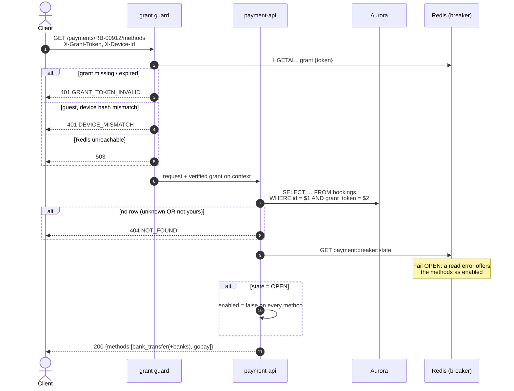

# GET /payments/{booking_id}/methods — Get Payment Methods

| | |
|---|---|
| **Service** | `services/payment-api` (Lambda) |
| **Auth** | `X-Grant-Token` (+ `X-Device-Id` when the customer is not logged in) |
| **Contract** | Apidog `GET /payments/{booking_id}/methods` · api-contracts §5.1 |
| **Requirements** | FR-20 |
| **Status** | done |

## 1. Purpose

Returns the payment methods open for this booking, with the parameters the
client needs to render the choice: the bank list for `bank_transfer`, nothing
extra for `gopay`.

The catalogue is static, so the booking lookup is the only thing this endpoint
really does. It is not ceremony: without it the endpoint would answer 200 to
anyone who asks, which makes it an oracle for which booking ids exist — and
`RB-00912`-style ids are trivially enumerable at 300,000 concurrent customers.

`enabled` is `false` while the payment-gateway breaker is open, so the UI greys
the choice out instead of letting the customer discover the outage after
pressing Pay.

## 2. Flow

## 3. Steps

1. The guard resolves `X-Grant-Token` against `grant:{token}` and, for a guest,
   checks `HMAC(DEVICE_PEPPER, X-Device-Id) == device_hash`
   ([06-grant-guard.md](06-grant-guard.md)).
2. `GetOwned(booking_id, grant.Token)` — ownership is in the `WHERE` clause, not
   in a comparison afterwards. No row is a 404.
3. `breaker.Allow()`. A read **error** is logged and treated as allowed: the
   worst outcome of guessing "enabled" is a 503 at charge time, which §5.2
   answers properly, while guessing "disabled" would make the sale look closed
   over a Redis blip.
4. `entity.Catalogue(PAYMENT_ICON_BASE, allowed)` builds the two methods in
   display order, with the four banks under `bank_transfer` only.
5. Render. `banks` is omitted entirely for a method that has none rather than
   sent as `[]`: the client's question is "is there a bank step", and an empty
   array answers that ambiguously.

## 4. Data touched

| Store | Key / table | Op | Notes |
|---|---|---|---|
| Redis | `grant:{token}` | HGETALL | Guard only |
| Aurora | `bookings` | SELECT | Bound on `id` **and** `grant_token` |
| Redis | `payment:breaker:state` | GET | Drives `enabled`; fail open |
| Aurora | `payment_method_switches` | SELECT (latest per method/bank, cached) | The operator kill switch; fail open |

Nothing is written.

## 5. Responses and errors

| HTTP | Code | When |
|---|---|---|
| 200 | — | Catalogue returned |
| 400 | `DEVICE_ID_REQUIRED` | Guest grant, `X-Device-Id` absent |
| 401 | `GRANT_TOKEN_MISSING` | Header absent |
| 401 | `GRANT_TOKEN_INVALID` | Unknown, expired or revoked grant |
| 401 | `DEVICE_MISMATCH` | Guest grant presented from another device |
| 404 | `NOT_FOUND` | No such booking, **or** not the token holder's |
| 500 | — | Database failure. The driver's message never reaches the client |
| 503 | — | Redis unreachable in the guard |

## 6. Edge cases and decisions

- **Why only two methods.** Cards and over-the-counter cannot honour the
  ten-minute window at the gateway: Midtrans states explicitly that
  `custom_expiry` does not apply to cards, and OTC needs the customer to reach a
  physical store. Both remaining methods accept `custom_expiry`, so the
  gateway's deadline and ours end on the same second for every live method
  (§5.1).
- **Why only four banks.** Midtrans documents the reversal case — `settlement`
  flipping to `deny` within 1–5 minutes, money returned — only for Permata,
  Mandiri Bill Payment and Indomaret. None is opened, so that failure class
  cannot occur and no reversal handler is needed.
- **No `requires_tokenization`, no `client_key`.** Both are card-only. With
  cards out of scope, Midtrans.js in the browser and the whole PCI-DSS surface
  leave the POC with them (NFR-07).
- `icon_url` values are built from `PAYMENT_ICON_BASE` and are cosmetic: a wrong
  value shows broken images, it fails no payment.
- The breaker key is `payment:breaker:*`, deliberately **not** shared with
  `dukcapil:breaker:state`. One upstream being down says nothing about the
  other, and sharing a key would couple two unrelated outages.

### The operator kill switch

`enabled` answers two questions at once, and they have different owners:

| Layer | Answers | Who changes it | How fast |
|---|---|---|---|
| **Catalogue** (`entity.Catalogue`) | which methods exist *at all* | a deploy | ~15 min |
| **Breaker** (`payment:breaker:state`) | is Midtrans answering? | itself | seconds |
| **Switches** (`payment_method_switches`) | has an operator turned this off? | an operator | seconds |

The breaker knows whether **Midtrans** is answering; it knows nothing about one
bank behind it. So when BCA's virtual accounts start failing at minute 20 of a
sale, every customer still sees BCA offered, still gets a VA number they cannot
pay into, and still loses their seats to the sweep. Migration `0014` is the
lever for that: one `INSERT` and BCA stops being offered, with no deploy.

**The switch can only ever subtract.** The list is built from the code, then
masked by `entity.ApplyDisabled`. A row naming a method the code does not know
is ignored and logged, never advertised — because offering a method the charge
path cannot shape is the one failure this design refuses to make possible. That
is also why the catalogue is not itself a table: a method needs a charge-body
shaper and an instruction extractor before it is chargeable, and neither is a
column.

Two shapes on the wire, because the contract has two:

- A disabled **method** stays in the list with `enabled: false`. The field
  already exists, the frontend already greys it out, and a customer who reads
  "unavailable" learns more than one whose options silently shrank.
- A disabled **bank** is **removed** from `banks[]`. `Bank` is
  `{code, name, icon_url}` with no `enabled` field, so there is nothing to set,
  and adding one would be a contract change for an incident tool.
- Every bank off becomes `enabled: false` with no `banks` at all: "choose a
  bank" with no banks is a dead end, and an empty array answers the frontend's
  own question — is there a bank step — ambiguously.

**Fail open, deliberately.** An unreadable switch table is treated as "nothing
is switched off", and the read never returns an error the caller must handle. A
kill switch that hides every payment method when its own storage hiccups is a
worse outage than the one it was built for — and if Aurora is unreachable, §5.2
cannot charge anything anyway, because it needs the same database to lock the
booking.

**Cached for `PAYMENT_SWITCH_CACHE_SECONDS`** (default 10). That is the delay
between the `INSERT` and customers seeing it, and it is the honest cost of not
adding a query to the hottest path in the service for state that changes a
handful of times a year. The switch replaces a fifteen-minute deploy; it does
not need to be synchronous.

The operator procedure is in `RUNBOOK.md`; §5.2 enforces the same switch, which
[02-initiate-payment.md](02-initiate-payment.md) explains.

## 7. Tests

Implemented in `internal/payment/application/usecase/get_methods_test.go`,
`internal/payment/domain/entity/method_test.go` and
`internal/payment/infrastructure/http/payment_test.go`.

- [x] unit: catalogue shape — two methods in order, four banks on
      `bank_transfer` only, none on `gopay`
- [x] unit: card and OTC ids never appear
- [x] unit: `SupportedBank` rejects the three reversal-prone banks
- [x] unit: unknown or unowned booking → 404 with `NOT_FOUND`
- [x] unit: breaker OPEN → every method `enabled: false`
- [x] unit: breaker read error → fails open, methods enabled
- [x] unit: a non-`ErrNotFound` repository error stays a 500, not a 404
- [x] unit: a switched-off bank is not offered, and the method stays enabled
- [x] unit: a switched-off method is listed with `enabled: false`
- [x] unit: every bank off → the method is disabled, not emptied
- [x] unit: a switch for an unknown method changes nothing
- [x] unit: an unreadable switch table offers every method
- [x] unit: an unowned booking is still 404, and the switch store is not even
      consulted
- [x] unit (adapter): latest row per method and bank wins; `available = true`
      ends a switch; an expired switch is filtered in SQL; the cache serves the
      TTL then refreshes; an unreadable table keeps the last known state
- [x] unit: handler passes the path id and the context grant, never a header
- [x] unit: route without the guard → 500, and the use case is never reached

## 8. Tasks

- [x] `entity.Catalogue` + `SupportedBank`
- [x] `PaymentUsecase.GetMethods` with the ownership lookup first
- [x] breaker read, failing open
- [x] handler + route behind the grant guard
- [ ] confirm the four bank codes and icon paths against the Midtrans sandbox
      account actually in use
