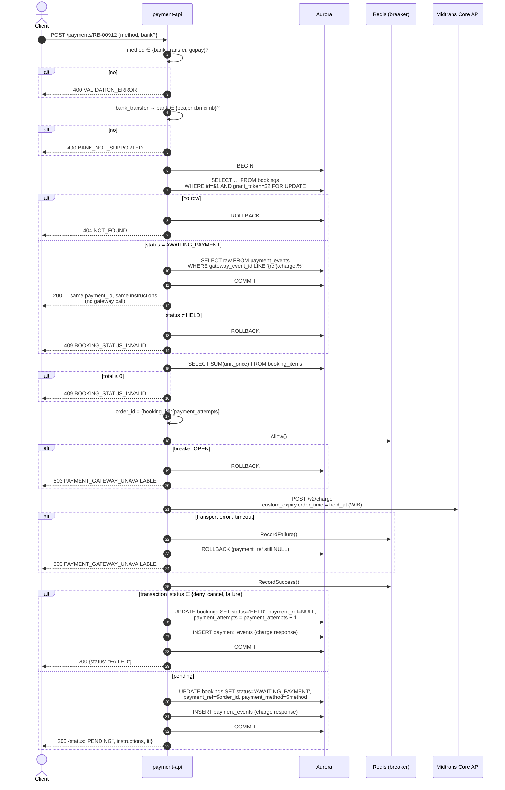

# POST /payments/{booking_id} — Initiate Payment

| | |
|---|---|
| **Service** | `services/payment-api` (Lambda) |
| **Auth** | `X-Grant-Token` (+ `X-Device-Id` when the customer is not logged in) |
| **Contract** | Apidog `POST /payments/{booking_id}` · api-contracts §5.2 |
| **Requirements** | FR-20 · FR-21 · FR-24 · FR-25 · BR-05 |
| **Status** | done |

## 1. Purpose

Creates the payment instrument — a virtual account number or a QR — and moves
the booking from `HELD` to `AWAITING_PAYMENT`.

This is the endpoint a customer calls again after a refusal. The `deny` path
raises `payment_attempts` itself, so the next derived `order_id` is fresh and
Midtrans accepts it; §5.3 exists only to void a payment that is still *pending*.

It is idempotent with no key from the client. The `bookings` row is the
idempotency record: the row is locked, and if the status is already
`AWAITING_PAYMENT` the stored `payment_ref` and the stored instructions are
returned unchanged. A double-clicked Pay button produces one charge and two
identical responses, and must not look like a failure.

## 2. Flow

## 3. Steps

1. **Validate the method before anything else.** `method` must be
   `bank_transfer` or `gopay`; a `bank_transfer` must name an opened bank. The
   bank gets its own code (`BANK_NOT_SUPPORTED`) because "bca typed as bcaa" and
   "no method at all" are different fixes for the client.
2. **Then the operator kill switch** (`payment_method_switches`, migration
   `0014`): if the method, or the chosen bank under it, is switched off, answer
   `503 PAYMENT_GATEWAY_UNAVAILABLE` and stop.

   Checked here and not only on §5.1 because a customer who loaded the payment
   page **before** an operator switched BCA off still has a BCA button on
   screen. A switch enforced only on the listing does nothing for exactly the
   people already mid-checkout — the ones about to be handed an instrument
   nobody can pay. Before the lock and before the gateway, so refusing costs
   the customer only a choice of method.

   Switching off a **method** also refuses each of its banks, so a client
   holding a bank code from an older page cannot slip past a method-level
   switch.
3. `BEGIN`, then `SELECT … FOR UPDATE` bound on `id` **and** `grant_token`.
4. Branch on status:
   - `AWAITING_PAYMENT` → **replay**. Read the stored charge back from
     `payment_events`, commit, return. No gateway call and no writes.
   - `HELD` → the only state a charge may start from.
   - anything else → `409 BOOKING_STATUS_INVALID`, with no gateway contact.
5. `SELECT COALESCE(SUM(unit_price),0) FROM booking_items` under the lock.
   `booking_items` is the authority on price, because `unit_price` is copied at
   purchase and must not follow a later catalogue change. A total of zero means
   the hold never completed, which is a status problem rather than an internal
   error.
6. `order_id = valueobject.OrderID(booking.ID, booking.PaymentAttempts)`.
7. Read the breaker **inside** the charge closure, so step 4's replay is not
   gated by it.
8. `POST /v2/charge` with `custom_expiry.order_time = held_at` rendered in WIB.
9. Write the status, store the charge response, `COMMIT`.

The charge happens **under the lock**. Two concurrent Pay clicks have to
serialise somewhere, and the `bookings` row is the only thing both of them
touch.

## 4. Data touched

| Store | Key / table | Op | Notes |
|---|---|---|---|
| Aurora | `bookings` | SELECT … FOR UPDATE | Ownership bound in SQL |
| Aurora | `booking_items` | SELECT SUM | The charged amount |
| Aurora | `bookings` | UPDATE | Status, `payment_ref`, `payment_method`, or the decline path's `payment_attempts + 1` |
| Aurora | `payment_events` | INSERT … ON CONFLICT DO NOTHING | Key `"{order_id}:charge:{status_code}"` |
| Redis | `payment:breaker:*` | GET / INCR / SET / DEL | Only when a charge is actually sent |
| Midtrans | `POST /v2/charge` | write | Never retried by this service |

`held_at` and `payment_expires_at` are **not** written here. Both were set at
`HELD`; re-writing `held_at` would re-anchor `custom_expiry` and hand a fresh
ten minutes to every charge, so BR-05 would never bind.

## 5. Responses and errors

| HTTP | Code | When |
|---|---|---|
| 200 | — | `status: "PENDING"` with instructions, or a replay of the first response |
| 200 | — | `status: "FAILED"` — the gateway refused synchronously. The request succeeded; the payment did not |
| 400 | `VALIDATION_ERROR` | Body unparseable, or `method` not one of the two |
| 400 | `BANK_NOT_SUPPORTED` | `bank_transfer` with a bank outside the opened four |
| 400 | `DEVICE_ID_REQUIRED` | Guest grant, no `X-Device-Id` |
| 401 | `GRANT_TOKEN_MISSING` / `GRANT_TOKEN_INVALID` / `DEVICE_MISMATCH` | Guard |
| 404 | `NOT_FOUND` | No such booking, or not the token holder's |
| 409 | `BOOKING_STATUS_INVALID` | Not `HELD`, already terminal, or a booking with no seats |
| 503 | `PAYMENT_GATEWAY_UNAVAILABLE` | Breaker open, the gateway could not be reached, **or** the method or bank is switched off by an operator (migration `0014`) |

The switch reuses `PAYMENT_GATEWAY_UNAVAILABLE` rather than introducing a code
of its own. From the client's side the situation and the remedy are identical —
this method cannot be used right now, pick another — and from the customer's
side an operator switching BCA off *is* BCA being unavailable. The operational
distinction is in the log line, which names the method, the bank and the
booking. A distinct `METHOD_UNAVAILABLE` would be more precise and would cost
an Appendix A entry and a client change; it is worth adding only if a frontend
ever needs to tell the two apart.

**200, not 201.** A replayed initiate creates nothing and the client cannot tell
the two apart, so neither should the status code.

## 6. Edge cases and decisions

- **A timeout is not a decline.** The instrument may exist at the gateway. The
  transaction rolls back with `payment_ref` still NULL, the breaker counts a
  failure, the client gets 503 — and the charge reconciler in `admission-ctl`
  resolves the truth. Re-sending the charge here is the one thing that must not
  happen.
- **A synchronous refusal commits.** `payment_attempts` has to move, or the next
  charge reuses an `order_id` Midtrans has already seen and the customer cannot
  retry at all. The booking returns to `HELD`, not `EXPIRED`: the payment
  failed, the claim did not, and the seats stay with the customer until the TTL.
- **Replays survive an open breaker.** The breaker is read inside the charge
  closure, which the repository only invokes when a charge is actually needed.
- **The charge response is stored, instructions and all.** A replay returns
  byte-identical instructions without re-parsing a Midtrans body in a second
  place — which is how a VA number and a QR url end up rendered differently on
  the first and second request.
- **`order_time` is `held_at` in WIB**, with the zone fixed in code rather than
  loaded from tzdata: a Lambda image without zoneinfo would fall back to UTC and
  shift every deadline by seven hours.
- **`gross_amount` is a number on the charge and a decimal string on the
  notification.** The two are not interchangeable; the signature uses the string
  exactly as received (see [05-payment-webhook.md](05-payment-webhook.md)).
- **QRIS, not just GoPay.** The customer may pay the QR with any QRIS app, so
  the webhook may arrive as `payment_type: qris`. The handler must not match the
  webhook's `payment_type` against the one sent at charge time — and does not.
- **OPEN:** impl-plan §10.2 lists a rate limit on this endpoint. The contract
  specifies none and none is implemented. Decide whether the plan or the
  contract is wrong.

## 7. Tests

Implemented in `internal/payment/application/usecase/initiate_test.go`,
`internal/payment/infrastructure/postgres/booking_test.go` and
`internal/payment/infrastructure/midtrans/client_test.go`.

- [x] unit: bank transfer and GoPay happy paths, instructions passed through
- [x] unit: unsupported method / bank rejected before any lookup or charge
- [x] unit: `custom_expiry.order_time` is `held_at`, not now; falls back to now
      when `held_at` is NULL
- [x] unit: the charged amount is the locked `booking_items` total
- [x] unit: `order_id` uses the stored attempt count
- [x] unit: replay returns stored instructions, writes nothing, calls no gateway
- [x] unit: replay still works while the breaker is open
- [x] unit: replay with no stored charge, and with a corrupt payload, still 200
- [x] unit: every non-`HELD` status → 409 with no gateway contact
- [x] unit: booking with no seats → 409
- [x] unit: timeout → 503, breaker failure recorded, nothing written, rollback
- [x] unit: synchronous decline → 200 FAILED, attempts raised, committed
- [x] unit: breaker bookkeeping failure never fails a successful charge
- [x] unit: `held_at` / `payment_expires_at` never appear in any write
- [x] unit: charge stored under `{order_id}:charge:{status_code}` with
      `ON CONFLICT DO NOTHING`
- [x] unit (client): Basic auth with the trailing colon; `/v2/charge`;
      `custom_expiry` always present; numeric `gross_amount`; 402-with-status_code
      is an answer, 4xx-without and 5xx are errors
- [ ] integration (docker compose Postgres): two concurrent initiates on one
      booking produce one charge
- [ ] integration (Midtrans sandbox): a real VA and a real QR, end to end

## 8. Tasks

- [x] `valueobject.OrderID` / `ParseOrderID`
- [x] `BookingRepository.Initiate` — lock, replay, total, charge, write, commit
- [x] Midtrans `Charge` with `custom_expiry`
- [x] breaker inside the charge closure
- [x] handler, body validation, 200-not-201
- [ ] resolve the rate-limit question above
