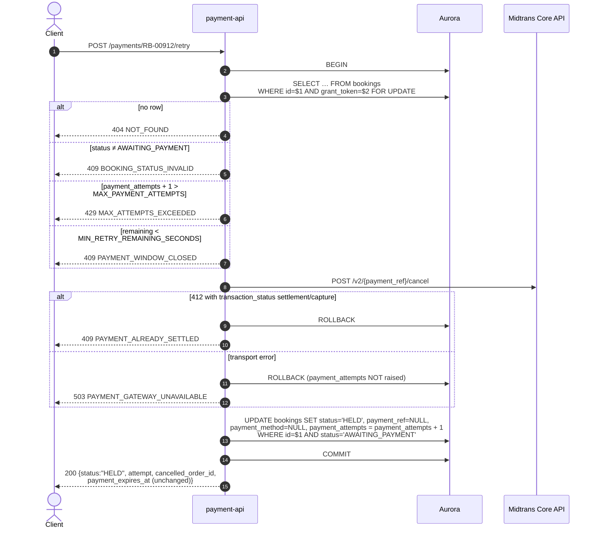

# POST /payments/{booking_id}/retry — Cancel & Switch Payment Method

| | |
|---|---|
| **Service** | `services/payment-api` (Lambda) |
| **Auth** | `X-Grant-Token` (+ `X-Device-Id` when the customer is not logged in) |
| **Contract** | Apidog `POST /payments/{booking_id}/retry` · api-contracts §5.3 |
| **Requirements** | FR-20 · NFR-02 (jangan PHP) · BR-05 |
| **Status** | done |

## 1. Purpose

Voids a payment that is **still pending** so the customer can choose another
method — they took a BCA virtual account and then decided on GoPay.

Narrower than its name suggests, and the name is the main hazard. It is:

- **not** the path after a refusal. The `deny` path already returned the booking
  to `HELD` and raised `payment_attempts`, and there is no live Midtrans
  transaction to void. The call is §5.2.
- **not** for changing the selection in the UI before pressing Pay. Nothing
  exists at the gateway yet; the method choice is frontend state until a charge
  is sent.

The window is **not** reset. `payment_expires_at` stays anchored to `held_at`,
so switching at minute 8 of a ten-minute window yields a new instrument with two
minutes on it, not a fresh ten (BR-05).

## 2. Flow

The client then calls `POST /payments/{booking_id}` with the new method.

## 3. Steps

1. `BEGIN`, `SELECT … FOR UPDATE` bound on `id` and `grant_token`.
2. Status must be `AWAITING_PAYMENT`. `HELD` is excluded explicitly — see §1.
3. `payment_attempts + 1 > MAX_PAYMENT_ATTEMPTS` → 429. Checked **before** the
   gateway call: an attempt that cannot be granted must not void a working
   instrument on the way to being refused.
4. `RemainingPaymentWindow(now) < MIN_RETRY_REMAINING_SECONDS` → 409. Also
   before the gateway call.
5. `POST /v2/{order_id}/cancel`. **Cancel, not expire**: nothing expired, the
   merchant cancelled it, and Midtrans reports the two separately on the
   dashboard where someone will eventually reconcile them.
6. Write `HELD`, clear `payment_ref` and `payment_method`, raise
   `payment_attempts`. The `UPDATE` is guarded on `status = 'AWAITING_PAYMENT'`
   so a booking that moved between the lock and the write cannot be dragged
   backwards.
7. `COMMIT`.

**The cancel happens before the commit.** Reversed, a failed cancel would leave
the customer with a raised attempt counter **and** a still-payable virtual
account — two live instruments for one booking.

## 4. Data touched

| Store | Key / table | Op | Notes |
|---|---|---|---|
| Aurora | `bookings` | SELECT … FOR UPDATE | Ownership bound in SQL |
| Aurora | `bookings` | UPDATE | Guarded on the status that was read |
| Midtrans | `POST /v2/{order_id}/cancel` | write | Before the commit |

No `payment_events` row is written: the cancel is not a gateway *event* about
this booking's money, and the next charge's response will be stored under its
own key.

## 5. Responses and errors

| HTTP | Code | When |
|---|---|---|
| 200 | — | Cancelled. `attempt` is the new count, `payment_expires_at` is unchanged |
| 401 | `GRANT_TOKEN_*` / `DEVICE_MISMATCH` | Guard |
| 404 | `NOT_FOUND` | No such booking, or not the token holder's |
| 409 | `BOOKING_STATUS_INVALID` | Not `AWAITING_PAYMENT` — includes `HELD` after a refusal |
| 409 | `PAYMENT_ALREADY_SETTLED` | The old payment turned out to be paid as the cancel was attempted |
| 409 | `PAYMENT_WINDOW_CLOSED` | TTL elapsed, or too little of it left |
| 429 | `MAX_ATTEMPTS_EXCEEDED` | Past `MAX_PAYMENT_ATTEMPTS` |
| 503 | `PAYMENT_GATEWAY_UNAVAILABLE` | Midtrans unreachable. `payment_attempts` **not** raised |

## 6. Edge cases and decisions

- **`PAYMENT_ALREADY_SETTLED` is a real outcome, not an error.** Midtrans
  answers 412 with `transaction_status: settlement` when asked to cancel
  something already paid. Nothing changes here; the webhook confirms the booking
  in the ordinary way, and the customer lands on the success page.
- **A failed cancel raises nothing.** The old instrument is still valid, so the
  customer may simply pay the virtual account they already have, or try the
  switch again. Raising the attempt counter on a failed cancel would burn one of
  five attempts for a payment that never changed.
- **Why there is a floor at all.** Handing out a new virtual account with
  fifteen seconds of life only moves the failure somewhere more painful — the
  customer now watches a second countdown die. The window is never extended, so
  the remainder only ever shrinks.
- `MIN_RETRY_REMAINING_SECONDS` must be below `PAYMENT_TTL_SECONDS` or every
  switch is refused, which reads as a broken endpoint rather than a policy. The
  config loader refuses to start on that, and the SAM template's `Rules` block
  catches the equal case at deploy time.
- **OPEN:** the response's `status` is the booking status (`HELD`), while §5.4's
  `status` is an API-level value (`PENDING`/`PAID`/…). Two fields of the same
  name with different vocabularies, one endpoint apart. The contract specifies
  it this way and the implementation follows; worth renaming before the public
  API is frozen.

## 7. Tests

Implemented in `internal/payment/application/usecase/retry_test.go`,
`internal/payment/infrastructure/postgres/booking_test.go` and
`internal/payment/infrastructure/midtrans/client_test.go`.

- [x] unit: happy path — cancel called with the stored `payment_ref`, attempt
      raised, `HELD` returned
- [x] unit: the cancel happens before any write
- [x] unit: `payment_expires_at` comes back unchanged
- [x] unit: every status other than `AWAITING_PAYMENT` → 409, no cancel attempted
- [x] unit: max attempts → 429 **before** the gateway call
- [x] unit: 30 seconds left, and already expired → 409, no gateway call
- [x] unit: `ErrAlreadySettled` → 409, nothing written, rolled back
- [x] unit: cancel failure → 503 and `payment_attempts` untouched
- [x] unit: the `UPDATE` is guarded on `status = 'AWAITING_PAYMENT'`
- [x] unit (client): `/cancel`, not `/expire`; 412 + settlement/capture →
      `ErrAlreadySettled`
- [ ] integration (Midtrans sandbox): cancel a live VA, then charge GoPay on the
      same booking and confirm the deadline did not move

## 8. Tasks

- [x] `BookingRepository.Retry` — lock, validate, cancel, write, commit
- [x] Midtrans `Cancel` with the already-settled detection
- [x] error mapping for all five refusal codes
- [ ] decide the `status` naming question above
