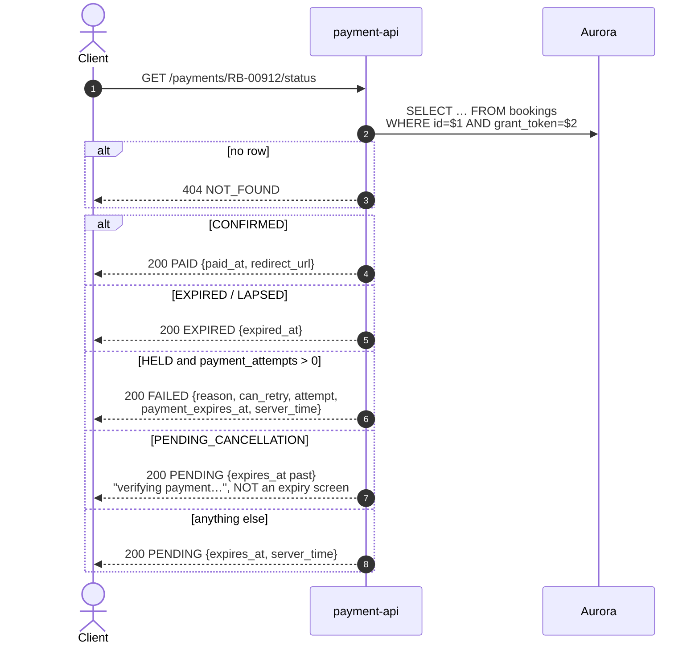

# GET /payments/{booking_id}/status — Get Payment Status

| | |
|---|---|
| **Service** | `services/payment-api` (Lambda) |
| **Auth** | `X-Grant-Token` (+ `X-Device-Id` when the customer is not logged in) |
| **Contract** | Apidog `GET /payments/{booking_id}/status` · api-contracts §5.4 |
| **Requirements** | FR-22 · FR-23 · NFR-02 |
| **Status** | done |

## 1. Purpose

What the payment page polls. Polling rather than SSE on purpose: a payment
settles once, and the client already knows when to stop (Appendix B).

**This is the only signal that a payment failed.** Without it the customer
watches a countdown run down with no idea the charge was refused, so the
`FAILED` branch carries everything the frontend needs to send them back to the
method list: `can_retry`, the attempt number, and the **unchanged** deadline.

## 2. Flow

## 3. Steps

1. `GetOwned(booking_id, grant.Token)` — one read, no transaction.
2. Map the booking status onto the API status (table below).
3. `expires_at` is the stored `payment_expires_at`, reported as it is: never
   recomputed as "now + TTL", and never clamped. Contract v2.15 (#107) replaced
   `ttl_seconds` with it, because a countdown computed at the server is already
   stale by the time the reply is rendered — and stale in the customer's
   favour, right up to the moment the seats go. The client subtracts
   `expires_at - server_time` and clamps its own countdown at zero, so a
   deadline already past still reads as "0s" on screen without the server
   having to pretend the deadline moved.
4. `meta.message` tracks the status (`Payment successful` / `expired` /
   `failed` / `pending`), and `meta.server_time` is on every envelope so a
   client can correct its own clock drift from any reply it is already making
   (§7, BR-10).

## 4. Status mapping

| `bookings.status` | `data.status` | What the frontend does |
|---|---|---|
| `AWAITING_PAYMENT` | `PENDING` | Stay on the instructions screen, keep polling |
| `CONFIRMED` | `PAID` | Go to the ticket page |
| `HELD` with `payment_attempts > 0` | **`FAILED`** | Back to the method list |
| `HELD` with `payment_attempts = 0` | `PENDING` | Never charged; stay on the method list |
| `PENDING_CANCELLATION` | `PENDING`, `expires_at` in the past | Show "verifying payment…" — **not** an expiry screen |
| `EXPIRED` / `LAPSED` | `EXPIRED` | Expiry screen |
| `GRANTED` / `SELECTING` / `ABANDONED` | `PENDING` | Unreachable through a payment route, but still answers coherently |

`payment_attempts` is the whole distinction in the `HELD` row: after a refusal
it is a **failure the customer must be told about**, before any charge it is
simply "not started".

`PENDING_CANCELLATION` is deliberately `PENDING`. The TTL elapsed and the
30-second grace is running; a callback may still arrive and confirm, and showing
an expiry screen there is the "jangan PHP" failure NFR-02 exists to prevent —
and it would be factually wrong, not merely unhelpful.

## 5. Responses and errors

| HTTP | Code | When |
|---|---|---|
| 200 | — | One of the five `data.status` values above |
| 401 | `GRANT_TOKEN_*` / `DEVICE_MISMATCH` | Guard |
| 404 | `NOT_FOUND` | No such booking, or not the token holder's |
| 500 | — | Database failure |

There is no 409 and no 503 on this endpoint: a status read has nothing to
conflict with and no gateway to depend on.

## 6. Edge cases and decisions

- **`reason` is passed through, not translated.** It is the gateway's
  `status_message`, for support rather than for display; the frontend shows its
  own localised text and puts `reason` in the detail. With cards out of scope
  (§5.1), the refusals that can occur come only from `bank_transfer` and
  `gopay`.
- **`can_retry` is `payment_attempts < MAX_PAYMENT_ATTEMPTS`**, and "retry"
  there means calling §5.2 again — not §5.3.
- **`paid_at` is not a column.** The settlement time lives in `payment_events`.
  The contract renders a timestamp here, and the booking's stored deadline is
  the closest instant available, so the frontend gets a value without a second
  query on a polling path. **OPEN:** read the real settlement time from
  `payment_events` if the displayed value matters; today it is approximate and
  nothing in the UI depends on it.
- A countdown that has run out reports `0`, not a negative number.
- **OPEN:** the contract shows no explicit rate limit for this endpoint, and
  none is implemented. At 300,000 concurrent customers polling every few
  seconds, this is the highest-volume endpoint in the service. API Gateway
  throttling is the natural place for it; decide the figure before load testing.

## 7. Tests

Implemented in `internal/payment/application/usecase/get_status_test.go` and
`internal/payment/infrastructure/http/payment_test.go`.

- [x] unit: every row of the mapping table, including the three statuses a
      payment route cannot reach
- [x] unit: `HELD` + attempts → FAILED with `can_retry`, `attempt` and the
      unchanged deadline
- [x] unit: `HELD` + no attempts → PENDING with the deadline and `server_time`
- [x] unit: at `MAX_PAYMENT_ATTEMPTS` → `can_retry: false`
- [x] unit: `PENDING_CANCELLATION` → PENDING with its deadline and no
      `expired_at`
- [x] unit: a deadline in the past → reported unchanged, not clamped to now
- [x] unit: `server_time` present on every polled answer
- [x] unit: unknown booking → 404
- [x] unit (handler): `meta.message` tracks the status
- [ ] integration: poll through a full settlement and confirm the transition
      PENDING → PAID is seen within one poll of the webhook

## 8. Tasks

- [x] `PaymentUsecase.GetStatus` with the full mapping
- [x] `statusMessage` for `meta.message`
- [x] handler + route
- [ ] decide on polling throttles (above)
- [ ] decide whether `paid_at` should come from `payment_events`
