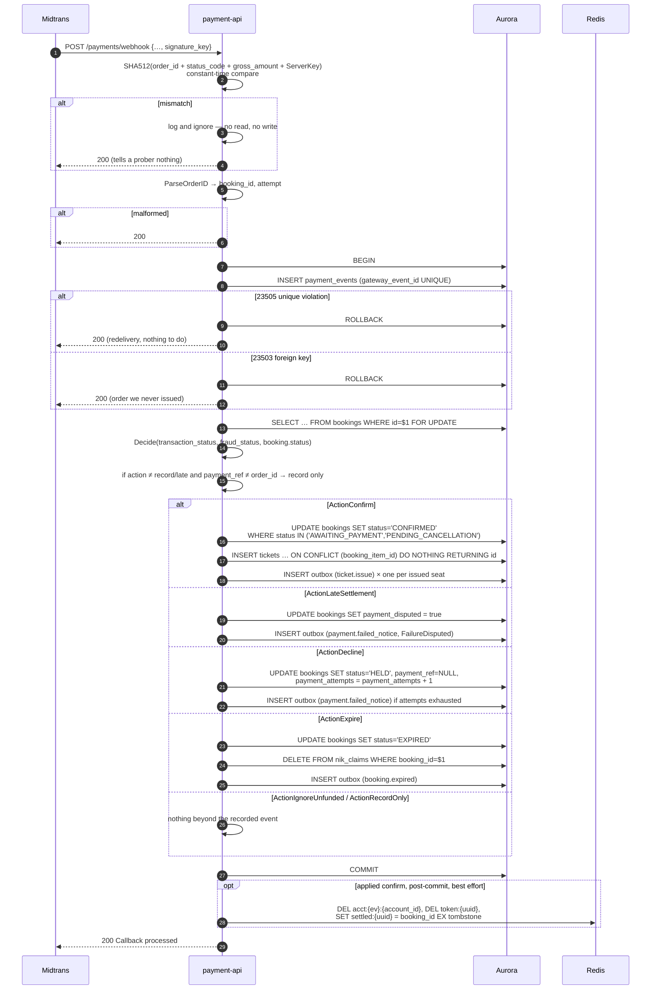

# POST /payments/webhook — Payment Gateway Callback

| | |
|---|---|
| **Service** | `services/payment-api` (Lambda) |
| **Auth** | `signature_key` **inside the body** — no header, no grant |
| **Contract** | Apidog `POST /payments/webhook` · api-contracts §5.5 |
| **Requirements** | FR-22 · FR-23 · FR-25 · FR-26 · FR-28 · FR-28a · BR-02 · BR-07 · NFR-07 |
| **Status** | done |

## 1. Purpose

The one place a payment becomes tickets. Midtrans calls it; no client does.

It is the only endpoint in the service that is **not** behind the grant guard,
because Midtrans holds no grant. If it were guarded, every real notification
would be rejected and no booking would ever be confirmed.

## 2. Flow



## 3. Signature verification

```
signature_key == SHA512(order_id + status_code + gross_amount + ServerKey)
```

Plain concatenation, no separators. Three details each silently break
verification:

1. **There is no signature header.** Midtrans sends no `X-Callback-Signature` of
   any kind on Core API HTTP notifications; the signature is the `signature_key`
   field in the body. An implementation that follows contract v2.4 literally
   demands a header that never arrives and **rejects every valid notification**.
2. **SHA512, not SHA256.** The SHA256withRSA scheme on Midtrans's *Security
   Specification* page belongs to other API lines, not this webhook.
3. **`gross_amount` enters the hash exactly as received, decimals included.**
   `"3000000.00"` and `"3000000"` hash differently and only the first matches,
   so the field is a string all the way from the JSON to the hash and is never
   normalised, parsed or re-rendered on the way.

The comparison is constant-time: the endpoint is reachable by anyone who learns
the URL, and a compare that exits on the first wrong byte lets an attacker
recover a valid signature byte by byte. A mismatch means ignore the notification
entirely — do not process it, do not change any status, and do not say why.

Midtrans also recommends a second check: call Get Transaction Status and compare.
That check **already exists** in this system as the charge reconciler in
`admission-ctl` (every 5 minutes, read-only), so the webhook does not call it
inline and add latency to the path that matters most.

## 4. Idempotency

The key is **derived**, because Midtrans sends no event id:

```
gateway_event_id = order_id + ':' + transaction_status + ':' + status_code
```

`UNIQUE` on `payment_events.gateway_event_id`. The insert is the **first**
statement in the transaction, so a redelivery aborts before it can touch a
status; the unique violation rolls the whole transaction back and the endpoint
still answers 200.

Why not the obvious alternatives:

| Candidate | Why not |
|---|---|
| `event_id` (contract v2.4) | The field does not exist. `gateway_event_id` would always be NULL and the `UNIQUE` would guard nothing |
| `booking_id` | One row per booking swallows every event after the first |
| `transaction_id` alone | Stable for the **lifetime** of one transaction: the `pending` and `settlement` notifications of the same payment carry an identical value, so the second would be swallowed — exactly the `booking_id` mistake again |
| `transaction_id` + status | Works, but the three fields above are already trusted (two of them are in the signature formula) and `order_id` carries the booking id and attempt number, so the key is human-readable during reconciliation (§6.3) |

One row per **event**, not per booking: `pending → settlement → refund` produces
three rows and all three are processed.

## 5. Event table

`valueobject.Decide(transaction_status, fraud_status, booking.status)` is the
contract's table expressed as data, because the handler also owns a
transaction, an idempotency insert and an outbox write — mixing the decision
into that is how a status ends up half-applied.

| `transaction_status` | `fraud_status` | Booking status | Action |
|---|---|---|---|
| `settlement` / `capture` | — | `EXPIRED` / `LAPSED` | **ActionLateSettlement** |
| `settlement` / `capture` | — | `CONFIRMED` | ActionRecordOnly (already settled) |
| `capture` | not `accept` | live | **ActionIgnoreUnfunded** — authorised, not funded |
| `settlement` | present and not `accept` | live | ActionIgnoreUnfunded |
| `settlement` | absent | live | **ActionConfirm** — Midtrans omits the field for non-card channels |
| `settlement` / `capture` | `accept` | live | **ActionConfirm** |
| `deny` / `cancel` / `failure` | — | live | **ActionDecline** |
| `deny` / `cancel` / `failure` | — | terminal | ActionRecordOnly |
| `expire` | — | live | **ActionExpire** |
| `expire` | — | terminal | ActionRecordOnly |
| `pending`, `refund`, `partial_refund`, `chargeback`, anything new | — | — | ActionRecordOnly |

Notes that are easy to get wrong:

- **Late settlement is checked before the fraud rules.** Once the seats are
  gone, the funding question is moot; what matters is that money arrived too
  late.
- **A settlement with an absent `fraud_status` is funded.** Midtrans omits the
  field for some non-card channels, and `bank_transfer`/`gopay` are the only
  methods open. Requiring it would reject real payments.
- **A `capture` without `accept` is not funded.** Issuing tickets there would
  hand out seats for money never received.
- **Reversal is not handled, and does not need to be.** `settlement → deny`
  happens only on Permata, Mandiri Bill and Indomaret, none of which is opened
  (§5.1).
- **`payment_type` on the webhook may differ from the one charged.** A customer
  paying a GoPay QR with another QRIS app produces `payment_type: qris`. Nothing
  here matches the two.

## 6. Why it always answers 200

| If it answered | What happens |
|---|---|
| 409 on a duplicate | Midtrans retries. One event becomes a retry storm, during the minutes the system is busiest |
| 401 on a bad signature | A prober learns their guess was wrong — a free oracle |
| 404 on an unknown order | Midtrans redelivers something that can never succeed, forever |
| 500 on our own failure | Midtrans redelivers while our database is down, which is when a retry storm is least affordable |

So everything interesting is in the log, not the response, and the
acknowledgement is byte-identical whatever happened. The charge reconciler is
the backstop for the cases a 5xx would otherwise have escalated.

An unparseable body also gets a 200: retrying it will not make it parseable, and
the use case is never called with a half-decoded payload.

## 7. Row locking

The booking is locked by **id**, parsed out of `order_id` — not by
`payment_ref`, because `payment_ref` is cleared on a decline and a later
notification for that attempt would then match nothing at all.

The cost of that choice is that a stale attempt's notification can reach a live
one, so transitions are gated on the notification describing the **current**
instrument:

```go
if action != ActionRecordOnly && action != ActionLateSettlement {
    if b.PaymentRef != "" && b.PaymentRef != in.OrderID {
        action = ActionRecordOnly
    }
}
```

The late-settlement path is exempt: by definition no instrument is live any
more, so there is nothing to compare against — and real money arrived.

Every `UPDATE` is additionally guarded on the status it read. A zero-row update
means the booking raced to a terminal state between the lock and the write, and
the action is downgraded to record-only rather than forced.

## 8. Ticket issuance

```sql
INSERT INTO tickets (…)
VALUES (…)
ON CONFLICT (booking_item_id) WHERE booking_item_id IS NOT NULL DO NOTHING
RETURNING id
```

- One ticket per `booking_item`, which is one row per NIK (BR-02).
- `ON CONFLICT … DO NOTHING` is the double-QR guard. The partial unique index
  on `tickets(booking_item_id)` is what makes it possible: an index on
  `booking_id` alone would not have collided across two attempts for one
  booking.
- `RETURNING id` is what makes the call safe to repeat — only rows actually
  inserted come back, so exactly as many e-ticket emails are queued as tickets
  created. A seat that already had a ticket is skipped and deliberately not
  re-emailed.
- `qr_nonce` is 256 bits of `crypto/rand`, and deliberately not derived from the
  ticket id or the NIK: a QR is screenshotted, forwarded and photographed, so it
  must be unguessable and must carry no identity (ADR-005 §8).
- One email per **seat**, all of them to `bookings.contact_email`. FR-26 wants
  every e-ticket delivered; ADR-006 §8.15 settled where to. `booking_items`
  never collected a per-seat address and migration `0010` dropped the column,
  so the buyer's address is the only one that exists and they forward each link
  on. `tickets.holder_email` survives and is filled with `contact_email`: the
  seat is bound by its NIK (BR-02), which is what decides who may enter — the
  address never did.

Every outbox row is written in the same transaction as the state change it
describes. That is the whole point of the pattern: no instant exists at which a
booking is `CONFIRMED` and its e-ticket email is not queued, and none at which
the email is queued for a booking that rolled back.

## 9. Post-commit credential cleanup

Best effort, after the commit, and **only** for an applied confirm:

| Op | Why |
|---|---|
| `DEL acct:{ev}:{account_id}` | BR-07 allows one **active** engagement, and a confirmed purchase is not active. A customer who wants a second pair of tickets must not be locked out |
| `DEL token:{uuid}` | The engagement is over |
| `SET settled:{uuid} = {booking_id}` with a TTL | The §3.3 tombstone: it stops a guest who refreshes between settlement and the e-ticket email from being shown an expiry screen. Telling someone who just paid that their session died is the "jangan PHP" failure in its purest form, and it is factually wrong rather than merely unhelpful |

The tombstone holds the booking id and nothing else — no ticket number, no
account id, no device hash. It cannot recover anything; it can only say
"confirmed".

A Redis failure here never fails the request: the booking is confirmed and the
tickets are issued. The worst case is a queue credential that outlives its
engagement until its own TTL, which the contract already treats as a bounded
window.

**Absent here, on purpose:** the `DECR slots:open`, the
`EVALSHA advance_now_serving.lua` and the `PUBLISH` that ADR-005 put in this
block. ADR-006 §3.2 deleted the counter and §4.1 removed the block with **no
replacement**; `admission-ctl` recounts from Aurora every tick and picks the
freed seat up within 500 ms. The lease that used to wrap this block went with
them: it protected the one non-idempotent operation, and that operation is gone.

## 10. Late settlement

Money arriving after the booking expired and the seats were resold is the one
case this service cannot fix by itself.

1. No transition: the booking stays `EXPIRED`.
2. `payment_disputed = true`, so an operator can find it.
3. A `payment.failed_notice` with `events.FailureDisputed` goes out in the same
   transaction — the customer is told the money arrived, the booking was
   cancelled and a refund is being processed. §6.3 calls that email mandatory,
   not a log line.
4. `LatePaymentRefund` is logged at ERROR for the operator.

There is deliberately no automatic refund. A refund moves money **out**, and an
automated path triggered by a callback is the most expensive thing to get wrong;
§6.3 defers the call, not the design, and points at `POST /v2/{order_id}/refund`
with an alarm on every execution before production.

> **OPEN:** §5.5's table says this emits `payment.refund`. No such outbox type
> exists and §6.3 describes a `payment.failed_notice`. The implementation follows
> §6.3; the §5.5 cell needs correcting.

## 11. Data touched

| Store | Key / table | Op |
|---|---|---|
| Aurora | `payment_events` | INSERT (first statement, `UNIQUE` guard) |
| Aurora | `bookings` | SELECT … FOR UPDATE, then UPDATE per action |
| Aurora | `booking_items` | SELECT (seats: id, category, price, NIK hmac and mask) |
| Aurora | `tickets` | INSERT … ON CONFLICT DO NOTHING |
| Aurora | `nik_claims` | DELETE on expiry |
| Aurora | `outbox` | INSERT — `ticket.issue`, `payment.failed_notice`, `booking.expired` |
| Aurora | `events` | SELECT (name, date, venue for the email; best effort) |
| Redis | `acct:*`, `token:*`, `settled:*` | Post-commit, confirm only |

## 12. Responses and errors

| HTTP | Body | When |
|---|---|---|
| 200 | `{"meta":{"code":200,"message":"Callback processed"},"data":{}}` | **Always** |

## 13. Edge cases and decisions

- `transaction_time` and `settlement_time` are `YYYY-MM-DD HH:mm:ss` in **WIB
  with no zone marker** — not ISO-8601. They are stored as received; anything
  parsing them must use `Asia/Jakarta`.
- `gross_amount` is parsed to minor units **for storage only**. The signature
  already used the original string, so dropping the fractional part cannot break
  verification. IDR has no circulating sub-unit and Midtrans always sends `.00`,
  so the fraction is dropped rather than rounded: rounding would invent a rupiah
  nobody was charged.
- A `capture` for a card would be confirmed by this handler if `fraud_status` is
  `accept` — the branch exists and is tested, even though cards are not opened.
  Leaving it out would make opening cards a code change in the riskiest handler
  in the service.
- **OPEN:** the API Gateway resource policy allowlisting Midtrans's notification
  IPs (§5.5) exists in neither of this service's templates. The webhook now
  arrives through the unified gateway, so the policy would sit on
  `infra/api-gateway/template.yaml` and apply to every route on that API, which
  is a decision wider than this endpoint. The signature is the authentication
  that matters, but the allowlist was specified and is missing.

## 14. Tests

Implemented in `internal/payment/domain/valueobject/{signature,transition,order_id}_test.go`,
`internal/payment/application/usecase/webhook_test.go`,
`internal/payment/infrastructure/postgres/{booking,ticket}_test.go` and
`internal/payment/infrastructure/http/webhook_test.go`.

- [x] unit: the signature is pinned against an independently computed SHA512, so
      a change to the field order fails
- [x] unit: a normalised `gross_amount` produces a different signature
- [x] unit: wrong key / order / status / amount, empty, truncated and
      upper-case signatures all rejected
- [x] unit: a bad signature touches nothing — no repository call at all
- [x] unit: every row of the event table, including late settlement beating the
      fraud check and `settlement` with an absent `fraud_status`
- [x] unit: `gateway_event_id` differs per event and per attempt
- [x] unit: duplicate → rollback, no tickets, still no error to the caller
- [x] unit: foreign-key failure → `ErrNotFound`, reported not swallowed
- [x] unit: a stale attempt's notification is recorded only
- [x] unit: the booking is locked by id, and the lock SQL mentions no
      `payment_ref`
- [x] unit: confirm accepts `PENDING_CANCELLATION` as well as `AWAITING_PAYMENT`
- [x] unit: a zero-row `UPDATE` downgrades to record-only for all three
      transitioning actions
- [x] unit: expiry deletes `nik_claims` and queues `booking.expired`
- [x] unit: decline returns to `HELD`, raises attempts, and notifies only when
      attempts are exhausted
- [x] unit: late settlement marks disputed, queues the notice, transitions
      nothing
- [x] unit: tickets are one per `booking_item`, idempotent per seat, and a seat
      already issued is skipped and not re-emailed
- [x] unit: the e-ticket payload carries the nonce and **not** the NIK hash
- [x] unit: expired notice reaches the buyer alone, and reads no per-seat
      address (§8.15)
- [x] unit: credential cleanup runs only for an applied confirm, and a Redis
      failure never fails the webhook
- [x] unit (handler): every outcome answers 200 with an identical body; an
      unparseable body is a 200 and is never processed; the literal
      `/payments/webhook` route beats `POST /payments/{booking_id}`
- [ ] integration (Midtrans sandbox): pay a real VA and confirm one ticket per
      seat and one email per seat, all to `contact_email`
- [ ] integration: redeliver the same notification three times and confirm one
      ticket per seat

## 15. Tasks

- [x] `valueobject.SignatureKey` / `VerifySignature`
- [x] `valueobject.Decide` + the action enum
- [x] `BookingRepository.ApplyNotification` — idempotency first, lock by id,
      transition, tickets, outbox
- [x] `issueTickets` with the partial-unique guard, `enqueue*` helpers
- [x] post-commit credential cleanup, with the queue half deliberately absent
- [x] handler that always answers 200
- [ ] add the API Gateway resource policy (§13)
- [ ] correct api-contracts §5.5's `payment.refund` cell (§10)
