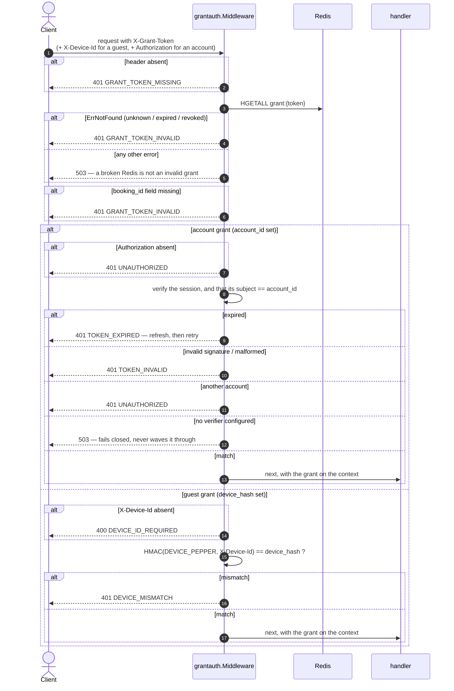

# Grant guard — `pkg/grantauth`

| | |
|---|---|
| **Component** | `pkg/grantauth` (shared library, no endpoint) |
| **Used by** | `services/payment-api` (§5) and `services/booking` (§4) |
| **Contract** | api-contracts §4 header table · §5 · §9 |
| **Sources** | ADR-005 §12, §17 · ADR-006 §8.9, §8.13, §8.17 |
| **Requirements** | BR-07 · NFR-09 |
| **Status** | done |

## 1. Purpose

Verifies the credential §4 and §5 authorise on — the grant — plus the account
session behind it when the grant names an account (§8.17), and puts the
verified grant on the request context. It lives in `pkg/` rather than in payment-api because booking
and payment guard the **same** credential, and two copies of a credential check
are two places for them to drift apart.

It does the **credential** half only. A valid grant proves the bearer holds *a*
slot; it does not prove the slot belongs to the `booking_id` in the URL, so
every caller still binds the row in SQL (`WHERE id = $1 AND grant_token = $2`).
That is the ownership half, and it belongs to the repository.

## 2. The four credentials

ADR-005 §17: four credentials, four slots, not interchangeable.

| Credential | Slot | Proves | Read here |
|---|---|---|---|
| **Grant** | **`X-Grant-Token`** | **that you hold a slot** | **Always** |
| Account session | `Authorization: Bearer` | *who* you are | Only for an account grant, and then **required** |
| Waiting-room token | `queue_token` cookie / `X-Queue-Token` | a position in line | No |
| E-ticket token | `?t=` | possession of one ticket link | No |

The grant is what **authorises**. `Authorization` says nothing about whether an
account is holding seats, so on its own it would let a logged-in customer with
no grant pay for a booking; and a guest with a grant and no account must be
able to pay.

ADR-006 §8.17 then added a second question for account grants only: a grant
carrying `account_id` is a bearer token for an identity as well as for seats,
so the guard also verifies the session in `Authorization` and that its subject
is that same account. A grant lifted from someone's browser is then worth
nothing without their session.

Two things that check are deliberately **not**:

- It is not where the account comes from. Attribution is read from the grant
  hash, which admission-ctl wrote; a stale or swapped header cannot attribute a
  booking to the wrong account.
- It is not an authorisation step. A valid session with no grant still gets
  `GRANT_TOKEN_MISSING`, because the slot is what these endpoints are about.

A **guest** grant reads no `Authorization` at all — there is no account to
check, and §8.9's device binding is what holds. A token sent beside a guest
grant is not an error; it is simply not what binds it.

## 3. The grant hash

`grant:{token}` is a Redis HASH whose fields are fixed by ADR-006 §8.13(a):

| Field | Always? |
|---|---|
| `event_id` | yes |
| `booking_id` | yes |
| `queue_token` | yes |
| `account_id` | **exactly one of these two** |
| `device_hash` | **exactly one of these two** |

The other is **absent**, never empty. That is what makes `DEVICE_MISMATCH` a
guest-only condition: an account grant travels between devices by design,
because the account is what binds it.

There is deliberately no `token` field — that is the key's own name — and no
`rebinds` field: ADR-006 §8.9 removed rebinding entirely.

The key's TTL is the expiry mechanism, so there is no timestamp to compare. It
is `GRANT_TOKEN_TTL_SECONDS` (1080) from `granted_at`, not the 300-second
booking TTL: a hash dying at second 300 would cut off a customer who already
holds a seat, mid-payment (ADR-006 §8.13(b)).

## 4. Flow



## 5. Ordering, and why it is not arbitrary

**The token is resolved before the device is considered.** A device check
against an unknown grant would answer `DEVICE_MISMATCH`, and that answer
confirms some *other* grant exists for that device. An unknown grant is always
`GRANT_TOKEN_INVALID`.

**A broken Redis is a 503, never a 401.** Treating an infrastructure failure as
an authentication failure tells every paying customer their session expired,
during an outage, at the worst possible moment.

**Unknown, expired and revoked are one answer.** Telling them apart maps which
grants are live.

**A hash with no `booking_id` fails closed.** That is a malformed grant written
by a producer predating ADR-006 §8.13, not a client problem — and letting the
request through would have it match a NULL column.

**HGETALL on a missing key returns an empty map, not an error.** The length is
checked explicitly; without that, an expired grant would look like a grant with
no fields and sail straight past the check.

**The session is checked last, and only for an account grant.** Checking it
first would make `TOKEN_EXPIRED` reachable for a guest, who has no session to
refresh, and would answer a question about identity before establishing that
the caller holds seats at all.

**A missing session verifier is a 503, not a skip.** A guard that waves an
account grant through when misconfigured restores exactly the gap §8.17 closes,
on the path where a leaked grant is worth the most. `JWT_SECRET` has no default
in any environment: a default signing key is a forged-session generator.

## 6. Device binding

```
device_hash = hex(HMAC-SHA256(DEVICE_PEPPER, X-Device-Id))
```

The raw device id is never stored. It is a quasi-identifier — it links one
device's visits — so a Redis dump must not yield a cross-event correlator
(§9, NFR-09).

`DEVICE_PEPPER` is **not** the NIK pepper and **not** `JWT_SECRET`:

| Secret | Rotatable? |
|---|---|
| NIK pepper | **Never.** Rotation orphans every stored hash (ADR-005 §8) |
| `DEVICE_PEPPER` | **Between sales only.** Rotating mid-sale invalidates every live binding at once, and every guest holding a grant gets `401 DEVICE_MISMATCH` with no way back |
| `JWT_SECRET` | Freely |

It must be the **same value** in whatever issues grants and in whatever verifies
them. **OPEN:** nothing enforces that today; a mismatch surfaces as
`DEVICE_MISMATCH` on every guest checkout and nowhere else.

The comparison uses `hmac.Equal`, because the value can be retried from a script
and a byte-by-byte compare that exits early leaks the correct prefix.

## 7. Error codes

| HTTP | Code | When |
|---|---|---|
| 400 | `DEVICE_ID_REQUIRED` | Guest grant, `X-Device-Id` absent. A 400 and not a 401: the client omitted a required header, which is a different fix from "your grant is wrong" |
| 401 | `GRANT_TOKEN_MISSING` | Header absent. Distinct from invalid, because the fix differs |
| 401 | `GRANT_TOKEN_INVALID` | Unknown, expired, revoked, or malformed hash |
| 401 | `DEVICE_MISMATCH` | Guest grant presented from another device |
| 401 | `UNAUTHORIZED` | Account grant with no `Authorization`, or with a valid session belonging to **another** account (§8.17) |
| 401 | `TOKEN_EXPIRED` | Account grant whose session has expired. Distinct from the others because the fix is a refresh, not a re-login |
| 401 | `TOKEN_INVALID` | Account grant whose session is malformed, or signed with another key |
| 503 | `INTERNAL_ERROR` | Redis unreachable, or no session verifier configured |

`Middleware(rdb, Config)` writes the error itself through `pkg/apinizer`, so
every service answers a failed grant check in exactly the same envelope. The
codes above live in `pkg/grantauth` next to the only code allowed to emit
them.

## 8. Data touched

| Store | Key | Op | Notes |
|---|---|---|---|
| Redis | `grant:{token}` | HGETALL | Read-only. Written by booking-service |

## 9. Edge cases and decisions

- A handler reached **without** the guard must be able to tell:
  `FromContext` returns `ok == false`, and the handlers answer 500. A 401 there
  would send the client off chasing headers it had sent correctly.
- The raw token travels onward on `Grant.Token`, because repositories match it
  against `bookings.grant_token`: it is the ownership key, not just a credential.
- An account grant is accepted from **any device** on purpose: the account is
  what binds it, and §8.17's session check is what makes that safe. A customer
  who starts on a phone and pays on a laptop is a normal flow, not an attack.
- `DEVICE_MISMATCH` stays a guest-only condition, because exactly one of
  `account_id` and `device_hash` is present (§8.13(a)) — the other is absent,
  never empty.
- A grant with neither `account_id` nor `device_hash` is treated as a guest
  grant with no stored hash, so the comparison fails and the answer is
  `DEVICE_MISMATCH`. Failing closed beats inventing a third category.

## 10. Tests

Implemented in `pkg/grantauth/grantauth_test.go`. The grant hash is read by
this package alone — one reader across booking and payment rather than one per
service — so there is no per-service store to test.

- [x] unit: `DeviceHash` is hex HMAC-SHA256, stable, keyed, and leaks no device id
- [x] unit: missing header → `GRANT_TOKEN_MISSING`, Redis never consulted
- [x] unit: unknown grant → `GRANT_TOKEN_INVALID`, and **never**
      `DEVICE_MISMATCH`, with and without a device id
- [x] unit: Redis failure → 503, not 401, with the driver message stripped
- [x] unit: hash without `booking_id`, and an empty hash, → invalid
- [x] unit: account grant valid from any device, including none, **with** its
      own session
- [x] unit (§8.17): account grant with no `Authorization` → `UNAUTHORIZED`
- [x] unit (§8.17): another account's valid session → `UNAUTHORIZED`
- [x] unit (§8.17): expired session → `TOKEN_EXPIRED`; forged, malformed or
      wrongly-signed → `TOKEN_INVALID`
- [x] unit (§8.17): the `Bearer` scheme is case-insensitive, and another scheme
      reads as absent
- [x] unit (§8.17): a guest grant ignores `Authorization` entirely
- [x] unit (§8.17): no verifier configured → 503, and the handler is never
      reached
- [x] unit (§8.17): attribution comes from the grant hash, not from the session
- [x] unit: guest grant — matching device, wrong device, missing device id
- [x] unit: a rotated pepper invalidates a live binding
- [x] unit: context round-trip, and absence reported
- [x] unit: middleware passes the grant through, reads the headers, and a
      rejected request never reaches the handler
- [x] unit: the hash field names and header names are pinned
- [x] integration (`services/admission-ctl`): a grant written by the controller
      verifies here, both guest and logged-in, against the real cluster
- [ ] integration: the same `DEVICE_PEPPER` and `JWT_SECRET` resolved in two
      deployed services

## 11. Tasks

- [x] `pkg/grantauth` — middleware, device hash, context, keys from
      `pkg/rediskeys`
- [x] the grant hash is read here and nowhere else: payment-api's own Redis
      adapter for it is gone
- [x] §8.17 session check, and `JWT_SECRET` in both services' config and
      templates
- [x] adopted in `services/booking` for §4
- [ ] decide how `DEVICE_PEPPER` and `JWT_SECRET` consistency between services
      is enforced (§6)
