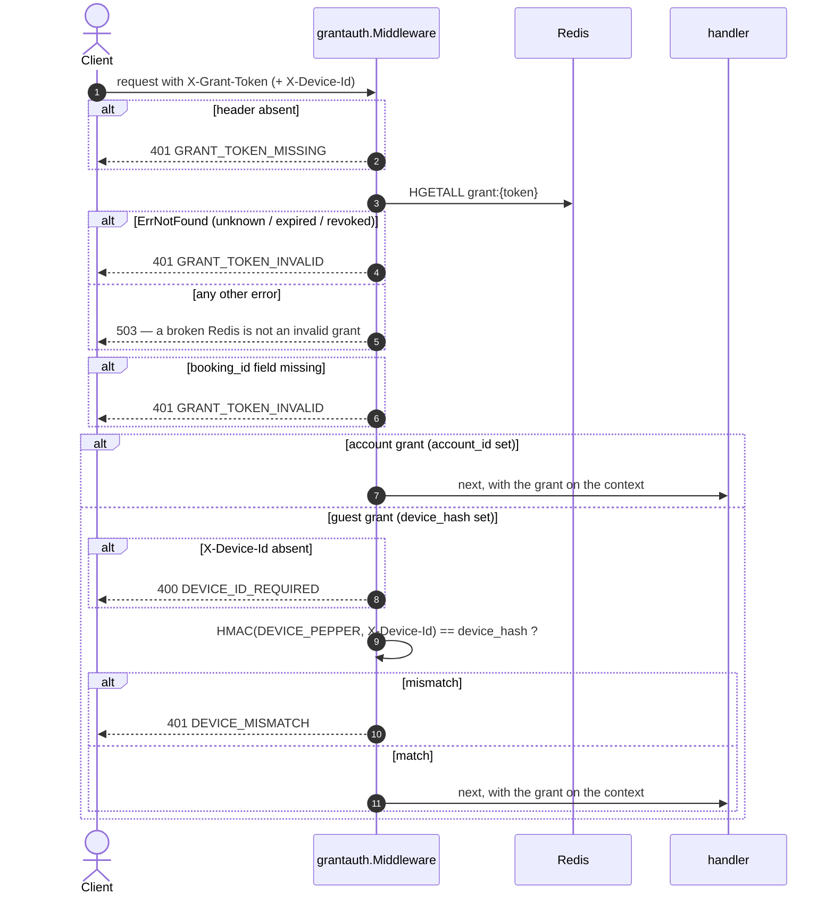

# Grant guard — `pkg/grantauth`

| | |
|---|---|
| **Component** | `pkg/grantauth` (shared library, no endpoint) |
| **Used by** | `services/payment-api` (§5), and `services/booking` (§4) when it adopts it |
| **Contract** | api-contracts §4 header table · §5 · §9 |
| **Sources** | ADR-005 §12, §17 · ADR-006 §8.9, §8.13 |
| **Requirements** | BR-07 · NFR-09 |
| **Status** | done |

## 1. Purpose

Verifies the one credential §4 and §5 accept, and puts the verified grant on the
request context. It lives in `pkg/` rather than in payment-api because booking
and payment guard the **same** credential, and two copies of a credential check
are two places for them to drift apart.

It does the **credential** half only. A valid grant proves the bearer holds *a*
slot; it does not prove the slot belongs to the `booking_id` in the URL, so
every caller still binds the row in SQL (`WHERE id = $1 AND grant_token = $2`).
That is the ownership half, and it belongs to the repository.

## 2. The four credentials

ADR-005 §17: four credentials, four slots, not interchangeable.

| Credential | Slot | Proves |
|---|---|---|
| Account session | `Authorization: Bearer` | *who* you are |
| **Grant** | **`X-Grant-Token`** | **that you hold a slot** |
| Waiting-room token | `queue_token` cookie / `X-Queue-Token` | a position in line |
| E-ticket token | `?t=` | possession of one ticket link |

`Authorization` is **not sent** to §4 or §5. It identifies an account, which
says nothing about whether that account is holding seats — and a logged-in
customer with no grant must not be able to pay for a booking, while a guest with
a grant must be able to.

## 3. The grant hash

`grant:{token}` is a Redis HASH whose fields are fixed by ADR-006 §8.13(a):

| Field | Always? |
|---|---|
| `event_id` | yes |
| `booking_id` | yes |
| `queue_token` | yes |
| `account_id` | **exactly one of these two** |
| `device_hash` | **exactly one of these two** |

The other is **absent**, never empty. That is what makes `DEVICE_MISMATCH` a
guest-only condition: an account grant travels between devices by design,
because the account is what binds it.

There is deliberately no `token` field — that is the key's own name — and no
`rebinds` field: ADR-006 §8.9 removed rebinding entirely.

The key's TTL is the expiry mechanism, so there is no timestamp to compare. It
is `GRANT_TOKEN_TTL_SECONDS` (1080) from `granted_at`, not the 300-second
booking TTL: a hash dying at second 300 would cut off a customer who already
holds a seat, mid-payment (ADR-006 §8.13(b)).

## 4. Flow



## 5. Ordering, and why it is not arbitrary

**The token is resolved before the device is considered.** A device check
against an unknown grant would answer `DEVICE_MISMATCH`, and that answer
confirms some *other* grant exists for that device. An unknown grant is always
`GRANT_TOKEN_INVALID`.

**A broken Redis is a 503, never a 401.** Treating an infrastructure failure as
an authentication failure tells every paying customer their session expired,
during an outage, at the worst possible moment.

**Unknown, expired and revoked are one answer.** Telling them apart maps which
grants are live.

**A hash with no `booking_id` fails closed.** That is a malformed grant written
by a producer predating ADR-006 §8.13, not a client problem — and letting the
request through would have it match a NULL column.

**HGETALL on a missing key returns an empty map, not an error.** The adapter
checks the length explicitly; without that, an expired grant would look like a
grant with no fields and sail straight past the check.

## 6. Device binding

```
device_hash = hex(HMAC-SHA256(DEVICE_PEPPER, X-Device-Id))
```

The raw device id is never stored. It is a quasi-identifier — it links one
device's visits — so a Redis dump must not yield a cross-event correlator
(§9, NFR-09).

`DEVICE_PEPPER` is **not** the NIK pepper and **not** `JWT_SECRET`:

| Secret | Rotatable? |
|---|---|
| NIK pepper | **Never.** Rotation orphans every stored hash (ADR-005 §8) |
| `DEVICE_PEPPER` | **Between sales only.** Rotating mid-sale invalidates every live binding at once, and every guest holding a grant gets `401 DEVICE_MISMATCH` with no way back |
| `JWT_SECRET` | Freely |

It must be the **same value** in whatever issues grants and in whatever verifies
them. **OPEN:** nothing enforces that today; a mismatch surfaces as
`DEVICE_MISMATCH` on every guest checkout and nowhere else.

The comparison uses `hmac.Equal`, because the value can be retried from a script
and a byte-by-byte compare that exits early leaks the correct prefix.

## 7. Error codes

| HTTP | Code | When |
|---|---|---|
| 400 | `DEVICE_ID_REQUIRED` | Guest grant, `X-Device-Id` absent. A 400 and not a 401: the client omitted a required header, which is a different fix from "your grant is wrong" |
| 401 | `GRANT_TOKEN_MISSING` | Header absent. Distinct from invalid, because the fix differs |
| 401 | `GRANT_TOKEN_INVALID` | Unknown, expired, revoked, or malformed hash |
| 401 | `DEVICE_MISMATCH` | Guest grant presented from another device |
| 503 | — | Redis unreachable |

The guard renders nothing itself: `Middleware(onError)` hands the
`*apperror.AppError` to the service's own writer, so the package carries no
response envelope and stays reusable.

## 8. Data touched

| Store | Key | Op | Notes |
|---|---|---|---|
| Redis | `grant:{token}` | HGETALL | Read-only. Written by booking-service |

## 9. Edge cases and decisions

- A handler reached **without** the guard must be able to tell:
  `FromContext` returns `ok == false`, and the handlers answer 500. A 401 there
  would send the client off chasing headers it had sent correctly.
- The raw token travels onward on `Grant.Token`, because repositories match it
  against `bookings.grant_token`: it is the ownership key, not just a credential.
- On §4/§5 there is no `Authorization` to compare `account_id` against, so an
  account grant is accepted from any device and ownership comes from the SQL
  clause instead (ADR-006 §8.9).
- A grant with neither `account_id` nor `device_hash` is treated as a guest
  grant with no stored hash, so the comparison fails and the answer is
  `DEVICE_MISMATCH`. Failing closed beats inventing a third category.

## 10. Tests

Implemented in `pkg/grantauth/grantauth_test.go` (100% of statements) and
`services/payment-api/internal/payment/infrastructure/redis/redis_test.go`.

- [x] unit: `NewVerifier` refuses an empty pepper and a nil store
- [x] unit: `DeviceHash` is hex HMAC-SHA256, stable, keyed, and leaks no device id
- [x] unit: missing header → `GRANT_TOKEN_MISSING`, store never consulted
- [x] unit: unknown grant → `GRANT_TOKEN_INVALID`, and **never**
      `DEVICE_MISMATCH`, with and without a device id
- [x] unit: store failure → 503, not 401, with the driver message stripped
- [x] unit: hash without `booking_id`, and an empty hash, → invalid
- [x] unit: account grant valid from any device, including none
- [x] unit: guest grant — matching device, wrong device, missing device id
- [x] unit: a rotated pepper invalidates a live binding
- [x] unit: context round-trip, and absence reported
- [x] unit: middleware passes the grant through, reads both headers, and a
      rejected request never reaches the handler
- [x] unit: the hash field names and header names are pinned
- [x] unit (adapter): `grant:` prefix applied; expired key → `ErrNotFound`;
      unreachable Redis not mistaken for missing
- [ ] integration: a grant issued by booking-service verifies here, with the
      same `DEVICE_PEPPER`

## 11. Tasks

- [x] `pkg/grantauth` — verifier, store port, device hash, middleware, context
- [x] Redis adapter in payment-api (`infrastructure/redis/grant.go`)
- [x] error codes in `pkg/apperror`
- [ ] adopt it in `services/booking` for §4, replacing whatever it guards with
      today
- [ ] decide how `DEVICE_PEPPER` consistency between services is enforced (§6)
