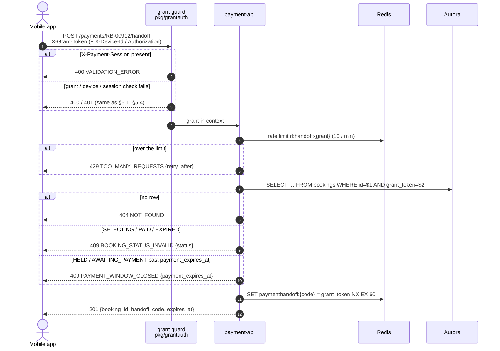

# POST /payments/{booking_id}/handoff — Create Payment Handoff Code

| | |
|---|---|
| **Service** | `services/payment-api` (Lambda) |
| **Auth** | `X-Grant-Token` (+ `X-Device-Id` for a guest, + `Authorization` for an account grant). `X-Payment-Session` is refused |
| **Contract** | Apidog `POST /payments/{booking_id}/handoff` · api-contracts §5.6 (v2.25) |
| **Sources** | ADR-007 · ADR-006 §8.9, §8.13, §8.17 |
| **Requirements** | FR-21 · NFR-02 · NFR-11 |
| **Status** | done |

## 1. Purpose

The mobile app opens the web payment page in a WebView. The app holds the credentials (grant, device id, account
session), the web page holds none, and none of them may travel in a URL (ADR-007). This endpoint gives the app a
**one-time code** for that one trip: 256 random bits, valid 60 seconds, used once by
[08-exchange-payment-handoff.md](08-exchange-payment-handoff.md).

It runs behind the normal grant guard, so the device binding (guest) and the account session check (logged-in) happen
here, once. The web page never repeats them.

## 2. Flow

## 3. Steps

1. **Guard** (`grantauth.Middleware`, unchanged apart from one rule): a request carrying `X-Payment-Session` is refused
   with `400 VALIDATION_ERROR` before the grant is read. The session cannot mint new codes; only the app can.
2. **Rate limit**: `pkg/ratelimit` bucket `rl:handoff:<grant_token>`, capacity 10, refill 10 per minute. A Redis error
   on the limiter **fails open** (same as join): the limiter protects Redis from a client bug, it is not a security
   control (the code itself is the control).
3. **Booking** (`IBookingRepository.GetOwned`, the same read as §5.4): no row → `404 NOT_FOUND`.
4. **Status**, in this order:

   | `bookings.status` | Answer |
   |---|---|
   | `GRANTED`, `SELECTING` | `409 BOOKING_STATUS_INVALID`, `data.status = "SELECTING"` |
   | `CONFIRMED` | `409 BOOKING_STATUS_INVALID`, `data.status = "PAID"` |
   | `EXPIRED`, `LAPSED`, `ABANDONED` | `409 BOOKING_STATUS_INVALID`, `data.status = "EXPIRED"` |
   | `HELD`, `AWAITING_PAYMENT` with `payment_expires_at <= now` | `409 PAYMENT_WINDOW_CLOSED`, `data.payment_expires_at` |
   | `HELD`, `AWAITING_PAYMENT` (in time), `PENDING_CANCELLATION` | continue |

   `data.status` uses the four values of §4.4, so the app routes the same way it does on `GET /bookings/{id}`.
5. **Code**: `hc_` + 32 bytes from `crypto/rand`, base64url without padding (46 characters). `SET
   paymenthandoff:<code> <grant_token> NX EX 60`. `NX` failing (a collision on 256 random bits) is treated as a Redis
   error: 503.
6. **Answer** `201 {booking_id, handoff_code, expires_at}`, `expires_at = now + 60 s`.

The value is the **grant token only**. The booking id is in the grant hash, so storing it twice would only create a
second copy to disagree with.

## 4. Data touched

| Store | Key / table | Op | Notes |
|---|---|---|---|
| Redis | `grant:<grant_token>` | HGETALL | Guard only |
| Redis | `rl:handoff:<grant_token>` | EVALSHA (`pkg/ratelimit`) | Token bucket, 10 / min |
| Aurora | `bookings` | SELECT | Bound on `id` **and** `grant_token` |
| Redis | `paymenthandoff:<code>` | SET NX EX 60 | Plain string: the grant token. Read once by 08 (`GET` + `DEL` in one `MULTI`) |

## 5. Responses and errors

| HTTP | Code | When |
|---|---|---|
| 201 | — | Code created |
| 400 | `VALIDATION_ERROR` | `X-Payment-Session` sent here |
| 400 | `DEVICE_ID_REQUIRED` | Guest without `X-Device-Id` (guard) |
| 401 | `GRANT_TOKEN_MISSING` / `GRANT_TOKEN_INVALID` / `DEVICE_MISMATCH` | Guard |
| 401 | `UNAUTHORIZED` / `TOKEN_EXPIRED` / `TOKEN_INVALID` | Account grant session check (guard) |
| 404 | `NOT_FOUND` | Not this grant's booking |
| 409 | `BOOKING_STATUS_INVALID` | §3 step 4, with `data.status` |
| 409 | `PAYMENT_WINDOW_CLOSED` | §3 step 4, with `data.payment_expires_at` |
| 429 | `TOO_MANY_REQUESTS` | Over 10 / min, with `data.retry_after` and `Retry-After` |
| 503 | `INTERNAL_ERROR` | Redis (code write) or Aurora unreachable |

Errors are written with `apinizer.WriteError`, **not** payment-api's own `WriteError`: that one passes `nil` as `data`,
which would drop `data.status`, `data.payment_expires_at` and `data.retry_after`.

## 6. Edge cases and decisions

- **A new code does not cancel an older one.** Each is single use and dies in 60 s; tracking "the latest code per
  grant" would need a second key for no gain.
- **The code is stored as the key in clear**, like `grant:<token>`. Hashing it would protect only against someone
  reading Redis, who can read the grant itself anyway.
- **`PENDING_CANCELLATION` is accepted** although its deadline has passed: a payment may still land in the 30 s grace,
  and the page shows "memverifikasi pembayaran…" from §5.4 (contract §4.4). Refusing it would show an expired screen to
  someone who may have paid.
- **The status check runs before the deadline check.** An `EXPIRED` booking whose grant still exists answers
  `BOOKING_STATUS_INVALID {status: EXPIRED}` (the app already routes on it); `PAYMENT_WINDOW_CLOSED` covers only a
  `HELD` / `AWAITING_PAYMENT` booking past its deadline before the sweep runs.

## 7. Tests

`services/payment-api`: `application/usecase/handoff_test.go`, `infrastructure/http/handoff_test.go`,
`infrastructure/redis/handoff_test.go` (miniredis and, with `REDIS_ADDR`, the real Redis), `delivery/handoff_e2e_test.go`
(real Postgres via `pkg/pgtest`).

- [x] unit (usecase): each row of the §3 status table gives its answer, `PENDING_CANCELLATION` included
- [x] unit (usecase): `HELD` at, one second after and one second before `payment_expires_at`
- [x] unit (usecase): the stored value is the grant token, the TTL is 60 s, the code has the `hc_` prefix and 256 bits
- [x] unit (usecase): two calls give two different codes, both stored
- [x] unit (usecase): over the limit → 429 with `retry_after` rounded up; a broken limiter lets the request through;
      Redis failing on the write → 503
- [x] unit (handler): 201 body shape; 409 and 429 keep their `data` and `Retry-After` (regression for the `nil` data
      writer); without the guard → 500, not 401
- [x] integration (Redis): the 11th call in a minute is refused; a limiter error is reported to the use case
- [x] e2e (Postgres): a guest code needs the grant's device; a session cannot mint another code (400)

## 8. Tasks

- [x] `pkg/rediskeys`: `PaymentHandoff(code)`, `HandoffRateLimit(grantToken)` + rows in `docs/redis-keys.md`
- [x] port `IHandoffStore` / `IHandoffLimiter` (outbound) + Redis adapter `infrastructure/redis/handoff.go`
- [x] usecase `CreateHandoff` (`application/usecase/handoff.go`, its own `IHandoffUsecase` port) + handler + route
- [x] templates: route in `services/payment-api/template.yaml` **and** `template-cfn.yaml`, and in
      `infra/api-gateway/template.yaml`
