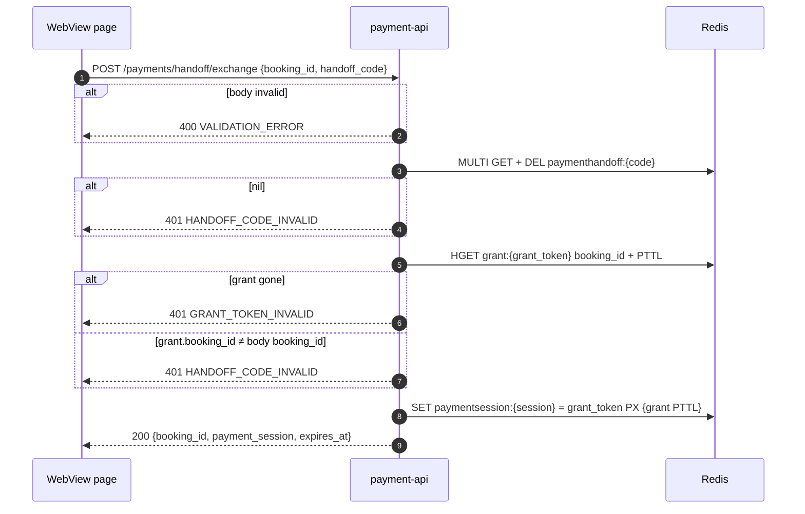

# POST /payments/handoff/exchange — Exchange Payment Handoff Code

| | |
|---|---|
| **Service** | `services/payment-api` (Lambda) |
| **Auth** | None in headers: the `handoff_code` in the body is the credential |
| **Contract** | Apidog `POST /payments/handoff/exchange` · api-contracts §5.7 (v2.25) |
| **Sources** | ADR-007 |
| **Requirements** | FR-21 · NFR-11 |
| **Status** | done |

## 1. Purpose

The web payment page, loaded in the app's WebView with `#code=`, swaps the code from
[07-create-payment-handoff.md](07-create-payment-handoff.md) for a **payment session**. The session is what the page
then sends as `X-Payment-Session` on §4.4 and §5.1–§5.4 ([06-grant-guard.md](06-grant-guard.md) §12).

The pattern is OAuth's authorization code: the code is useless once used or after 60 seconds, and the session it buys
can only see and pay this one booking.

## 2. Flow

## 3. Steps

1. **Body**: `booking_id` non-empty; `handoff_code` starts with `hc_` and is at most 64 characters (real codes are 46). Otherwise
   `400 VALIDATION_ERROR`, and Redis is not touched (a malformed code cannot be a real one).
2. **Take the code**: `GET` + `DEL paymenthandoff:<code>` in one `MULTI` (atomic, so of two concurrent exchanges only
   one reads it). Not `GETDEL`: it needs Redis 6.2+, and a developer's local Redis 6.0 refused it. Nil →
   `401 HANDOFF_CODE_INVALID`. From here on the code is spent, whatever happens next.
3. **Read the grant** in one pipeline: `HGET grant:<grant_token> booking_id` and `PTTL grant:<grant_token>`.
   - Missing hash (`PTTL = -2`) → `401 GRANT_TOKEN_INVALID`: the booking ended between 07 and now.
   - `booking_id` ≠ body `booking_id` (constant-time compare) → `401 HANDOFF_CODE_INVALID`. Same answer as an unknown
     code, so a guesser learns nothing.
   - `PTTL = -1` (no TTL) cannot happen (`PutGrant` sets both in one MULTI); treat it as `GRANT_TOKEN_INVALID` and log
     an error rather than mint a session that never dies.
4. **Session**: `ps_` + 32 bytes from `crypto/rand`, base64url. `SET paymentsession:<session> <grant_token> PX <pttl> NX`.
   The session cannot outlive the grant by construction, and the guard checks the grant on every request anyway.
5. **Answer** `200 {booking_id, payment_session, expires_at}`, `expires_at = now + pttl`.

## 4. Data touched

| Store | Key / table | Op | Notes |
|---|---|---|---|
| Redis | `paymenthandoff:<code>` | MULTI GET + DEL | Single use: spent on the first attempt, success or not |
| Redis | `grant:<grant_token>` | HGET `booking_id`, PTTL | Read-only. Owner: admission-ctl |
| Redis | `paymentsession:<session>` | SET PX NX | Plain string: the grant token. TTL = the grant's remaining TTL |

No Aurora access: everything needed is in Redis, and the guard plus the repositories check the booking row on every
later request.

## 5. Responses and errors

| HTTP | Code | When |
|---|---|---|
| 200 | — | Session created |
| 400 | `VALIDATION_ERROR` | Body missing / malformed |
| 401 | `HANDOFF_CODE_INVALID` | Unknown, used, expired, or another booking's code |
| 401 | `GRANT_TOKEN_INVALID` | Code was valid, the grant is gone (booking ended) |
| 503 | `INTERNAL_ERROR` | Redis unreachable. If the `MULTI` itself failed the code may still be alive |

## 6. Edge cases and decisions

- **No rate limit.** A code is 256 random bits, so guessing is not a threat, and a per-IP limit would hurt many users
  behind one carrier NAT. The gateway's default throttling still applies.
- **No CAPTCHA, no Origin check.** The code is the proof; the endpoint sets no cookie, so there is no CSRF to defend.
- **Not atomic across steps 2–4, on purpose.** If the grant disappears between step 3 and step 4 the new session is
  dead on arrival: the guard reads the grant on every request and answers `401 PAYMENT_SESSION_INVALID`. A Lua script
  would only make that window smaller, not remove a risk.
- **Values store the grant token only**, not `{booking_id, grant_token}` as ADR-007 and contract §9 describe. The
  booking id lives in the grant hash already. The docs need a one-line wording fix (task below); the behaviour is the
  same.
- **The session is not bound to a device.** It lives in the page's memory only; copying it out requires code running in
  the page, which could also just use it there. Its reach is one booking, until the grant ends.

## 7. Tests

- [x] unit (usecase): happy path stores the grant token with the grant's remaining TTL and returns `expires_at`
- [x] unit (usecase): second exchange of the same code → `HANDOFF_CODE_INVALID`
- [x] unit (usecase): a code for booking A with `booking_id` B → `HANDOFF_CODE_INVALID`, and the code is spent
- [x] unit (usecase): grant deleted after the code was issued → `GRANT_TOKEN_INVALID`
- [x] unit (usecase): grant with no TTL → `GRANT_TOKEN_INVALID`, logged, no session
- [x] unit (usecase): malformed body → 400 without touching Redis; Redis failing → 503
- [x] unit (handler): no guard on the route; a body that is not JSON → 400; use case errors pass through
- [x] integration (Redis 6.0 and 7.4): a code is read once; never overwritten; 20 concurrent exchanges of one code have
      exactly one winner; the grant's booking and PTTL are read, a grant without TTL reads as `<= 0`; the session gets
      the TTL it is given
- [x] e2e (Postgres): the session lives no longer than the grant

## 8. Tasks

- [x] `pkg/rediskeys`: `PaymentSession(session)` + row in `docs/redis-keys.md`
- [x] `IHandoffStore`: `TakeCode`, `GrantBooking` (booking id + PTTL), `PutSession`
- [x] usecase `ExchangeHandoff` + handler + route `POST /payments/handoff/exchange` (outside the guard, like the
      webhook)
- [x] templates: route in `services/payment-api/template.yaml` **and** `template-cfn.yaml`, and in
      `infra/api-gateway/template.yaml`
- [ ] docs (`documentations`, ask first): ADR-007 and contract §9 say the keys hold `{booking_id, grant_token}`; change
      to "the grant token". ADR-007 rule 2 and contract §5.7 say `GETDEL`; change to "read and delete atomically"
